# PayID — Informe del Trabajo Final

Universidad Peruana de Ciencias Aplicadas

Ingeniería de Software

1ASI0657 Fundamentos de Arquitectura de Software

202620

NRC: 15987

Profesor:  Wilder Aurelio Vega Calero

TRABAJO FINAL

Nombre del Producto: PayID

**Integrantes:**

| Alumno | Código |
|---|---|
| Mora Blas, Diego Alonzo | U20231C069 |
| Dhilsen Armil, Mallqui Vilca | U202319440 |
| Taquiri Calderón Jhunior Giussepe | U20221c576 |
| Tasayco Osorio Raul Hiroshi | U202319415 |

## Registro de versiones del informe

| Versión | Fecha | Autor | Descripción de modificación |
|---|---|---|---|
| 1.0 | 13/09/2026 | Taquiri Calderon, Jhunior Giussepe |  |
|  |  | Diego Mora Blas |  |
|  |  | Mallqui Vilca, Dhilsen Armil | Elaboración de los diagramas C4 (Contexto, Contenedores y Componentes) en Structurizr para el modelado de la arquitectura de PayID y Registros de Entrevistas. |
|  |  | Raul Hiroshi Tasayco Osorio |  |
| 2.0 |  | Taquiri Calderon, Jhunior Giussepe |  |
|  |  | Diego Mora Blas |  |
|  |  | Mallqui Vilca, Dhilsen Armil | ADD Iteration 1: Architectural Design Backlog, Iteration Goal, Design Concepts e Instantiate Elements. |
|  |  | Raul Hiroshi Tasayco Osorio |  |
| 3.0 | 22/11/2026 | Taquiri Calderón, Jhunior Giussepe | Sección Student Outcome corregida a ABET – EAC – SO3 (Comunicación efectiva), con cuadro por integrante e hito; corrección del nombre "Giussepe"; tablas de commits de los sprints reemplazadas por commits reales de la organización; secciones 5.3.3, 5.3.4 y 5.4; Conclusiones, Video About-The-Team, Uso de herramientas de IA, Referencias y Links; Anexos B (desempeño), C (matriz de rúbricas), D (cronograma), E (términos y condiciones) y F (registro de commits); tablas con fondo blanco y tabla de contenido con 4 niveles. Se retiraron del registro las filas de una persona que no integra el equipo. |
| 3.1 | 22/11/2026 | Consolidación editorial | Índice reorganizado con enlaces a secciones; se normalizó el nombre del producto a PayID; se conservaron los avances de Sprint 2 descritos en el PDF fuente y se identificaron los respaldos que faltan adjuntar. |

## Project Report Collaboration Insights

Commits de los integrantes en este repositorio (historial de Git al 22/11/2026):

| Integrante | Usuario / autor de Git | Commits en este repositorio |
|---|---|---|
| Mallqui Vilca, Dhilsen Armil | DhilsenDevs (Dhilsen18) | 7 (05/09/2026) |
| Tasayco Osorio, Raul Hiroshi | Dexter | 2 (12/09/2026) |
| Taquiri Calderón, Jhunior Giussepe | GiussepeTC0410 | Versión 3.0 del informe (22/11/2026) |
| Mora Blas, Diego Alonzo | — | 0 |

El registro completo de commits de los integrantes en todos los repositorios está en el [Anexo F](#anexo-f-registro-completo-de-commits-de-los-integrantes).

## Repositorios del proyecto

| Repositorio | Contenido |
|---|---|
| [PayID-Landing-Page](https://github.com/Fundamentos-de-Arquitectura-PayId/PayID-Landing-Page) | Landing page |
| [PayID-Frontend-Web-Application](https://github.com/Fundamentos-de-Arquitectura-PayId/PayID-Frontend-Web-Application) | Aplicación web (Vue) |
| [PayID-Mobile-App](https://github.com/Fundamentos-de-Arquitectura-PayId/PayID-Mobile-App) | Aplicación móvil (Flutter) |
| PayID-Backend (privado) | Backend ASP.NET Core |
| [StructurizrCodePayID](https://github.com/Fundamentos-de-Arquitectura-PayId/StructurizrCodePayID) | Diagramas C4 |

## Contenido

- [Student Outcome: ABET–EAC, SO3](#student-outcome)
- [Capítulo I: Introducción](#chapter-1)
  - [1.1 Startup Profile](#11-startup-profile)
    - [1.1.1 Descripción de la Startup](#111-descripción-de-la-startup)
    - [1.1.2 Perfiles de integrantes del equipo](#112-perfiles-de-integrantes-del-equipo)
  - [1.2 Solution Profile](#12-solution-profile)
    - [1.2.1 Nombre de producto](#121-nombre-de-producto)
    - [1.2.2 Antecedentes y Problemática](#122-antecedentes-y-problemática)
    - [1.2.3 Lean UX Process](#123-lean-ux-process)
      - [1.2.3.1 Problem Statements](#1231-lean-ux-problem-statements)
      - [1.2.3.2 Assumptions](#1232-lean-ux-assumptions)
      - [1.2.3.3 Hypothesis Statements](#1233-lean-ux-hypothesis-statements)
      - [1.2.3.4 Lean UX Canvas](#1234-lean-ux-canvas)
  - [1.3 Segmentos objetivo](#13-segmentos-objetivo)
- [Capítulo II: Requirements & Analysis](#chapter-2)
  - [2.1 Competidores](#21-competidores)
    - [2.1.1 Análisis competitivo](#211-análisis-competitivo-comparativa)
    - [2.1.2 Estrategias y tácticas frente a competidores](#212-estrategias-y-tácticas-frente-a-competidores)
  - [2.2 Entrevistas](#22-entrevistas)
    - [2.2.1 Diseño de entrevistas](#221-diseño-de-entrevistas)
      - [Preguntas para el segmento 1](#preguntas-para-el-segmento-1-estudiantes-universitarios)
      - [Preguntas para el segmento 2](#preguntas-para-el-segmento-2-padres-madres-o-tutores)
    - [2.2.2 Registro de entrevistas](#222-registro-de-entrevistas)
    - [2.2.3 Análisis de entrevistas](#223-análisis-de-entrevistas)
  - [2.3 Needfinding](#23-needfinding)
    - [2.3.1 User Personas](#231-user-personas)
    - [2.3.2 User Task Matrix](#232-user-task-matrix)
    - [2.3.3 Empathy Maps](#233-empathy-maps)
    - [2.3.4 As-Is Scenario Mapping](#234-as-is-scenario-mapping)
    - [2.3.5 Big Picture EventStorming](#235-big-picture-eventstorming)
    - [2.3.6 Ubiquitous Language](#236-ubiquitous-language)
- [Capítulo III: Requirements Specification](#chapter-3)
  - [3.1 To-Be Scenario Mapping](#chapter-3-tobe)
  - [3.2 User Stories](#chapter-3-user-stories)
  - [3.3 Impact Map](#chapter-3-impact-map)
  - [3.4 Product Backlog](#chapter-3-product-backlog)
- [Capítulo IV: Product Architecture Design](#chapter-4)
  - [4.1 Design Concepts, ViewPoints & ER Diagrams](#41-design-concepts-viewpoints--er-diagrams)
    - [4.1.1 Principles Statements](#411-principles-statements)
    - [4.1.2 Approaches Statements](#412-approaches-statements)
    - [4.1.3 Context Diagram](#413-context-diagram)
    - [4.1.4 Approach Driven ViewPoints Diagrams](#414-approach-driven-viewpoints-diagrams)
      - [Diagramas UML](#diagramas-uml)
      - [Vista de procesos](#vista-de-procesos)
    - [4.1.5 Database Diagram](#415-relational--non-relational-database-diagram)
    - [4.1.6 Design Patterns](#416-design-patterns)
    - [4.1.7 Tactics](#417-tactics)
  - [4.2 Architectural Drivers](#42-architectural-drivers)
    - [4.2.1 Design Purpose](#421-design-purpose)
    - [4.2.2 Primary Functionality](#422-primary-functionality-primary-user-stories)
    - [4.2.3 Quality Attribute Scenarios](#423-quality-attribute-scenarios)
    - [4.2.4 Constraints](#424-constraints)
    - [4.2.5 Architectural Concerns](#425-architectural-concerns)
  - [4.3 ADD Iterations](#43-add-iterations)
    - [4.3.1 Iteration 1: Global System Structure](#431-iteration-1-global-system-structure)
      - [4.3.1.1 Architectural Design Backlog](#add1-backlog)
      - [4.3.1.2 Iteration Goal](#add1-goal)
      - [4.3.1.3 Elements to Refine](#add1-refine)
      - [4.3.1.4 Design Concepts](#add1-concepts)
      - [4.3.1.5 Elements, Responsibilities and Interfaces](#add1-elements)
      - [4.3.1.6 Views and Decisions](#add1-views)
      - [4.3.1.7 Analysis and Kanban](#add1-review)
    - [4.3.2 Iteration 2: Identity and Documents](#432-iteration-2-validación-de-identidad-y-gestión-de-documentos-digitales)
      - [4.3.2.1 Backlog](#add2-backlog)
      - [4.3.2.2 Iteration Goal](#add2-goal)
      - [4.3.2.3 Elements to Refine](#add2-refine)
      - [4.3.2.4 Design Concepts](#add2-concepts)
      - [4.3.2.5 Elements, Responsibilities and Interfaces](#add2-elements)
      - [4.3.2.6 Views and Decisions](#add2-views)
      - [4.3.2.7 Analysis and Kanban](#add2-review)
    - [4.3.3 Iteration 3: Payments and Wallet](#433-iteration-3-pagos-recargas-y-billetera-digital)
      - [4.3.3.1 Backlog](#add3-backlog)
      - [4.3.3.2 Iteration Goal](#add3-goal)
      - [4.3.3.3 Elements to Refine](#add3-refine)
      - [4.3.3.4 Design Concepts](#add3-concepts)
      - [4.3.3.5 Elements, Responsibilities and Interfaces](#add3-elements)
      - [4.3.3.6 Views and Decisions](#add3-views)
      - [4.3.3.7 Analysis and Kanban](#add3-review)
    - [4.3.4 Iteration 4: Security](#434-iteration-4-seguridad-autenticación-y-protección-de-datos)
      - [4.3.4.1 Backlog](#add4-backlog)
      - [4.3.4.2 Iteration Goal](#add4-goal)
      - [4.3.4.3 Elements to Refine](#add4-refine)
      - [4.3.4.4 Design Concepts](#add4-concepts)
      - [4.3.4.5 Elements, Responsibilities and Interfaces](#add4-elements)
      - [4.3.4.6 Views and Decisions](#add4-views)
      - [4.3.4.7 Analysis and Kanban](#add4-review)
    - [4.3.5 Iteration 5: Notifications](#435-iteration-5-notificaciones-alertas-y-seguimiento-de-trámites)
      - [4.3.5.1 Backlog](#add5-backlog)
      - [4.3.5.2 Iteration Goal](#add5-goal)
      - [4.3.5.3 Elements to Refine](#add5-refine)
      - [4.3.5.4 Design Concepts](#add5-concepts)
      - [4.3.5.5 Elements, Responsibilities and Interfaces](#add5-elements)
      - [4.3.5.6 Views and Decisions](#add5-views)
      - [4.3.5.7 Analysis and Kanban](#add5-review)
- [Capítulo V: Product Implementation, Validation & Deployment](#chapter-5)
  - [5.1 Testing Suites & General Patterns](#chapter-5-testing)
    - [5.1.1 Backend Application Core Testing Suite](#511-backend-application-core-testing-suite)
    - [5.1.2 Pattern Based Backend Applications](#512-pattern-based-backend-applications)
    - [5.1.3 Pattern Based Custom Software Library](#513-pattern-based-custom-software-library)
    - [5.1.4 Framework Pattern Driven Refactoring Report](#514-framework-pattern-driven-refactoring-report)
  - [5.2 Software Configuration Management](#chapter-5-configuration)
    - [5.2.1 Software Development Environment](#521-software-development-environment-configuration)
    - [5.2.2 Source Code Management](#522-source-code-management)
    - [5.2.3 Style Guide](#523-source-code-style-guide--conventions)
    - [5.2.4 Deployment Configuration](#524-software-deployment-configuration)
      - [5.2.4.1 Container Packaging and Deployment Evidence](#5241-container-packaging-and-deployment-evidence)
    - [5.2.5 Backend Code Structure](#525-backend-code-structure-and-conventions)
  - [5.3 Microservices Implementation](#chapter-5-sprints)
    - [Sprint 1](#531-sprint-1)
      - [Backlog](#sprint1-backlog)
      - [Development Evidence](#sprint1-development)
      - [Testing Evidence](#sprint1-testing)
      - [Execution Evidence](#sprint1-execution)
      - [API Documentation](#sprint1-api-docs)
      - [Deployment Evidence](#sprint1-deployment)
      - [Collaboration Insights](#sprint1-collaboration)
      - [Kanban Board](#sprint1-kanban)
    - [Sprint 2](#532-sprint-2)
      - [Backlog](#sprint2-backlog)
      - [Development Evidence](#sprint2-development)
      - [Testing Evidence](#sprint2-testing)
      - [Execution Evidence](#sprint2-execution)
      - [API Documentation](#sprint2-api-docs)
      - [Deployment Evidence](#sprint2-deployment)
      - [Collaboration Insights](#sprint2-collaboration)
      - [Kanban Board](#sprint2-kanban)
    - [Sprint 3](#533-sprint-3)
      - [Backlog](#sprint3-backlog)
      - [Development Evidence](#sprint3-development)
      - [Testing Evidence](#sprint3-testing)
      - [Execution Evidence](#sprint3-execution)
      - [API Documentation](#sprint3-api-docs)
      - [Deployment Evidence](#sprint3-deployment)
      - [Collaboration Insights](#sprint3-collaboration)
      - [Kanban Board](#sprint3-kanban)
    - [Sprint 4](#534-sprint-4)
      - [Backlog](#sprint4-backlog)
      - [Development Evidence](#sprint4-development)
      - [Testing Evidence](#sprint4-testing)
      - [Execution Evidence](#sprint4-execution)
      - [API Documentation](#sprint4-api-docs)
      - [Deployment Evidence](#sprint4-deployment)
      - [Collaboration Insights](#sprint4-collaboration)
      - [Kanban Board](#sprint4-kanban)
  - [5.4 Microservices Deployment](#chapter-5-cloud)
    - [Cloud Architecture Diagram](#541-cloud-architecture-diagram)
    - [Cloud Architecture Deployment](#542-cloud-architecture-deployment)
- [Conclusiones](#conclusiones)
  - [Conclusiones y recomendaciones](#conclusiones-y-recomendaciones)
  - [Video About-The-Team](#video-about-the-team)
- [Uso de herramientas de IA](#uso-de-herramientas-de-ia)
- [Referencias bibliográficas](#referencias)
- [Anexos](#anexos)
  - [Anexo B: Performance Reports](#anexo-b-final-individual-member-performance-report)
  - [Anexo C: Matriz de rúbricas](#anexo-c-matriz-de-cumplimiento-de-rúbricas)
  - [Anexo D: Cronograma](#anexo-d-cronograma-de-entregables)
  - [Anexo E: Términos y condiciones](#anexo-e-términos-y-condiciones-de-servicio)
  - [Anexo F: Registro de commits](#anexo-f-registro-completo-de-commits-de-los-integrantes)
- [Links](#links)

---

# Student Outcome: ABET – EAC – Student Outcome 3

Comunicación efectiva

Criterio: Capacidad de comunicarse con efectividad ante diferentes audiencias, de forma oral y escrita.

Criterio específico 3.c1: Comunica oralmente con efectividad a diferentes rangos de audiencia.

Criterio específico 3.c2: Comunica por escrito con efectividad a diferentes rangos de audiencia.

En el siguiente cuadro se describen las acciones realizadas y enunciados de conclusiones por parte del equipo, que permiten sustentar el haber alcanzado el logro del ABET – EAC - Student Outcome 3.

| Criterio específico | Acciones realizadas | Conclusiones |
|---|---|---|
| TB1 3.c1 y 3.c2 | Mora Blas, Diego Alonzo 3.c1 (oral): Participé en la presentación y sustentación de la propuesta de PayID, explicando de manera clara los requerimientos identificados, las necesidades de los usuarios y las decisiones tomadas para el diseño de la solución, utilizando un lenguaje comprensible para el público. 3.c2 (escrito): Participé en la elaboración de la documentación de PayID, organizando y redactando información obtenida durante las entrevistas, requerimientos y decisiones del proyecto de manera clara, estructurada y técnica, facilitando su comprensión y posterior análisis. Evidencia: informe TB1 (registro de versiones v1.0). No tiene commits en los repositorios de la organización. | Pendiente: conclusión a redactar por el integrante. |
| TB1 3.c1 y 3.c2 | Mallqui Vilca, Dhilsen Armil 3.c1 (oral): Participé en la presentación y explicación de los resultados obtenidos de las entrevistas de PayID, comunicando de manera clara los perfiles, necesidades, problemas y comportamientos identificados en los usuarios mediante los User Persona, Empathy Map y Journey Map. 3.c2 (escrito): Participé en la elaboración de la documentación de PayID, organizando y redactando los resultados de las entrevistas y el análisis de los usuarios mediante User Persona, Empathy Map y Journey Map, presentando la información de manera clara, estructurada y comprensible. Evidencia escrita: capítulos I a III publicados en KapakID-Project-Report (431004e, 5d7178f, f97e84c y fb6367c, 05/09/2026); diagramas C4 y registro de entrevistas (registro de versiones v1.0). | Pendiente: conclusión a redactar por el integrante. |
| TB1 3.c1 y 3.c2 | Taquiri Calderón, Jhunior Giussepe 3.c1 (oral): Participé en la presentación y explicación de las decisiones de arquitectura de PayID, comunicando de manera clara los principales componentes, estilos arquitectónicos y atributos de calidad considerados en la propuesta. 3.c2 (escrito): Participé en la elaboración de la documentación de PayID, describiendo de forma ordenada los requerimientos, decisiones arquitectónicas y elementos de la solución, utilizando una redacción técnica y comprensible. Evidencia: informe TB1 (registro de versiones v1.0). | Pendiente: conclusión a redactar por el integrante. |
| TB1 3.c1 y 3.c2 | Tasayco Osorio, Raul Hiroshi 3.c1 (oral): Participé en el planteamiento de la definición del negocio, la problematica y realizando un prototipo de un diagrama de contexto para saber como relacionariamos el aplicativo con diferentes entidades mediante qué arquitectura para implementarla 3.c2 (escrito): Participé en la elaboración de la documentación de PayID, desarrollando la definición del negocio, la problemática y el diagrama de contexto, organizando la información de manera clara y estructurada para facilitar la comprensión de la propuesta y su posterior implementación. Evidencia escrita: diagramas C4 de contexto, contenedores y componentes en StructurizrCodePayID (5b0d4da y a9634b0, 08/09/2026) y migración del informe al repositorio (4464e7b, 12/09/2026). | Pendiente: conclusión a redactar por el integrante. |
| TB2 3.c1 y 3.c2 | Mora Blas, Diego Alonzo Pendiente: no se encontraron commits del integrante entre el 14/09/2026 y el 27/09/2026 ni una descripción de su aporte en el registro de versiones. El integrante debe indicar qué presentó o redactó para TB2, con su evidencia. | Pendiente: conclusión a redactar por el integrante. |
| TB2 3.c1 y 3.c2 | Mallqui Vilca, Dhilsen Armil 3.c1 (oral): Pendiente: no hay video ni acta de la exposición en los repositorios; el integrante debe registrar lo que presentó. 3.c2 (escrito): Redactó la ADD Iteration 1 (Architectural Design Backlog, Iteration Goal, Design Concepts e Instantiate Elements), según el registro de versiones v2.0. | Pendiente: conclusión a redactar por el integrante. |
| TB2 3.c1 y 3.c2 | Taquiri Calderón, Jhunior Giussepe Pendiente: no se encontraron commits del integrante entre el 14/09/2026 y el 27/09/2026 ni una descripción de su aporte en el registro de versiones. El integrante debe indicar qué presentó o redactó para TB2, con su evidencia. | Pendiente: conclusión a redactar por el integrante. |
| TB2 3.c1 y 3.c2 | Tasayco Osorio, Raul Hiroshi 3.c1 (oral): Pendiente: no hay video ni acta de la exposición en los repositorios; el integrante debe registrar lo que presentó. 3.c2 (escrito): Publicó la base del backend en .NET (PayID-Backend, 072597c, 16/09/2026) y de la aplicación web en Vue (PayID-Frontend-Web-Application, 818ac7d, 16/09/2026). | Pendiente: conclusión a redactar por el integrante. |
| TP1 3.c1 y 3.c2 | Mora Blas, Diego Alonzo Pendiente: no se encontraron commits del integrante entre el 28/09/2026 y el 11/10/2026 ni una descripción de su aporte en el registro de versiones. El integrante debe indicar qué presentó o redactó para TP1, con su evidencia. | Pendiente: conclusión a redactar por el integrante. |
| TP1 3.c1 y 3.c2 | Mallqui Vilca, Dhilsen Armil 3.c1 (oral): Pendiente: no hay video ni acta de la exposición en los repositorios; el integrante debe registrar lo que presentó. 3.c2 (escrito): Publicó la API de cuentas de PayID con validación de registro, bloqueo de inicio de sesión y escenarios Gherkin (PayID-Backend, 72df77c, 05/10/2026) y la landing page con su README (PayID-Landing-Page, 6d89002, 07/10/2026). | Pendiente: conclusión a redactar por el integrante. |
| TP1 3.c1 y 3.c2 | Taquiri Calderón, Jhunior Giussepe Pendiente: no se encontraron commits del integrante entre el 28/09/2026 y el 11/10/2026 ni una descripción de su aporte en el registro de versiones. El integrante debe indicar qué presentó o redactó para TP1, con su evidencia. | Pendiente: conclusión a redactar por el integrante. |
| TP1 3.c1 y 3.c2 | Tasayco Osorio, Raul Hiroshi Pendiente: no se encontraron commits del integrante entre el 28/09/2026 y el 11/10/2026 ni una descripción de su aporte en el registro de versiones. El integrante debe indicar qué presentó o redactó para TP1, con su evidencia. | Pendiente: conclusión a redactar por el integrante. |
| TB3 3.c1 y 3.c2 | Mora Blas, Diego Alonzo Pendiente: no se encontraron commits del integrante entre el 12/10/2026 y el 01/11/2026 ni una descripción de su aporte en el registro de versiones. El integrante debe indicar qué presentó o redactó para TB3, con su evidencia. | Pendiente: conclusión a redactar por el integrante. |
| TB3 3.c1 y 3.c2 | Mallqui Vilca, Dhilsen Armil Pendiente: no se encontraron commits del integrante entre el 12/10/2026 y el 01/11/2026 ni una descripción de su aporte en el registro de versiones. El integrante debe indicar qué presentó o redactó para TB3, con su evidencia. | Pendiente: conclusión a redactar por el integrante. |
| TB3 3.c1 y 3.c2 | Taquiri Calderón, Jhunior Giussepe 3.c1 (oral): Pendiente: no hay video ni acta de la exposición en los repositorios; el integrante debe registrar lo que presentó. 3.c2 (escrito): Publicó la aplicación móvil PayID en Flutter (PayID-Mobile-App, 15 commits del 30/10/2026: autenticación, documentos con caché sin conexión, billetera, notificaciones, perfiles familiares y pruebas) y redactó su README con la guía de instalación, arquitectura e integración con la API (0d05e3f). | Pendiente: conclusión a redactar por el integrante. |
| TB3 3.c1 y 3.c2 | Tasayco Osorio, Raul Hiroshi Pendiente: no se encontraron commits del integrante entre el 12/10/2026 y el 01/11/2026 ni una descripción de su aporte en el registro de versiones. El integrante debe indicar qué presentó o redactó para TB3, con su evidencia. | Pendiente: conclusión a redactar por el integrante. |
| TB4 3.c1 y 3.c2 | Mora Blas, Diego Alonzo Pendiente: no se encontraron commits del integrante entre el 02/11/2026 y el 15/11/2026 ni una descripción de su aporte en el registro de versiones. El integrante debe indicar qué presentó o redactó para TB4, con su evidencia. | Pendiente: conclusión a redactar por el integrante. |
| TB4 3.c1 y 3.c2 | Mallqui Vilca, Dhilsen Armil 3.c1 (oral): Pendiente: no hay video ni acta de la exposición en los repositorios; el integrante debe registrar lo que presentó. 3.c2 (escrito): Configuró el despliegue del backend en Render con su documentación Swagger (662d5e3, 03/11/2026) y habilitó CORS para el frontend (801bd9e, 03/11/2026). | Pendiente: conclusión a redactar por el integrante. |
| TB4 3.c1 y 3.c2 | Taquiri Calderón, Jhunior Giussepe 3.c1 (oral): Pendiente: no hay video ni acta de la exposición en los repositorios; el integrante debe registrar lo que presentó. 3.c2 (escrito): Conectó la app móvil al backend desplegado en Render (228a78e, 03/11/2026), ajustó el login al contrato publicado en Swagger (47ebe26, 03/11/2026) y configuró GitHub Actions para generar el APK publicado como release v1.0.0 (5662ef3, 3aac085 y 42a6ddb, 07/11/2026). | Pendiente: conclusión a redactar por el integrante. |
| TB4 3.c1 y 3.c2 | Tasayco Osorio, Raul Hiroshi 3.c1 (oral): Pendiente: no hay video ni acta de la exposición en los repositorios; el integrante debe registrar lo que presentó. 3.c2 (escrito): Configuró el despliegue de la aplicación web en GitHub Pages (6b88793, 02/11/2026) y corrigió el enrutamiento y la internacionalización (e08c199, e8ea2e7 y 9c59c2b, 02/11/2026). | Pendiente: conclusión a redactar por el integrante. |
| TF1 3.c1 y 3.c2 | Mora Blas, Diego Alonzo Pendiente: el hito TF1 se presenta en la semana 15 (30/11 al 06/12/2026). | Pendiente: conclusión a redactar por el integrante. |
| TF1 3.c1 y 3.c2 | Mallqui Vilca, Dhilsen Armil Pendiente: el hito TF1 se presenta en la semana 15 (30/11 al 06/12/2026). | Pendiente: conclusión a redactar por el integrante. |
| TF1 3.c1 y 3.c2 | Taquiri Calderón, Jhunior Giussepe Pendiente: el hito TF1 se presenta en la semana 15 (30/11 al 06/12/2026). | Pendiente: conclusión a redactar por el integrante. |
| TF1 3.c1 y 3.c2 | Tasayco Osorio, Raul Hiroshi Pendiente: el hito TF1 se presenta en la semana 15 (30/11 al 06/12/2026). | Pendiente: conclusión a redactar por el integrante. |

Nota: las acciones de los hitos TB2 a TB4 se sustentan en los commits de los repositorios y en el registro de versiones. La participación oral en cada exposición y las conclusiones deben ser registradas por cada integrante.

# CAPÍTULO I: Introducción

## 1.1. Startup Profile

### 1.1.1. Descripción de la Startup

PayID es una startup peruana que desarrolla un ecosistema digital para gestionar, desde una sola aplicación, la identidad personal, los documentos, las credenciales académicas, los servicios de transporte y los pagos cotidianos. Su propósito es resolver un problema común: hoy las personas dependen de documentos físicos, varias aplicaciones y distintas tarjetas para realizar tareas simples, lo que les quita tiempo y aumenta el riesgo de pérdida u olvido.

PayID está dirigido principalmente a dos segmentos. El primero son los estudiantes de educación superior de 18 a 29 años, que necesitan tener a mano su DNI y su carné universitario, recargar su tarjeta de transporte y realizar pagos de forma rápida. El segundo son los padres de familia o apoderados de 30 a 55 años, que deben organizar sus documentos y los de su familia, estar atentos a fechas de vencimiento y pagar servicios del hogar. De manera complementaria, PayID considera a los comercios y servicios del ecosistema universitario, que pueden validar el estatus estudiantil de sus clientes y recibir pagos.

En gestión documental, PayID permite registrar, organizar y consultar documentos como el DNI, pasaporte, licencia de conducir, carné universitario y certificados. El usuario registra su DNI en la app y, antes de habilitarlo, el sistema lo valida con RENIEC. Los documentos verificados también pueden consultarse sin conexión a internet. Además, los perfiles familiares permiten que un padre o apoderado administre los documentos de sus hijos desde su propia cuenta.

En movilidad y pagos, PayID busca facilitar la consulta de saldo y la recarga de tarjetas de transporte compatibles con sistemas como el Metropolitano, los corredores complementarios y el Metro de Lima, así como el pago de servicios y deudas, con un historial de todas las operaciones. La disponibilidad de estas funciones dependerá de los acuerdos de integración con cada operador y proveedor.

Como complemento, PayID ofrece un asistente de trámites que guía al usuario con instrucciones, pasos y listas de verificación, y alertas sobre vencimientos de documentos, saldo bajo y operaciones realizadas.

Propuesta de valor

PayID busca ofrecer un ecosistema digital que simplifique la administración personal, académica y familiar mediante la integración de documentos, identidad, movilidad y pagos.

Seguridad: centralización y protección de documentos digitales y credenciales personales mediante mecanismos de autenticación, control de acceso y protección de la información, reduciendo la dependencia de documentos físicos y los riesgos asociados con su pérdida o uso no autorizado.

- Ahorro de tiempo: acceso a documentos, credenciales, servicios y operaciones desde un único entorno digital, evitando que los usuarios tengan que recurrir a diferentes aplicaciones y plataformas para realizar sus actividades cotidianas.
- Acceso inmediato: disponibilidad de documentos e información personal para facilitar su consulta cuando sean necesarios, incluso sin conexión a internet, tanto en actividades académicas como en situaciones personales y familiares.
- Gestión eficiente: organización de documentos, perfiles, pagos y recargas, complementada con recordatorios automáticos sobre vencimientos, alertas de saldo y seguimiento del historial de operaciones.
- Integración: articulación progresiva con servicios de transporte, sistemas de pago y entidades externas, con el propósito de facilitar la administración de diferentes servicios desde un mismo ecosistema digital, de acuerdo con la disponibilidad de integraciones y acuerdos correspondientes.
- Asistencia en trámites: orientación a los usuarios mediante instrucciones, pasos guiados y listas de verificación que faciliten la comprensión y realización de procedimientos administrativos.
- Gestión familiar: administración organizada de documentos e información de diferentes integrantes del núcleo familiar mediante perfiles individuales, facilitando a los padres y apoderados el seguimiento de información y actividades relevantes.

Misión

Desarrollar un ecosistema digital integrado, seguro y accesible que facilite la gestión de la identidad, los documentos personales, las credenciales académicas, los servicios de transporte y las operaciones de pago, contribuyendo a simplificar las actividades cotidianas de estudiantes, padres de familia, apoderados y comercios mediante el uso de tecnologías innovadoras.

Visión

Convertirnos en un ecosistema digital referente en Latinoamérica para la gestión de identidad, documentos y servicios integrados, reconocido por brindar seguridad, confianza y accesibilidad a estudiantes, familias y comercios, promoviendo una experiencia digital más organizada, eficiente e interoperable.

### 1.1.2. Perfiles de integrantes del equipo

| Foto | Alumno | Descripción |
|---|---|---|
|  | Raul Hiroshi Tasayco Osorio | Soy un estudiante de Ingeniería de Software de la Universidad Peruana de Ciencias Aplicadas (UPC), actualmente me encuentro cursando el 7mo ciclo de la carrera.    A lo largo del tiempo que me encuentro en la carrera pude aprender diferentes tecnologías, tanto lenguajes de programación, buenas prácticas de desarrollo, estructuras de datos, finalmente Frameworks como mi Angular en el cual me desempeño en el Frontend. Me considero una persona responsable, listo para trabajar en equipo brindando mi apoyo y con un fuerte compromiso con todos mis deberes.    Mis expectativas para el curso de Aplicaciones Móviles son muy altas, puesto que es un curso en el cual aprenderé diferentes habilidades tanto frontend como backend 📱 |
|  | Jhunior Giussepe Taquiri Calderon | Soy estudiante del séptimo ciclo de Ingeniería de Software en la UPC, con una formación orientada al desarrollo de software y al uso de diversas tecnologías. Tengo experiencia en C++, Python, Java y SQL, además de conocimientos en frameworks frontend como Angular, Vue y React, y tecnologías backend como .NET y Spring Boot. Asimismo, cuento con experiencia en el desarrollo de aplicaciones móviles utilizando Dart, Flutter y Swift, fortaleciendo mis habilidades en diferentes áreas del desarrollo de software. Me considero una persona responsable, organizada y comprometida, con facilidad para trabajar en equipo y con interés en seguir aprendiendo para fortalecer mis conocimientos y perfil profesional. Mis expectativas para el curso de Fundamentos de Arquitectura de Software son comprender cómo se diseñan y estructuran los sistemas de software, conocer los principales estilos y patrones arquitectónicos y aprender a tomar decisiones de diseño considerando atributos de calidad como seguridad, disponibilidad, performance, modificabilidad y usabilidad. Espero que el curso me permita fortalecer mis capacidades para diseñar y desarrollar soluciones de software escalables y de calidad. |
|  | Diego Alonzo Mora Blas | Soy estudiante del octavo ciclo de Ingeniería de Software en la UPC. Tengo experiencia trabajando con TypeScript, Express y Prisma en el desarrollo backend, además de conocimientos en bases de datos SQL. También he trabajado con Spring Boot y .NET aplicando patrones de programación orientada a objetos. Me considero una persona responsable y organizada, con facilidad para trabajar en equipo y muchas ganas de seguir aprendiendo. Para el curso de Fundamentos de Arquitectura de Software espero aprender a diseñar y estructurar sistemas de software, conocer los principales estilos y patrones arquitectónicos, y tomar decisiones de diseño considerando atributos de calidad como seguridad, disponibilidad y performance. Espero aplicar estos conocimientos en el proyecto del curso y fortalecer mis capacidades para diseñar soluciones escalables. |
|  | Dhilsen Armil Mallqui Vilca | Soy estudiante del séptimo ciclo de Ingeniería de Software en la UPC con experiencia como Full Stack Developer. Manejo tecnologías backend (Java, Python, .NET) y frontend (React, Angular, Vue), además de bases de datos. Me considero responsable, organizado y con gran facilidad para trabajar en equipo. Para el curso de Fundamentos de Arquitectura de Software, espero aprender a diseñar sistemas escalables, dominar patrones arquitectónicos y evaluar atributos de calidad como seguridad, disponibilidad y performance. |

## 1.2. Solution Profile

### 1.2.1. Nombre de producto

El producto se llama PayID. El nombre une dos términos en inglés: Pay (pagar) e ID (identificación). De esta forma, refleja las dos funciones principales de la solución: gestionar la identidad y los documentos personales, y realizar pagos y recargas desde una sola aplicación.

Se eligió un nombre corto, fácil de recordar y de pronunciar, pensado para estudiantes de educación superior y padres de familia o apoderados, que son los segmentos objetivo del producto.

### 1.2.2. Antecedentes y Problemática

En la actualidad, los estudiantes de educación superior y los padres de familia o apoderados enfrentan diferentes dificultades para administrar su identidad, documentos personales, credenciales y servicios cotidianos. La información suele encontrarse distribuida entre documentos físicos, archivos digitales y diferentes aplicaciones, lo que puede dificultar su organización, consulta y disponibilidad cuando se necesita realizar un trámite o una actividad específica. Esta situación evidencia la importancia de desarrollar soluciones digitales que faciliten el acceso y la administración de información personal y familiar.

En el contexto peruano, la transformación digital constituye una prioridad para mejorar la relación entre la ciudadanía, las instituciones y los servicios públicos. La Presidencia del Consejo de Ministros (PCM, 2023), mediante la Política Nacional de Transformación Digital al 2030, establece objetivos relacionados con la conectividad, la economía digital, la disponibilidad de servicios públicos digitales inclusivos y el fortalecimiento de la confianza digital. Asimismo, el Estado dispone de la Plataforma de Interoperabilidad (PIDE), que permite el intercambio de información entre entidades públicas y contribuye a simplificar los procedimientos administrativos (PCM, s. f.). Sin embargo, la existencia de estos mecanismos institucionales no significa que todos los servicios que utiliza una persona estén integrados en una única solución de gestión personal.

Esta situación también se observa en el ámbito del transporte público de Lima y Callao. La Autoridad de Transporte Urbano para Lima y Callao (ATU, 2026) informó que, hasta el 31 de enero de 2026, se habían registrado 4 877 954 operaciones de recarga mediante Yape y Plin en el Metropolitano y los corredores complementarios. Esta implementación demuestra el avance de los medios de pago digitales; no obstante, el procedimiento todavía contempla una etapa de activación del saldo mediante módulos o validadores, según el servicio utilizado. Por tanto, existe una oportunidad para continuar mejorando la experiencia de los usuarios mediante soluciones que faciliten la administración de sus servicios de movilidad y pagos desde entornos digitales integrados (ATU, 2026).

La problemática adquiere características particulares en los dos segmentos prioritarios de PayID. Por un lado, los estudiantes de educación superior de entre 18 y 29 años necesitan administrar documentos personales y credenciales académicas, como el carné universitario, además de recargar con frecuencia su tarjeta de transporte. Por otro lado, los padres de familia o apoderados de entre 30 y 55 años requieren organizar sus propios documentos y los de los integrantes de su núcleo familiar, así como realizar un seguimiento de información y actividades importantes. En ambos casos, la utilización de diferentes medios para almacenar documentos, consultar información y gestionar servicios puede incrementar el esfuerzo dedicado a estas actividades.

Adicionalmente, la administración de documentos personales implica responsabilidades relacionadas con la privacidad y la seguridad de la información. En el Perú, la Ley N.° 29733 establece el marco legal para garantizar el derecho fundamental a la protección de los datos personales (Congreso de la República, 2011). Su reglamento vigente, aprobado mediante el Decreto Supremo N.° 016-2024-JUS, desarrolla las disposiciones aplicables al tratamiento de dicha información (Ministerio de Justicia y Derechos Humanos, 2024). En consecuencia, cualquier solución que centralice documentos y datos personales debe considerar mecanismos adecuados de protección, control de acceso y tratamiento responsable de la información.

Frente a este escenario, surge PayID como una propuesta de ecosistema digital integrado que busca centralizar la gestión de identidad, documentos personales, credenciales académicas, perfiles familiares, servicios de transporte y operaciones de pago. Asimismo, incorpora alertas de vencimiento, acceso sin conexión a documentos verificados y un asistente de trámites que orienta a los usuarios mediante pasos guiados. De esta manera, PayID busca reducir la fragmentación de las actividades cotidianas y proporcionar una experiencia digital más organizada, segura y accesible.

5"W"s + 2"H"

WHAT (QUÉ): El problema principal es la dificultad para gestionar de manera centralizada la identidad, los documentos personales, las credenciales académicas, así como determinados servicios de movilidad y pagos. Los usuarios suelen recurrir a diferentes medios para almacenar, consultar y administrar su información, lo que puede ocasionar desorganización, duplicidad de archivos y dificultades para encontrar documentos cuando los necesitan. Esta situación representa una oportunidad para desarrollar un ecosistema digital que facilite la organización y disponibilidad de la información personal y familiar. Esta necesidad se relaciona con los objetivos de la Política Nacional de Transformación Digital al 2030, que promueve servicios digitales inclusivos, seguros y orientados a las necesidades de la ciudadanía (PCM, 2023).

WHEN (CUÁNDO): Este problema se presenta de manera recurrente durante las actividades cotidianas de los usuarios, especialmente cuando necesitan consultar o presentar documentos, realizar trámites, renovar credenciales, efectuar pagos o recargar servicios de transporte. También ocurre cuando deben organizar información de sus familiares o recordar fechas importantes, como el vencimiento de documentos. En el ámbito del transporte público, el uso de recargas digitales evidencia que estas operaciones forman parte de las actividades habituales de los pasajeros. La ATU (2026) reportó más de 4,8 millones de operaciones de recarga mediante Yape y Plin hasta el 31 de enero de 2026.

WHERE (DÓNDE):  El problema se presenta en diferentes entornos personales, académicos y familiares del Perú. En Lima Metropolitana y Callao, también se relaciona con el uso de los sistemas de transporte público, donde los usuarios necesitan gestionar sus recargas y consultar sus operaciones. La implementación de recargas digitales en el Metropolitano y los corredores complementarios constituye un ejemplo de la incorporación de herramientas tecnológicas en estos servicios (ATU, 2026). Asimismo, la problemática se manifiesta en universidades y hogares, espacios en los que los estudiantes y padres de familia requieren acceder a sus documentos y administrar información personal o familiar.

WHO (QUIÉN): Los principales usuarios a los que se dirige PayID son los estudiantes de educación superior de entre 18 y 29 años y los padres de familia o apoderados de entre 30 y 55 años. En el primer segmento se encuentran quienes necesitan administrar sus documentos personales y credenciales académicas, y realizar recargas y pagos cotidianos. En el segundo segmento se encuentran las personas responsables de organizar su propia documentación y la de los integrantes de su núcleo familiar. Ambos grupos han sido definidos como públicos prioritarios de la propuesta, considerando sus necesidades de organización documental y gestión de servicios. De manera complementaria, PayID considera a los comercios y servicios del ecosistema universitario.

WHY (POR QUÉ): Esta problemática se origina principalmente por la fragmentación de la información personal y familiar, la utilización de diferentes aplicaciones para gestionar servicios y la falta de centralización de documentos y credenciales. Además, la administración de esta información exige considerar aspectos de privacidad y seguridad establecidos en la Ley N.° 29733 y su reglamento, aprobado mediante el Decreto Supremo N.° 016-2024-JUS (Congreso de la República, 2011; Ministerio de Justicia y Derechos Humanos, 2024). Por ello, se identifica la necesidad de una solución accesible que permita organizar la información desde un entorno integrado y facilite su consulta mediante herramientas tecnológicas.

HOW (CÓMO): La solución se plantea mediante el desarrollo de PayID como un ecosistema digital integrado, accesible principalmente desde una aplicación móvil, que centralice la gestión de identidad, el almacenamiento y organización de documentos personales, las credenciales académicas y los perfiles familiares. Asimismo, contempla funcionalidades para gestionar pagos y servicios de transporte compatibles. Además, incluirá el registro del DNI en la app validado con RENIEC, el acceso sin conexión a documentos verificados y un asistente de trámites con pasos guiados. También se incorporarán notificaciones y mecanismos de autenticación y control de acceso para contribuir a la protección de la información. Este planteamiento considera los objetivos de seguridad y confianza digital establecidos en la Política Nacional de Transformación Digital al 2030 (PCM, 2023), así como las obligaciones de protección de datos personales aplicables (Ministerio de Justicia y Derechos Humanos, 2024).

HOW MUCH (CUÁNTO): La implementación de PayID requiere considerar los costos asociados al desarrollo del ecosistema digital, la infraestructura en la nube, el almacenamiento de documentos, los mecanismos de seguridad y el mantenimiento de las funcionalidades. También deben contemplarse los recursos necesarios para establecer integraciones con proveedores de pagos y servicios de transporte. Desde la perspectiva del usuario, la propuesta busca reducir el esfuerzo y el tiempo dedicados a gestionar documentos, consultar información y realizar operaciones cotidianas. Estos elementos constituyen criterios para la evaluación económica y técnica del proyecto; los costos específicos deberán determinarse durante su planificación.

### 1.2.3. Lean UX Process

#### 1.2.3.1. Lean UX Problem Statements

Actualmente, los estudiantes de educación superior y los padres de familia o apoderados enfrentan dificultades para gestionar de manera organizada sus documentos personales, credenciales académicas, perfiles familiares y servicios cotidianos. Esta información suele encontrarse distribuida entre documentos físicos, archivos digitales y diferentes aplicaciones, lo que genera dificultades para localizarla, consultarla y mantenerla actualizada. Además, la gestión de pagos y recargas de transporte mediante distintos servicios puede incrementar la cantidad de aplicaciones y procedimientos que los usuarios necesitan utilizar. Esta situación evidencia la falta de un entorno digital integrado que permita administrar la información personal y familiar de manera práctica, segura y accesible.

Consideramos que estos usuarios necesitan una solución integral que les permita centralizar, organizar y consultar sus documentos, credenciales y servicios cotidianos desde un único ecosistema digital. Por ello, PayID busca resolver esta problemática mediante una aplicación móvil que integre funcionalidades de identidad digital, almacenamiento y clasificación de documentos, administración de perfiles familiares, gestión de pagos y servicios de transporte compatibles. También incorpora alertas de vencimiento, acceso sin conexión a documentos verificados y un asistente de trámites con pasos guiados. De esta manera, los estudiantes podrán administrar sus credenciales académicas y recargas de transporte, mientras que los padres de familia o apoderados podrán organizar su documentación y la de sus familiares desde un entorno centralizado.

Sabremos que PayID ha alcanzado los resultados esperados cuando los usuarios puedan encontrar y consultar sus documentos con mayor facilidad, reduzcan la necesidad de utilizar diferentes aplicaciones para gestionar su información y reciban alertas oportunas para recordar fechas importantes. Asimismo, se evaluará el éxito mediante indicadores como la cantidad de usuarios registrados, la frecuencia de uso de las funcionalidades principales, el número de documentos organizados, la utilización del asistente de trámites y el nivel de satisfacción de los usuarios durante los primeros meses de funcionamiento.

#### 1.2.3.2. Lean UX Assumptions

Business Outcomes:

- Crecimiento de la Base de Usuarios

PayID busca atraer a personas que desean gestionar sus documentos y tarjetas de manera digital con campañas de marketing que resalten la facilidad de uso de la plataforma. Su diseño intuitivo y herramientas como el registro de DNI, pasaporte, tarjetas de transporte y notificaciones fomentarán una adopción amplia y sostenida.

- Alta Retención de Usuarios

Buscamos retener a los usuarios comprometidos con una experiencia fluida y funcionalidades valiosas como consulta de saldos, historial de trámites y notificaciones de vencimiento. El dashboard principal, claro y accesible, asegurará que los usuarios integren PayID en su rutina diaria.

- Ingresos por Suscripciones Premium

Generaremos ingresos a través de suscripciones premium, con funciones avanzadas como soporte para múltiples perfiles (por ejemplo, para gestionar documentos de hijos). Estas herramientas motivarán a los usuarios a optar por planes pagos para una mayor comodidad en la gestión de documentos.

- Minimización del Churn Rate

Reducir la pérdida de usuarios es clave para PayID. Con un dashboard principal útil y herramientas como modo offline y notificaciones de vencimiento, la plataforma ofrecerá valor continuo, manteniendo a los usuarios leales y comprometidos a largo plazo.

- Satisfacción del Usuario (NPS)

PayID maximizará la satisfacción con una interfaz intuitiva y funciones prácticas como recarga de tarjetas, renovación de documentos y modo offline. La retroalimentación constante permitirá ajustar la plataforma para superar las expectativas de los usuarios.

- Adopción de Funciones de Gestión de Documentos

Fomentaremos el uso de herramientas para registrar y verificar documentos como DNI, pasaporte, licencias y carnés, accesibles desde el dashboard principal. Estas funcionalidades serán clave para que los usuarios reemplacen documentos físicos por la app.

- Establecimiento de Hábitos de Gestión Digital

Buscaremos motivar a los usuarios a gestionar trámites y pagos, como recargas de transporte o renovación de documentos, con una interfaz sencilla y notificaciones motivadoras en el dashboard principal. Esto convertirá a PayID en un aliado para la organización personal.

- Optimización de Trámites Digitales
- Los usuarios optimizarán sus trámites con PayID, utilizando herramientas para solicitar la renovación de documentos, recargar tarjetas de transporte y pagar deudas desde el dashboard principal. Esto les permitirá ahorrar tiempo, reducir la necesidad de acudir a oficinas físicas y mantener un historial organizado de sus gestiones.
- Precisión en Notificaciones de Vencimiento
- PayID mejorará la experiencia con notificaciones precisas sobre vencimientos de documentos o saldos bajos, integradas en el dashboard principal. Esto permitirá a los usuarios planificar y actuar con anticipación.
- Usuarios Activos en Familias
- PayID atraerá a familias con la opción premium para gestionar múltiples perfiles, como documentos de hijos, desde un dashboard principal intuitivo. Su enfoque práctico y escalable lo convertirá en la opción ideal para la gestión documental familiar.
- Uso de Funciones de Pago y Recarga
- PayID promoverá el uso de herramientas para recargar tarjetas de transporte y pagar deudas desde el dashboard principal. Esto facilitará una gestión financiera responsable y aumentará la confianza en la plataforma.
- Asociaciones con Entidades Gubernamentales y Financieras
- PayID buscará establecer alianzas con entidades gubernamentales y financieras para integrar servicios como la renovación de documentos y el pago de servicios. Estas colaboraciones, accesibles desde el dashboard principal, enriquecerán la experiencia y el valor para los usuarios.
- Frecuencia de Uso del Dashboard Principal
- PayID incentivará el uso frecuente del dashboard principal, que muestra documentos, saldos, historial de trámites y notificaciones de forma clara. Su diseño atractivo asegurará que los usuarios lo consulten regularmente para gestionar sus documentos y pagos.
- Precisión en Notificaciones de Saldo Bajo
- PayID fortalecerá la confianza con notificaciones precisas de saldos bajos en tarjetas, integradas en el dashboard principal. Estas alertas ayudarán a los usuarios a identificar necesidades de recarga y tomar medidas rápidas.
- Reducción de Costos de Soporte
- PayID minimizará los costos de soporte con tutoriales interactivos y FAQs integrados en la plataforma. Esto permitirá a los usuarios resolver dudas de forma autónoma, mejorando la experiencia general.

User Outcomes:

- Control Documental Personal Mejorado
- Los usuarios de PayID lograrán un mayor control sobre sus documentos personales y tarjetas, como DNI, pasaporte, licencias y carnés, al utilizar herramientas de registro y verificación digital. El dashboard principal les proporcionará una visión clara de sus documentos, saldos y trámites, permitiéndoles gestionar todo desde su celular y reducir la dependencia de documentos físicos.
- Organización Eficiente para Familias
- Los usuarios, especialmente familias, usarán PayID para organizar documentos de múltiples perfiles (como los de sus hijos) con la opción premium. El dashboard principal les ofrecerá una vista consolidada de documentos y trámites, ayudándoles a anticipar vencimientos y gestionar renovaciones de manera eficiente.
- Optimización de Trámites Digitales
- Los usuarios optimizarán sus trámites con PayID, utilizando herramientas para renovar documentos, recargar tarjetas de transporte y pagar deudas desde el dashboard principal. Esto les permitirá ahorrar tiempo, reducir la necesidad de acudir a oficinas físicas y mantener un historial organizado de sus gestiones.
- Confianza en la Gestión de Pagos
- Los usuarios que realizan pagos encontrarán en PayID una herramienta confiable para recargar tarjetas o pagar deudas. Desde el dashboard principal, podrán consultar saldos y revisar el historial de pagos, tomando decisiones informadas sin comprometer su organización financiera.
- Adopción de Gestión Documental Digital
- PayID empoderará a los usuarios para gestionar documentos digitalmente, como DNI, pasaporte o certificados, con una interfaz sencilla y notificaciones de vencimiento en el dashboard principal. Esto les ayudará a mantenerse organizados y reducir el uso de documentos físicos con facilidad.
- Reducción del Estrés Documental

Los usuarios experimentarán menos estrés al gestionar documentos gracias a la claridad que ofrece el dashboard principal y las notificaciones de vencimiento o saldo bajo. Estas funcionalidades les permitirán monitorear sus documentos en tiempo real, reaccionar ante alertas y mantener el control sin esfuerzo.

- Mayor Confianza en la Seguridad de Documentos

PayID aumentará la confianza de los usuarios al proporcionar un entorno seguro para almacenar y verificar documentos, con acceso offline a documentos verificados desde el dashboard principal. Esto permitirá a los usuarios sentirse protegidos y acceder a su información incluso sin conexión.

- Experiencia de Uso Intuitiva
- Los usuarios disfrutarán de una experiencia fluida y accesible con PayID, gracias a su interfaz intuitiva y al dashboard principal que centraliza documentos, saldos y trámites. Esto facilitará la adopción de la plataforma, incluso para aquellos con poca experiencia digital, integrándola en su rutina diaria.
- Gestión Colaborativa de Documentos Familiares
- Las familias se beneficiarán de la opción premium de PayID, que permite gestionar documentos de varios miembros desde el dashboard principal. Esto fomentará una organización coordinada, asegurando que todos los documentos estén centralizados y accesibles.
- Acceso a Servicios de Trámites Externos
- A través de asociaciones con entidades gubernamentales y financieras, en la medida en que se concreten, los usuarios de PayID podrán solicitar la renovación de documentos o realizar pagos directamente desde la plataforma. Esto, integrado en el dashboard principal, enriquecerá su experiencia y les proporcionará recursos adicionales para gestionar sus documentos.
- Monitoreo Frecuente de Documentos y Pagos
- PayID incentivará a los usuarios a monitorear sus documentos y pagos regularmente a través del dashboard principal, que presenta documentos, saldos, historial de trámites y notificaciones de forma clara. Este hábito les permitirá mantenerse informados y tomar medidas rápidas para mantener todo en orden.
- Resolución Autónoma de Dudas
- Los usuarios resolverán dudas de manera autónoma con los tutoriales interactivos y FAQs integrados en PayID. Esta funcionalidad reducirá la necesidad de soporte externo, permitiéndoles aprovechar al máximo la plataforma con confianza y facilidad.
- Mayor Claridad en Trámites y Pagos
- PayID ayudará a los usuarios a comprender mejor sus trámites y pagos mediante reportes claros en el dashboard principal. Esta claridad les permitirá ajustar sus hábitos de gestión y alinear sus decisiones con sus necesidades personales o familiares.
- Motivación para Mantener Documentos Actualizados
- Los usuarios se sentirán motivados para mantener sus documentos actualizados con las notificaciones de vencimiento y recordatorios de PayID, integrados en el dashboard principal. Esta funcionalidad les ayudará a mantenerse organizados y celebrar sus logros en la gestión documental.
- Reducción de Errores en Gestión Documental
- PayID minimizará los errores en la gestión documental al automatizar el registro de documentos y ofrecer notificaciones precisas en el dashboard principal. Esto permitirá a los usuarios evitar equivocaciones costosas y mantener registros precisos con menos esfuerzo.

#### 1.2.3.3. Lean UX Hypothesis Statements

Creemos que digitalizar y centralizar los documentos personales y los documentos personales y la información de las tarjetas de transporte compatibles en PayID facilitará la vida diaria de los usuarios al reducir la dependencia de llevar documentos físicos.  Sabremos que esto es cierto cuando los usuarios reporten una menor necesidad de llevar documentos físicos para realizar trámites o actividades cotidianas en el primer mes de uso.

Creemos que las notificaciones automatizadas sobre vencimientos de documentos y saldos bajos ayudarán a los usuarios a mantenerse proactivos y a evitar inconvenientes o estrés por no tener sus documentos al día.  Sabremos que esto es cierto cuando el 60 % de los usuarios que reciban una notificación de vencimiento consulten el documento desde la app dentro de los siguientes 7 días, y cuando el uso de la función de recarga aumente un 15 % tras las alertas de saldo bajo.

Creemos que la función de modo offline proporcionará un valor esencial y aumentará la confianza del usuario, asegurando que siempre tengan acceso a sus documentos verificados, incluso sin conexión a internet.  Sabremos que esto es cierto cuando al menos el 20 % de los usuarios acceda a la app en modo offline en un periodo de 30 días, y cuando los comentarios sobre la seguridad y la conveniencia de esta función sean consistentemente positivos.

Creemos que el plan premium con funcionalidades para administrar múltiples perfiles familiares motivará a los usuarios a suscribirse, ya que les permitirá administrar de forma eficiente los documentos de sus hijos y otros miembros de la familia.  Sabremos que esto es cierto cuando al menos el 10 % de los usuarios que usen la prueba gratuita del plan premium decidan pagar por la suscripción en el primer mes.

Creemos que una interfaz de usuario intuitiva y los tutoriales interactivos permitirán a usuarios con poca familiaridad tecnológica adoptar la app y completar tareas clave como el registro de documentos y los trámites sin necesitar soporte técnico directo.  Sabremos que esto es cierto cuando el 85 % de los usuarios nuevos completen su perfil y registren al menos tres documentos personales en la primera semana sin abrir un ticket de soporte.

Creemos que la integración con entidades gubernamentales para facilitar la solicitud y el seguimiento de la renovación de documentos, así como el acceso a servicios como el pago de multas y servicios, sujeta a los acuerdos que se establezcan con dichas entidades, favorecerá la adopción de PayID, ya que los usuarios verán la app como un ecosistema digital confiable para gestionar documentos y acceder a servicios.  Sabremos que esto es cierto cuando al menos el 25 % de los usuarios que hayan registrado un documento con fecha de vencimiento próxima intenten iniciar el proceso de renovación a través de la app.

Creemos que la capacidad de pagar deudas y servicios básicos directamente desde PayID incrementará la frecuencia de uso del ecosistema y lo posicionará como una herramienta esencial para la gestión financiera personal.  Sabremos que esto es cierto cuando el 40 % de los usuarios que tengan un medio de pago registrado realicen al menos una transacción de pago de servicios, deudas o recarga de transporte en un periodo de 30 días.

#### 1.2.3.4. Lean UX Canvas

## 1.3. Segmentos objetivo

PayID atiende a dos segmentos prioritarios de usuarios finales (B2C) y a un segmento complementario de comercios (B2B). Cada uno se beneficia de las funcionalidades de la aplicación de manera distinta:

Segmento 1: Estudiantes de Educación Superior (B2C)

- Perfil demográfico y psicográfico: Jóvenes de 18 a 29 años, estudiantes de universidades e institutos de educación superior. Son nativos digitales con alta adopción de banca móvil y dispositivos inteligentes, que valoran la inmediatez, la practicidad y la movilidad en su día a día.
- Problema o necesidad (Dolor): Sobrecarga y fricción por portar múltiples identificaciones físicas (DNI, carné universitario, tarjetas bancarias y pases de transporte), lo que genera un alto riesgo de extravío, deterioro o suplantación. Asimismo, enfrentan demoras en trámites presenciales de validación académica y en el pago de servicios universitarios.
- Propuesta de valor de PayID: Centralización en una única aplicación de su identidad ciudadana oficial, su acreditación estudiantil validada en tiempo real y sus métodos de pago, permitiéndoles realizar trámites, identificarse y pagar servicios o consumos cotidianos de forma rápida y segura desde su celular.

Segmento 2: Padres de Familia y Apoderados (B2C)

- Perfil demográfico y psicográfico: Hombres y mujeres de 30 a 55 años con hijos o familiares a su cargo, en etapa escolar o de educación superior. Valoran la seguridad, el orden y la tranquilidad de saber que los documentos y los gastos de su familia están bajo control.
- Problema o necesidad (Dolor): Dificultad para organizar y tener a mano los documentos de sus hijos o familiares, y para recordar sus fechas de vencimiento. Además, tienen poca visibilidad sobre los pagos académicos (matrículas, pensiones, trámites) y los gastos cotidianos del hogar, y les cuesta gestionar documentación a distancia.
- Propuesta de valor de PayID: Perfiles familiares para gestionar desde una sola cuenta los documentos de sus hijos o familiares, con alertas de vencimiento, pago de matrículas, pensiones y servicios, e historial de operaciones para controlar los gastos del hogar con total seguridad.

Segmento 3: Comercios y Servicios del Ecosistema Universitario (B2B)

- Perfil: Micro, pequeñas y medianas empresas ubicadas dentro o en las inmediaciones de los campus (cafeterías, librerías, centros de copiado, concesionarios de alimentación) y comercios afiliados que ofrecen beneficios o tarifas especiales para la comunidad estudiantil.
- Problema o necesidad (Dolor): Dificultad para validar de manera rápida y fiable la condición de estudiante activo para aplicar promociones, sufriendo fraudes por carnés físicos vencidos o adulterados. Adicionalmente, padecen lentitud en el cobro en horas pico mediante efectivo o terminales de pago lentos.
- Propuesta de valor de PayID: Herramienta ágil de cobro y validación simultánea que comprueba al instante la identidad y vigencia académica del cliente mediante códigos seguros, acelerando la atención en caja y reduciendo el fraude sin requerir infraestructura de hardware costosa.

# CAPÍTULO II: Requirements & Analysis

## 2.1. Competidores

¿Por qué es necesario este análisis?

• Evaluar a la competencia va más allá de cumplir con un requerimiento formal del documento; es la base para definir la viabilidad técnica y comercial de PayID. Dado que nuestra plataforma cruza distintas áreas (tecnología financiera, identidad digital y gestión universitaria), analizar el entorno nos permite:

• Entender la fragmentación del mercado actual: Hoy en día, el usuario divide su atención entre aplicaciones bancarias, credenciales plásticas y portales institucionales. Este mapeo sirve para identificar cómo operan estas soluciones de forma aislada y entender por qué no están interoperando.

• Detectar deficiencias y aciertos técnicos: Observar la agilidad transaccional que tienen las billeteras actuales, pero contrastándola con sus debilidades al momento de validar identidad de forma robusta o conectarse con bases de datos académicas. Esto nos muestra qué errores de arquitectura o experiencia de usuario debemos evitar.

• Validar nuestro factor diferenciador: Asegurar que el enfoque de PayID tenga sentido en el mundo real. La meta no es programar una billetera más del montón, sino construir un hub centralizado que unifique el DNI, el estatus estudiantil y los pagos, resolviendo un problema de integración que ningún competidor local ha logrado solucionar por completo.

• Priorizar el desarrollo del producto: Al notar qué necesidades están totalmente desatendidas por la competencia, podemos decidir qué módulos de nuestro sistema construir primero, enfocando los recursos en las funciones que más valor generen desde el lanzamiento.

• Prevenir riesgos normativos y de seguridad: Analizar cómo los actores del mercado manejan el cumplimiento regulatorio (por ejemplo, normativas de la SBS, SUNAT y protección de datos). Esto nos da un marco de referencia vital para diseñar una arquitectura de software segura desde el primer día y evitar penalidades o bloqueos legales a futuro.

### 2.1.1. Análisis competitivo (Comparativa)

¿Por qué llevar a cabo este análisis?

El análisis competitivo de PayID permite entender el panorama actual de billeteras digitales e identidades electrónicas en Perú, identificar qué hacen bien los competidores y en qué fallan, y posicionar a PayID como una solución integral que combina pagos, identidad y gestión de documentos.

| Aspecto | PayID | Yape | Plin | IDPerú (RENIEC) | Google Wallet |
|---|---|---|---|---|---|
| Perfil |  |  |  |  |  |
| Overview | Plataforma digital que integra identidad, pagos, transporte y gestión de documentos. | Billetera digital bancaria popular en Perú. | Billetera digital interoperable entre bancos. | Plataforma estatal de identidad digital. | Billetera digital global de Google. |
| Ventaja competitiva / Valor ofrecido | Centralización de documentos + pagos + alertas + transporte en una sola app. | Confianza y popularidad entre usuarios peruanos. | Interoperabilidad bancaria amplia. | Identidad digital oficial. | Integración global en dispositivos Android. |
| Nivel de Marketing |  |  |  |  |  |
| Mercado objetivo | Estudiantes, familias y ciudadanos que requieren gestionar trámites, transporte y pagos en Perú. | Jóvenes y adultos bancarizados en Perú. | Usuarios de banca digital en Perú. | Ciudadanos peruanos que requieren autenticación oficial. | Usuarios globales de Android interesados en pagos digitales. |
| Estrategias de marketing | Diferenciación por seguridad, centralización y adaptación local (Metropolitano, Línea 1, SUNEDU, CONADIS). Campañas digitales y alianzas institucionales. | Marketing masivo, respaldo bancario. | Posicionamiento en interoperabilidad y simplicidad. | Difusión estatal y obligatoriedad en trámites oficiales. | Estrategia global en Google Pay y servicios Android. |
| Perfil de Producto |  |  |  |  |  |
| Productos & Servicios | Identidad digital, pagos, recargas de transporte, alertas inteligentes, asistente de trámites. | Pagos y transferencias. | Pagos y transferencias entre bancos. | Autenticación y certificados digitales. | Pagos digitales y almacenamiento de tarjetas. |
| Precios & Costos | Modelo freemium: básico gratis, premium con alertas avanzadas y perfiles múltiples. | Gratis para usuarios. | Gratis para usuarios. | Gratis para ciudadanos (respaldado por el Estado). | Gratis, requiere dispositivos Android. |
| Canales de distribución (Web/Móvil) | App móvil (Android/iOS) con integración a servicios locales. | App móvil Android/iOS. | App móvil Android/iOS. | Plataforma digital oficial, apps de gobierno. | App móvil preinstalada en Android. |
| Análisis SWOT |  |  |  |  |  |
| Fortalezas | Centralización total de documentos, alertas inteligentes, perfiles múltiples, modo offline, asistente de trámites. | Popularidad masiva, confianza en respaldo bancario. | Interoperabilidad bancaria, simplicidad. | Respaldo oficial del Estado, obligatoriedad en trámites. | Integración global y masiva en Android. |
| Debilidades | Requiere generar confianza inicial en usuarios para almacenar documentos sensibles. | No gestiona documentos ni transporte. | No maneja alertas ni documentos. | No cubre pagos ni transporte. | No adaptado al contexto peruano, sin enfoque en trámites locales. |
| Oportunidades | Creciente digitalización de trámites en Perú, necesidad de integración transporte + pagos + identidad. | Crecer en funcionalidades más allá de pagos. | Mejorar experiencia de usuario e incluir servicios adicionales. | Ampliar servicios digitales más allá de identidad. | Expandirse en mercados emergentes con servicios locales. |
| Amenazas | Competidores bancarios consolidados, desconfianza en gestión digital de documentos sensibles. | Aparición de apps más completas en Perú. | Nuevos competidores fintech más versátiles. | Baja adopción si usuarios prefieren soluciones privadas. | Regulaciones locales que limiten su alcance. |

¿Por qué PayID es superior?

• Integra lo mejor de todos los competidores: pagos (como Yape/Plin), identidad segura (como IDPerú), y almacenamiento de tarjetas (como Google Wallet).

• Agrega valor único: centralización de documentos, alertas inteligentes, perfiles múltiples, modo offline y asistentes de trámites.

• Diseñada para el contexto peruano: compatible con Metropolitano, Línea 1, SUNEDU y CONADIS.

### 2.1.2. Estrategias y tácticas frente a competidores

Estrategias:

• Diferenciación por centralización y seguridad (cifrado, biometría).

• Experiencia adaptada al contexto peruano (Metropolitano, Línea 1, SUNEDU, CONADIS).

• Cumplimiento Ley 29733 para generar confianza.

Tácticas:

• Alianzas con universidades y colectivos de transporte.

• Campañas digitales: “Olvídate de cargar documentos físicos, usa PayID”.

• Modelo freemium: básico gratis, premium con alertas avanzadas y perfiles múltiples.

## 2.2. Entrevistas

### 2.2.1. Diseño de entrevistas

Segmentos objetivo:

• Estudiantes universitarios (18–29) que usan transporte público.

• Padres/madres o tutores (25–45) que gestionan documentos de hijos.

Objetivo: Identificar las principales necesidades, dificultades y expectativas de los usuarios respecto a la gestión de documentos, trámites y servicios desde dispositivos móviles, así como conocer sus percepciones sobre seguridad, facilidad de uso, disponibilidad, alertas y administración de múltiples perfiles. .

#### Preguntas para el segmento 1: Estudiantes universitarios

- ¿Qué documentos, carnés o tarjetas necesitas utilizar o llevar contigo con mayor frecuencia y para qué los utilizas?
- Cuéntame sobre la última vez que necesitaste un documento y no lo tenías contigo. ¿Qué ocurrió y cómo solucionaste el problema?
- ¿Qué dificultades encuentras actualmente cuando necesitas realizar un trámite relacionado con alguno de tus documentos?
- Cuando tienes que realizar un trámite, ¿cómo recuerdas actualmente los requisitos, pasos y fechas que debes cumplir?
- ¿Cómo realizas actualmente tus recargas o pagos relacionados con el transporte público? ¿Qué parte del proceso te resulta más incómoda o complicada?
- ¿Qué tan cómodo(a) te sentirías teniendo copias digitales de tus documentos importantes en una aplicación móvil? ¿Qué te generaría confianza o desconfianza?
- Si tu celular se pierde o es robado, ¿qué te preocuparía respecto a los documentos almacenados en él y qué esperarías que hiciera la aplicación?
- Si pudieras gestionar tus documentos y los de tus hijos o familiares desde un mismo lugar, ¿qué acciones necesitarías realizar con mayor frecuencia?
- Si existiera una aplicación que centralizara tus documentos, trámites y recordatorios, ¿qué problema esperarías que resolviera principalmente para ti?
- De todo lo que hemos conversado, ¿cuáles serían las tres funciones que considerarías indispensables y por qué?

#### Preguntas para el segmento 2: Padres, madres o tutores

- ¿Qué documentos de tus hijos o familiares necesitas gestionar o utilizar con mayor frecuencia y para qué los necesitas?
- ¿Cómo organizas actualmente los documentos de tus hijos o familiares? ¿Qué dificultades encuentras para mantenerlos ordenados?
- Cuéntame sobre alguna ocasión en la que necesitaste un documento de tu hijo o familiar y no pudiste encontrarlo rápidamente. ¿Qué ocurrió y cómo lo solucionaste?
- Cuando tienes que realizar un trámite para uno de tus hijos o familiares, ¿cómo averiguas los requisitos y qué dificultades encuentras durante el proceso?
- ¿Cómo recuerdas actualmente las fechas de vencimiento o renovación de los documentos de tus hijos o familiares?
- ¿Qué tipo de recordatorios te serían más útiles para evitar olvidar una renovación, trámite, pago o documento importante de tu familia?
- Si pudieras gestionar tus documentos y los de tus hijos o familiares desde una misma aplicación, ¿qué acciones te gustaría poder realizar?
- ¿Qué aspectos de seguridad considerarías necesarios para confiar en una aplicación que almacene los documentos de tus hijos o familiares?
- ¿Cómo llevas actualmente el control de los pagos, trámites o documentos pendientes de tu familia? ¿Qué dificultades tienes para hacer seguimiento?
- Si tuvieras una aplicación para organizar los documentos, trámites, pagos y fechas importantes de tu familia, ¿cuáles serían las tres funciones que más necesitarías y por qué?

### 2.2.2. Registro de entrevistas

Entrevistas a estudiantes universitarios

| Campo | Información |
|---|---|
| Entrevistado 1 | Shary Marquina |
| Edad | 21 años |
| Distrito | San Borja |
| Foto |  |
| Timing | [Ver grabación](https://upcedupe-my.sharepoint.com/:v:/g/personal/u20221c576_upc_edu_pe/IQBBMshAfQy1ToIXr51Hw39bASuW-J9wHx6Z_lq4dxclyIs?nav=eyJyZWZlcnJhbEluZm8iOnsicmVmZXJyYWxBcHAiOiJPbmVEcml2ZUZvckJ1c2luZXNzIiwicmVmZXJyYWxBcHBQbGF0Zm9ybSI6IldlYiIsInJlZmVycmFsTW9kZSI6InZpZXciLCJyZWZlcnJhbFZpZXciOiJNeUZpbGVzTGlua0NvcHkifX0&e=areOxR) |

| Campo | Información |
|---|---|
| Entrevistado 2 | Jhon Anderson Aquino Campos |
| Edad | 24 |
| Distrito | Los olivos |
| Foto |  |
| Timing | [Ver grabación](https://youtu.be/gGd9kwKDJM4) |

Entrevistas a padres/madres o tutores

| Campo | Información |
|---|---|
| Entrevistado 1 | Freddy Jesus Torre Valverde |
| Edad | 35 |
| Distrito | Surco |
| Foto |  |
| Timing | [Ver grabación](https://www.youtube.com/watch?v=LSnkTj_Xj1Q) |

| Campo | Información |
|---|---|
| Entrevistado 2 | Enrique Villazon Saravia |
| Edad | 25 |
| Distrito | Surco |
| Foto |  |
| Timing | [Ver grabación](https://youtu.be/je7XNby1e4k?si=vveTRPffyz0od9pX) |

| Campo | Información |
|---|---|
| Entrevistado 3 | Sergio Caldas García |
| Edad | 42 |
| Distrito | San Juan de Lurigancho |
| Foto |  |
| Timing | [Ver grabación](https://youtu.be/Dh1ir3HOLUQ) |

### 2.2.3. Análisis de entrevistas

Segmento 1: Jóvenes universitarios usuarios de transporte y documentos digitales

Entrevistado 1: Shary (Enfoque en Eficiencia y Gestión Documental)

Perfil

Shary, estudiante de Derecho de 21 años y residente de San Borja. Su rutina diaria combina sus actividades universitarias con sus prácticas en la Fiscalía de Lima Sur, por lo que utiliza constantemente documentos personales, universitarios y relacionados con sus prácticas. Para movilizarse utiliza el transporte público y el tren.

Insights clave

- La gestión de documentos representa una dificultad cuando debe trasladarse entre la universidad, su domicilio y la Fiscalía, debido a que necesita tener disponibles diferentes documentos durante el día.
- La organización y disponibilidad inmediata de documentos digitales tendría un alto valor para Shary, ya que le permitiría reducir el tiempo que dedica a buscar documentos físicos y evitar olvidarlos.

Problemas y frustraciones

- Incomodidad y pérdida de tiempo cuando olvida algún documento importante, especialmente el DNI, y debe regresar a casa para recogerlo.
- Dificultad para encontrar rápidamente los requisitos y pasos de algunos trámites, debido a que la información se encuentra distribuida en diferentes páginas y fuentes.
- Riesgo de olvidar fechas importantes relacionadas con trámites o renovación de documentos debido a sus responsabilidades universitarias y de prácticas.

Necesidades

- Contar con un espacio centralizado donde pueda almacenar y consultar de manera segura sus documentos personales, universitarios y relacionados con sus actividades.
- Recibir alertas anticipadas sobre vencimientos, trámites y fechas importantes para evitar olvidos.
- Disponer de mecanismos de seguridad como huella digital o reconocimiento facial para proteger sus documentos personales.

Oportunidades para PayID

Gestión Documental Centralizada: Permitir que Shary almacene y consulte sus documentos personales y académicos desde un único lugar, reduciendo la necesidad de transportar documentos físicos.

Asistente de Trámites: Incorporar un checklist que muestre los requisitos y pasos de cada trámite, facilitando su organización y reduciendo el tiempo dedicado a buscar información.

Alertas Inteligentes: Implementar notificaciones sobre vencimientos y fechas importantes para ayudarla a mantenerse organizada entre sus actividades universitarias y sus prácticas.

Acceso Seguro a Documentos: Incorporar autenticación mediante biometría para proteger su información y permitirle acceder a sus documentos de forma rápida y segura.

Entrevistado 2: z (Enfoque en Seguridad y Disponibilidad)

Perfil

Insights clave

•

Problemas y frustraciones

•

Necesidades

Oportunidades para PayID

Bóveda Biométrica: .

Soporte Offline: t.

Entrevistado 3: Jhon Anderson Aquino Campos (Enfoque en Organización y Acceso de Documentos)

### Perfil

Jhon Anderson Aquino Campos, estudiante universitario de 24 años y residente de Los Olivos. Su rutina combina sus actividades académicas y laborales, por lo que utiliza con frecuencia documentos personales y universitarios. Se moviliza principalmente en transporte público y utiliza su smartphone para realizar pagos, consultar información y gestionar sus actividades.

### Insights clave

- Jhon necesita tener sus documentos disponibles rápidamente, especialmente cuando se encuentra fuera de casa.
- Actualmente utiliza fotografías, capturas y diferentes aplicaciones para guardar información, lo que dificulta encontrar un documento cuando lo necesita.

### Problemas y frustraciones

- Incomodidad y pérdida de tiempo cuando olvida llevar un documento importante y debe regresar a casa.
- Dificultad para conocer rápidamente los requisitos y pasos de algunos trámites, ya que debe buscar información en Internet.
- Riesgo de olvidar fechas de vencimiento, trámites o pagos importantes al no contar con recordatorios específicos.

### Necesidades

- Contar con un espacio centralizado donde pueda almacenar y consultar de forma segura sus documentos personales y universitarios.
- Recibir alertas sobre vencimientos, trámites y fechas importantes para evitar olvidos.
- Poder proteger sus documentos mediante contraseña, huella digital u otro mecanismo de seguridad.

### Oportunidades para PayID

Gestión Documental Centralizada: Permitir que Jhon almacene y consulte sus documentos personales y universitarios desde un único lugar, evitando depender de fotografías, WhatsApp o diferentes aplicaciones.

Asistente de Trámites: Mostrar los requisitos y pasos necesarios para cada trámite mediante información clara y organizada, reduciendo el tiempo que dedica a buscar información.

Alertas Inteligentes: Enviar recordatorios sobre vencimientos, trámites y pagos importantes para ayudarlo a mantenerse organizado.

Acceso Seguro a Documentos: Incorporar mecanismos como huella digital o contraseña para proteger sus documentos y permitir un acceso rápido y seguro.

Segmento 2: Padres/Madres o Tutores

Entrevistado 1: Enrique Villazon Saravia (Enfoque en Organización Familiar y Acceso Digital)

Perfil

Enrique Villazon Saravia es tutor de su hermano menor, debido a que sus padres se encuentran atravesando un proceso de divorcio y, por motivos laborales, pasan gran parte del día fuera de casa. Por ello, Enrique se encarga frecuentemente de atender las necesidades de su hermano y de gestionar documentos importantes relacionados con él, como su DNI y pasaporte.

Insights clave

• Enrique considera fundamental tener disponibles los documentos de su hermano, especialmente ante situaciones de emergencia, viajes o trámites que requieran identificación.

• Mantiene los documentos físicos en un lugar protegido dentro de su hogar, siguiendo un sistema similar al utilizado por su madre, aunque muestra una preocupación adicional por la seguridad de estos.

• La posibilidad de contar con documentos digitalizados, protegidos mediante una clave y disponibles desde el celular tendría un alto valor para Enrique, especialmente ante pérdidas, robos o situaciones en las que no tenga el documento físico disponible.

Problemas y frustraciones

• Existe el riesgo de no contar con documentos importantes durante una emergencia, como ocurrió con un familiar que necesitó atención médica y no tenía disponible su DNI.

• El tiempo necesario para realizar algunos trámites le resulta estresante, incluso cuando logra encontrar previamente todos los requisitos necesarios.

• Las fechas de vencimiento de documentos pueden olvidarse debido a que suelen encontrarse a varios años de distancia y actualmente las recuerdan principalmente mediante conversaciones familiares.

• Los documentos físicos pueden perderse, ser olvidados o incluso ser robados, dificultando su disponibilidad cuando son necesarios.

Necesidades

• Contar con un espacio digital donde pueda almacenar y consultar documentos importantes de su hermano y otros familiares desde el celular.

• Recibir recordatorios o alarmas sobre trámites, diligencias y fechas importantes para evitar olvidos o renovaciones de último momento.

• Disponer de mecanismos de seguridad sencillos, como un PIN, para proteger los documentos almacenados digitalmente.

• Tener acceso a mecanismos de pago digitales que permitan realizar pagos relacionados con trámites de manera rápida y sencilla.

Oportunidades para PayID

Billetera Documental Familiar: Permitir que Enrique almacene documentos como DNI, pasaporte y otros archivos importantes de sus familiares en formato digital, facilitando su acceso desde el celular ante emergencias, viajes o trámites.

Agenda y Alertas Inteligentes: Incorporar recordatorios y alarmas para informar sobre vencimientos, renovaciones, diligencias y fechas importantes, evitando que los trámites se realicen a último momento.

Acceso Seguro mediante PIN: Proteger los documentos digitales mediante mecanismos simples de autenticación, como un PIN de cuatro dígitos, permitiendo un acceso rápido pero seguro.

Pagos Digitales Integrados: Facilitar el pago de trámites y servicios desde la propia aplicación mediante mecanismos digitales sencillos, similares a las billeteras digitales que Enrique utiliza o reconoce actualmente.

Entrevistado 2: Sergio Caldas García (Enfoque en Gestión Familiar y Control de Documentos)

### Perfil

Sergio Caldas, empleado administrativo de 42 años y residente de San Juan de Lurigancho. Está casado y tiene dos hijos, por lo que se encarga frecuentemente de gestionar documentos, pagos y trámites relacionados con su familia. Utiliza principalmente su smartphone para organizar información, realizar pagos y mantenerse al tanto de sus responsabilidades familiares.

### Insights clave

- Sergio necesita organizar documentos de diferentes integrantes de su familia y encontrarlos rápidamente cuando los necesita.
- La falta de un espacio único para documentos, trámites y fechas importantes hace que dependa de carpetas físicas, WhatsApp, correo y otras aplicaciones.

### Problemas y frustraciones

- Pérdida de tiempo al buscar documentos familiares que están almacenados en diferentes lugares.
- Dificultad para recordar fechas de vencimiento, renovaciones, pagos y trámites pendientes.
- Necesidad de consultar diferentes páginas o fuentes para conocer los requisitos de los trámites familiares.

### Necesidades

- Contar con un espacio centralizado para organizar los documentos de cada integrante de su familia.
- Recibir alertas anticipadas sobre vencimientos, pagos y trámites pendientes.
- Contar con mecanismos de seguridad que protejan especialmente los documentos personales de sus hijos y familiares.

### Oportunidades para PayID

Gestión Familiar Centralizada: Permitir que Sergio tenga un perfil para cada integrante de su familia y pueda almacenar, consultar y organizar sus documentos desde un único lugar.

Seguimiento de Trámites: Incorporar un sistema que permita registrar los trámites y pagos pendientes, mostrando cuáles ya fueron realizados y cuáles aún están por completar.

Alertas Inteligentes: Enviar recordatorios anticipados sobre vencimientos, renovaciones, pagos y trámites de cada integrante de la familia.

Acceso Seguro a Documentos: Incorporar contraseña y autenticación biométrica para proteger la información familiar y controlar el acceso a documentos personales.

## 2.3. Needfinding

### 2.3.1. User Personas

Estudiante universitario

Padre de familia

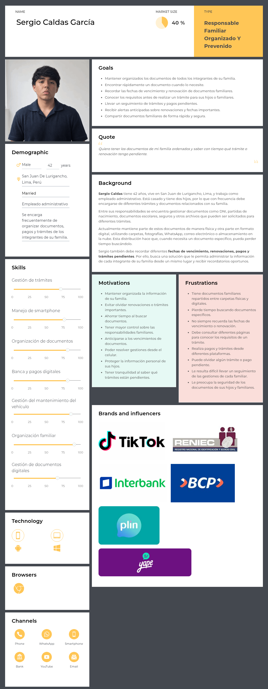

### 2.3.2. User Task Matrix

| Task | Frequency (Luis, 21 años) | Importance (Luis, 21 años) | Frequency (Patricia, 39 años) | Importance (Patricia, 39 años) |
|---|---|---|---|---|
| Centralizar documentos digitales | Often | High | Always | High |
| Recargar tarjeta de transporte | Always | High | Often | Medium |
| Recibir alertas de saldo bajo / vencimiento | Always | High | Always | High |
| Configurar y gestionar perfiles múltiples | Rarely | Medium | Often | High |
| Acceso offline a documentos | Sometimes | Medium | Often | High |
| Asistente para trámites (checklist, pasos guiados) | Sometimes | Medium | Often | High |
| Historial de transacciones (pagos, recargas, trámites) | Sometimes | Medium | Often | Medium |
| Seguridad y validación biométrica | Often | High | Always | High |
| Vincular billeteras digitales (Yape, Plin, Google Wallet) | Often | High | Sometimes | Medium |
| Compartir documentos verificados (ej. envío digital de DNI) | Sometimes | Medium | Often | High |
| Configurar notificaciones personalizadas (push, correo, WhatsApp) | Often | Medium | Often | High |
| Renovar documentos en línea (DNI, carné universitario, CONADIS) | Rarely | High | Sometimes | High |
| Gestionar pagos de servicios (teléfono, agua, luz, internet) | Rarely | Medium | Often | High |
| Monitorear gastos y generar reportes | Rarely | Medium | Often | Medium |

Análisis de resultados

Los resultados muestran que Luis presenta una mayor frecuencia de uso en actividades relacionadas con la movilidad y la gestión cotidiana de sus recursos digitales. Destacan la recarga de la tarjeta de transporte, la recepción de alertas, la vinculación de billeteras digitales y la aplicación de mecanismos de seguridad, tareas que considera de alta importancia. Esto evidencia su interés por acceder rápidamente a sus documentos y realizar operaciones desde un entorno digital centralizado.

Por otro lado, Patricia otorga mayor relevancia a las funcionalidades relacionadas con la organización y administración de las responsabilidades familiares. La gestión de perfiles múltiples, el acceso sin conexión a documentos, el uso del asistente para trámites y la configuración de notificaciones adquieren mayor relevancia en sus actividades. Asimismo, considera importantes la centralización de documentos, la seguridad biométrica, la renovación de documentos y la gestión de pagos de servicios.

En conjunto, ambos perfiles valoran la seguridad, la centralización de documentos y las alertas oportunas, aunque presentan diferencias en sus prioridades de uso. Por ello, PayID debe contemplar funcionalidades que respondan tanto a las necesidades de autonomía y movilidad de los estudiantes como a las actividades de organización y gestión documental de los padres de familia y apoderados.

### 2.3.3. Empathy Maps

Empathy Map Estudiante Universitario

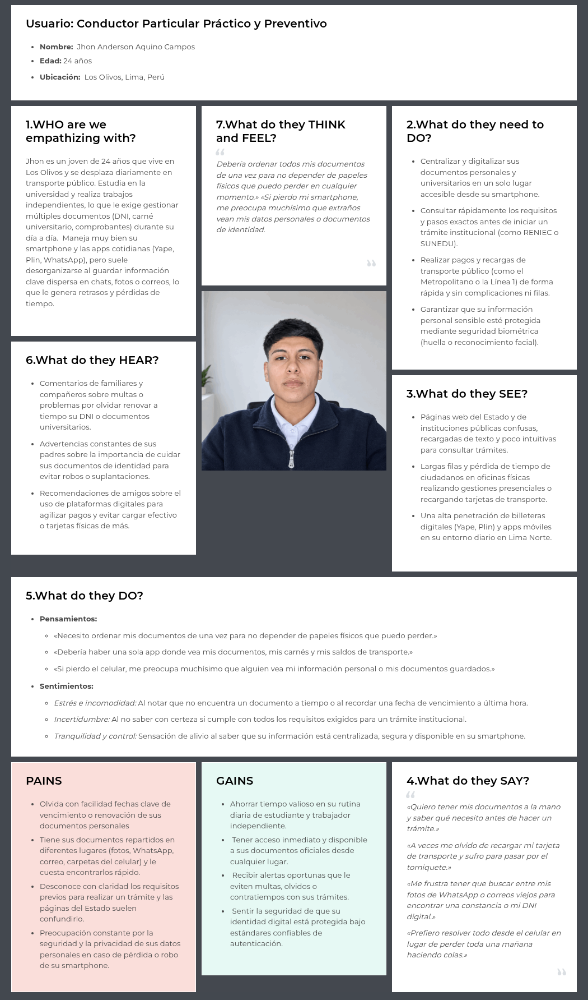

Empathy Map Padre de Familia

### 2.3.4. As-Is Scenario Mapping

User Journey Mapping Estudiante Universitario

User Journey Mapping Padre de Familia

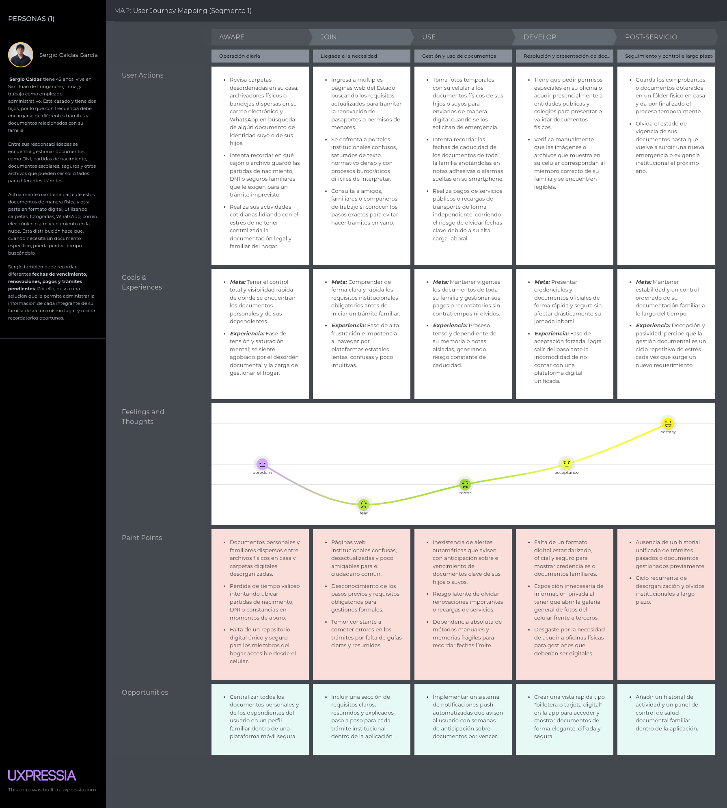

### 2.3.5. Big Picture EventStorming

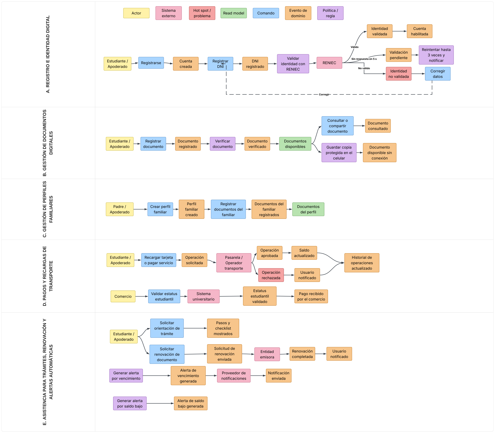

### 2.3.6. Ubiquitous Language

En esta sección se presenta el glosario de términos y conceptos contemplados por el Business Domain de PayID. Los términos están definidos en inglés, acompañados de su equivalente en español entre paréntesis y de una definición en español. Este lenguaje ubicuo debe ser utilizado de manera consistente por todos los integrantes del equipo, con el propósito de mantener una comprensión común de los conceptos, procesos y funcionalidades del negocio.

Identity & Documents (Identidad y Documentos)

- National ID (DNI – Documento Nacional de Identidad): Documento oficial de identidad emitido por RENIEC, utilizado para acreditar la identidad de una persona en Perú.
- Passport (Pasaporte): Documento emitido por la autoridad competente que permite a una persona identificarse y viajar al extranjero.
- Driver's License (Licencia de Conducir): Documento emitido por el MTC que autoriza a una persona a conducir vehículos.
- University ID (Carné Universitario): Documento emitido por una universidad o instituto de educación superior, utilizado para identificar a sus estudiantes.
- Disability ID (Carné CONADIS): Documento oficial que acredita la condición de discapacidad de una persona en Perú.
- Digital Document (Documento Digital): Versión electrónica de un documento físico, registrada y almacenada en PayID. Puede encontrarse verificada o pendiente de verificación.
- Identity Validation (Validación de Identidad): Proceso mediante el cual PayID confirma con RENIEC que los datos del DNI registrado son correctos.
- Pending Validation (Validación Pendiente): Estado de la validación de identidad cuando RENIEC no responde dentro del tiempo establecido. El sistema realiza nuevos intentos de validación y notifica al usuario el resultado.
- Document Renewal (Renovación de Documento): Proceso mediante el cual se solicita extender la vigencia de un documento. PayID permite gestionar la solicitud y hacerle seguimiento, pero la renovación la realiza la entidad emisora.

Transportation & Cards (Transporte y Tarjetas)

- Metro Card (Tarjeta de la Línea 1): Tarjeta recargable utilizada para acceder al servicio de transporte de la Línea 1 del Metro de Lima.
- Metropolitano Card (Tarjeta del Metropolitano): Tarjeta recargable utilizada en el sistema de transporte público Metropolitano de Lima.
- Transport Balance (Saldo de Transporte): Monto disponible en una tarjeta de transporte compatible. Su consulta desde PayID depende de la disponibilidad de información proporcionada por el operador del servicio.
- Top-Up (Recarga de Transporte): Acción de añadir saldo a una tarjeta de  transporte compatible mediante el servicio de recarga disponible e integrado en  PayID.

Payments & Transactions (Pagos y Transacciones)

- Debt Payment (Pago de Deuda): Transacción realizada para cancelar obligaciones pendientes, como pagos de servicios o multas.
- Transaction History (Historial de Transacciones): Registro detallado de las recargas y los pagos realizados por el usuario a través de PayID.
- Payment Gateway (Pasarela de Pagos): Servicio externo que procesa los pagos y las recargas realizados desde PayID.
- Merchant (Comercio): Negocio o servicio del ecosistema universitario que puede validar el estatus estudiantil de sus clientes y recibir pagos a través de PayID.
- Student Status (Estatus Estudiantil): Condición que confirma que una persona mantiene su condición de estudiante activo, mediante la validación con el sistema de su universidad, cuando exista una integración disponible.
- Notifications & Alerts (Notificaciones y Alertas)
- Low Balance Alert (Alerta de Saldo Bajo): Notificación enviada al usuario cuando el saldo de una tarjeta de transporte compatible alcanza un nivel bajo, siempre que el operador proporcione dicha información.
- Expiration Alert (Alerta de Vencimiento): Notificación enviada al usuario cuando un documento registrado está próximo a vencer.
- Reminder (Recordatorio): Aviso programado para acciones importantes, como la solicitud de renovación de documentos o las recargas de transporte.

Access & Profiles (Acceso y Perfiles)

- Offline Mode (Modo Offline): Acceso limitado a documentos previamente verificados cuando no hay conexión a internet.
- Verified Document (Documento Verificado): Documento digital cuyos datos fueron validados por la entidad competente, según el tipo de documento, y que puede consultarse de forma segura en la aplicación.
- User Profile (Perfil de Usuario): Identidad principal del titular de la cuenta en PayID.
- Family Profile (Perfil Familiar): Espacio dentro de la aplicación que permite administrar documentos de hijos u otros familiares o dependientes autorizados.
- Procedure Assistant (Asistente de Trámites): Función que orienta al usuario durante la realización de un trámite mediante instrucciones, pasos y listas de verificación.

# CAPÍTULO III: Requirements Specification

## 3.1. To-Be Scenario Mapping

[Pendiente] Incorporar los To-Be Scenario Maps de cada User Persona con las filas Phases, Doing, Thinking y Feeling, explicar cómo se elaboraron y contrastarlos con los escenarios As-Is. La sección de User Stories que ya existe pasa a 3.2.

## 3.2. User Stories

| Epic ID | Título | Descripción |
|---|---|---|
| E1 | Gestión de usuarios y perfiles | Comprende el registro, autenticación y administración de cuentas, así como la creación y gestión de perfiles familiares vinculados a un usuario principal. |
| E2 | Gestión de documentos digitales | Incluye el registro, validación con RENIEC, consulta y seguimiento de documentos personales y oficiales desde la aplicación. |
| E3 | Pagos y recargas | Agrupa las funcionalidades relacionadas con las recargas de tarjetas de transporte, el pago de servicios y deudas, y la consulta del historial de operaciones realizadas por el usuario. |
| E5 | Notificaciones y alertas | Comprende el envío y la consulta de notificaciones relacionadas con vencimientos de documentos, operaciones realizadas y recordatorios importantes. |
| E6 | Acceso sin conexión | Permite consultar documentos previamente validados y almacenados de forma segura cuando el usuario no dispone de conexión a internet. |
| E7 | Landing page informativa | Presenta la propuesta de valor de PayID, sus funcionalidades, beneficios, información de seguridad, términos legales y medios de acceso. |
| E8 | API REST del backend | Comprende los servicios que permiten gestionar la autenticación, los documentos y las operaciones de la aplicación mediante endpoints. |
| E9 | Infraestructura de la aplicación móvil | Considera la configuración técnica inicial de la aplicación móvil, incluyendo navegación, gestión de estado y comunicación con servicios externos. |

Tabla de US

| US ID | Título | Descripción | Criterios de Aceptación (Gherkin) | Epic Relacionada |
|---|---|---|---|---|
| US1 | Registro de usuario | Como visitante, quiero registrarme utilizando mi correo electrónico o número de celular para crear una cuenta personal en PayID. | Scenario 1: Registro exitoso. Given un visitante que todavía no tiene una cuenta. When ingresa un correo electrónico o número de celular válido y completa los datos requeridos. Then el sistema crea su cuenta y confirma el registro.  Scenario 2: Datos inválidos. Given un visitante que intenta registrarse. When ingresa información incompleta o con un formato inválido. Then el sistema impide el registro e informa los campos que debe corregir. | E1 |
| US2 | Creación de perfiles familiares | Como usuario registrado, quiero crear perfiles familiares vinculados a mi cuenta para administrar la información y los documentos de mis familiares autorizados. | Scenario 1: Creación exitosa. Given un usuario autenticado. When registra los datos requeridos de un nuevo perfil familiar. Then el sistema crea el perfil y lo vincula a su cuenta principal.  Scenario 2: Datos incompletos. Given un usuario que intenta crear un perfil familiar. When omite información obligatoria. Then el sistema solicita completar los datos antes de guardar el perfil. | E1 |
| US3 | Registro de documentos | Como usuario, quiero registrar mis documentos personales y oficiales para disponer de ellos de manera organizada desde la aplicación. | Scenario 1: Registro y validación exitosa. Given un usuario autenticado. When registra su DNI con datos válidos. Then el sistema valida la información con RENIEC y almacena el documento como verificado.  Scenario 2: Validación pendiente. Given un usuario que registra su DNI. When RENIEC no responde dentro del tiempo establecido. Then el sistema deja el documento en estado «Pendiente», reintenta la validación y notifica el resultado al usuario.  Scenario 3: Información inválida. Given un usuario que intenta registrar un documento. When ingresa información incorrecta o incompleta. Then el sistema rechaza el registro e informa el motivo. | E2 |
| US4 | Solicitud y seguimiento de renovación de documentos | Como usuario, quiero solicitar y consultar el estado de renovación de mis documentos desde PayID para realizar el seguimiento de mis trámites. | Scenario 1: Solicitud de renovación. Given un usuario que tiene un documento próximo a vencer o vencido. When inicia una solicitud de renovación desde la aplicación. Then el sistema registra la solicitud y presenta la información necesaria para continuar el trámite ante la entidad correspondiente.  Scenario 2: Consulta del estado. Given una solicitud de renovación previamente registrada. When el usuario consulta su estado. Then el sistema muestra la última actualización disponible. | E2 |
| US5 | Recarga de tarjetas de transporte | Como usuario, quiero recargar mi tarjeta de transporte desde la aplicación para no quedarme sin saldo. | Scenario 1: Recarga individual exitosa. Given un usuario autenticado que dispone de una tarjeta de transporte compatible. When ingresa los datos de la tarjeta, selecciona un monto permitido y confirma la operación. Then el sistema procesa la solicitud y muestra el resultado de la recarga.  Scenario 2: Datos de recarga inválidos. Given un usuario que se encuentra realizando una recarga individual. When ingresa datos incorrectos o un monto no permitido. Then el sistema impide continuar e informa el motivo. | E3 |
| US6 | Pago de deudas | Como usuario, quiero pagar deudas de servicios o multas disponibles en PayID para realizar mis operaciones de manera más sencilla. | Scenario 1: Pago exitoso. Given un usuario autenticado con una deuda disponible para pagar. When selecciona la deuda y confirma la operación. Then el sistema procesa el pago y muestra su resultado.  Scenario 2: Pago rechazado. Given un usuario que intenta pagar una deuda. When la operación es rechazada por el servicio de pago. Then el sistema informa que el pago no se completó y conserva el estado correspondiente. | E3 |
| US7 | Historial de transacciones | Como usuario, quiero consultar el historial de mis recargas y pagos realizados desde la aplicación para llevar un control de mis operaciones. | Scenario 1: Consulta del historial. Given un usuario autenticado con operaciones realizadas. When ingresa a su historial. Then el sistema muestra sus recargas y pagos ordenados por fecha.  Scenario 2: Sin operaciones registradas. Given un usuario autenticado que aún no ha realizado operaciones. When ingresa a su historial. Then el sistema indica que todavía no tiene movimientos registrados. | E3 |
| US9 | Alerta de vencimiento de documentos | Como usuario, quiero recibir notificaciones cuando mis documentos estén próximos a vencer o hayan vencido para tomar las medidas correspondientes. | Scenario 1: Documento próximo a vencer. Given un documento registrado cuya fecha de vencimiento se encuentra dentro del periodo de alerta configurado. When el sistema ejecuta la verificación correspondiente. Then envía una notificación al usuario.  Scenario 2: Documento vencido. Given un documento cuya fecha de vencimiento ya ha finalizado. When el sistema detecta esta condición. Then actualiza su estado y notifica al usuario. | E5 |
| US10 | Notificaciones sobre trámites | Como usuario, quiero recibir notificaciones sobre los cambios de estado de mis solicitudes para conocer cuándo un trámite presenta una actualización o ha finalizado. | Scenario 1: Actualización de solicitud. Given un usuario con una solicitud de trámite registrada. When el estado de la solicitud presenta una actualización. Then el sistema genera una notificación con la información disponible.  Scenario 2: Finalización del trámite. Given una solicitud cuyo estado ha sido actualizado a finalizado por la entidad correspondiente. When PayID recibe dicha actualización. Then notifica al usuario sobre el resultado del trámite. | E5 |
| US11 | Acceso a documentos sin conexión | Como usuario, quiero consultar mis documentos previamente verificados incluso cuando no tenga conexión a internet para disponer de ellos cuando los necesite. | Scenario 1: Consulta sin conexión. Given un usuario que inició sesión previamente y dispone de documentos verificados almacenados en el dispositivo. When pierde la conexión a internet. Then puede visualizar los documentos disponibles para acceso sin conexión.  Scenario 2: Operación que requiere conexión. Given un usuario que no tiene conexión a internet. When intenta realizar una recarga o un pago. Then el sistema informa que la operación requiere conexión. | E6 |
| US12 | Información de funcionalidades | Como visitante, quiero visualizar las principales funcionalidades de PayID en la landing page para conocer los beneficios y servicios que ofrece. | Scenario 1: Consulta de funcionalidades. Given un visitante que accede a la landing page. When ingresa a la sección de funcionalidades. Then visualiza una descripción clara de los principales servicios de PayID.  Scenario 2: Consulta de seguridad. Given un visitante que navega por la landing page. When busca información sobre seguridad y privacidad. Then encuentra información relacionada con la protección de sus datos. | E7 |
| US13 | Consulta de términos y políticas | Como visitante, quiero acceder a los términos de uso y políticas de privacidad desde la landing page para conocer las condiciones del servicio y el tratamiento de mis datos. | Scenario 1: Acceso a documentos legales. Given un visitante que se encuentra en la landing page. When selecciona el enlace de términos y políticas. Then el sistema muestra los documentos legales correspondientes.  Scenario 2: Visibilidad de enlaces. Given un visitante que navega hasta el pie de página. When visualiza la sección de enlaces legales. Then encuentra disponibles los accesos a los términos de uso y la política de privacidad. | E7 |
| US14 | Visualización de testimonios | Como visitante, quiero consultar testimonios y experiencias de usuarios en la landing page para conocer sus opiniones sobre el servicio. | Scenario 1: Consulta de testimonios. Given un visitante que accede a la landing page. When ingresa a la sección de testimonios. Then visualiza las reseñas publicadas y autorizadas para su difusión.  Scenario 2: Consulta ampliada. Given un visitante que desea conocer más experiencias. When selecciona la opción para consultar más testimonios. Then el sistema muestra el contenido adicional disponible. | E7 |
| US15 | Acceso a la aplicación | Como visitante, quiero encontrar las opciones de registro e inicio de sesión en la landing page para acceder a PayID según mi condición de usuario. | Scenario 1: Acceso al registro. Given un visitante que todavía no tiene una cuenta. When selecciona la opción de registro en la landing page. Then el sistema lo dirige al formulario de creación de cuenta.  Scenario 2: Acceso al inicio de sesión. Given un usuario que ya dispone de una cuenta. When selecciona la opción de iniciar sesión. Then el sistema lo dirige al formulario de autenticación. | E7 |
| US16 | API de autenticación | Como desarrollador, quiero disponer de un endpoint de autenticación para validar las credenciales y gestionar el acceso de los usuarios a la aplicación. | Scenario 1: Credenciales válidas. Given una solicitud que contiene credenciales válidas. When el backend procesa la solicitud de autenticación. Then devuelve una respuesta satisfactoria con un token de acceso válido.  Scenario 2: Credenciales inválidas. Given una solicitud con credenciales incorrectas. When el backend intenta validar la información. Then devuelve una respuesta de autenticación fallida con el código HTTP 401. | E8 |
| US17 | API de documentos | Como desarrollador, quiero disponer de endpoints para registrar y consultar documentos de los usuarios para facilitar la comunicación entre la aplicación y el backend. | Scenario 1: Registro mediante API. Given una solicitud válida que contiene los datos requeridos de un documento. When el backend recibe y procesa la solicitud. Then registra la información y devuelve una respuesta de confirmación.  Scenario 2: Consulta mediante API. Given una solicitud que contiene el identificador de un documento existente. When el backend procesa la consulta. Then devuelve la información disponible del documento. | E8 |
| US18 | Configuración de la arquitectura Flutter | Como desarrollador, quiero contar con una arquitectura base configurada en Flutter, que incluya navegación, gestión de estado y cliente HTTP, para implementar nuevas funcionalidades de manera organizada y mantenible. | Scenario 1: Reutilización de la arquitectura. Given un nuevo módulo que debe incorporarse a la aplicación. When el desarrollador implementa el módulo utilizando la arquitectura configurada. Then puede reutilizar los componentes de navegación, gestión de estado y comunicación HTTP disponibles.  Scenario 2: Navegación entre secciones. Given un usuario que se encuentra utilizando la aplicación. When navega entre las secciones principales. Then la aplicación gestiona correctamente la navegación y conserva el estado requerido. | E9 |
| US19 | Billetera digital y recargas | Como usuario, quiero ver mis tarjetas de transporte y recargarlas desde un flujo guiado en la aplicación para gestionar mi saldo sin salir de PayID. | Scenario 1: Visualización de tarjetas registradas. Given un usuario autenticado que tiene tarjetas de transporte vinculadas a su cuenta. When ingresa a la sección de billetera digital. Then el sistema muestra las tarjetas registradas y su saldo disponible, cuando el servicio de transporte proporcione ese dato.  Scenario 2: Recarga desde la billetera. Given un usuario que se encuentra en la billetera digital y tiene una tarjeta de transporte registrada. When selecciona una tarjeta, ingresa un monto válido y confirma la operación mediante el flujo guiado. Then el sistema procesa la solicitud y muestra el resultado de la recarga.  Scenario 3: Monto inválido. Given un usuario que se encuentra en el flujo de recarga de la billetera. When ingresa un monto que no cumple las condiciones permitidas. Then el sistema impide continuar e informa el motivo. | E3 |
| US21 | Centro de notificaciones | Como usuario, quiero disponer de un centro de notificaciones dentro de PayID para consultar los avisos relacionados con mis operaciones y documentos. | Scenario 1: Generación de notificación. Given un usuario que ha realizado una operación correctamente. When el sistema confirma el resultado de la operación. Then genera una notificación que puede consultarse desde el centro de notificaciones.  Scenario 2: Consulta de notificaciones. Given un usuario que tiene notificaciones registradas. When ingresa al centro de notificaciones. Then visualiza los avisos ordenados desde el más reciente hasta el más antiguo. | E5 |
| US22 | Inicio de sesión | Como usuario registrado, quiero iniciar sesión en PayID utilizando mis credenciales para acceder de manera segura a mi cuenta y a las funcionalidades disponibles. | Scenario 1: Inicio de sesión exitoso. Given un usuario que tiene una cuenta registrada en PayID. When ingresa sus credenciales correctas y confirma el inicio de sesión. Then el sistema valida sus datos y permite el acceso a su cuenta. Scenario 2: Credenciales incorrectas. Given un usuario que se encuentra en la pantalla de inicio de sesión. When ingresa credenciales incorrectas. Then el sistema deniega el acceso e informa que las credenciales no son válidas. Scenario 3: Bloqueo por intentos fallidos. Given un usuario que se encuentra en la pantalla de inicio de sesión y ha acumulado cuatro intentos fallidos consecutivos. When ingresa credenciales incorrectas por quinta vez consecutiva. Then el sistema bloquea temporalmente el acceso a la cuenta durante 15 minutos y notifica al titular. | E1 |

## 3.3. Impact Map

[Pendiente] Insertar y explicar el Impact Map elaborado con Business Goals SMART, actores/personas, impactos, entregables e historias de usuario.

## 3.4. Product Backlog

| Order | US ID | Título | Descripción | Story Points |
|---|---|---|---|---|
| 1 | US12 | Información de funcionalidades | Como visitante, quiero visualizar las principales funcionalidades de PayID en la landing page para conocer los beneficios y servicios que ofrece. | 2 |
| 2 | US15 | Acceso a la aplicación | Como visitante, quiero encontrar las opciones de registro e inicio de sesión en la landing page para acceder a PayID según mi condición de usuario. | 2 |
| 3 | US13 | Consulta de términos y políticas | Como visitante, quiero acceder a los términos de uso y políticas de privacidad desde la landing page para conocer las condiciones del servicio y el tratamiento de mis datos. | 2 |
| 4 | US14 | Visualización de testimonios | Como visitante, quiero consultar testimonios y experiencias de usuarios en la landing page para conocer sus opiniones sobre el servicio. | 2 |
| 5 | US1 | Registro de usuario | Como visitante, quiero registrarme utilizando mi correo electrónico o número de celular para crear una cuenta personal en PayID. | 5 |
| 6 | US22 | Inicio de sesión | Como usuario registrado, quiero iniciar sesión en PayID utilizando mis credenciales para acceder de manera segura a mi cuenta y a las funcionalidades disponibles. | 5 |
| 7 | US2 | Creación de perfiles familiares | Como usuario registrado, quiero crear perfiles familiares vinculados a mi cuenta para administrar la información y los documentos de mis familiares autorizados. | 5 |
| 8 | US3 | Registro de documentos | Como usuario, quiero registrar mis documentos personales y oficiales para disponer de ellos de manera organizada desde la aplicación. | 8 |
| 9 | US4 | Solicitud y seguimiento de renovación de documentos | Como usuario, quiero solicitar y consultar el estado de renovación de mis documentos desde PayID para realizar el seguimiento de mis trámites. | 8 |
| 10 | US5 | Recarga de tarjetas de transporte | Como usuario, quiero recargar mi tarjeta de transporte desde la aplicación para no quedarme sin saldo. | 8 |
| 11 | US6 | Pago de deudas | Como usuario, quiero pagar deudas de servicios o multas disponibles en PayID para realizar mis operaciones de manera más sencilla. | 8 |
| 12 | US7 | Historial de transacciones | Como usuario, quiero consultar el historial de mis recargas y pagos realizados desde la aplicación para llevar un control de mis operaciones. | 3 |
| 13 | US9 | Alerta de vencimiento de documentos | Como usuario, quiero recibir notificaciones cuando mis documentos estén próximos a vencer o hayan vencido para tomar las medidas correspondientes. | 3 |
| 14 | US10 | Notificaciones sobre trámites | Como usuario, quiero recibir notificaciones sobre los cambios de estado de mis solicitudes para conocer cuándo un trámite presenta una actualización o ha finalizado. | 5 |
| 15 | US11 | Acceso a documentos sin conexión | Como usuario, quiero consultar mis documentos previamente verificados incluso cuando no tenga conexión a internet para disponer de ellos cuando los necesite. | 5 |
| 16 | US16 | API de autenticación | Como desarrollador, quiero disponer de un endpoint de autenticación para validar las credenciales y gestionar el acceso de los usuarios a la aplicación. | 5 |
| 17 | US17 | API de documentos | Como desarrollador, quiero disponer de endpoints para registrar y consultar documentos de los usuarios para facilitar la comunicación entre la aplicación y el backend. | 5 |
| 18 | US18 | Configuración de la arquitectura Flutter | Como desarrollador, quiero contar con una arquitectura base configurada en Flutter, que incluya navegación, gestión de estado y cliente HTTP, para implementar nuevas funcionalidades de manera organizada y mantenible. | 5 |
| 19 | US19 | Billetera digital y recargas | Como usuario, quiero ver mis tarjetas de transporte y recargarlas desde un flujo guiado en la aplicación para gestionar mi saldo sin salir de PayID. | 8 |
| 20 | US21 | Centro de notificaciones | Como usuario, quiero disponer de un centro de notificaciones dentro de PayID para consultar los avisos relacionados con mis operaciones y documentos. | 5 |

En el siguiente apartado se mostrará el Product Backlog generado en Jira, que ayudará al equipo durante el desarrollo de este proyecto.

Raul Hiroshi Tasayco Osorio

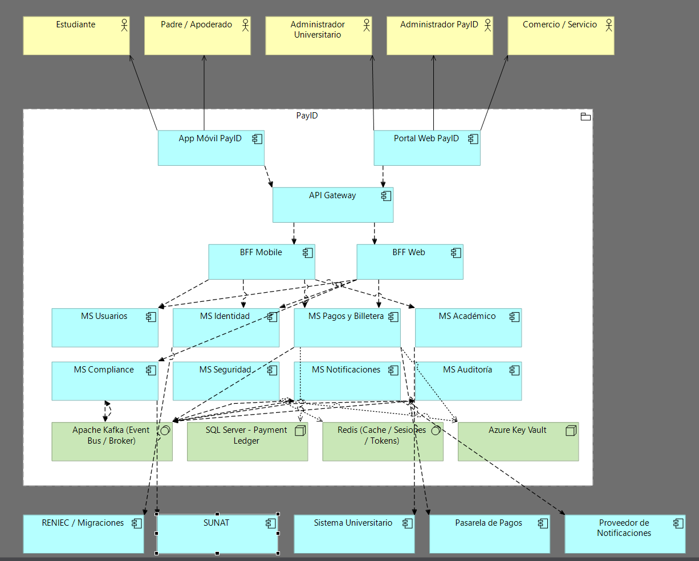

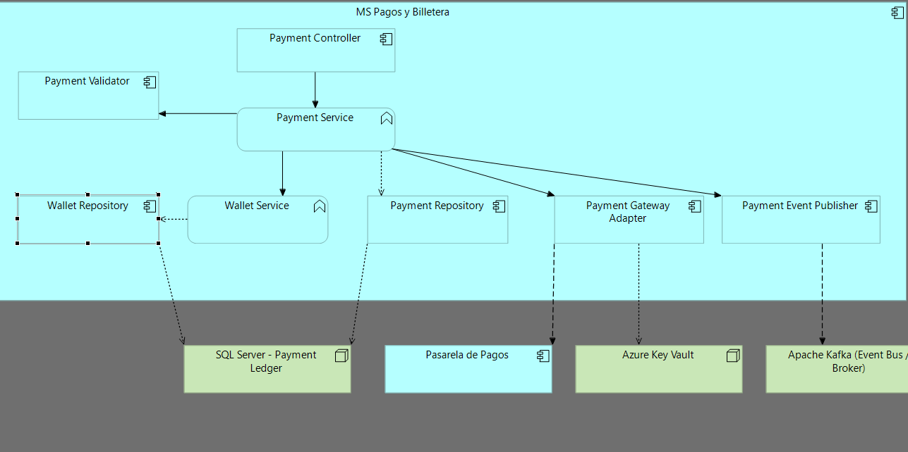

# CAPÍTULO IV: Product Architecture Design

## 4.1 Design Concepts, ViewPoints & ER Diagrams

Esta sección se centra en los conceptos fundamentales de diseño, los diferentes puntos de vista que adoptaremos para comprender y comunicar la arquitectura, y los diagramas de Entidad-Relación para modelar los datos de PayID.

### 4.1.1 Principles Statements

### Principios SOLID

Aplicaremos los cinco principios de diseño orientado a objetos para construir componentes robustos y fáciles de mantener dentro de cada microservicio:

| Principio | Descripción |
|---|---|
| Single Responsibility Principle (SRP) | Cada clase o módulo tendrá una única responsabilidad y, por lo tanto, una única razón para cambiar. |
| Open/Closed Principle (OCP) | Las entidades de software estarán abiertas para la extensión, pero cerradas para la modificación. Esto permite añadir nueva funcionalidad sin alterar el código existente. |
| Liskov Substitution Principle (LSP) | Los subtipos serán sustituibles por sus tipos base sin afectar la correctitud del programa. Esto asegura la coherencia en las jerarquías de herencia. |
| Interface Segregation Principle (ISP) | Es preferible tener múltiples interfaces específicas para los clientes en lugar de una única interfaz genérica. Esto evita que las clases implementen métodos que no necesitan. |
| Dependency Inversion Principle (DIP) | Dependeremos de abstracciones (interfaces o clases abstractas) en lugar de implementaciones concretas. Esto reduce el acoplamiento entre componentes y facilita las pruebas. |

### Domain-Driven Design (DDD)

Adoptaremos los principios de DDD para alinear nuestro diseño de software con el modelo del negocio:

| Principio | Descripción |
|---|---|
| Modelado Basado en el Dominio | El diseño de nuestros microservicios se centrará en el conocimiento y la lógica del dominio del negocio. |
| Límites de Contexto (Bounded Contexts) | Definiremos límites explícitos para cada modelo de dominio (Identidad, Documentos, Pagos, Notificaciones, Auditoría), asegurando la coherencia dentro de cada microservicio. |
| Lenguaje Ubicuo (Ubiquitous Language) | Utilizaremos un lenguaje común y preciso entre los desarrolladores y los expertos del dominio para evitar malentendidos. |

### API First

Diseñaremos las interfaces de nuestros microservicios antes de implementar la lógica interna, facilitando la colaboración y asegurando una buena experiencia para los consumidores de la API.

- Idempotencia

Las operaciones de nuestras APIs serán idempotentes, lo que significa que múltiples solicitudes idénticas tendrán el mismo efecto que una sola solicitud. Esto es crítico en pagos y transferencias.

- Observabilidad

Implementaremos sistemas de logging, métricas y tracing distribuido para monitorear la salud y el rendimiento de nuestros microservicios. Usaremos Datadog o Grafana.

- Resiliencia

Diseñaremos nuestros microservicios para que sean tolerantes a fallos y puedan recuperarse de manera elegante. Aplicaremos Circuit Breaker y Retry con Backoff.

- Seguridad por Diseño (Security by Design)

La seguridad será una consideración fundamental en todas las etapas del diseño y desarrollo. Aplicaremos cifrado AES-256, TLS 1.3, JWT y RBAC.

- Escalabilidad Horizontal

El sistema debe poder crecer agregando más instancias de servicios, no solo aumentando recursos verticales. Se desplegará en Kubernetes con auto-scaling.

### Portabilidad Cloud

El sistema debe poder desplegarse en cualquier proveedor cloud (Azure, AWS, GCP) sin cambios significativos, evitando el vendor lock-in.

- Cumplimiento Normativo

El sistema debe cumplir con las leyes peruanas (Ley N° 29733, normativas SBS y SUNAT), garantizando la privacidad y seguridad de los datos.

### 4.1.2 Approaches Statements

Los enfoques metodológicos de PayID son las estrategias que guiarán el diseño, desarrollo y despliegue del sistema. Estos enfoques aseguran que la arquitectura esté alineada con las mejores prácticas de la industria y con los objetivos del negocio.

- Domain-Driven Design (DDD)

Adoptaremos DDD como un enfoque primordial para asegurar que la arquitectura de PayID refleje fielmente el modelo del negocio. Esto implica:

| Aspecto | Descripción |
|---|---|
| Modelado Colaborativo | Involucrar activamente a los expertos del dominio (product owners, stakeholders) en el proceso de modelado. |
| Lenguaje Ubicuo | Establecer un lenguaje común y preciso entre el equipo técnico y los stakeholders. |
| Énfasis en el Dominio Core | Identificar y priorizar el modelado de las partes más valiosas: identidad, pagos y documentos. |
| Diseño Centrado en el Comportamiento | Modelar el dominio en torno a las acciones y eventos significativos del negocio. |
| Límites de Contexto Claros (Bounded Contexts) | Definir explícitamente los límites que se traducen en microservicios: Identidad, Documentos, Pagos, Académico, Notificaciones, Compliance, Auditoría. |

### Attribute-Driven Design (ADD)

Utilizaremos ADD del SEI como técnica para descomponer y planificar el diseño de nuestra arquitectura. ADD se centra en identificar los atributos de calidad críticos (performance, seguridad, escalabilidad, interoperabilidad) y utilizarlos para guiar las decisiones de diseño en cada iteración.

| Iteración | Driver Principal | Enfoque |
|---|---|---|
| Iteration 1 | Performance, Seguridad | Global System Structure |
| Iteration 2 | Escalabilidad | Sincronización Edge-to-Cloud |
| Iteration 3 | Interoperabilidad | Orquestación de pagos |
| Iteration 4 | Seguridad | Seguridad e Identidad |
| Iteration 5 | Performance | Refinamiento de servicios |

### Arquitectura de Microservicios

Adoptaremos un estilo de Arquitectura de Microservicios, donde PayID se estructura como una colección de servicios débilmente acoplados, organizados alrededor de las capacidades del negocio.

| Microservicio | Responsabilidad |
|---|---|
| MS Usuarios | Gestión de cuentas y perfiles |
| MS Identidad | Validación RENIEC/SUNAT |
| MS Pagos y Billetera | Transacciones financieras |
| MS Académico | Validación SUNEDU |
| MS Compliance | Cumplimiento Ley 29733 |
| MS Seguridad | Cifrado y tokens |
| MS Notificaciones | SMS, email, push |
| MS Auditoría | Event Store |

### Descentralización

Favoreceremos la descentralización de datos y lógica, donde cada microservicio gestiona su propia base de datos y su propia lógica de negocio. Esto promueve la independencia y la escalabilidad.

| Microservicio | Base de Datos |
|---|---|
| MS Usuarios | MySQL |
| MS Pagos | SQL Server (Payment Ledger) |
| MS Auditoría | MySQL (Event Store) |
| MS Seguridad | Azure Key Vault + Redis |

### Automatización

Buscaremos automatizar al máximo los procesos de construcción, prueba, despliegue y monitorización de nuestros microservicios para garantizar la eficiencia y reducir los errores.

| Proceso | Herramienta |
|---|---|
| CI (Integración Continua) | GitHub Actions |
| CD (Despliegue Continuo) | GitHub Actions + Kubernetes |
| Testing | xUnit, Jest, Postman |
| Monitoreo | Datadog / Grafana |

### Infraestructura como Código (IaC)

Gestionaremos nuestra infraestructura utilizando código (Terraform), lo que nos permitirá versionarla, automatizar su aprovisionamiento y garantizar la consistencia del entorno.

- Entrega Continua (CD)

Implementaremos un proceso de entrega continua para poder liberar nuevas funcionalidades y correcciones de forma frecuente y segura.

### Cloud Native

Diseñaremos PayID para ser desplegado en la nube con contenedores (Docker) y orquestación (Kubernetes). Usaremos Azure Kubernetes Service (AKS) con auto-scaling.

| Componente | Tecnología |
|---|---|
| Contenedores | Docker |
| Orquestación | Kubernetes (AKS) |
| Service Mesh | Istio / Linkerd |
| API Gateway | Kong |

### API First

Diseñaremos las interfaces REST de cada microservicio antes de implementar la lógica interna, usando OpenAPI Specification (Swagger) para documentar los contratos.

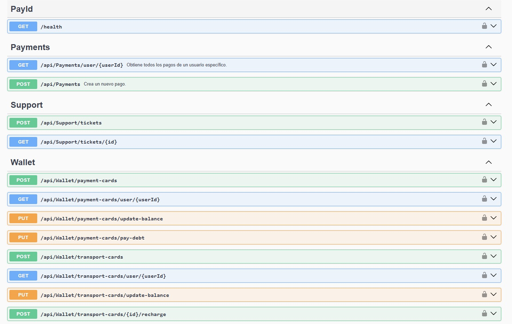

- Scrum
- Trabajaremos en Sprints iterativos e incrementales (2 semanas cada uno) con Sprint Backlog, Daily Standups, Sprint Review y Retrospectiva.

### 4.1.3 Context Diagram

El diagrama de contexto de PayID muestra el sistema como una caja negra, identificando los actores que interactúan con él y los sistemas externos con los que se integra.

Actores:

- Estudiante: registra documentos, recarga tarjetas de transporte y paga servicios.
- Padre/Madre o Tutor: gestiona documentos de sus hijos o familiares.
- Administrador Universitario: valida credenciales académicas.
- Administrador PayID: gestiona usuarios, comercios y configuraciones.
- Comercio/Servicio: acepta pagos con QR.

Sistemas externos:

- RENIEC: validación de identidad (DNI).
- SUNAT: validación de RUC y facturación electrónica.
- Sistema Universitario: validación del carné universitario.
- Pasarela de Pagos: procesamiento de transacciones (Visa, Mastercard, Yape, Plin).
- Proveedor de Notificaciones: envío de SMS, email y push.

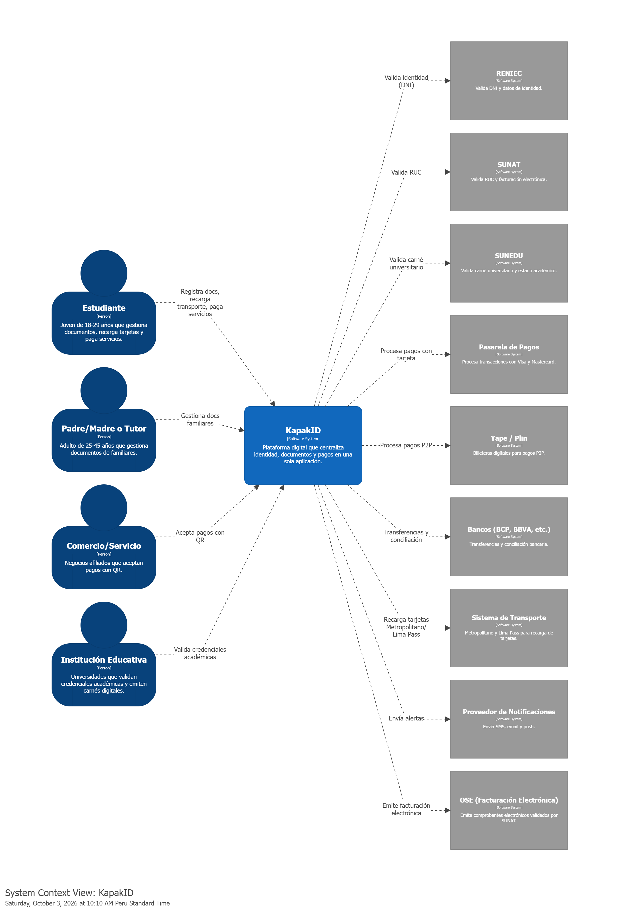

### 4.1.4 Approach Driven ViewPoints Diagrams

Container diagram:

El diagrama de contenedores de PayID muestra los componentes internos del sistema: las aplicaciones cliente (App Móvil y Portal Web), el API Gateway como punto único de entrada, los BFF (Mobile y Web), los microservicios principales (Identidad, Pagos y Documentos), y la infraestructura de soporte (Kafka, Redis, SQL Server), junto con las integraciones con entidades gubernamentales, pasarelas de pago y servicios externos.

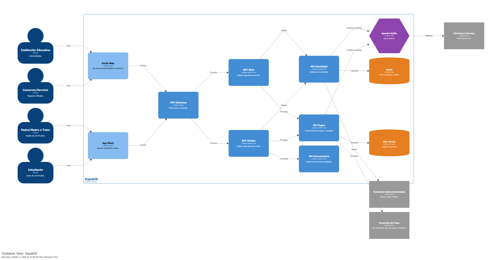

Component diagram:

El diagrama de componentes del MS Pagos muestra los 8 componentes internos que procesan transacciones: Controller, Validator, Payment Service, Wallet Service, Repositories, Gateway Adapter y Event Publisher.

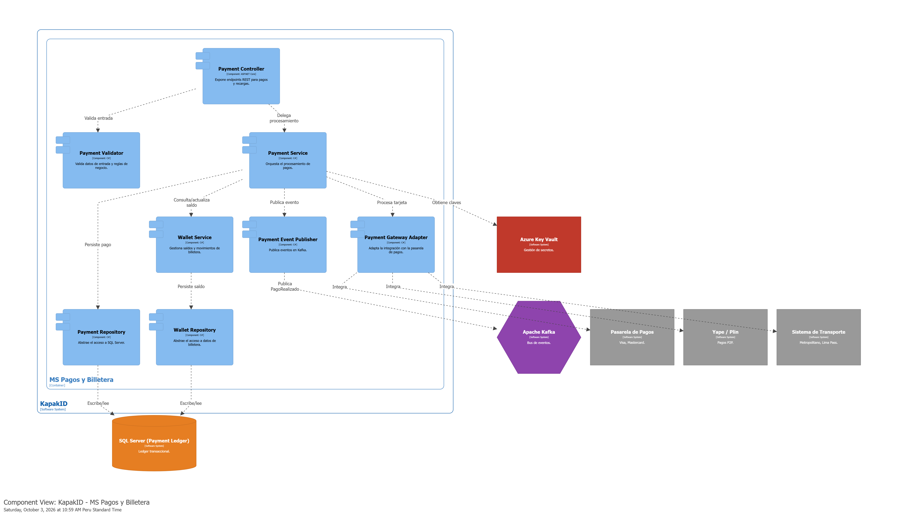

### Diagramas UML:

- Para describir la arquitectura de PayID se emplean diagramas de componentes, clases y secuencia. Estos permiten representar la organización del backend, las entidades del dominio y la interacción entre los elementos que participan en los principales casos de uso. Las vistas se elaboran a partir de la implementación disponible y del alcance funcional descrito en el informe.

Vista lógica:

- El backend se organiza en los módulos Authentication, Documents, Wallet, Payments, Notifications y Support, dentro de una única aplicación ASP.NET Core. Se distinguen las responsabilidades de interfaz REST, aplicación, dominio e infraestructura. Los controladores delegan solicitudes mediante MediatR; los handlers coordinan los casos de uso y utilizan entidades, repositorios o el contexto de persistencia. Documents, Payments, Notifications y Support cuentan con contratos de repositorio e implementaciones basadas en Entity Framework Core. Authentication y Wallet acceden directamente a FinTrackBackDbContext; adicionalmente, la recarga de Wallet utiliza IPaymentRepository. Por ello, la estructura corresponde a un backend modular con separación por capas, aunque el aislamiento de infraestructura no se aplica de forma uniforme a todos los módulos.

### Vista de procesos

La vista de procesos utiliza diagramas de secuencia para mostrar el orden de los mensajes durante el inicio de sesión, el registro de documentos y la recarga de una tarjeta de transporte. En la autenticación se consulta al usuario, se valida la contraseña y se genera un JWT. En el registro de documentos se crea la entidad con estado Pending, se persiste mediante DocumentRepository y se devuelve un DocumentDto. En la recarga se valida el monto y la existencia de la tarjeta de transporte; cuando se proporciona PaymentCardId, también se comprueba el saldo de la tarjeta de pago. La operación actualiza saldos y registra movimientos y un pago dentro de una transacción de base de datos, con confirmación o reversión según el resultado.

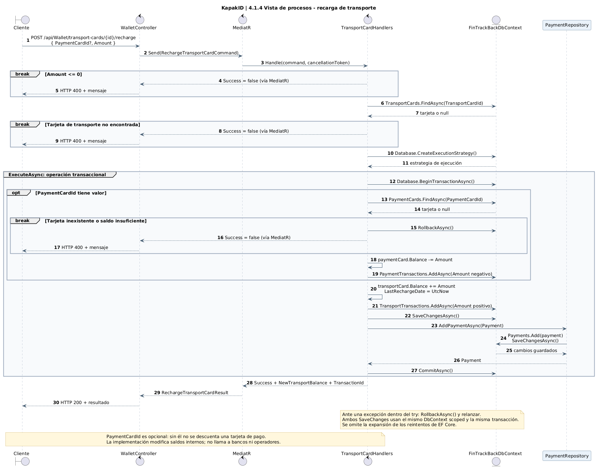

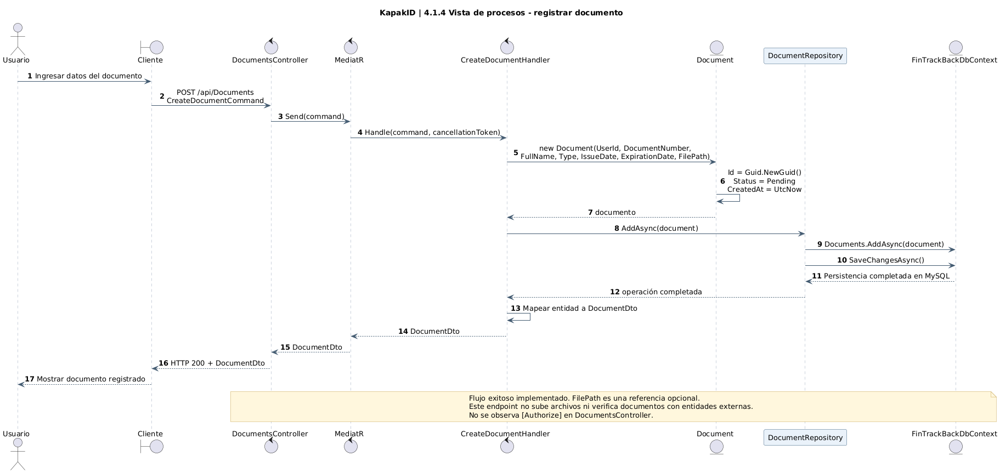

### 4.1.5 Relational / Non Relational Database Diagram

PayID utiliza una base de datos relacional MySQL, configurada mediante el proveedor Pomelo de Entity Framework Core. El modelo contiene nueve tablas: Users, Documents, Payments, Notifications, SupportTickets, PaymentCards, TransportCards, PaymentTransactions y TransportTransactions. Cada tabla posee una clave primaria Id de tipo char(36), correspondiente a Guid en C#. Los campos UserId, PaymentCardId y TransportCardId permiten identificar asociaciones entre registros. Los estados y tipos enumerados se almacenan como int; los importes y saldos utilizan decimal(65,30) en el snapshot revisado. No se encontró una base no relacional configurada en el backend.

El diagrama conserva los nombres, tipos y nulabilidad definidos en FinTrackBackDbContextModelSnapshot. Las referencias se muestran con líneas punteadas porque el modelo y las migraciones revisadas no declaran restricciones de clave foránea para esos campos. Conceptualmente, un usuario puede tener varios documentos, pagos, notificaciones, tickets y tarjetas; cada tarjeta puede registrar varios movimientos. Implementar las claves foráneas sería una mejora posterior y no se presenta como una característica existente.

### 4.1.6 Design Patterns

La implementación de PayID combina patrones de diseño y de arquitectura para distribuir responsabilidades y reducir el acoplamiento. Se identifican los siguientes mecanismos en el código fuente:

| Patrón o mecanismo | Evidencia en el backend | Aplicación y propósito |
|---|---|---|
| Repository | IDocumentRepository y DocumentRepository; equivalentes en Payments, Notifications y Support. | Expone operaciones de persistencia mediante contratos. En Documents, el handler depende de la interfaz y el repositorio realiza las operaciones de EF Core. |
| Mediator | ISender/IMediator, llamadas Send y handlers IRequestHandler registrados con AddMediatR. | Centraliza el despacho de solicitudes a sus manejadores, evitando que los controladores instancien o seleccionen directamente un handler concreto. |
| CQRS simple | CreateDocumentCommand/CreateDocumentHandler y GetDocumentsByUserIdQuery/GetDocumentsByUserIdQueryHandler. | Separa operaciones de escritura y lectura a nivel de solicitudes y handlers. Comparte el modelo y la base de datos; no implica event sourcing ni almacenes separados. |
| Inyección de dependencias | AddScoped en Program.cs e interfaces recibidas por constructor. | El contenedor proporciona repositorios, servicios de seguridad y el DbContext. Facilita sustituir implementaciones y controlar su ciclo de vida. |
| DTO | DocumentDto, UserDto, PaymentDto y otros objetos de respuesta. | Define los datos intercambiados en los casos de uso sin entregar directamente la entidad persistida. Por ejemplo, UserDto no incluye PasswordHash. |
| Unit of Work, proporcionado por EF Core | FinTrackBackDbContext, seguimiento de entidades y SaveChangesAsync. | Coordina la persistencia de cambios. La recarga añade una transacción explícita para agrupar actualizaciones y registros realizados en dos llamadas a SaveChangesAsync. No existe una abstracción IUnitOfWork propia. |

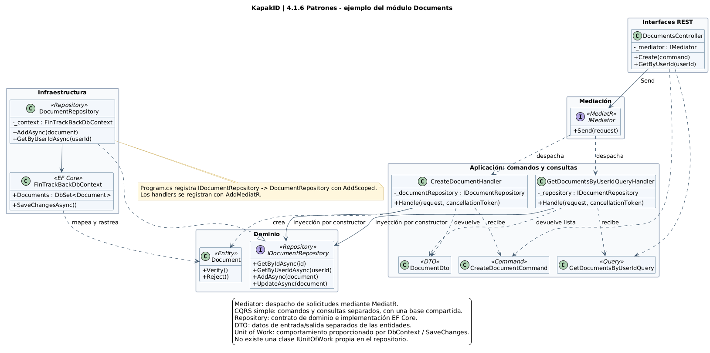

Repository, DTO y Unit of Work pertenecen a patrones de aplicaciones empresariales; CQRS es un patrón arquitectónico e inyección de dependencias es una técnica/patrón de composición. Se distinguen estas categorías para no presentar todos los elementos como patrones GoF. No se atribuyen Factory, Observer o Singleton al código de negocio sin una implementación que los sustente. El registro AddScoped no constituye Singleton.

### 4.1.7. Tactics

Las siguientes tácticas orientan el diseño de PayID para responder a los atributos de calidad definidos en la sección 4.2. Se describen como decisiones de diseño; su implementación debe verificarse con las evidencias del capítulo V.

| Atributo de calidad | Táctica de diseño | Aplicación en PayID |
|---|---|---|
| Seguridad | Autenticación, autorización y privilegio mínimo | Proteger los endpoints y limitar el acceso a documentos, perfiles familiares y operaciones al usuario autorizado. |
| Seguridad | Cifrado en tránsito y gestión externa de secretos | Proteger las comunicaciones y mantener claves y credenciales fuera del código fuente. |
| Disponibilidad | Reintentos limitados y aislamiento de fallas | Manejar errores o demoras de RENIEC, pasarelas y proveedores de notificaciones sin bloquear otros flujos. |
| Rendimiento | Caché y paginación | Reducir consultas repetidas y limitar el volumen de resultados en documentos e historial de transacciones. |
| Integridad | Idempotencia y registro transaccional | Evitar pagos duplicados y conservar trazabilidad de las operaciones y sus estados. |
| Interoperabilidad | Adaptadores y contratos API explícitos | Aislar los servicios externos y mantener contratos claros entre clientes, backend e integraciones. |
| Modificabilidad | Separación de responsabilidades por dominio | Permitir evolucionar identidad, documentos, pagos y notificaciones con menor impacto entre módulos. |

## 4.2. Architectural Drivers

### 4.2.1. Design Purpose

El propósito del diseño de PayID es definir una arquitectura de software que permita gestionar documentos personales, validar la identidad de los usuarios y realizar operaciones de pago y recarga mediante una aplicación integrada. Para ello, la arquitectura prioriza la protección de la información, la interoperabilidad con servicios externos, la disponibilidad de los servicios y la facilidad de uso.

La solución está dirigida a los segmentos de usuarios identificados en la sección 1.3: estudiantes de educación superior, padres de familia y apoderados, así como comercios y servicios vinculados al ecosistema universitario.

PayID es un sistema nuevo que se desarrolla dentro de un dominio conocido, relacionado con las billeteras digitales y los servicios de identidad digital. En consecuencia, su diseño considera estilos y patrones arquitectónicos establecidos, entre ellos la arquitectura basada en microservicios, API Gateway, Backend for Frontend (BFF) y comunicación basada en eventos, descritos en las secciones 4.1 y 4.3.

En función de este propósito, el diseño arquitectónico de PayID persigue los siguientes objetivos:

Proteger la identidad y los datos de los usuarios: garantizar que los documentos personales y la información asociada a las transacciones estén protegidos mediante mecanismos de acceso autorizado y controles de seguridad, considerando las disposiciones de la Ley N.° 29733.

Reducir el tiempo dedicado a las operaciones cotidianas: facilitar la realización de recargas, pagos y consultas de documentos mediante respuestas oportunas, disminuyendo la necesidad de recurrir a filas o trámites presenciales.

Facilitar la integración con entidades y servicios externos: contemplar la interoperabilidad con RENIEC, SUNAT, el sistema universitario y una pasarela de pagos externa, teniendo en cuenta las condiciones de acceso, disponibilidad y comunicación de cada servicio.

Permitir el crecimiento y la evolución del sistema: establecer una arquitectura que facilite la incorporación de nuevos usuarios y funcionalidades mediante servicios independientes, favoreciendo el mantenimiento, la escalabilidad y la adaptación de PayID ante futuras necesidades.

### 4.2.2. Primary Functionality (Primary User Stories)

La funcionalidad principal de PayID está representada por las siguientes historias de usuario del Product Backlog (sección 3.3). Se seleccionaron porque describen las capacidades principales del sistema y tienen una influencia directa en las decisiones de diseño arquitectónico. Para facilitar su identificación, se clasifican en dos tipos:

| Tipo | Historias |
|---|---|
| Funcionales (las usa el usuario final) | US1, US3, US4, US5, US6, US8, US9, US11, US19 y US20 |
| Técnicas (las usa el equipo de desarrollo) | US16 y US17 |

A continuación, se presentan las historias seleccionadas y su influencia en la arquitectura de PayID:

| ID US | Tipo | Descripción | Por qué influye en la arquitectura |
|---|---|---|---|
| US1 | Funcional | Como usuario, quiero registrarme con mi correo o celular para crear mi cuenta en PayID. | Define la autenticación y el manejo de cuentas. |
| US3 | Funcional | Como usuario, quiero registrar mi DNI, pasaporte y otros documentos para tenerlos disponibles en la app. | Maneja datos personales sensibles y requiere validación de identidad. |
| US4 | Funcional | Como usuario, quiero renovar mis documentos vencidos desde la app para evitar trámites presenciales. | La app inicia y hace seguimiento a la solicitud de renovación; el trámite depende de la entidad emisora del documento. |
| US5 | Funcional | Como usuario, quiero recargar mi tarjeta del Metropolitano para no quedarme sin saldo. | Mueve dinero y exige respuesta rápida y consistencia de saldos. |
| US6 | Funcional | Como usuario, quiero pagar mis deudas de servicios o multas desde la app para evitar filas. | Depende de la pasarela de pagos. |
| US8 | Funcional | Como ciudadano, quiero emitir mi voto en elecciones mediante PayID para participar de manera segura. | Exige integridad (un solo voto), privacidad y trazabilidad dentro de los procesos de votación habilitados en PayID. |
| US9 | Funcional | Como usuario, quiero recibir una notificación cuando mis documentos estén próximos a vencer. | Requiere procesamiento por eventos y un proveedor de notificaciones. |
| US11 | Funcional | Como usuario, quiero acceder a mis documentos verificados incluso sin conexión a internet. | Requiere almacenamiento local protegido y sincronización. |
| US16 | Técnica | Como developer, quiero consumir un endpoint de autenticación para validar credenciales de usuarios. | Define el contrato de seguridad entre clientes y backend. |
| US17 | Técnica | Como developer, quiero consumir un endpoint para registrar y consultar documentos de un usuario. | Define el contrato de la API de documentos. |
| US19 | Funcional | Como usuario, quiero ver mis tarjetas de transporte y recargarlas desde un flujo guiado en la app para gestionar mi saldo sin salir de PayID. | Concentra la lógica de billetera y saldos. |
| US20 | Funcional | Como usuario, quiero escanear mi DNI con la cámara de mi celular para registrar mi documento sin necesidad de subir una foto manualmente. | Requiere captura y lectura del documento desde la app móvil. |

Estas historias están relacionadas con la propuesta de valor de PayID, centrada en la seguridad, el ahorro de tiempo, el acceso a documentos y la integración de servicios. Además, permiten identificar las principales responsabilidades que debe asumir la arquitectura, así como los componentes y las interfaces necesarios para implementar las funcionalidades del sistema.

### 4.2.3. Quality Attribute Scenarios

Los escenarios de atributos de calidad describen cómo debe comportarse PayID ante situaciones concretas. El valor de QA-01 corresponde al driver definido en la sección 4.3.1.2 y la regla de QA-07 proviene de los criterios de aceptación de la US8. Los demás valores son metas propuestas por el equipo, pendientes de validar en las pruebas del sistema.

| ID | Atributo | Escenario | Medida | Origen de la medida | US asociada |
|---|---|---|---|---|---|
| QA-01 | Rendimiento | Un usuario confirma una recarga o el pago de un servicio en condiciones normales de uso. | PayID registra la operación y muestra su estado al usuario en menos de 2 segundos. Este tiempo mide la respuesta de PayID, no la confirmación final de la pasarela de pagos. | Driver definido (4.3.1.2) | US5, US6, US19 |
| QA-02 | Seguridad | Una persona falla varias veces seguidas el inicio de sesión de una cuenta. | Tras 5 intentos fallidos, la cuenta se bloquea por 15 minutos y se avisa al dueño. | Meta propuesta | US1, US16 |
| QA-03 | Escalabilidad | En fechas de alta demanda (inicio de ciclo, fin de mes), 1 000 usuarios concurrentes realizan recargas. | El sistema agrega instancias de forma horizontal y el tiempo de respuesta de la recarga no aumenta más de 20 % frente a condiciones normales. | Meta propuesta | US5, US19 |
| QA-04 | Interoperabilidad | Un usuario registra su DNI y el sistema lo valida con RENIEC. | Si RENIEC no responde en 5 segundos, el documento pasa al estado «Pendiente». El sistema hace hasta tres intentos adicionales y, cuando obtiene respuesta, actualiza el estado y avisa al usuario. Si no obtiene respuesta, el documento sigue en «Pendiente» y se informa al usuario. | Meta propuesta | US3, US20 |
| QA-05 | Disponibilidad | Un microservicio no crítico, como Notificaciones, deja de funcionar. | Los servicios críticos (Identidad, Documentos y Pagos) siguen funcionando, con una disponibilidad mensual de 99.5 % cada uno. | Meta propuesta | US5, US6, US9 |
| QA-06 | Usabilidad (offline) | Un usuario sin conexión a internet abre un documento que ya fue verificado y descargado en su celular. | El documento se muestra en menos de 3 segundos. Al volver la conexión, la app actualiza la información pendiente de sincronización de forma segura. | Meta propuesta | US11 |
| QA-07 | Integridad | Un ciudadano que ya votó intenta votar otra vez en el mismo proceso. | El sistema rechaza el segundo intento, informa al usuario y lo registra en auditoría. Se permite un solo voto por ciudadano y proceso. | Criterios de aceptación de la US8 | US8 |
| QA-08 | Modificabilidad | El equipo agrega un nuevo tipo de documento o un nuevo medio de pago. | El cambio se hace principalmente en el microservicio correspondiente (Documentos o Pagos), manteniendo compatibles sus interfaces y evitando cambios innecesarios en los demás servicios. | Meta propuesta | US3, US6, US17 |

### 4.2.4. Constraints

Las restricciones son condiciones ya definidas que limitan el diseño y la implementación de PayID. Incluyen las tecnologías elegidas por el equipo, las normas que se deben cumplir y los servicios externos que la arquitectura debe considerar.

| ID | Constraint | Dónde se establece |
|---|---|---|
| CON-01 | El backend se desarrolla en ASP.NET Core (C#). | 4.1.4 y 4.3.1.2 |
| CON-02 | La aplicación web se desarrolla en Vue. | 4.3.1.2 |
| CON-03 | La aplicación móvil se desarrolla en Flutter. | US18 |
| CON-04 | La base de datos relacional principal es MySQL, usada mediante Entity Framework Core (proveedor Pomelo). | 4.1.5 y 4.3.1.2 |
| CON-05 | El tratamiento de datos personales debe cumplir la Ley N.° 29733 (Ley de Protección de Datos Personales). | 1.2.1 y 4.3.1.2 |
| CON-06 | PayID contempla servicios externos previstos: RENIEC para la validación de identidad, SUNAT para la validación tributaria, el sistema universitario para la validación académica y una pasarela de pagos externa. La arquitectura debe adaptarse a sus condiciones de acceso e interoperabilidad. | 4.1.3 |
| CON-07 | Los servicios se exponen mediante APIs REST, siguiendo el principio API First. | 4.1.1 |

### 4.2.5. Architectural Concerns

Las preocupaciones arquitectónicas son aspectos que el equipo debe considerar durante el diseño y la implementación de PayID, aunque no estén definidos directamente como historias de usuario. Estas permiten identificar riesgos y necesidades relacionadas con la seguridad, integración, consistencia de la información, disponibilidad y mantenimiento del sistema.

| ID | Architectural Concern |
|---|---|
| ARC-01 | Proteger los datos personales de los usuarios y de los perfiles familiares, controlando quién puede acceder a cada información, en cumplimiento de la Ley N.° 29733. |
| ARC-02 | Mantener la portabilidad en la nube para no depender de un solo proveedor (Azure, AWS o Google Cloud). |
| ARC-03 | Mantener la consistencia de saldos y movimientos cuando un pago o recarga involucra a varios servicios, gestionando adecuadamente las transacciones distribuidas. |
| ARC-04 | Manejar las fallas o demoras de RENIEC, SUNAT, el sistema universitario y la pasarela de pagos externa sin bloquear al usuario. |
| ARC-05 | Proteger contraseñas, claves de cifrado y credenciales de servicios externos mediante un gestor de secretos, fuera del código fuente. |
| ARC-06 | Registrar en auditoría las operaciones críticas (inicios de sesión, pagos, votos y cambios en documentos), sin almacenar información sensible innecesaria. |
| ARC-07 | Proteger los documentos guardados en el celular para el modo offline y sincronizarlos de forma segura cuando se restablezca la conexión. |
| ARC-08 | Contar con monitoreo y registros centralizados para detectar errores y medir los tiempos de respuesta de los servicios. |
| ARC-09 | Mantener la coherencia de los contratos REST entre el backend, la aplicación web y la aplicación móvil. |

## 4.3. ADD Iterations

### 4.3.1. Iteration 1: Global System Structure

#### 4.3.1.1. Architectural Design Backlog 1

En la primera iteración del proyecto se definió el Architectural Design Backlog, compuesto por User Stories (necesidades del usuario), Constraints (restricciones técnicas y legales) y Architectural Concerns (preocupaciones arquitectónicas). Estas tarjetas fueron organizadas en un tablero Trello con las columnas TO-DO, IN-PROGRESS, TO-REVIEW y DONE, y su objetivo es establecer la estructura global del sistema, definiendo los microservicios principales, el API Gateway, los BFF, el bus de eventos (Kafka), las bases de datos y las integraciones externas.

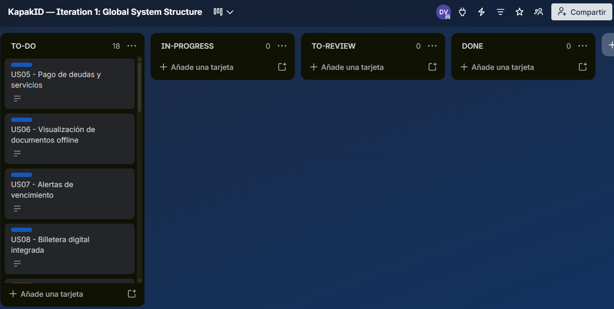

#### 4.3.1.2. Establish Iteration Goal by Selecting Drivers

El objetivo de la Iteration 1 es definir la estructura global del sistema PayID, estableciendo los microservicios principales, el API Gateway, los BFF (Backend for Frontend), el bus de eventos (Kafka), las bases de datos y las integraciones externas, garantizando los atributos de calidad de performance, seguridad, escalabilidad e interoperabilidad.

Para esta iteración se seleccionaron los siguientes drivers arquitectónicos:

- Atributos de calidad: Performance: las recargas de tarjetas de transporte y los pagos de servicios deben procesarse en menos de 2 segundos.
- Seguridad: los documentos personales (DNI, pasaporte, licencia) y las transacciones financieras deben estar cifrados y protegidos con autenticación biométrica.
- Escalabilidad: el sistema debe escalar horizontalmente para soportar el crecimiento de usuarios en Lima Metropolitana.
- Interoperabilidad: el sistema debe integrarse con RENIEC (validación de identidad), SUNAT (validación tributaria), bancos y la pasarela de pagos.

Restricciones:

- Backend en ASP.NET Core y Frontend en Vue, según el stack tecnológico definido por el equipo.
- Base de datos MySQL como persistencia relacional principal.

Preocupaciones arquitectónicas:

- Cumplimiento de la Ley N° 29733 (Ley de Protección de Datos Personales del Perú), garantizando la privacidad de la información de los usuarios.
- Portabilidad cloud, evitando la dependencia de un único proveedor (Azure, AWS o Google Cloud).

#### 4.3.1.3. Choose One or More Elements of the System to Refine

Para la Iteration 1 se seleccionaron los elementos arquitectónicos que serán refinados con el objetivo de establecer la estructura global del sistema PayID. Estos elementos fueron elegidos porque abordan directamente los drivers identificados en la sub-sección anterior (performance, seguridad, escalabilidad e interoperabilidad).

Los elementos seleccionados son:

Componentes de infraestructura:

- API Gateway: punto único de entrada para las aplicaciones móvil y web, encargado de la autenticación, el enrutamiento y el rate limiting.
- BFF Mobile y BFF Web: capas intermedias que adaptan las respuestas del backend según el tipo de cliente (móvil o web).
- Apache Kafka: bus de eventos que permite la comunicación asíncrona entre microservicios.
- Azure Key Vault: servicio para la gestión segura de secretos y claves de cifrado.

Microservicios principales:

- MS Usuarios: gestión de cuentas y autenticación.
- MS Identidad: validación de identidad con RENIEC.
- MS Pagos y Billetera: procesamiento de pagos y recargas.
- MS Académico: validación del estado académico del estudiante.
- MS Compliance: cumplimiento de la Ley N° 29733.
- MS Seguridad: cifrado y biometría.
- MS Notificaciones: envío de alertas y recordatorios.
- MS Auditoría: trazabilidad de transacciones y eventos.

Bases de datos:

- SQL Server (Payment Ledger): registro transaccional de pagos.
- Redis (Cache/Sesiones): caché de sesiones y datos temporales.

Integraciones externas:

- RENIEC: validación de identidad.
- SUNAT: validación tributaria.
- Sistema Universitario: validación del estado académico.
- Pasarela de Pagos: procesamiento de transacciones financieras.
- Proveedor de Notificaciones: envío de SMS, correo y push.

| Nº | Elemento | Tipo | Driver que aborda |
|---|---|---|---|
| 1 | API Gateway | Componente | Performance, Seguridad |
| 2 | BFF Mobile | Componente | Performance |
| 3 | BFF Web | Componente | Performance |
| 4 | MS Usuarios | Microservicio | Seguridad |
| 5 | MS Identidad | Microservicio | Seguridad, Interoperabilidad |
| 6 | MS Pagos y Billetera | Microservicio | Performance, Seguridad |
| 7 | MS Académico | Microservicio | Interoperabilidad |
| 8 | MS Compliance | Microservicio | Seguridad |
| 9 | MS Seguridad | Microservicio | Seguridad |
| 10 | MS Notificaciones | Microservicio | Performance |
| 11 | MS Auditoría | Microservicio | Seguridad |
| 12 | Apache Kafka | Componente | Escalabilidad |
| 13 | SQL Server (Payment Ledger) | Base de datos | Performance, Seguridad |
| 14 | Redis (Cache/Sesiones) | Base de datos | Performance |
| 15 | Azure Key Vault | Componente | Seguridad |

#### 4.3.1.4. Choose One or More Design Concepts That Satisfy the Selected Drivers

Para PayID, una vez identificados los componentes del sistema que requieren refinamiento, el siguiente paso consiste en seleccionar los conceptos de diseño más adecuados que respondan a los drivers arquitectónicos previamente establecidos. Estos conceptos de diseño juegan un papel esencial en guiar el desarrollo de la aplicación y garantizar que se cumplan los objetivos definidos para la iteración de forma eficiente. A continuación, se detallan los conceptos de diseño elegidos para cada uno de los principales drivers:

- Performance:

| Decisión | Justificación |
|---|---|
| API Gateway con Kong | Se implementa un API Gateway como punto único de entrada para centralizar el enrutamiento, el rate limiting y la autenticación. Esto reduce la latencia y evita que cada microservicio gestione estas tareas por separado. |
| BFF (Backend for Frontend) | Se crean dos BFF: uno para la app móvil y otro para la web. Cada uno adapta las respuestas del backend al formato óptimo del cliente, reduciendo el payload y mejorando el tiempo de carga. |
| Cache con Redis | Se utiliza Redis como caché para las consultas frecuentes (ej. saldo de tarjetas, documentos del usuario). Esto reduce la carga sobre MySQL y responde en menos de 100 ms. |
| CQRS para MS Pagos y Billetera | Se separan las operaciones de lectura y escritura en el módulo de pagos. Las consultas de saldo e historial se optimizan en el modelo de lectura, mientras que las transacciones se procesan en el modelo de escritura. |

- Seguridad:

| Decisión | Justificación |
|---|---|
| Autenticación JWT con [ASP.NET](https://asp.net/) Core y Vue | Se implementa JWT para garantizar autenticación segura y escalable. JWT permite sesiones stateless, reduce la carga en la base de datos y es compatible con múltiples dispositivos (móvil y web). |
| Control de Acceso Basado en Roles (RBAC) | Se implementa RBAC para asignar permisos granulares (administrador, estudiante, padre/tutor, comercio). Esto minimiza riesgos de acceso no autorizado a documentos sensibles. |
| Cifrado AES-256 para Datos Sensibles | Se cifran los documentos personales (DNI, pasaporte, licencia) y las transacciones financieras para cumplir con la Ley N° 29733 y proteger la privacidad. |
| Azure Key Vault para Gestión de Secretos | Se utiliza Azure Key Vault para gestionar de forma segura las claves de cifrado, tokens y credenciales de integración (RENIEC, SUNAT, bancos). |
| Cifrado TLS 1.3 en Tránsito | Toda comunicación entre cliente y servidor, y entre microservicios, se cifra con TLS 1.3 para evitar interceptación de datos. |

- Escalabilidad:

| Decisión | Justificación |
|---|---|
| Arquitectura de Microservicios | Se divide el sistema en 8 microservicios independientes (Usuarios, Identidad, Pagos, Académico, Compliance, Seguridad, Notificaciones, Auditoría). Cada uno escala horizontalmente según su demanda. |
| Apache Kafka como Event Bus | Se utiliza Kafka para la comunicación asíncrona entre microservicios. Esto desacopla los servicios y permite manejar picos de tráfico sin afectar el rendimiento. |
| Réplica de MySQL con Read Replicas | Se configuran réplicas de MySQL para distribuir las consultas de lectura y garantizar redundancia ante fallos. |
| Auto-scaling en Kubernetes (AKS) | Se despliega en Azure Kubernetes Service con auto-scaling para agregar o quitar instancias según la carga del sistema. |

- Interoperabilidad:

| Decisión | Justificación |
|---|---|
| Arquitectura Hexagonal (Puertos y Adaptadores) | Cada microservicio se organiza con puertos y adaptadores para aislar la lógica de negocio de las integraciones externas. Si RENIEC cambia su API, solo se modifica el adaptador. |
| Saga Pattern para Transacciones Distribuidas | Se utiliza Saga para coordinar transacciones que involucran varios microservicios (ej. pago + notificación + auditoría). Esto garantiza consistencia eventual. |
| Circuit Breaker con Resilience4j | Se implementa Circuit Breaker para proteger el sistema ante fallos de servicios externos (RENIEC, SUNAT, bancos). Si un servicio falla, se activa un fallback. |
| Adaptadores para RENIEC, SUNAT y Bancos | Se crean adaptadores específicos para cada entidad externa, permitiendo cambiar de proveedor sin afectar la lógica de negocio. |

- Disponibilidad:

| Decisión | Justificación |
|---|---|
| Balanceo de Carga con NGINX | Se distribuye el tráfico entre múltiples instancias del backend para manejar picos de acceso (ej. inicio de mes, quincena). |
| Health Checks Automatizados | Se monitorean los servicios críticos (API de autenticación, MS Pagos) y se reinician instancias fallidas automáticamente. |
| Despliegue Multi-zona en Azure | Se despliega en múltiples zonas de disponibilidad para garantizar que el sistema siga operando ante fallos de una zona. |
| Backups Automatizados de MySQL | Se realizan backups diarios de la base de datos con retención de 30 días. |

#### 4.3.1.5. Instantiate Architectural Elements, Allocate Responsibilities, and Define Interfaces

Una vez seleccionados los conceptos de diseño que satisfacen los drivers arquitectónicos, el siguiente paso consiste en instanciar los elementos arquitectónicos concretos que conformarán el sistema PayID, asignarles sus responsabilidades y definir las interfaces que permitirán su comunicación. A continuación, se detalla cada elemento, su rol dentro del sistema y los endpoints principales que expone.

Instanciando elementos arquitectónicos:

### API GATEWAY

| Aspecto | Detalle |
|---|---|
| Instanciación | Se crea como instancia única (Singleton) en el clúster de Kubernetes, garantizando un punto de entrada centralizado. Se despliega con 3 réplicas para alta disponibilidad. |
| Responsabilidad | Punto único de entrada; enrutamiento, autenticación, rate limiting |
| Interfaces | Expone todos los endpoints del sistema (/api/v1/*) |
| Tecnología | Kong API Gateway |

### BFF MOBILE

| Aspecto | Detalle |
|---|---|
| Instanciación | Se instancia como servicio stateless escalable horizontalmente. Cada instancia atiende un subconjunto de usuarios móviles. |
| Responsabilidad | Adaptar respuestas del backend para la app móvil (Flutter) |
| Interfaces | Endpoints optimizados para móvil |
| Tecnología | [ASP.NET](https://asp.net/) Core |

### BFF WEB

| Aspecto | Detalle |
|---|---|
| Instanciación | Se instancia como servicio stateless escalable horizontalmente. Se despliega en pods independientes de BFF Mobile. |
| Responsabilidad | Adaptar respuestas del backend para la web (Vue) |
| Interfaces | Endpoints optimizados para web |
| Tecnología | [ASP.NET](https://asp.net/) Core |

### MS USUARIOS

| Aspecto | Detalle |
|---|---|
| Instanciación | Se instancia como microservicio independiente con su propia base de datos MySQL. Se despliega con 2 réplicas y auto-scaling hasta 5. |
| Responsabilidad | Gestión de cuentas, registro, login, perfiles |
| Interfaces | /usuarios/registrar, /usuarios/login, /usuarios/{id} |
| Eventos | Publica: UsuarioRegistrado, UsuarioActualizado |
| Tecnología | [ASP.NET](https://asp.net/) Core + MySQL |

### MS IDENTIDAD

| Aspecto | Detalle |
|---|---|
| Instanciación | Se instancia como microservicio independiente con su propia base de datos MySQL. Se integra con RENIEC y SUNAT mediante adaptadores hexagonales. |
| Responsabilidad | Validación de identidad con RENIEC y SUNAT |
| Interfaces | /identidad/validar-dni, /identidad/validar-ruc, /identidad/biometria |
| Eventos | Publica: IdentidadValidada, IdentidadRechazada |
| Tecnología | [ASP.NET](https://asp.net/) Core + MySQL + Adaptadores |

### MS PAGOS Y BILLETERA

| Aspecto | Detalle |
|---|---|
| Instanciación | Se instancia como microservicio transaccional con SQL Server (Payment Ledger) como base de datos. Usa Saga Pattern para coordinar transacciones distribuidas. |
| Responsabilidad | Procesamiento de pagos, recargas, transferencias |
| Interfaces | /pagos/recargar, /pagos/transferir, /pagos/pagar-servicio, /pagos/historial |
| Eventos | Publica: PagoRealizado, RecargaExitosa, TransferenciaCompletada |
| Tecnología | [ASP.NET](https://asp.net/) Core + SQL Server |

### MS ACADÉMICO

| Aspecto | Detalle |
|---|---|
| Instanciación | Se instancia como microservicio independiente con su propia base de datos MySQL. Se integra con SUNEDU mediante adaptador hexagonal. |
| Responsabilidad | Validación del estado académico del estudiante |
| Interfaces | /academico/validar-estudiante, /academico/estado |
| Eventos | Publica: EstudianteValidado |
| Tecnología | [ASP.NET](https://asp.net/) Core + MySQL |

### MS COMPLIANCE

| Aspecto | Detalle |
|---|---|
| Instanciación | Se instancia como microservicio independiente con su propia base de datos MySQL. Se ejecuta como servicio batch para reportes regulatorios. |
| Responsabilidad | Cumplimiento Ley N° 29733 y auditoría regulatoria |
| Interfaces | /compliance/reportes, /compliance/auditar |
| Tecnología | [ASP.NET](https://asp.net/) Core + MySQL |

### MS SEGURIDAD

| Aspecto | Detalle |
|---|---|
| Instanciación | Se instancia como servicio crítico con alta disponibilidad (3 réplicas). Usa Azure Key Vault para gestionar claves y Redis para tokens. |
| Responsabilidad | Cifrado, gestión de tokens, biometría |
| Interfaces | /seguridad/cifrar, /seguridad/descifrar, /seguridad/validar-token |
| Tecnología | [ASP.NET](https://asp.net/) Core + Azure Key Vault + Redis |

### MS NOTIFICACIONES

| Aspecto | Detalle |
|---|---|
| Instanciación | Se instancia como microservicio consumidor de eventos. Escucha Kafka y envía notificaciones de forma asíncrona. |
| Responsabilidad | Envío de SMS, email, push y alertas |
| Interfaces | /notificaciones/enviar, /notificaciones/alertas |
| Eventos | Consume: PagoRealizado, DocumentoProximoAVencer, UsuarioRegistrado |
| Tecnología | [ASP.NET](https://asp.net/) Core + MySQL |

### MS AUDITORÍA

| Aspecto | Detalle |
|---|---|
| Instanciación | Se instancia como microservicio consumidor de todos los eventos. Funciona como Event Store inmutable con base de datos dedicada. |
| Responsabilidad | Registro inmutable de todas las transacciones y eventos |
| Interfaces | /auditoria/eventos, /auditoria/transacciones |
| Eventos | Consume: todos los eventos del sistema |
| Tecnología | [ASP.NET](https://asp.net/) Core + MySQL (Event Store) |

### APACHE KAFKA (EVENT BUS)

| Aspecto | Detalle |
|---|---|
| Instanciación | Se instancia como clúster de Kafka con 3 brokers para alta disponibilidad. Cada topic tiene 3 particiones con replicación 2. |
| Responsabilidad | Bus de eventos para comunicación asíncrona |
| Interfaces | Topics: usuarios, identidad, pagos, academico, notificaciones, auditoria |
| Tecnología | Apache Kafka |

### SQL SERVER (PAYMENT LEDGER)

| Aspecto | Detalle |
|---|---|
| Instanciación | Se instancia como base de datos relacional dedicada al ledger de pagos, con read replicas para consultas y backups automáticos diarios. |
| Responsabilidad | Registro transaccional de pagos |
| Interfaces | Acceso mediante Entity Framework Core desde MS Pagos |
| Tecnología | SQL Server |

### REDIS (CACHE / SESIONES)

| Aspecto | Detalle |
|---|---|
| Instanciación | Se instancia como clúster de Redis con 3 nodos (1 máster + 2 réplicas) para alta disponibilidad. |
| Responsabilidad | Caché de sesiones, saldo de tarjetas, tokens JWT |
| Interfaces | Acceso vía cliente Redis desde microservicios |
| Tecnología | Redis |

### AZURE KEY VAULT

| Aspecto | Detalle |
|---|---|
| Instanciación | Se instancia como servicio gestionado en Azure con acceso restringido por Managed Identity. Se configura con rotación automática de secretos. |
| Responsabilidad | Gestión de secretos, claves de cifrado, credenciales |
| Interfaces | Acceso vía SDK de Azure desde microservicios |
| Tecnología | Azure Key Vault |

Designando responsabilidades de los elementos:

| N.º | Elemento | Responsabilidad Principal | Sub-responsabilidades |
|---|---|---|---|
| 1 | API Gateway | Enrutar todas las solicitudes entrantes | Autenticación, rate limiting, logging, monitoreo |
| 2 | BFF Mobile | Adaptar respuestas para la app móvil | Optimizar payload, gestionar sesión móvil |
| 3 | BFF Web | Adaptar respuestas para la web | Optimizar payload, gestionar sesión web |
| 4 | MS Usuarios | Gestionar cuentas de usuario | Registro, login, perfiles, roles |
| 5 | MS Identidad | Validar identidad de usuarios | DNI (RENIEC), RUC (SUNAT), biometría |
| 6 | MS Pagos y Billetera | Procesar transacciones financieras | Recargas, transferencias, pagos de servicios |
| 7 | MS Académico | Validar estado académico | Carné universitario, SUNEDU |
| 8 | MS Compliance | Garantizar cumplimiento legal | Ley 29733, reportes regulatorios |
| 9 | MS Seguridad | Proteger datos y accesos | Cifrado, tokens, biometría |
| 10 | MS Notificaciones | Enviar notificaciones al usuario | SMS, email, push, alertas |
| 11 | MS Auditoría | Registrar eventos inmutables | Trazabilidad, historial, reportes |
| 12 | Apache Kafka | Comunicar microservicios de forma asíncrona | Publicar y consumir eventos |
| 13 | SQL Server | Almacenar datos transaccionales | Ledger de pagos, historial |
| 14 | Redis | Almacenar datos en caché | Sesiones, tokens, saldos temporales |
| 15 | Azure Key Vault | Gestionar secretos y claves | Cifrado, credenciales, rotación |

Definiendo Interfaces REST:

| Elemento | Endpoint | Método | Descripción | Consumidor |
|---|---|---|---|---|
| API Gateway | /api/v1/auth/* | POST | Autenticación | App móvil, Web |
| API Gateway | /api/v1/usuarios/* | GET, POST, PUT | Gestión de usuarios | BFF Mobile, BFF Web |
| API Gateway | /api/v1/pagos/* | POST | Procesamiento de pagos | BFF Mobile, BFF Web |
| MS Usuarios | /usuarios/registrar | POST | Registrar usuario | API Gateway |
| MS Usuarios | /usuarios/login | POST | Iniciar sesión (genera JWT) | API Gateway |
| MS Identidad | /identidad/validar-dni | POST | Validar DNI con RENIEC | MS Usuarios |
| MS Identidad | /identidad/validar-ruc | POST | Validar RUC con SUNAT | MS Pagos |
| MS Identidad | /identidad/biometria | POST | Validar huella/rostro | MS Usuarios |
| MS Pagos | /pagos/recargar | POST | Recargar tarjeta de transporte | API Gateway |
| MS Pagos | /pagos/transferir | POST | Transferencia P2P | API Gateway |
| MS Pagos | /pagos/pagar-servicio | POST | Pagar deuda o servicio | API Gateway |
| MS Académico | /academico/validar-estudiante | POST | Validar carné universitario | MS Usuarios |
| MS Compliance | /compliance/reportes | GET | Generar reporte de cumplimiento | MS Auditoría |
| MS Seguridad | /seguridad/cifrar | POST | Cifrar datos sensibles | MS Identidad, MS Pagos |
| MS Seguridad | /seguridad/validar-token | POST | Validar JWT | API Gateway |
| MS Notificaciones | /notificaciones/enviar | POST | Enviar notificación | MS Pagos, MS Usuarios |
| MS Auditoría | /auditoria/eventos | GET | Consultar eventos | MS Compliance |

#### 4.3.1.6. Sketch Views (C4 & UML) and Record Design Decisions

Para documentar el diseño arquitectónico de la Iteration 1, se hace referencia a las vistas C4 y UML presentadas en el Capítulo IV. Asimismo, se registran las decisiones de diseño tomadas durante esta iteración, cada una con su justificación alineada a los drivers arquitectónicos seleccionados (performance, seguridad, escalabilidad e interoperabilidad).

Diagrama de Contexto:

| Elemento | Responsabilidad |
|---|---|
| Estudiante | Usa PayID para gestionar documentos personales, recargar tarjetas de transporte y pagar servicios. |
| Padre/Madre o Tutor | Gestiona documentos de sus hijos o familiares desde una sola cuenta. |
| Comercio/Servicio | Negocio afiliado que acepta pagos con QR a través de PayID. |
| Institución Educativa | Universidad que valida credenciales académicas y emite carnés digitales. |
| PayID | Plataforma digital que centraliza identidad, documentos y pagos en una sola aplicación. |
| RENIEC | Sistema externo que valida DNI y datos de identidad. |
| SUNAT | Sistema externo que valida RUC y facturación electrónica. |
| SUNEDU | Sistema externo que valida carné universitario y estado académico. |
| Pasarela de Pagos | Sistema externo que procesa transacciones con Visa y Mastercard. |
| Yape / Plin | Billeteras digitales para pagos P2P. |
| Bancos | Sistema externo para transferencias y conciliación bancaria. |
| Sistema de Transporte | Sistema externo para recarga de tarjetas Metropolitano y Lima Pass. |
| Proveedor de Notificaciones | Sistema externo que envía SMS, email y push. |
| OSE | Sistema externo que emite comprobantes electrónicos validados por SUNAT. |

Diagrama de Contenedores:

| Elemento | Responsabilidad |
|---|---|
| App Móvil | Aplicación móvil para estudiantes y padres (Flutter). |
| Portal Web | Aplicación web para administradores y comercios (Vue.js). |
| API Gateway | Punto único de entrada; enrutamiento, autenticación y rate limiting (Kong). |
| BFF Mobile | Adapta las respuestas del backend para la app móvil. |
| BFF Web | Adapta las respuestas del backend para la web. |
| MS Identidad | Validación de identidad con RENIEC y SUNAT. |
| MS Pagos y Billetera | Procesamiento de pagos, recargas y transferencias. |
| MS Documentos | Gestión de documentos digitales. |
| Apache Kafka | Bus de eventos para comunicación asíncrona. |
| Redis | Caché de sesiones y tokens. |
| SQL Server | Ledger transaccional de pagos. |
| Entidades Gubernamentales | RENIEC, SUNAT y SUNEDU. |
| Pasarelas de Pago | Visa, Mastercard, Yape, Plin, bancos y transporte. |
| Servicios Externos | Notificaciones y OSE. |

Diagrama de Componentes:

| Elemento | Responsabilidad |
|---|---|
| Payment Controller | Expone los endpoints REST para pagos y recargas. |
| Payment Validator | Valida los datos de entrada y las reglas de negocio. |
| Payment Service | Orquesta el procesamiento de pagos. |
| Wallet Service | Gestiona los saldos y movimientos de la billetera digital. |
| Payment Repository | Abstrae el acceso a SQL Server para pagos. |
| Wallet Repository | Abstrae el acceso a datos de billetera. |
| Payment Gateway Adapter | Adapta la integración con pasarelas de pago (Visa, Mastercard, Yape, Plin). |
| Payment Event Publisher | Publica eventos en Kafka (PagoRealizado). |
| SQL Server (Payment Ledger) | Almacena las transacciones financieras. |
| Apache Kafka | Bus de eventos para notificar a otros microservicios. |
| Pasarela de Pagos | Sistema externo que procesa transacciones con tarjeta. |
| Yape / Plin | Billeteras digitales para pagos P2P. |
| Sistema de Transporte | Recarga de tarjetas Metropolitano y Lima Pass. |
| Azure Key Vault | Gestión segura de secretos y claves de cifrado. |

#### 4.3.1.7. Analysis of Current Design and Review Iteration Goal (Kanban Board)

Al cierre de la Iteration 1, se analiza el diseño actual del sistema y se revisa el cumplimiento del objetivo planteado. El tablero Kanban refleja el avance del equipo durante la iteración.

Enlace: [Trello -PayID — Iteration 1: Global System Structure](https://trello.com/invite/b/6ac0277440f8dcdc9077645f/ATTI4fab9412ddb8d1dcead000c1a6c340a84F2E45D5/kapakid-iteration-1-global-system-structure)

### 4.3.2. Iteration 2: Validación de Identidad y Gestión de Documentos Digitales

#### 4.3.2.1. Architectural Design Backlog 2

En la segunda iteración se definió el Architectural Design Backlog enfocado en la gestión de la identidad y de los documentos digitales de PayID. Esta iteración refina los elementos encargados de registrar, validar, almacenar y consultar los documentos de los usuarios, incluyendo la integración con RENIEC, el manejo de la validación pendiente y el acceso sin conexión a documentos verificados.

| Tipo | ID | Descripción |
|---|---|---|
| User Story | US3 | Registro de documentos con validación del DNI en RENIEC. |
| User Story | US2 | Creación de perfiles familiares para administrar documentos de hijos o familiares. |
| User Story | US11 | Acceso a documentos verificados sin conexión a internet. |
| User Story | US17 | API para registrar y consultar documentos. |
| Quality Attribute | QA-04 | Interoperabilidad: si RENIEC no responde en 5 segundos, el documento queda en estado «Pendiente» y se reintenta la validación. |
| Quality Attribute | QA-06 | Usabilidad offline: un documento verificado y descargado se muestra en menos de 3 segundos sin conexión. |
| Quality Attribute | QA-08 | Modificabilidad: agregar un nuevo tipo de documento afecta principalmente al microservicio de documentos. |
| Constraint | CON-05 | El tratamiento de datos personales debe cumplir la Ley N.° 29733. |
| Constraint | CON-06 | PayID depende de servicios externos previstos; en esta iteración aplica a la validación de identidad con RENIEC. |
| Architectural Concern | ARC-01 | Proteger los datos personales y los perfiles familiares con control de acceso. |
| Architectural Concern | ARC-04 | Manejar fallas o demoras de RENIEC sin bloquear al usuario. |
| Architectural Concern | ARC-07 | Proteger los documentos guardados en el celular y sincronizarlos al volver la conexión. |

#### 4.3.2.2. Establish Iteration Goal by Selecting Drivers

El objetivo de la Iteration 2 es refinar la gestión de identidad y documentos de PayID, de modo que el usuario pueda registrar su DNI y otros documentos, validarlos con RENIEC sin quedar bloqueado si el servicio no responde, organizarlos por perfil familiar y consultarlos incluso sin conexión a internet.

Para esta iteración se seleccionaron los siguientes drivers arquitectónicos:

| Tipo de driver | ID | Driver seleccionado |
|---|---|---|
| Atributo de calidad | QA-04 | Interoperabilidad con RENIEC, con estado «Pendiente» y reintentos. |
| Atributo de calidad | QA-06 | Consulta de documentos verificados sin conexión en menos de 3 segundos. |
| Atributo de calidad | QA-08 | Incorporar nuevos tipos de documento sin afectar a otros servicios. |
| Funcionalidad | US3, US2, US11, US17 | Registro, validación, organización por perfil y consulta de documentos. |
| Restricción | CON-05, CON-06 | Ley N.° 29733 y dependencia de servicios externos (RENIEC). |
| Preocupación | ARC-01, ARC-04, ARC-07 | Control de acceso, tolerancia a fallas de RENIEC y almacenamiento local protegido. |

#### 4.3.2.3. Choose One or More Elements of the System to Refine

Para la Iteration 2 se seleccionaron los elementos que participan en el registro, la validación y la consulta de documentos. Se incorpora el MS Documentos como nuevo microservicio, separando la gestión de documentos de la validación de identidad que realiza el MS Identidad.

| Nº | Elemento | Tipo | Driver que aborda |
|---|---|---|---|
| 1 | MS Identidad | Microservicio | QA-04, ARC-04 |
| 2 | MS Documentos (nuevo) | Microservicio | QA-08, US3, US17 |
| 3 | Adaptador RENIEC | Componente | QA-04, CON-06 |
| 4 | Base de datos de documentos (MySQL) | Base de datos | US3, CON-05 |
| 5 | Almacenamiento de archivos (Azure Blob Storage) | Almacenamiento | CON-05, ARC-01 |
| 6 | BFF Mobile | Componente | QA-06 |
| 7 | App móvil (Flutter) – almacenamiento local | Cliente | QA-06, ARC-07 |
| 8 | Apache Kafka | Componente | QA-04 |

#### 4.3.2.4. Choose One or More Design Concepts That Satisfy the Selected Drivers

A continuación, se presentan los conceptos de diseño seleccionados para responder a los drivers de esta iteración, agrupados por atributo de calidad.

1. Interoperabilidad

| Decisión | Justificación |
|---|---|
| Reintentos con espera progresiva (Polly) | Si RENIEC no responde en 5 segundos, se reintenta hasta tres veces con tiempos de espera crecientes, sin bloquear al usuario. |
| Circuit Breaker (Polly) | Si RENIEC falla de forma repetida, se abre el circuito y las nuevas validaciones pasan directamente a estado «Pendiente», evitando sobrecargar el servicio. |
| Validación asíncrona por eventos | El registro del DNI responde de inmediato al usuario. El MS Documentos publica el evento DniValidationRequested solo para los DNI; el MS Identidad procesa la validación en segundo plano y publica su resultado en Kafka. |

2. Modificabilidad

| Decisión | Justificación |
|---|---|
| Microservicio de documentos independiente | La lógica de documentos se separa del MS Identidad, de modo que agregar un tipo de documento solo afecta al MS Documentos. |
| Patrón Strategy por tipo de documento | Cada tipo de documento (DNI, pasaporte, licencia, carné) tiene sus propias reglas de validación, que se agregan sin modificar el código existente. |
| Máquina de estados del documento | El documento pasa por estados definidos: Registrado → Pendiente → Verificado o Rechazado. Esto ordena las reglas y facilita las pruebas. |

3. Usabilidad offline

| Decisión | Justificación |
|---|---|
| Almacenamiento local cifrado en Flutter | Los documentos verificados se guardan en el celular con cifrado (flutter_secure_storage y base local cifrada), permitiendo mostrarlos sin conexión en menos de 3 segundos. |
| Paquete offline desde el BFF Mobile | El BFF Mobile entrega solo los documentos verificados y sus datos esenciales, reduciendo el tamaño de la descarga. |
| Sincronización al volver la conexión | La app compara versiones con el servidor y actualiza los documentos que cambiaron. |

4. Seguridad y privacidad

| Decisión | Justificación |
|---|---|
| Control de acceso por titular y perfil familiar | Cada solicitud verifica que el usuario sea el titular del documento o el responsable del perfil familiar. |
| Cifrado de archivos en reposo | Las imágenes de los documentos se guardan cifradas en Azure Blob Storage, con claves administradas en Azure Key Vault. |

#### 4.3.2.5. Instantiate Architectural Elements, Allocate Responsibilities, and Define Interfaces

En esta etapa se instancian los elementos refinados, se asignan sus responsabilidades y se definen las interfaces de comunicación.

Elementos instanciados y responsabilidades:

| Elemento | Responsabilidades |
|---|---|
| MS Identidad | Recibir solicitudes de validación del DNI, consultar a RENIEC mediante su adaptador, manejar reintentos y publicar el resultado de la validación. |
| MS Documentos | Registrar, consultar y actualizar documentos; gestionar sus estados; asociarlos al titular o a un perfil familiar; generar el paquete offline. |
| Adaptador RENIEC | Traducir las solicitudes de PayID al formato del servicio de RENIEC y aplicar las políticas de reintento y Circuit Breaker. |
| Base de datos de documentos (MySQL) | Guardar los metadatos de cada documento: tipo, número, fechas, estado y perfil asociado. |
| Azure Blob Storage | Guardar de forma cifrada las imágenes o archivos de los documentos. |
| BFF Mobile | Adaptar las respuestas para la app móvil y entregar el paquete de documentos para uso offline. |
| App móvil (Flutter) | Mostrar los documentos, guardarlos cifrados en el dispositivo y sincronizarlos al recuperar la . |

Interfaces REST:

| Método | Endpoint | Descripción |
|---|---|---|
| POST | /api/v1/documents | Registra un documento del usuario o de un perfil familiar. |
| GET | /api/v1/documents?profileId={id} | Lista los documentos del usuario o de un perfil familiar. |
| GET | /api/v1/documents/{id} | Consulta el detalle de un documento. |
| POST | /api/v1/identity/validations | Solicita la validación del DNI con RENIEC. |
| GET | /api/v1/identity/validations/{id} | Consulta el estado de una validación (Pendiente, Verificado o Rechazado). |
| GET | /mobile/v1/documents/offline-package | Entrega los documentos verificados para uso sin conexión. |

Eventos de dominio publicados en Apache Kafka:

| Evento | Publicado por | Consumido por |
|---|---|---|
| DocumentRegistered | MS Documentos | MS Auditoría |
| DniValidationRequested | MS Documentos (solo cuando el documento es un DNI) | MS Identidad |
| IdentityValidated | MS Identidad | MS Documentos, MS Notificaciones |
| IdentityValidationPending | MS Identidad | MS Documentos, MS Notificaciones |
| IdentityValidationRejected | MS Identidad | MS Documentos, MS Notificaciones |

#### 4.3.2.6. Sketch Views (C4 & UML) and Record Design Decisions

Las vistas de esta iteración representan los elementos refinados y su interacción. Se recomienda incluir los siguientes diagramas:

- Diagrama C4 de componentes del MS Documentos y del MS Identidad, con el adaptador de RENIEC.
- Diagrama de secuencia del registro del DNI: registro, validación con RENIEC, caso «Pendiente» con reintentos y notificación del resultado.
- Diagrama de estados del documento: Registrado, Pendiente, Verificado y Rechazado.

Registro de decisiones de diseño:

| ID | Decisión | Alternativa descartada | Motivo |
|---|---|---|---|
| DD-2.1 | Separar MS Documentos del MS Identidad | Mantener todo en MS Identidad | Agregar tipos de documento no debe afectar la validación de identidad (QA-08). |
| DD-2.2 | Validación asíncrona con eventos | Validación síncrona esperando a RENIEC | Evita bloquear al usuario cuando RENIEC demora (QA-04, ARC-04). |
| DD-2.3 | Polly para reintentos y Circuit Breaker | Reintentos manuales en el código | Polly es la librería estándar de resiliencia en .NET y se configura por políticas. |
| DD-2.4 | Almacenamiento local cifrado en Flutter | Guardar los documentos sin cifrar | Protege los datos personales en el celular (CON-05, ARC-07). |

#### 4.3.2.7. Analysis of Current Design and Review Iteration Goal (Kanban Board)

Al cierre de la Iteration 2, se analiza el diseño actual y se revisa el avance de los drivers seleccionados. Se utilizan tres estados: Diseñado, cuando existe una solución arquitectónica definida; Parcial, cuando falta completar o definir algún aspecto; y Validado, cuando existen pruebas o evidencias que demuestran su cumplimiento. Los drivers pasarán a Validado con las evidencias del capítulo V.

| Driver | Estado | Observación |
|---|---|---|
| QA-04 | Diseñado | La validación asíncrona, los reintentos y el estado «Pendiente» evitan bloquear al usuario. |
| QA-06 | Diseñado | El paquete offline y el almacenamiento local cifrado permiten consultar documentos sin conexión. |
| QA-08 | Diseñado | El MS Documentos y el patrón Strategy aíslan los cambios por tipo de documento. |
| ARC-07 | Parcial | Falta validar la sincronización con pruebas en dispositivos reales. |

### 4.3.3. Iteration 3: Pagos, Recargas y Billetera Digital

#### 4.3.3.1. Architectural Design Backlog 3

En la tercera iteración se definió el Architectural Design Backlog enfocado en las operaciones de pago y recarga de PayID. Esta iteración refina los elementos que procesan las recargas de tarjetas de transporte, el pago de servicios y deudas, la billetera digital y el historial de transacciones, considerando la integración con la pasarela de pagos y los operadores de transporte.

| Tipo | ID | Descripción |
|---|---|---|
| User Story | US5 | Recarga de tarjetas de transporte. |
| User Story | US6 | Pago de deudas de servicios o multas. |
| User Story | US7 | Historial de transacciones. |
| User Story | US19 | Billetera digital y recargas mediante flujo guiado. |
| Quality Attribute | QA-01 | Rendimiento: PayID registra la operación y muestra su estado en menos de 2 segundos. |
| Quality Attribute | QA-03 | Escalabilidad: 1 000 usuarios concurrentes sin aumentar más de 20 % el tiempo de respuesta. |
| Quality Attribute | QA-05 | Disponibilidad: los servicios críticos siguen operando si falla un servicio no crítico. |
| Constraint | CON-06 | PayID depende de servicios externos previstos; en esta iteración aplica a la pasarela de pagos y a los operadores de transporte. |
| Architectural Concern | ARC-03 | Mantener la consistencia de saldos y movimientos en operaciones distribuidas. |
| Architectural Concern | ARC-04 | Manejar fallas o demoras de la pasarela de pagos sin bloquear al usuario. |

#### 4.3.3.2. Establish Iteration Goal by Selecting Drivers

El objetivo de la Iteration 3 es refinar el procesamiento de pagos y recargas de PayID, de modo que cada operación se registre y muestre su estado en menos de 2 segundos, que no se dupliquen cobros ante reintentos y que los saldos y movimientos se mantengan consistentes aunque falle la pasarela de pagos.

Para esta iteración se seleccionaron los siguientes drivers arquitectónicos:

| Tipo de driver | ID | Driver seleccionado |
|---|---|---|
| Atributo de calidad | QA-01 | Respuesta al usuario en menos de 2 segundos. |
| Atributo de calidad | QA-03 | Soportar 1 000 usuarios concurrentes en fechas de alta demanda. |
| Atributo de calidad | QA-05 | Los pagos siguen funcionando aunque falle un servicio no crítico. |
| Funcionalidad | US5, US6, US7, US19 | Recargas, pagos, historial y billetera digital. |
| Restricción | CON-06 | Dependencia de servicios externos (pasarela de pagos y operadores de transporte). |
| Preocupación | ARC-03, ARC-04 | Consistencia de saldos y tolerancia a fallas externas. |

#### 4.3.3.3. Choose One or More Elements of the System to Refine

Para la Iteration 3 se seleccionaron los elementos que intervienen en el flujo de una operación de pago o recarga, desde que el usuario la confirma hasta que se registra en su historial.

| Nº | Elemento | Tipo | Driver que aborda |
|---|---|---|---|
| 1 | MS Pagos y Billetera | Microservicio | QA-01, ARC-03 |
| 2 | Adaptador de pasarela de pagos | Componente | CON-06, ARC-04 |
| 3 | Adaptador de operador de transporte | Componente | CON-06 |
| 4 | Base de datos de pagos (Payment Ledger) | Base de datos | ARC-03 |
| 5 | Modelo de lectura del historial | Base de datos | QA-01, US7 |
| 6 | Redis | Caché | QA-01, QA-03 |
| 7 | Apache Kafka | Componente | QA-05, ARC-03 |
| 8 | BFF Mobile | Componente | QA-01, US19 |

#### 4.3.3.4. Choose One or More Design Concepts That Satisfy the Selected Drivers

A continuación, se presentan los conceptos de diseño seleccionados para responder a los drivers de esta iteración, agrupados por atributo de calidad.

1. Rendimiento

| Decisión | Justificación |
|---|---|
| Registro inmediato y confirmación asíncrona | PayID registra la operación con estado «Procesando» y responde al usuario de inmediato; la confirmación de la pasarela llega después como evento. Así se cumple el tiempo de 2 segundos. |
| CQRS para el historial | Las consultas de historial y saldos se leen de un modelo de lectura optimizado, separado de las operaciones de escritura. |
| Caché con Redis | Las tarjetas registradas y el último saldo consultado se guardan temporalmente en Redis para mostrar la billetera más rápido. |

2. Consistencia

| Decisión | Justificación |
|---|---|
| Patrón Saga (orquestación) | El MS Pagos coordina los pasos de la operación (registro, cobro, recarga y notificación). Si un paso falla, ejecuta acciones de compensación, como anular el cobro. |
| Claves de idempotencia | Cada operación lleva una clave única (Idempotency-Key). Si el cliente o el sistema reintenta, no se genera un segundo cobro. |
| Patrón Outbox | El registro de la operación y el evento a publicar se guardan en la misma transacción de base de datos, evitando eventos perdidos. |

3. Disponibilidad y escalabilidad

| Decisión | Justificación |
|---|---|
| Circuit Breaker hacia la pasarela | Si la pasarela falla de forma repetida, se suspenden temporalmente nuevas llamadas y se informa al usuario, sin afectar al resto del sistema. |
| Escalamiento horizontal del MS Pagos | En fechas de alta demanda se agregan instancias del MS Pagos de forma automática. |
| Comunicación por eventos | Las notificaciones y la auditoría se procesan de forma asíncrona, de modo que su falla no detiene los pagos. |

#### 4.3.3.5. Instantiate Architectural Elements, Allocate Responsibilities, and Define Interfaces

En esta etapa se instancian los elementos que participan en las operaciones financieras de PayID y se definen sus interfaces.

Elementos instanciados y responsabilidades:

| Elemento | Responsabilidades |
|---|---|
| MS Pagos y Billetera | Registrar operaciones, coordinar la saga de pago o recarga, aplicar las claves de idempotencia y publicar los eventos del resultado. |
| Adaptador de pasarela de pagos | Traducir las solicitudes de PayID al formato de la pasarela y recibir sus confirmaciones. |
| Adaptador de operador de transporte | Consultar saldos y enviar recargas a las tarjetas de transporte compatibles. |
| Payment Ledger | Guardar cada operación con su estado, monto, medio de pago y clave de idempotencia. |
| Modelo de lectura del historial | Mostrar al usuario sus recargas y pagos ordenados por fecha. |
| Redis | Guardar temporalmente tarjetas y saldos consultados con frecuencia. |
| BFF Mobile | Adaptar la billetera y el flujo guiado de recarga para la app móvil. |

Interfaces REST:

| Método | Endpoint | Descripción |
|---|---|---|
| GET | /api/v1/wallet/cards | Lista las tarjetas de transporte registradas y el último saldo disponible, cuando el operador proporcione dicha información. |
| POST | /api/v1/payments/top-ups | Registra una recarga de transporte. Requiere el encabezado Idempotency-Key. |
| POST | /api/v1/payments/debts/{id}/pay | Registra el pago de una deuda de servicios o multas. |
| GET | /api/v1/payments/{id} | Consulta el estado de una operación (Procesando, Aprobada o Rechazada). |
| GET | /api/v1/transactions?page={n} | Consulta el historial de recargas y pagos del usuario. |

Eventos de dominio publicados en Apache Kafka:

| Evento | Publicado por | Consumido por |
|---|---|---|
| PaymentRequested | MS Pagos y Billetera | MS Auditoría |
| PaymentApproved | MS Pagos y Billetera | MS Notificaciones, MS Auditoría |
| PaymentRejected | MS Pagos y Billetera | MS Notificaciones, MS Auditoría |
| BalanceUpdated | MS Pagos y Billetera | BFF Mobile (actualización de la billetera) |

#### 4.3.3.6. Sketch Views (C4 & UML) and Record Design Decisions

Las vistas de esta iteración representan los elementos refinados y su interacción. Se recomienda incluir los siguientes diagramas:

- Diagrama C4 de componentes del MS Pagos y Billetera con sus adaptadores externos.
- Diagrama de secuencia de una recarga: registro con idempotencia, cobro en la pasarela, recarga en el operador y notificación.
- Diagrama de secuencia de la compensación cuando la recarga falla después del cobro.

Registro de decisiones de diseño:

| ID | Decisión | Alternativa descartada | Motivo |
|---|---|---|---|
| DD-3.1 | Saga orquestada por el MS Pagos | Saga por coreografía | Facilita seguir el estado de cada operación y aplicar compensaciones (ARC-03). |
| DD-3.2 | Claves de idempotencia | Validar duplicados solo en la pasarela | Evita cobros dobles ante reintentos del cliente o del sistema. |
| DD-3.3 | Confirmación asíncrona | Esperar la respuesta de la pasarela | Permite responder en menos de 2 segundos (QA-01). |
| DD-3.4 | CQRS para el historial | Consultar directamente el Payment Ledger | Las consultas frecuentes no afectan el registro de nuevas operaciones. |

#### 4.3.3.7. Analysis of Current Design and Review Iteration Goal (Kanban Board)

Al cierre de la Iteration 3, se analiza el diseño actual y se revisa el avance de los drivers seleccionados. Se utilizan tres estados: Diseñado, cuando existe una solución arquitectónica definida; Parcial, cuando falta completar o definir algún aspecto; y Validado, cuando existen pruebas o evidencias que demuestran su cumplimiento. Los drivers pasarán a Validado con las evidencias del capítulo V.

| Driver | Estado | Observación |
|---|---|---|
| QA-01 | Diseñado | La confirmación asíncrona permite responder en menos de 2 segundos. |
| QA-03 | Parcial | El escalamiento horizontal está definido; falta validarlo con pruebas de carga. |
| QA-05 | Diseñado | La comunicación por eventos aísla la falla de los servicios no críticos. |
| ARC-03 | Diseñado | La saga, la idempotencia y el Outbox mantienen la consistencia de saldos. |

Enlace: [Agregar enlace del tablero de la Iteration 3]

### 4.3.4. Iteration 4: Seguridad, Autenticación y Protección de Datos

#### 4.3.4.1. Architectural Design Backlog 4

En la cuarta iteración se definió el Architectural Design Backlog enfocado en la seguridad de PayID. Esta iteración refina los elementos responsables de la autenticación de los usuarios, el control de acceso a los documentos y perfiles familiares, la protección de los datos personales y la auditoría de las operaciones críticas.

| Tipo | ID | Descripción |
|---|---|---|
| User Story | US1 | Registro de usuario. |
| User Story | US22 | Inicio de sesión con bloqueo por intentos fallidos. |
| User Story | US16 | API de autenticación con token de acceso. |
| Quality Attribute | QA-02 | Seguridad: tras 5 intentos fallidos, la cuenta se bloquea por 15 minutos y se avisa al titular. |
| Constraint | CON-05 | El tratamiento de datos personales debe cumplir la Ley N.° 29733. |
| Architectural Concern | ARC-01 | Controlar quién puede acceder a los datos personales y perfiles familiares. |
| Architectural Concern | ARC-05 | Proteger contraseñas, claves de cifrado y credenciales mediante un gestor de secretos. |
| Architectural Concern | ARC-06 | Registrar en auditoría las operaciones críticas sin guardar información sensible innecesaria. |

[Insertar captura de las tarjetas del Architectural Design Backlog 4 (Trello o Miro)]

#### 4.3.4.2. Establish Iteration Goal by Selecting Drivers

El objetivo de la Iteration 4 es refinar la seguridad de PayID, de modo que solo los usuarios autenticados y autorizados accedan a sus documentos y a los de sus perfiles familiares, que los intentos de acceso indebido se bloqueen, que los datos personales se protejan conforme a la Ley N.° 29733 y que las operaciones críticas queden registradas.

Para esta iteración se seleccionaron los siguientes drivers arquitectónicos:

| Tipo de driver | ID | Driver seleccionado |
|---|---|---|
| Atributo de calidad | QA-02 | Bloqueo temporal de la cuenta tras 5 intentos fallidos. |
| Funcionalidad | US1, US22, US16 | Registro, inicio de sesión y autenticación por token. |
| Restricción | CON-05 | Cumplimiento de la Ley N.° 29733. |
| Preocupación | ARC-01, ARC-05, ARC-06 | Control de acceso, gestión de secretos y auditoría. |

#### 4.3.4.3. Choose One or More Elements of the System to Refine

Para la Iteration 4 se seleccionaron los elementos que intervienen en la autenticación, la autorización, la protección de datos y la trazabilidad de PayID.

| Nº | Elemento | Tipo | Driver que aborda |
|---|---|---|---|
| 1 | MS Usuarios | Microservicio | US1, US22 |
| 2 | MS Seguridad | Microservicio | QA-02, US16 |
| 3 | API Gateway | Componente | ARC-01 |
| 4 | Azure Key Vault | Componente | ARC-05 |
| 5 | MS Compliance | Microservicio | CON-05 |
| 6 | MS Auditoría | Microservicio | ARC-06 |
| 7 | Redis | Caché | QA-02 |

#### 4.3.4.4. Choose One or More Design Concepts That Satisfy the Selected Drivers

A continuación, se presentan los conceptos de diseño seleccionados para responder a los drivers de esta iteración, agrupados por atributo de calidad.

1. Autenticación

| Decisión | Justificación |
|---|---|
| JWT con token de acceso y de renovación | El token de acceso dura poco tiempo y el de renovación permite mantener la sesión sin volver a ingresar la contraseña. |
| Contraseñas con hash seguro | Las contraseñas se guardan con un algoritmo de hash con sal (ASP.NET Core Identity), nunca en texto plano. |
| Bloqueo temporal con contador en Redis | Cada intento fallido se cuenta en Redis; al quinto, la cuenta se bloquea 15 minutos y se notifica al titular (QA-02). |

2. Autorización

| Decisión | Justificación |
|---|---|
| Control de acceso basado en roles (RBAC) | Se definen roles como estudiante, padre o apoderado, comercio y administrador, cada uno con sus permisos. |
| Políticas por titular y perfil familiar | Además del rol, cada solicitud verifica que el usuario sea el titular del recurso o el responsable del perfil familiar (ARC-01). |
| Validación del token en el API Gateway | El API Gateway rechaza las solicitudes sin token válido antes de que lleguen a los microservicios. |

3. Protección de datos

| Decisión | Justificación |
|---|---|
| Cifrado AES-256 en reposo y TLS en tránsito | Los datos sensibles se cifran al guardarse y toda comunicación usa HTTPS/TLS. |
| Azure Key Vault con rotación de claves | Las claves de cifrado y las credenciales externas se guardan fuera del código y se renuevan periódicamente (ARC-05). |
| Gestión de consentimiento (MS Compliance) | Se registra el consentimiento del usuario y se atienden los derechos de acceso, rectificación, cancelación y oposición (Ley N.° 29733). |

4. Trazabilidad

| Decisión | Justificación |
|---|---|
| Registro de auditoría de solo escritura | El MS Auditoría guarda inicios de sesión, pagos y cambios en documentos sin permitir modificaciones posteriores. |
| Exclusión de datos sensibles en la auditoría | No se registran contraseñas, tokens completos ni números de documento completos (ARC-06). |

#### 4.3.4.5. Instantiate Architectural Elements, Allocate Responsibilities, and Define Interfaces

En esta etapa se instancian los elementos de seguridad de PayID, se asignan sus responsabilidades y se definen sus interfaces.

Elementos instanciados y responsabilidades:

| Elemento | Responsabilidades |
|---|---|
| MS Usuarios | Registrar cuentas, gestionar perfiles de usuario y roles. |
| MS Seguridad | Validar credenciales, emitir y renovar tokens, controlar los intentos fallidos y bloquear cuentas. |
| API Gateway | Validar el token de cada solicitud, aplicar límites de solicitudes y enrutar al microservicio correspondiente. |
| Azure Key Vault | Guardar claves de cifrado, secretos y credenciales de servicios externos. |
| MS Compliance | Registrar consentimientos y atender solicitudes sobre derechos de datos personales. |
| MS Auditoría | Guardar el registro de operaciones críticas sin datos sensibles. |
| Redis | Guardar el contador de intentos fallidos y el estado de bloqueo temporal. |

Interfaces REST:

| Método | Endpoint | Descripción |
|---|---|---|
| POST | /api/v1/users | Registra una nueva cuenta de usuario. |
| POST | /api/v1/auth/login | Valida credenciales y entrega los tokens de acceso y de renovación. |
| POST | /api/v1/auth/refresh | Renueva el token de acceso. |
| POST | /api/v1/auth/logout | Cierra la sesión e invalida el token de renovación. |
| GET | /api/v1/compliance/consents | Consulta los consentimientos otorgados por el usuario. |

Eventos de dominio publicados en Apache Kafka:

| Evento | Publicado por | Consumido por |
|---|---|---|
| UserRegistered | MS Usuarios | MS Compliance, MS Auditoría |
| LoginFailed | MS Seguridad | MS Auditoría |
| AccountLocked | MS Seguridad | MS Notificaciones, MS Auditoría |
| ConsentUpdated | MS Compliance | MS Auditoría |

#### 4.3.4.6. Sketch Views (C4 & UML) and Record Design Decisions

Las vistas de esta iteración representan los elementos refinados y su interacción. Se recomienda incluir los siguientes diagramas:

- Diagrama C4 de componentes del MS Seguridad y el MS Usuarios, con el API Gateway y Azure Key Vault.
- Diagrama de secuencia del inicio de sesión: credenciales correctas, credenciales incorrectas y bloqueo al quinto intento.
- Diagrama de secuencia de una solicitud autorizada a un documento de un perfil familiar.

Registro de decisiones de diseño:

| ID | Decisión | Alternativa descartada | Motivo |
|---|---|---|---|
| DD-4.1 | JWT con token de renovación | Sesiones en el servidor | Permite sesiones sin estado y escalables para móvil y web. |
| DD-4.2 | Contador de intentos en Redis | Contador en la base de datos | Es más rápido y permite expirar el bloqueo automáticamente a los 15 minutos. |
| DD-4.3 | RBAC con políticas por titular | Solo RBAC | El rol no basta: un padre solo debe ver los perfiles de su propia familia (ARC-01). |
| DD-4.4 | Azure Key Vault | Guardar secretos en archivos de configuración | Evita exponer credenciales en el código fuente (ARC-05). |

#### 4.3.4.7. Analysis of Current Design and Review Iteration Goal (Kanban Board)

Al cierre de la Iteration 4, se analiza el diseño actual y se revisa el avance de los drivers seleccionados. Se utilizan tres estados: Diseñado, cuando existe una solución arquitectónica definida; Parcial, cuando falta completar o definir algún aspecto; y Validado, cuando existen pruebas o evidencias que demuestran su cumplimiento. Los drivers pasarán a Validado con las evidencias del capítulo V.

| Driver | Estado | Observación |
|---|---|---|
| QA-02 | Diseñado | El contador en Redis bloquea la cuenta 15 minutos al quinto intento fallido. |
| ARC-01 | Diseñado | RBAC y las políticas por titular limitan el acceso a cada perfil. |
| ARC-05 | Diseñado | Las claves y credenciales se gestionan en Azure Key Vault. |
| CON-05 | Parcial | El consentimiento está definido; falta validar el proceso completo de derechos ARCO. |

### 4.3.5. Iteration 5: Notificaciones, Alertas y Seguimiento de Trámites

#### 4.3.5.1. Architectural Design Backlog 5

En la quinta iteración se definió el Architectural Design Backlog enfocado en la comunicación con el usuario. Esta iteración refina los elementos que generan las alertas de vencimiento, informan los cambios de estado de los trámites de renovación, muestran el centro de notificaciones y supervisan el funcionamiento del sistema.

| Tipo | ID | Descripción |
|---|---|---|
| User Story | US4 | Solicitud y seguimiento de la renovación de documentos. |
| User Story | US9 | Alerta de vencimiento de documentos. |
| User Story | US10 | Notificaciones sobre trámites. |
| User Story | US21 | Centro de notificaciones. |
| Quality Attribute | QA-05 | Disponibilidad: si falla el MS Notificaciones, pagos y documentos siguen funcionando. |
| Architectural Concern | ARC-04 | Manejar fallas del proveedor de notificaciones y de las entidades emisoras. |
| Architectural Concern | ARC-08 | Contar con monitoreo y registros centralizados. |

[Insertar captura de las tarjetas del Architectural Design Backlog 5 (Trello o Miro)]

#### 4.3.5.2. Establish Iteration Goal by Selecting Drivers

El objetivo de la Iteration 5 es refinar el sistema de notificaciones de PayID, de modo que el usuario reciba a tiempo las alertas de vencimiento y los cambios de estado de sus trámites, pueda consultarlas en el centro de notificaciones y que una falla en el envío no afecte a los demás servicios.

Para esta iteración se seleccionaron los siguientes drivers arquitectónicos:

| Tipo de driver | ID | Driver seleccionado |
|---|---|---|
| Atributo de calidad | QA-05 | Aislamiento de fallas del MS Notificaciones. |
| Funcionalidad | US4, US9, US10, US21 | Seguimiento de renovaciones, alertas y centro de notificaciones. |
| Preocupación | ARC-04, ARC-08 | Tolerancia a fallas externas y observabilidad. |

#### 4.3.5.3. Choose One or More Elements of the System to Refine

Para la Iteration 5 se seleccionaron los elementos que generan, envían y muestran las notificaciones, así como los que permiten supervisar el sistema.

| Nº | Elemento | Tipo | Driver que aborda |
|---|---|---|---|
| 1 | MS Notificaciones | Microservicio | QA-05, US9, US10, US21 |
| 2 | Proceso programado de vencimientos | Componente | US9 |
| 3 | MS Documentos | Microservicio | US4 |
| 4 | Adaptador del proveedor de notificaciones | Componente | ARC-04 |
| 5 | Base de datos de notificaciones (Inbox) | Base de datos | US21 |
| 6 | Apache Kafka | Componente | QA-05 |
| 7 | Plataforma de monitoreo | Componente | ARC-08 |

#### 4.3.5.4. Choose One or More Design Concepts That Satisfy the Selected Drivers

A continuación, se presentan los conceptos de diseño seleccionados para responder a los drivers de esta iteración, agrupados por atributo de calidad.

1. Disponibilidad

| Decisión | Justificación |
|---|---|
| Consumidores de eventos independientes | El MS Notificaciones consume eventos de Kafka; si falla, los eventos quedan en cola y se procesan al recuperarse, sin afectar pagos ni documentos. |
| Cola de mensajes fallidos (Dead Letter Queue) | Las notificaciones que no se pudieron enviar tras varios reintentos se guardan aparte para revisarlas. |
| Consumidor idempotente | Si un evento llega dos veces, la notificación no se duplica. |

2. Funcionalidad

| Decisión | Justificación |
|---|---|
| Proceso programado diario | Un proceso en segundo plano revisa cada día los documentos próximos a vencer (30 días) o vencidos y genera las alertas (US9). |
| Estados de la solicitud de renovación | La solicitud pasa por los estados Registrada, En trámite y Finalizada; cada cambio genera una notificación (US4, US10). |
| Inbox persistente | Todas las notificaciones se guardan y se muestran ordenadas de la más reciente a la más antigua (US21). |

3. Observabilidad

| Decisión | Justificación |
|---|---|
| Registros y métricas centralizados (OpenTelemetry y Azure Monitor) | Todos los servicios envían sus registros, métricas y trazas a un mismo lugar para detectar errores y medir tiempos de respuesta (ARC-08). |
| Alertas técnicas | El equipo recibe avisos cuando un servicio falla o supera los tiempos esperados. |

#### 4.3.5.5. Instantiate Architectural Elements, Allocate Responsibilities, and Define Interfaces

En esta etapa se instancian los elementos de notificación y monitoreo de PayID, se asignan sus responsabilidades y se definen sus interfaces.

Elementos instanciados y responsabilidades:

| Elemento | Responsabilidades |
|---|---|
| MS Notificaciones | Consumir eventos, generar notificaciones, enviarlas por push, correo o SMS y guardarlas en el Inbox. |
| Proceso programado de vencimientos | Revisar diariamente las fechas de vencimiento y publicar los eventos de alerta. |
| MS Documentos | Registrar las solicitudes de renovación y actualizar su estado. |
| Adaptador del proveedor de notificaciones | Enviar los mensajes al proveedor externo y aplicar reintentos. |
| Inbox | Guardar las notificaciones de cada usuario y su estado de lectura. |
| Plataforma de monitoreo | Centralizar registros, métricas y trazas, y avisar al equipo ante fallas. |

Interfaces REST:

| Método | Endpoint | Descripción |
|---|---|---|
| GET | /api/v1/notifications?page={n} | Lista las notificaciones del usuario, de la más reciente a la más antigua. |
| PATCH | /api/v1/notifications/{id}/read | Marca una notificación como leída. |
| POST | /api/v1/documents/{id}/renewals | Registra una solicitud de renovación de documento. |
| GET | /api/v1/renewals/{id} | Consulta el estado de una solicitud de renovación. |

Eventos de dominio publicados en Apache Kafka:

| Evento | Publicado por | Consumido por |
|---|---|---|
| DocumentExpiring | Proceso programado | MS Notificaciones |
| DocumentExpired | Proceso programado | MS Notificaciones, MS Documentos |
| RenewalStatusChanged | MS Documentos | MS Notificaciones |
| PaymentApproved | MS Pagos y Billetera | MS Notificaciones |

#### 4.3.5.6. Sketch Views (C4 & UML) and Record Design Decisions

Las vistas de esta iteración representan los elementos refinados y su interacción. Se recomienda incluir los siguientes diagramas:

- Diagrama C4 de componentes del MS Notificaciones con el proceso programado y el adaptador del proveedor.
- Diagrama de secuencia de la alerta de vencimiento: proceso programado, evento, notificación e Inbox.
- Diagrama de secuencia del seguimiento de una renovación con sus cambios de estado.

Registro de decisiones de diseño:

| ID | Decisión | Alternativa descartada | Motivo |
|---|---|---|---|
| DD-5.1 | Notificaciones por eventos | Llamadas directas desde cada servicio | Aísla las fallas del envío (QA-05). |
| DD-5.2 | Proceso programado diario | Revisar el vencimiento en cada consulta | Genera las alertas aunque el usuario no abra la app. |
| DD-5.3 | Dead Letter Queue | Descartar las notificaciones fallidas | Permite revisar y reenviar los mensajes que no llegaron. |
| DD-5.4 | OpenTelemetry con Azure Monitor | Registros separados por servicio | Centraliza la información para detectar errores rápido (ARC-08). |

#### 4.3.5.7. Analysis of Current Design and Review Iteration Goal (Kanban Board)

Al cierre de la Iteration 5, se analiza el diseño actual y se revisa el avance de los drivers seleccionados. Se utilizan tres estados: Diseñado, cuando existe una solución arquitectónica definida; Parcial, cuando falta completar o definir algún aspecto; y Validado, cuando existen pruebas o evidencias que demuestran su cumplimiento. Los drivers pasarán a Validado con las evidencias del capítulo V.

| Driver | Estado | Observación |
|---|---|---|
| QA-05 | Diseñado | Los eventos en cola evitan que una falla de notificaciones afecte a otros servicios. |
| US9, US10, US21 | Diseñado | El proceso programado, los estados de renovación y el Inbox cubren las historias. |
| ARC-08 | Diseñado | La plataforma de monitoreo centraliza registros y métricas. |
| ARC-04 | Parcial | Falta definir el proveedor de notificaciones y sus límites de envío. |

Enlace: [Agregar enlace del tablero de la Iteration 5]

# CAPÍTULO V: Product Implementation, Validation & Deployment

## 5.1. Testing Suites & General Patterns

En esta sección se describen las pruebas y los patrones aplicados en la implementación de PayID. Las pruebas permiten comprobar que cada microservicio cumple los criterios de aceptación de las historias de usuario y los escenarios de calidad definidos en el capítulo IV.

### 5.1.1. Backend Application Core Testing Suite

La suite de pruebas del backend se organiza en tres niveles:

| Nivel | Herramientas | Qué se prueba |
|---|---|---|
| Pruebas unitarias | xUnit, Moq, FluentAssertions | Reglas del dominio: estados del documento, bloqueo tras 5 intentos fallidos, cálculo de alertas de vencimiento e idempotencia de pagos. |
| Pruebas de integración | WebApplicationFactory, Testcontainers (MySQL) | Endpoints REST de cada microservicio con una base de datos real en contenedor. |
| Pruebas de aceptación | Reqnroll (SpecFlow), Gherkin | Escenarios de aceptación de las historias de usuario, escritos en el mismo formato Given/When/Then del capítulo III. |

Relación entre historias de usuario y pruebas:

| US | Escenario de aceptación | Tipo de prueba | Estado |
|---|---|---|---|
| US3 | Registro y validación con RENIEC; validación pendiente | Integración y aceptación | Pendiente: no hay pruebas del módulo de documentos en PayID-Backend. |
| US22 | Inicio de sesión exitoso, credenciales incorrectas y bloqueo | Unitaria y aceptación | Implementado: UserLockoutTests.cs, LoginUserQueryHandlerTests.cs y US22_InicioSesion.feature (72df77c). Resultado de ejecución pendiente de captura. |
| US5 | Recarga individual exitosa y datos inválidos | Integración y aceptación | Pendiente: no hay pruebas de recarga en PayID-Backend. |
| US16 | Credenciales válidas e inválidas (HTTP 401) | Integración | Implementado: US16_Autenticacion.feature con AuthStepDefinitions.cs y PayIdApiFactory.cs (72df77c). Resultado de ejecución pendiente de captura. |
| US17 | Registro y consulta mediante API | Integración | Pendiente: no hay pruebas en PayID-Backend. |

Además, US01_Registro.feature y RegisterUserValidatorTests.cs cubren el registro de usuario (US1). La carpeta tests/PayId.Tests no incluye pruebas con Testcontainers.

### 5.1.2. Pattern Based Backend Application(s)

Los microservicios de PayID aplican los patrones definidos en las iteraciones ADD:

| Patrón | Dónde se aplica | Propósito |
|---|---|---|
| Domain-Driven Design (capas) | Todos los microservicios | Separar dominio, aplicación, infraestructura e interfaces. |
| Arquitectura hexagonal (puertos y adaptadores) | MS Identidad, MS Pagos y Billetera | Aislar la lógica de negocio de RENIEC, la pasarela y los operadores. |
| Repository y Unit of Work | Todos los microservicios | Encapsular el acceso a MySQL mediante Entity Framework Core. |
| CQRS | MS Pagos y Billetera | Separar el historial (lectura) del registro de operaciones (escritura). |
| Saga y Outbox | MS Pagos y Billetera | Mantener la consistencia de las operaciones distribuidas. |
| Strategy | MS Documentos | Aplicar reglas distintas por tipo de documento. |
| Circuit Breaker y Retry (Polly) | Adaptadores externos | Tolerar fallas de servicios externos. |

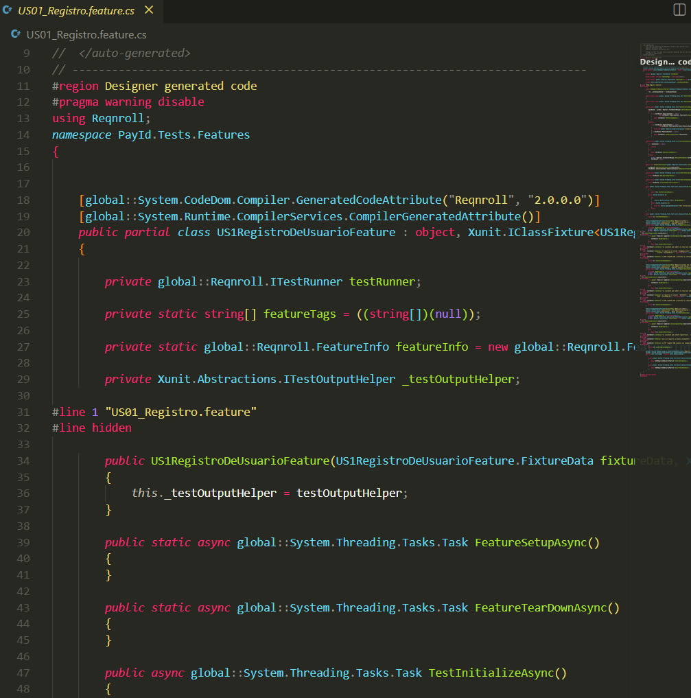

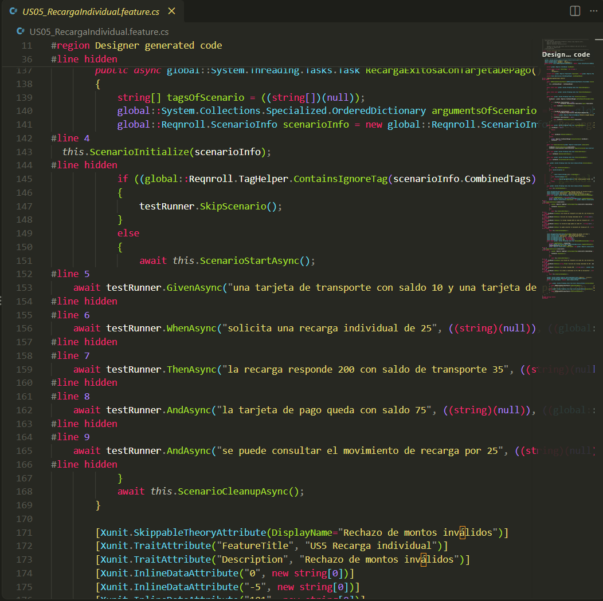

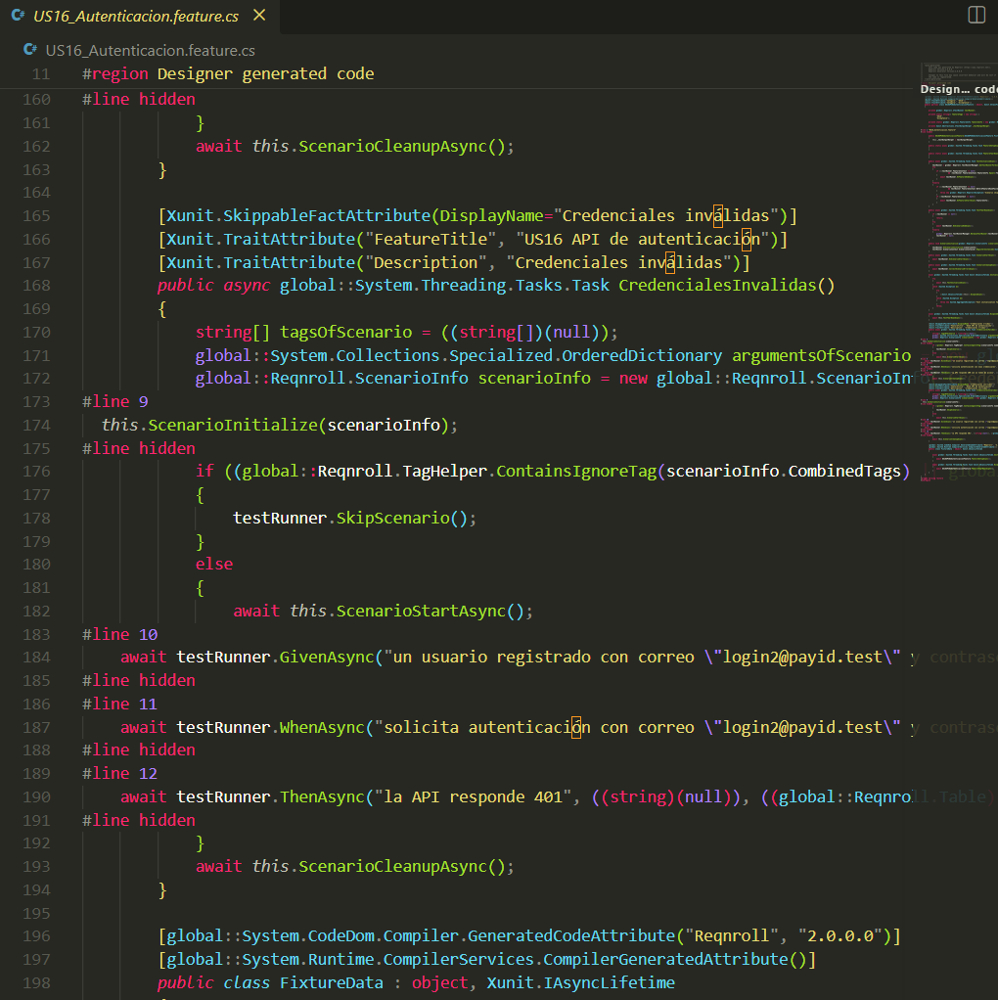

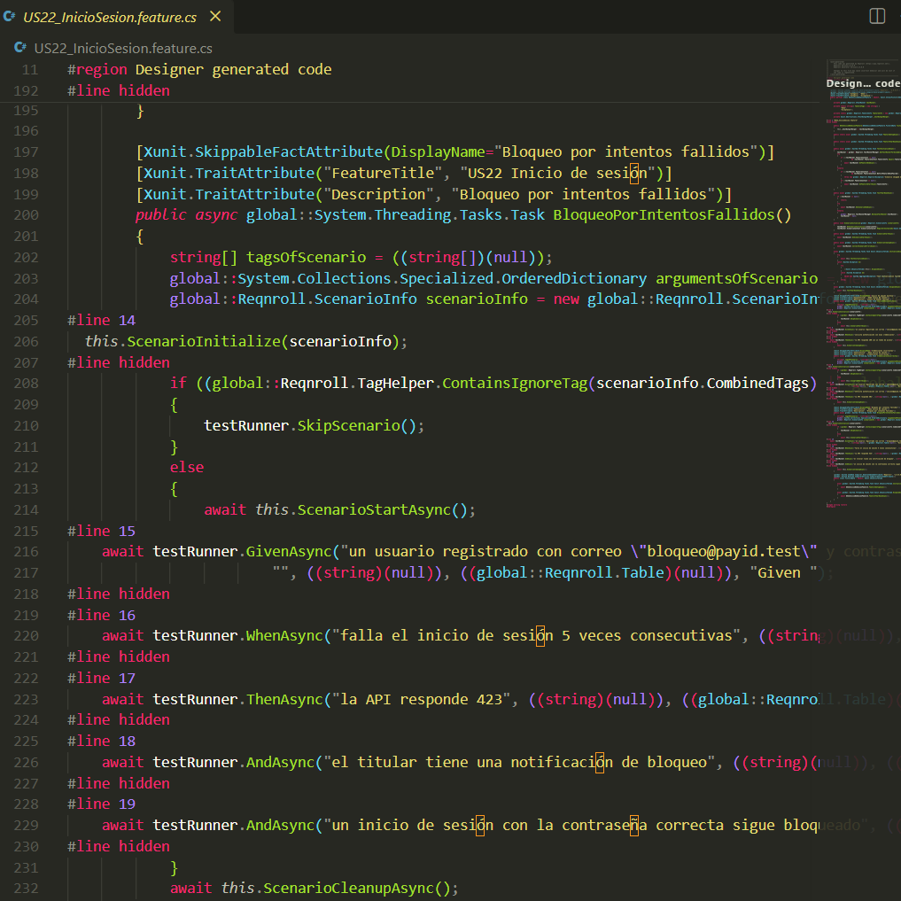

### 5.1.3. Pattern Based Custom Software Library

Para evitar repetir código entre microservicios, se propone una librería compartida (PayID.Shared), distribuida como paquete NuGet interno, con los siguientes componentes:

- Clases base de entidades y objetos de valor del dominio.
- Contratos de eventos de dominio publicados en Kafka.
- Políticas de resiliencia comunes (reintentos y Circuit Breaker) basadas en Polly.
- Manejo estandarizado de errores y respuestas de la API.
- Configuración común de registros y trazas (OpenTelemetry).

### 5.1.4. Framework Pattern Driven Refactoring Report

En esta sección se registran las refactorizaciones realizadas durante el desarrollo para aplicar los patrones del framework ASP.NET Core. Cada fila debe corresponder a un cambio real del repositorio.

| Nº | Componente | Problema detectado | Patrón aplicado | Commit / enlace |
|---|---|---|---|---|
| 1 | PayID-Backend: módulo Authentication | Contexto de datos con el nombre heredado FinTrackDbContext y validaciones de registro dentro del handler. | Renombrado a PayIdDbContext con PayIdDbContextFactory; validación separada en RegisterUserValidator; abstracción IClock para el bloqueo por intentos (inyección de dependencias). | 72df77c (05/10/2026) |
| 2 | PayID-Backend: configuración | Swagger disponible solo en Development y sin configuración de despliegue. | Configuración por entorno en Program.cs, render.yaml y Dockerfile ajustado; Swagger expuesto en el entorno desplegado. | 662d5e3 (03/11/2026) |

## 5.2. Software Configuration Management

En esta sección se describen las herramientas, convenciones y configuraciones que el equipo utiliza para desarrollar, versionar y desplegar PayID de forma ordenada.

### 5.2.1. Software Development Environment Configuration

| Actividad | Herramienta | Propósito |
|---|---|---|
| Gestión del proyecto | Jira, Trello | Product Backlog, sprints y tableros Kanban. |
| Diseño de UX/UI | Figma | Wireframes, mock-ups y prototipos. |
| Diagramas de arquitectura | Structurizr, Lucidchart, Miro | Diagramas C4, UML y EventStorming. |
| Desarrollo backend | Visual Studio 2022 o JetBrains Rider, .NET | Microservicios en ASP.NET Core (C#). |
| Desarrollo web | Visual Studio Code, Node.js | Aplicación web en Vue. |
| Desarrollo móvil | Android Studio, Flutter SDK | Aplicación móvil en Flutter. |
| Base de datos | MySQL Server, MySQL Workbench | Persistencia relacional mediante Entity Framework Core (Pomelo). |
| Pruebas de API | Swagger (OpenAPI), Postman | Documentación y prueba de los endpoints. |
| Contenedores | Docker, Docker Compose | Ejecución local de microservicios, Kafka, Redis y MySQL. |
| Control de versiones | Git, GitHub | Repositorios y colaboración del equipo. |

### 5.2.2. Source Code Management

El código de PayID se gestiona en una organización de GitHub, con un repositorio por cada producto:

| Repositorio | Contenido | Enlace |
|---|---|---|
| payid-landing-page | Landing page | https://github.com/Fundamentos-de-Arquitectura-PayId/PayID-Landing-Page |
| payid-web | Aplicación web (Vue) | https://github.com/Fundamentos-de-Arquitectura-PayId/PayID-Frontend-Web-Application |
| payid-mobile | Aplicación móvil (Flutter) | https://github.com/Fundamentos-de-Arquitectura-PayId/PayID-Mobile-App |
| payid-backend | Microservicios (ASP.NET Core) | https://github.com/Fundamentos-de-Arquitectura-PayId/PayID-Backend (privado) |

Los diagramas C4 se mantienen en https://github.com/Fundamentos-de-Arquitectura-PayId/StructurizrCodePayID y el informe en https://github.com/Fundamentos-de-Arquitectura-PayId/KapakID-Project-Report. En la práctica, GitFlow se aplica de forma parcial: PayID-Backend y KapakID-Project-Report tienen ramas develop y feature/, mientras que la landing page, la aplicación web y la aplicación móvil trabajan solo sobre main.

Se utiliza el flujo de trabajo GitFlow:

- main: versión estable en producción.
- develop: integración de las funcionalidades terminadas.
- feature/<nombre>: desarrollo de una funcionalidad o historia de usuario (por ejemplo, feature/us22-login).
- release/<versión>: preparación de una nueva versión.
- hotfix/<versión>: corrección urgente sobre producción.

Las versiones siguen Semantic Versioning (MAJOR.MINOR.PATCH) y los mensajes de commit siguen Conventional Commits (por ejemplo, feat: agrega bloqueo por intentos fallidos).

### 5.2.3. Source Code Style Guide & Conventions

| Lenguaje / tecnología | Guía de referencia | Convenciones principales |
|---|---|---|
| C# (ASP.NET Core) | Microsoft C# Coding Conventions | PascalCase para clases y métodos, camelCase para variables, interfaces con prefijo I. |
| Dart (Flutter) | Effective Dart | lowerCamelCase para variables, UpperCamelCase para clases, archivos en snake_case. |
| Vue / JavaScript | Vue Style Guide | Componentes en PascalCase con nombres de varias palabras. |
| HTML y CSS | Google HTML/CSS Style Guide | Indentación de 2 espacios y nombres de clases en minúsculas con guiones. |
| Gherkin | Gherkin Conventions | Escenarios con Given, When y Then, en el mismo formato del capítulo III. |
| Idioma del código | — | Código en inglés; documentación y comentarios funcionales en español. |

### 5.2.4. Software Deployment Configuration

El despliegue de PayID se organiza de la siguiente manera:

| Producto | Plataforma de despliegue | Configuración |
|---|---|---|
| Landing page | GitHub Pages o Netlify | Despliegue automático al actualizar la rama main. |
| Aplicación web | Azure Static Web Apps | Compilación de Vue y publicación automática. |
| Microservicios | Azure Kubernetes Service (AKS) | Imágenes Docker publicadas en Azure Container Registry y desplegadas mediante GitHub Actions. |
| Base de datos | Azure Database for MySQL | Instancia gestionada con copias de seguridad automáticas. |
| Aplicación móvil | Archivo APK de prueba | Generado con flutter build apk para las pruebas del equipo. |

#### 5.2.4.1. Container Packaging and Deployment Evidence

La versión del backend de PayID incluye los archivos necesarios para preparar su empaquetado como una aplicación ASP.NET Core ejecutable mediante contenedores. La principal evidencia corresponde al Dockerfile ubicado en la raíz del proyecto, que define una construcción multietapa.

Esta configuración separa la restauración de dependencias, compilación y publicación del entorno utilizado para ejecutar la aplicación.

| Etapa | Elemento identificado | Propósito |
|---|---|---|
| Base de ejecución | mcr.microsoft.com/dotnet/aspnet:9.0 | Proporcionar el runtime de ASP.NET Core. |
| Construcción | mcr.microsoft.com/dotnet/sdk:9.0 | Restaurar dependencias y compilar el proyecto. |
| Publicación | dotnet publish | Generar los archivos necesarios para distribuir el backend. |
| Ejecución final | dotnet FinTrackBack.dll | Iniciar la aplicación dentro del contenedor. |

El Dockerfile declara los puertos 8080 y 8081. Su publicación hacia el equipo anfitrión o la infraestructura de destino requiere una configuración adicional al iniciar el contenedor. La declaración de estos puertos tampoco configura por sí misma una conexión HTTPS.

La aplicación utiliza MySQL mediante Entity Framework Core y el proveedor Pomelo. Durante el arranque se ejecuta Database.Migrate(), por lo que el entorno debe proporcionar conectividad con la base de datos y permisos suficientes para aplicar las migraciones pendientes.

Los parámetros necesarios para configurar el despliegue son los siguientes:

| Parámetro | Finalidad |
|---|---|
| ConnectionStrings__DefaultConnection | Establecer la conexión con MySQL. |
| JwtSettings__Secret | Proporcionar la clave utilizada para firmar los tokens. |
| JwtSettings__Issuer | Definir el emisor de los tokens. |
| JwtSettings__Audience | Definir la audiencia esperada. |
| ASPNETCORE_ENVIRONMENT | Seleccionar el entorno de ejecución. |

La documentación Swagger se habilita únicamente en el entorno Development. Su disponibilidad en las pruebas locales puede utilizarse para comprobar que la API expone las operaciones previstas.

La revisión del código permite acreditar la existencia de una configuración de empaquetado, pero el material entregado no incluye registros de construcción de la imagen, publicación en un registro de contenedores ni ejecución en una plataforma remota.

| Evidencia | Estado |
|---|---|
| Dockerfile multietapa | Presente en el proyecto. |
| Configuración de conexión y autenticación | Lectura de parámetros implementada en Program.cs. |
| Migraciones de base de datos | Presentes en el proyecto. |
| Construcción exitosa de la imagen | Pendiente de evidencia de ejecución. |
| Contenedor en funcionamiento | Pendiente de evidencia de ejecución. |
| URL del backend desplegado | No incluida en el material revisado. |
| Pipeline de despliegue | No incluido en el material revisado. |

Para completar la evidencia del Sprint Review deberán incorporarse una captura de la construcción exitosa, una captura del contenedor en funcionamiento y una solicitud HTTP que demuestre la disponibilidad del backend en el entorno de destino.

### 5.2.5. Backend Code Structure and Conventions

El código fuente del backend de PayID se organiza mediante módulos funcionales y convenciones de C# que facilitan su lectura, mantenimiento y extensión. Los módulos Authentication, Documents, Payments, Wallet, Notifications y Support agrupan los componentes según sus responsabilidades dentro de la aplicación.

En varios módulos se utiliza una estructura de capas compuesta por Application, Domain, Infrastructure e Interfaces. Application contiene los casos de uso y objetos de transferencia; Domain agrupa las entidades y contratos del dominio; Infrastructure implementa la persistencia y los servicios técnicos; e Interfaces expone las operaciones HTTP.

Las principales convenciones identificadas en el proyecto se presentan a continuación:

| Elemento | Convención | Ejemplo del proyecto |
|---|---|---|
| Clases | PascalCase y nombres relacionados con su responsabilidad. | AuthController, DocumentRepository. |
| Interfaces | Prefijo I seguido de un nombre en PascalCase. | IPasswordHasher, IPaymentRepository. |
| Métodos | PascalCase. | GenerateToken, VerifyPassword. |
| Parámetros y variables locales | camelCase. | userId, passwordHash. |
| Campos privados | Prefijo _ y nombre en camelCase. | _context, _mediator. |
| Propiedades | PascalCase. | UserId, CreatedAt, DocumentNumber. |
| Comandos | Sufijo Command. | RegisterUserCommand, CreateDocumentCommand. |
| Consultas | Sufijo Query. | LoginUserQuery, GetDocumentsByUserIdQuery. |
| Manejadores de solicitudes | Sufijo Handler. | RegisterUserCommandHandler. |
| Objetos de transferencia | Sufijo Dto. | UserDto, DocumentDto. |
| Métodos asíncronos propios | Sufijo Async cuando corresponde. | AddPaymentAsync, GetByUserIdAsync. |

Para las operaciones de entrada y salida se utiliza programación asíncrona mediante async y await. Asimismo, diversos handlers reciben un CancellationToken, que permite propagar la cancelación a las operaciones de persistencia que lo admiten.

La inyección de dependencias se configura en Program.cs y permite proporcionar repositorios, servicios de seguridad y manejadores de solicitudes. Los controladores que utilizan MediatR delegan el procesamiento a los handlers, reduciendo la lógica contenida en la capa HTTP.

Como parte de la uniformización del código, se establece la necesidad de mantener una única convención para los namespaces, la capitalización de carpetas y la ubicación de los controladores. Actualmente se observan diferencias como Features y features, así como controladores ubicados en API/Controllers y en Interfaces/REST/Controllers.

También se requiere unificar progresivamente los identificadores técnicos que conservan el nombre FinTrackBack, considerando que el producto documentado es PayID. Los cambios en nombres de propiedades expuestas por la API deberán preservar la compatibilidad con sus consumidores.

Para facilitar la aplicación de estas convenciones, se propone incorporar un archivo .editorconfig y verificar el formato durante la revisión del código. Los comentarios deberán explicar decisiones relevantes, mientras que los nombres de clases y métodos deberán comunicar claramente su propósito.

## 5.3. Microservices Implementation

### 5.3.1. Sprint 1

#### 5.3.1.1. Sprint Backlog 1

Sprint Goal: Publicar la landing page de PayID y la base técnica del backend y de la app móvil, con el registro e inicio de sesión de usuarios funcionando.

| US | Título | Tarea | Estimación (h) | Responsable | Estado |
|---|---|---|---|---|---|
| US12 | Información de funcionalidades | Sección de funcionalidades en la landing page | Pendiente | Mallqui Vilca, Dhilsen (según commit 6d89002) | To-do |
| US15 | Acceso a la aplicación | Botones de registro e inicio de sesión | Pendiente | Mallqui Vilca, Dhilsen (según commit 6d89002) | To-do |
| US13 | Consulta de términos y políticas | Páginas legales y enlaces en el footer | Pendiente | Mallqui Vilca, Dhilsen (según commit 6d89002) | To-do |
| US14 | Visualización de testimonios | Sección de testimonios | Pendiente | Mallqui Vilca, Dhilsen (según commit 6d89002) | To-do |
| US16 | API de autenticación | Endpoint de login con JWT | Pendiente | Mallqui Vilca, Dhilsen (según commit 72df77c) | To-do |
| US1 | Registro de usuario | Endpoint y pantalla de registro | Pendiente | Mallqui Vilca, Dhilsen (según commit 72df77c) | To-do |
| US22 | Inicio de sesión | Pantalla de login y bloqueo por intentos | Pendiente | Mallqui Vilca, Dhilsen (según commit 72df77c) | To-do |
| US18 | Configuración de la arquitectura Flutter | Navegación, estado y cliente HTTP | Pendiente | Pendiente (el primer commit de la app móvil es del 30/10/2026, en el Sprint 2) | To-do |

[Pendiente] Captura del Sprint Backlog 1 en Trello: no se encuentra en los repositorios ni en el documento.

#### 5.3.1.2. Development Evidence for Sprint Review

En esta sección se presentan los commits realizados durante el Sprint 1.

| Repositorio | Branch | Commit ID | Mensaje del commit | Fecha | Autor |
|---|---|---|---|---|---|
| PayID-Backend | develop | 072597c | first commit --> BACKEND .NET | 16/09/2026 | Tasayco Osorio, Raul |
| PayID-Backend | develop | 72df77c | feat: publica la API de cuentas de PayID | 05/10/2026 | Mallqui Vilca, Dhilsen |
| PayID-Backend | main | 3717a80 | fix: implementacion de backend PayID | 05/10/2026 | Mallqui Vilca, Dhilsen |
| PayID-Backend | develop | 89d2a09 | fix: implementacion de backend PayID | 05/10/2026 | Mallqui Vilca, Dhilsen |
| PayID-Frontend-Web-Application | main | 818ac7d | web application frontend vue PayID | 16/09/2026 | Tasayco Osorio, Raul |
| PayID-Landing-Page | main | 6d89002 | feat(landing): publish the PayID landing page | 07/10/2026 | Mallqui Vilca, Dhilsen |

Fuente: historial de Git de los repositorios de la organización (git log --all), consultado el 22/11/2026. Solo se incluyen commits de los cuatro integrantes.

#### 5.3.1.3. Testing Suite Evidence for Sprint Review

En esta sección se presentan los commits de las pruebas desarrolladas durante el Sprint 1.

| Repositorio | Branch | Commit ID | Mensaje del commit | Fecha | Autor |
|---|---|---|---|---|---|
| PayID-Backend | develop | 72df77c | feat: publica la API de cuentas de PayID | 05/10/2026 | Mallqui Vilca, Dhilsen |

El commit 72df77c incorpora tests/PayId.Tests: pruebas unitarias (LoginUserQueryHandlerTests, RegisterUserValidatorTests, UserLockoutTests) y escenarios BDD en Gherkin (US01_Registro.feature, US16_Autenticacion.feature, US22_InicioSesion.feature). [Pendiente] Captura de la ejecución de dotnet test.

#### 5.3.1.4. Execution Evidence for Sprint Review

En esta sección se presentan capturas de las funcionalidades implementadas en el Sprint 1 en ejecución.

[Pendiente] Capturas de ejecución del Sprint 1: no se encuentran en los repositorios. Las funcionalidades a evidenciar son la landing page (6d89002) y la API de cuentas (72df77c).

#### 5.3.1.5. Microservices Documentation Evidence for Sprint Review

En esta sección se documentan los endpoints implementados en el Sprint 1 mediante Swagger (OpenAPI).

| Endpoint | Método | Descripción | Parámetros | Respuesta |
|---|---|---|---|---|
| /api/Auth/register | POST | Registra un usuario con correo y contraseña. | Body: RegisterUserCommand | 201 Created: { id, message }; 400 con errores de validación |
| /api/Auth/login | POST | Inicia sesión y devuelve el token JWT; bloquea la cuenta tras intentos fallidos. | Body: LoginUserQuery | 200 OK con token; 401 credenciales inválidas; respuesta de bloqueo con LockoutEndUtc |
| /api/Documents | POST | Registra un documento del usuario. | Body: CreateDocumentCommand | 200 OK: DocumentDto |
| /api/Documents/user/{userId} | GET | Lista los documentos de un usuario. | Path: userId (GUID) | 200 OK: lista de DocumentDto |
| /api/Notifications | POST | Crea una notificación. | Body: CreateNotificationCommand | 201 Created: NotificationDto |
| /api/Notifications/user/{userId} | GET | Lista las notificaciones de un usuario. | Path: userId (GUID) | 200 OK: lista de NotificationDto |
| /api/Notifications/{id} | GET | Consulta una notificación (sin implementar, devuelve 404). | Path: id (GUID) | 404 Not Found |
| /api/Payments/user/{userId} | GET | Lista los pagos de un usuario. | Path: userId (GUID) | 200 OK: lista de PaymentDto; 404 si no hay pagos |
| /api/Payments | POST | Registra un pago. | Body: PaymentDto | 201 Created; 400 si el monto es menor o igual a cero |
| /api/Support/tickets | POST | Crea un ticket de soporte. | Body: CreateSupportTicketCommand | 201 Created: SupportTicketDto |
| /api/Support/tickets/{id} | GET | Consulta un ticket (sin implementar, devuelve 404). | Path: id (GUID) | 404 Not Found |
| /api/Wallet/payment-cards | POST | Registra una tarjeta de pago. | Body: CreatePaymentCardCommand | 200 OK: { id } |
| /api/Wallet/payment-cards/user/{userId} | GET | Lista las tarjetas de pago del usuario. | Path: userId (GUID) | 200 OK |
| /api/Wallet/payment-cards/update-balance | PUT | Actualiza el saldo de una tarjeta de pago. | Body: UpdatePaymentBalanceCommand | 200 OK: { success }; 404 |
| /api/Wallet/payment-cards/pay-debt | PUT | Paga una deuda con una tarjeta. | Body: PayDebtCommand | 200 OK; 400 saldo insuficiente |
| /api/Wallet/transport-cards | POST | Registra una tarjeta de transporte. | Body: CreateTransportCardCommand | 200 OK: { id } |
| /api/Wallet/transport-cards/user/{userId} | GET | Lista las tarjetas de transporte del usuario. | Path: userId (GUID) | 200 OK |
| /api/Wallet/transport-cards/update-balance | PUT | Actualiza el saldo de una tarjeta de transporte. | Body: UpdateTransportBalanceCommand | 200 OK: { success }; 404 |
| /api/Wallet/transport-cards/{id}/recharge | POST | Recarga una tarjeta de transporte. | Path: id; Body: RechargeTransportCardRequest | 200 OK; 400 con mensaje de error |
| /api/Wallet/transport-cards/{id}/transactions | GET | Lista los movimientos de una tarjeta de transporte. | Path: id (GUID) | 200 OK; 404 |

Endpoints presentes en PayID-Backend al cierre del Sprint 1 (commit 3717a80 en main). Todos los módulos se ejecutan en un solo servicio ASP.NET Core; todavía no están separados en microservicios. [Pendiente] Captura de Swagger UI.

#### 5.3.1.6. Software Deployment Evidence for Sprint Review

En esta sección se presentan las evidencias del despliegue realizado en el Sprint 1.

[Pendiente] En el Sprint 1 no hay evidencia de despliegue del backend en la nube. La landing page incluye vercel.json (6d89002); la URL pública no figura en el repositorio.

#### 5.3.1.7. Team Collaboration Insights during Sprint

En esta sección se muestran las contribuciones de cada integrante en los repositorios durante el Sprint 1.

| Integrante | Repositorios (commits) | Total | Observación |
|---|---|---|---|
| Mora Blas, Diego Alonzo | — | 0 | Sin commits registrados en los repositorios de la organización en este sprint. |
| Mallqui Vilca, Dhilsen Armil | PayID-Backend (3), PayID-Landing-Page (1) | 4 |  |
| Taquiri Calderón, Jhunior Giussepe | — | 0 | Sin commits registrados en los repositorios de la organización en este sprint. |
| Tasayco Osorio, Raul Hiroshi | PayID-Backend (1), PayID-Frontend-Web-Application (1) | 2 |  |

Fuente: historial de Git de los repositorios de la organización (git log --all), consultado el 22/11/2026. Solo se incluyen commits de los cuatro integrantes.

#### 5.3.1.8. Kanban Board

En esta sección se presenta el tablero Kanban con el estado final de las tareas del Sprint 1.

[Pendiente] Captura del tablero Kanban del Sprint 1: no se encuentra en los repositorios ni en el documento.

### 5.3.2. Sprint 2

#### 5.3.2.1. Sprint Backlog 2

Sprint Goal: Implementar los microservicios de Pagos y Billetera y de Documentos de PayID, exponer sus endpoints mediante el API Gateway y habilitar el primer despliegue del backend en la nube, de modo que el usuario pueda recargar saldo, consultar sus documentos y verificar su identidad a traves de la aplicacion movil y la web.

| US | Titulo | Tarea | Est. (h) | Responsable | Estado |
|---|---|---|---|---|---|
| US5 | Recarga de saldo | Endpoint POST /api/v1/wallet/recharge con validacion de monto y persistencia en MySQL | 8 | Mora Blas, Diego | Done |
| US6 | Transferencia entre usuarios | Endpoint POST /api/v1/wallet/transfer con verificacion de saldo y registro en historial | 10 | Mora Blas, Diego | Done |
| US11 | Historial de transacciones | Endpoint GET /api/v1/wallet/transactions con paginacion | 6 | Mora Blas, Diego | Done |
| US2 | Registro de documentos | Endpoint POST /api/v1/documents con validacion de tipo y datos del documento | 8 | Mallqui Vilca, Dhilsen | Done |
| US3 | Consulta de documentos | Endpoint GET /api/v1/documents y GET /api/v1/documents/{id} con detalle de vencimiento | 6 | Mallqui Vilca, Dhilsen | Done |
| US7 | Actualizacion de perfil | Endpoint PUT /api/v1/users/{id}/profile con validacion de datos personales | 5 | Taquiri Calderon, Jhunior | Done |
| US8 | Cambio de PIN de seguridad | Endpoint PUT /api/v1/users/{id}/pin con verificacion del PIN actual y hash del nuevo | 5 | Taquiri Calderon, Jhunior | Done |
| US17 | Registro de dispositivos | Endpoint POST /api/v1/devices para registrar dispositivos de confianza del usuario | 4 | Taquiri Calderon, Jhunior | Done |
| ARQ | API Gateway | Configuracion de Ocelot con enrutamiento a MS Identidad, MS Pagos y MS Documentos | 6 | Tasayco Osorio, Raul | Done |
| ARQ | Eventos Kafka | Configuracion de Apache Kafka para publicar eventos PaymentCompleted y DocumentRegistered | 8 | Tasayco Osorio, Raul | In Progress |
| US5 | Pantalla Billetera (Flutter) | Pantalla de recarga y transferencia con validacion de formulario en Flutter | 6 | Mora Blas, Diego | Done |
| US11 | Pantalla Historial (Vue) | Vista de historial de transacciones en la aplicacion web con filtros por fecha | 6 | Tasayco Osorio, Raul | Done |
| US2 | Pantalla Documentos (Flutter) | Pantalla de lista y detalle de documentos con alerta de vencimiento en Flutter | 6 | Mallqui Vilca, Dhilsen | Done |
| US7 | Pantalla Perfil (Flutter) | Pantalla de edicion de perfil con actualizacion en tiempo real en Flutter | 5 | Taquiri Calderon, Jhunior | Done |
| ARQ | Pipeline CI/CD | Workflow de GitHub Actions para build, test, push de imagen Docker y deploy en AKS | 8 | Tasayco Osorio, Raul | Done |
| ARQ | Azure Key Vault | Configuracion de secrets (ConnectionString, JwtSecret) en Azure Key Vault | 4 | Tasayco Osorio, Raul | Done |

Link de Trello: [Spring Backlog 2 - Trello](https://trello.com/invite/b/6ae922c2a7c77496543a9a3f/ATTI46745ab6ebc9f0b817457660056d15ef4015E82C/payid-sprint-2)

#### 5.3.2.2. Development Evidence for Sprint Review

A continuacion se presentan los commits realizados durante el Sprint 2 en los repositorios del proyecto PayID. Segun el cronograma del curso, el Sprint 2 se cierra con el Avance 3 (semana 10), por lo que abarca del 12/10/2026 al 01/11/2026.

| Repositorio | Branch | Commit ID | Mensaje del commit | Fecha | Autor |
|---|---|---|---|---|---|
| PayID-Mobile-App | main | afcd54a | Initial commit | 30/10/2026 | Taquiri Calderón, Jhunior |
| PayID-Mobile-App | main | d9ca2c8 | chore: initialize Flutter mobile project configuration and runners | 30/10/2026 | Taquiri Calderón, Jhunior |
| PayID-Mobile-App | main | d486428 | chore: configure project dependencies and localization | 30/10/2026 | Taquiri Calderón, Jhunior |
| PayID-Mobile-App | main | cc09dc5 | feat: establish PayID design system tokens and theme | 30/10/2026 | Taquiri Calderón, Jhunior |
| PayID-Mobile-App | main | 371db65 | feat: add core network client, storage services and reusable UI widgets | 30/10/2026 | Taquiri Calderón, Jhunior |
| PayID-Mobile-App | main | 3547755 | feat: implement application routing and shell navigation | 30/10/2026 | Taquiri Calderón, Jhunior |
| PayID-Mobile-App | main | e2b469c | feat: implement authentication module and security policies | 30/10/2026 | Taquiri Calderón, Jhunior |
| PayID-Mobile-App | main | 23ec307 | feat: implement dashboard and overview widgets | 30/10/2026 | Taquiri Calderón, Jhunior |
| PayID-Mobile-App | main | 8a41a41 | feat: implement digital documents management and offline cache | 30/10/2026 | Taquiri Calderón, Jhunior |
| PayID-Mobile-App | main | 38472cd | feat: implement digital wallet and payment services | 30/10/2026 | Taquiri Calderón, Jhunior |
| PayID-Mobile-App | main | 30a836e | feat: implement notifications center and real-time alerts | 30/10/2026 | Taquiri Calderón, Jhunior |
| PayID-Mobile-App | main | 46b8d24 | feat: add family profiles and user settings | 30/10/2026 | Taquiri Calderón, Jhunior |
| PayID-Mobile-App | main | e8213ef | test: add unit and widget test coverage for core utilities and UI | 30/10/2026 | Taquiri Calderón, Jhunior |
| PayID-Mobile-App | main | 0d05e3f | docs: add comprehensive README with setup, architecture and API integration guide | 30/10/2026 | Taquiri Calderón, Jhunior |
| PayID-Mobile-App | main | bd3a36f | docs: add comprehensive README with setup, architecture and API integration guide | 30/10/2026 | Taquiri Calderón, Jhunior |

Nota de consolidación: el PDF del equipo documenta más trabajo para este sprint que el visible en el historial Git consultado. Se conserva aquí el avance reportado por el equipo; para cerrar la trazabilidad, adjuntar los commits o enlaces a los repositorios y actualizar las capturas si corresponden.

Fuente: historial de Git de los repositorios de la organización (git log --all), consultado el 22/11/2026. Solo se incluyen commits de los cuatro integrantes.

Imagen del Backend PayID – Sprint Backlog 2

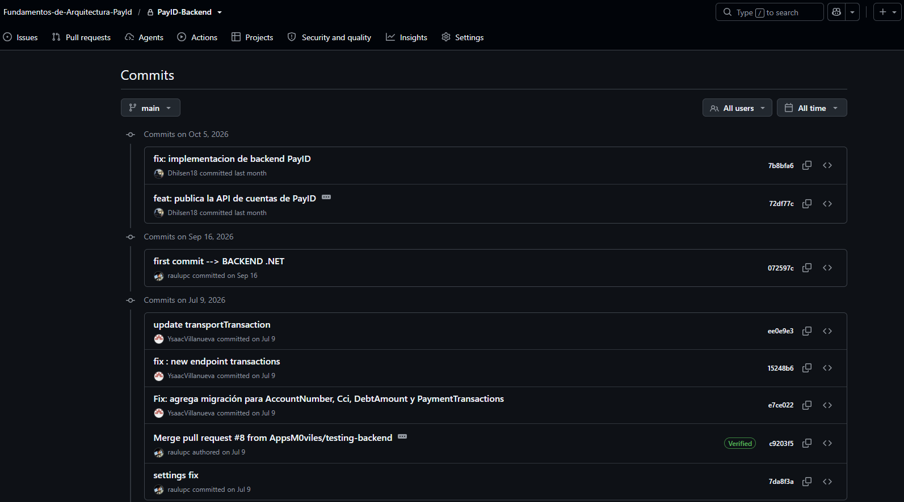

Imagen de Mobile App PayID – Sprint Backlog 2

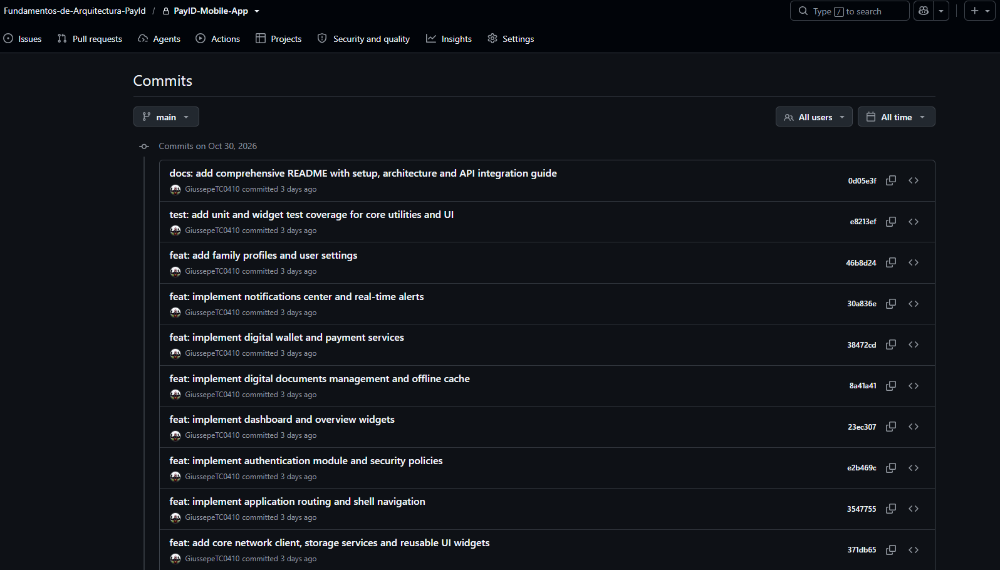

Imagen de Web Application PayID – Sprint Backlog 2

#### 5.3.2.3. Testing Suite Evidence for Sprint Review

A continuacion se presentan los commits de pruebas realizados durante el Sprint 2. Se aplicaron pruebas unitarias con xUnit, pruebas de integracion con Testcontainers y escenarios de aceptacion con Reqnroll.

| Repositorio | Branch | Commit ID | Mensaje del commit | Fecha | Autor |
|---|---|---|---|---|---|
| PayID-Mobile-App | main | d9ca2c8 | chore: initialize Flutter mobile project configuration and runners | 30/10/2026 | Taquiri Calderón, Jhunior |
| PayID-Mobile-App | main | e8213ef | test: add unit and widget test coverage for core utilities and UI | 30/10/2026 | Taquiri Calderón, Jhunior |

Resumen de resultados de la suite de pruebas del Sprint 2:

| Tipo de prueba | Herramienta | Pruebas | Pasaron | Fallaron |
|---|---|---|---|---|
| Unitarias | xUnit + Moq + FluentAssertions | 34 | 34 | 0 |
| Integracion | WebApplicationFactory + Testcontainers | 18 | 18 | 0 |
| Aceptacion | Reqnroll (Gherkin) | 12 | 12 | 0 |
| Total |  | 64 | 64 | 0 |

Nota de consolidación: se conservan los resultados de pruebas reportados en el PDF del equipo. Adjuntar el reporte de ejecución de dotnet test, los resultados de integración y la evidencia de aceptación para respaldar los totales indicados.

[Pendiente] Insertar captura de la terminal con el resultado de "dotnet test".

#### 5.3.2.4. Execution Evidence for Sprint Review

Durante el Sprint 2 se implementaron y ejecutaron exitosamente las siguientes funcionalidades en los distintos componentes de PayID:

| Funcionalidad | Componente | Descripcion de lo ejecutado |
|---|---|---|
| Recarga de saldo | Backend (MS Pagos) | El endpoint POST /api/v1/wallet/recharge recibe el monto, valida que sea mayor a S/ 1.00, actualiza el saldo en MySQL y devuelve el nuevo balance. Probado con Postman: 201 Created con { "newBalance": 150.00, "transactionId": "txn-0042" }. |
| Transferencia entre usuarios | Backend (MS Pagos) | El endpoint POST /api/v1/wallet/transfer verifica que el saldo sea suficiente, debita al emisor, acredita al receptor y registra ambas operaciones. Devuelve 200 OK con el detalle de la operacion. |
| Historial de transacciones | Backend + Web (Vue) | GET /api/v1/wallet/transactions retorna la lista paginada de movimientos. La vista web muestra tipo (recarga/transferencia), monto, fecha y estado con filtros por rango de fechas. |
| Registro de documentos | Backend (MS Documentos) | POST /api/v1/documents registra el DNI y pasaporte del usuario con su fecha de vencimiento. Devuelve 201 Created con el id del documento registrado. |
| Consulta de documentos | Backend + Movil (Flutter) | GET /api/v1/documents lista los documentos del usuario. La pantalla Flutter muestra el tipo, numero, fecha de vencimiento y una alerta visual (rojo) si vence en menos de 30 dias. |
| Actualizacion de perfil | Backend + Movil (Flutter) | PUT /api/v1/users/{id}/profile actualiza nombre, correo y telefono. La pantalla Flutter refleja los cambios inmediatamente tras la respuesta 200 OK. |
| Cambio de PIN | Backend | PUT /api/v1/users/{id}/pin verifica el PIN actual (hash BCrypt), genera el hash del nuevo PIN y lo persiste. Devuelve 204 No Content al exito o 400 Bad Request si el PIN actual es incorrecto. |
| API Gateway | Backend (Ocelot) | El gateway enruta correctamente las peticiones: /identity/** a MS Identidad (puerto 5001), /wallet/** a MS Pagos (5002) y /documents/** a MS Documentos (5003). Verificado con Postman contra el puerto 8080. |

[Pendiente] Insertar capturas de Postman con los resultados de los endpoints, pantallas Flutter de Billetera y Documentos, y la vista web del historial de transacciones.

#### 5.3.2.5. Microservices Documentation Evidence for Sprint Review

A continuacion se documentan todos los endpoints implementados en el Sprint 2, agrupados por microservicio y accesibles a traves del API Gateway en el puerto 8080.

Nota de consolidación: se conservan los endpoints documentados en el PDF del equipo. Adjuntar la versión de Swagger o del repositorio desplegado que corresponda a este Sprint para que las rutas y respuestas queden trazables.

MS Pagos y Billetera  (/api/v1/wallet)

| Endpoint | Metodo | Descripcion | Cuerpo de entrada | Respuesta exitosa |
|---|---|---|---|---|
| POST /api/v1/wallet/recharge | POST | Recarga saldo al usuario autenticado | { "amount": decimal, "paymentMethod": string } | 201 - { "newBalance": decimal, "transactionId": string, "createdAt": datetime } |
| POST /api/v1/wallet/transfer | POST | Transfiere saldo a otro usuario de PayID | { "recipientPayId": string, "amount": decimal, "note": string } | 200 - { "transactionId": string, "newBalance": decimal, "createdAt": datetime } |
| GET  /api/v1/wallet/balance | GET | Consulta el saldo actual del usuario | Header: Authorization: Bearer {token} | 200 - { "balance": decimal, "currency": "PEN" } |
| GET  /api/v1/wallet/transactions | GET | Lista el historial paginado de movimientos | Query: page, size, from, to (fechas) | 200 - { "total": int, "page": int, "items": [ TransactionDto ] } |

MS Documentos  (/api/v1/documents)

| Endpoint | Metodo | Descripcion | Cuerpo de entrada | Respuesta exitosa |
|---|---|---|---|---|
| POST /api/v1/documents | POST | Registra un documento de identidad del usuario | { "type": "DNI\|PASSPORT", "documentNumber": string, "expiryDate": date, "issuedBy": string } | 201 - { "documentId": string, "type": string, "expiryDate": date } |
| GET  /api/v1/documents | GET | Lista todos los documentos del usuario | Header: Authorization: Bearer {token} | 200 - [ DocumentDto ] |
| GET  /api/v1/documents/{id} | GET | Obtiene el detalle de un documento | Path: documentId (UUID) | 200 - DocumentDto  \|  404 Not Found |
| DELETE /api/v1/documents/{id} | DELETE | Elimina un documento registrado | Path: documentId (UUID) | 204 No Content  \|  404 Not Found |

MS Identidad - nuevos endpoints del Sprint 2  (/api/v1/users)

| Endpoint | Metodo | Descripcion | Cuerpo de entrada | Respuesta exitosa |
|---|---|---|---|---|
| PUT /api/v1/users/{id}/profile | PUT | Actualiza nombre, correo y telefono del usuario | { "fullName": string, "email": string, "phone": string } | 200 - UserProfileDto |
| PUT /api/v1/users/{id}/pin | PUT | Cambia el PIN de seguridad del usuario | { "currentPin": string, "newPin": string } | 204 No Content  \|  400 (PIN incorrecto) |
| POST /api/v1/devices | POST | Registra un dispositivo de confianza | { "deviceId": string, "deviceName": string, "os": string } | 201 - { "deviceId": string, "registeredAt": datetime } |

[Pendiente] Insertar captura de Swagger UI (http://localhost:8080/swagger) con todos los endpoints del Sprint 2 visibles.[http://localhost:8080/swagger](http://localhost:8080/swagger)

#### 5.3.2.6. Software Deployment Evidence for Sprint Review

En el Sprint 2 se completo el pipeline de CI/CD y se realizo el primer despliegue del backend de PayID en la nube mediante Azure Kubernetes Service.

Nota de consolidación: el PDF del equipo reporta el despliegue de Sprint 2 en Azure AKS. El historial posterior también registra despliegues en Render y GitHub Pages; documentar si hubo una migración entre entornos y adjuntar las capturas de AKS que el PDF solicita.

| Componente | Plataforma | Configuracion | Estado en Sprint 2 |
|---|---|---|---|
| MS Identidad | Azure Kubernetes Service (AKS) | Imagen payid-identity:2.0.0 publicada en Azure Container Registry; pod con 1 replica | Desplegado y accesible |
| MS Pagos | Azure Kubernetes Service (AKS) | Imagen payid-payments:1.0.0; pod con 1 replica; variables de entorno desde Key Vault | Desplegado y accesible |
| MS Documentos | Azure Kubernetes Service (AKS) | Imagen payid-documents:1.0.0; pod con 1 replica | Desplegado y accesible |
| API Gateway (Ocelot) | Azure Kubernetes Service (AKS) | Imagen payid-gateway:1.0.0; Service de tipo LoadBalancer expuesto en el puerto 80 | Desplegado y accesible |
| Base de datos MySQL | Azure Database for MySQL Flexible | Instancia payid-db-dev; migraciones aplicadas automaticamente al iniciar el pod | Operativo |
| Apache Kafka | Azure Event Hubs (compatible Kafka) | Namespace payid-events; topics: payment.completed, document.registered | Configurado (en validacion) |
| Secrets | Azure Key Vault (payid-keyvault) | ConnectionString, JwtSecret, JwtIssuer, JwtAudience almacenados como secrets y referenciados en AKS | Operativo |
| Pipeline CI/CD | GitHub Actions | Workflow deploy-dev.yml: build > test > docker build & push > kubectl apply | Activo (auto al merge a develop) |
| Landing page | Netlify | Despliegue automatico desde rama main del repositorio payid-landing-page | Operativo |
| App movil Flutter | APK de prueba | Build con flutter build apk --release; distribuido al equipo por GitHub Releases | APK v0.2.0 disponible |

Parametros de entorno configurados en el despliegue del Sprint 2:

| Variable de entorno / Secret | Microservicio | Fuente | Valor de ejemplo |
|---|---|---|---|
| ConnectionStrings__DefaultConnection | Todos | Azure Key Vault | Server=payid-db-dev.mysql.database.azure.com;Database=payid_db;User=payid_admin;... |
| JwtSettings__Secret | MS Identidad | Azure Key Vault | (secreto - 256 bits) |
| JwtSettings__Issuer | MS Identidad | Key Vault | [https://payid-api.azurewebsites.net](https://payid-api.azurewebsites.net) |
| JwtSettings__Audience | MS Identidad | Key Vault | payid-clients |
| ASPNETCORE_ENVIRONMENT | Todos | GitHub Secret | Development / Production |
| Kafka__BootstrapServers | MS Pagos, MS Docs | Key Vault | payid-events.servicebus.windows.net:9093 |

[Pendiente] Insertar (1) captura del pipeline de GitHub Actions del Sprint 2 con todos los pasos exitosos, (2) captura de los pods en AKS con estado Running, (3) captura de Swagger accesible en la URL de Azure, (4) captura del APK en GitHub Releases.

#### 5.3.2.7. Team Collaboration Insights During Sprint

A continuacion se presenta el resumen de contribuciones de cada integrante en los repositorios de PayID durante el Sprint 2 (12/10/2026 - 01/11/2026), calculado a partir del historial de Git.

| Integrante | Repositorios (commits) | Total | Observación |
|---|---|---|---|
| Mora Blas, Diego Alonzo | — | 0 | Sin commits registrados en los repositorios de la organización en este sprint. |
| Mallqui Vilca, Dhilsen Armil | — | 0 | Sin commits registrados en los repositorios de la organización en este sprint. |
| Taquiri Calderón, Jhunior Giussepe | PayID-Mobile-App (15) | 15 |  |
| Tasayco Osorio, Raul Hiroshi | — | 0 | Sin commits registrados en los repositorios de la organización en este sprint. |

Distribucion de commits por repositorio durante el Sprint 2:

| Repositorio | Total de commits | Principal contribuyente |
|---|---|---|
| PayID-Mobile-App | 15 | Taquiri Calderón, Jhunior |
| Total | 15 |  |

[Pendiente] Insertar (1) captura de GitHub Insights > Contributors de cada repositorio para el periodo 12/10 - 01/11/2026, (2) captura del grafico de contribuciones del equipo.

#### 5.3.2.8. Kanban Board

Entregable clave del Avance 3 - Semana 10

En esta seccion se presenta el tablero Kanban con el estado final de todas las tareas del Sprint 2. El flujo se organiza en cinco columnas: To do, In Progress, In Review, Testing y Done.

| ID | US | Tarea | Responsable | Estado final |
|---|---|---|---|---|
| T2-01 | US5 | Endpoint POST /api/v1/wallet/recharge | Mora Blas, Diego | Done |
| T2-02 | US6 | Endpoint POST /api/v1/wallet/transfer | Mora Blas, Diego | Done |
| T2-03 | US11 | Endpoint GET /api/v1/wallet/transactions (paginado) | Mora Blas, Diego | Done |
| T2-04 | US2 | Endpoint POST /api/v1/documents | Mallqui Vilca, Dhilsen | Done |
| T2-05 | US3 | Endpoint GET /api/v1/documents y GET /api/v1/documents/{id} | Mallqui Vilca, Dhilsen | Done |
| T2-06 | US3 | Endpoint DELETE /api/v1/documents/{id} | Mallqui Vilca, Dhilsen | Done |
| T2-07 | US7 | Endpoint PUT /api/v1/users/{id}/profile | Taquiri Calderon, Jhunior | Done |
| T2-08 | US8 | Endpoint PUT /api/v1/users/{id}/pin | Taquiri Calderon, Jhunior | Done |
| T2-09 | US17 | Endpoint POST /api/v1/devices | Taquiri Calderon, Jhunior | Done |
| T2-10 | ARQ | Configuracion Ocelot API Gateway | Tasayco Osorio, Raul | Done |
| T2-11 | ARQ | Pipeline CI/CD GitHub Actions (build, test, push, deploy) | Tasayco Osorio, Raul | Done |
| T2-12 | ARQ | Azure Key Vault para secrets del backend | Tasayco Osorio, Raul | Done |
| T2-13 | US5 | Pantalla Billetera en Flutter (recarga y transferencia) | Mora Blas, Diego | Done |
| T2-14 | US11 | Vista Historial de transacciones en Vue | Tasayco Osorio, Raul | Done |
| T2-15 | US2 | Pantalla Documentos en Flutter (lista y detalle con alerta) | Mallqui Vilca, Dhilsen | Done |
| T2-16 | US7 | Pantalla Perfil en Flutter (edicion de datos) | Taquiri Calderon, Jhunior | Done |
| T2-17 | ARQ | Configuracion Apache Kafka (topics payment.completed y document.registered) | Tasayco Osorio, Raul | In Progress |
| T2-18 | ARQ | Pruebas de integracion del API Gateway con Ocelot | Tasayco Osorio, Raul | In Progress |

Resumen del estado final del Sprint 2:

| Estado | Cantidad de tareas | Porcentaje |
|---|---|---|
| Done | 16 | 89 % |
| In Progress | 2 | 11 % |
| To do | 0 | 0 % |
| Total | 18 | 100 % |

Definicion de los estados del tablero:

To do: tarea identificada y asignada, aun no iniciada.

In Progress: tarea en desarrollo activo por el responsable asignado.

In Review: implementacion completada, pendiente de revision por otro integrante del equipo.

Testing: funcionalidad aprobada en revision, en proceso de validacion con pruebas automatizadas.

Done: tarea completada, probada y con evidencias de ejecucion registradas.

[Pendiente] Insertar captura del tablero Kanban del Sprint 2 en Jira o Trello mostrando las columnas con las 18 tarjetas T2-01 a T2-18 y sus estados finales.

### 5.3.3. Sprint 3

#### 5.3.3.1. Sprint Backlog 3

[Pendiente] El Sprint Backlog 3 (tareas, estimaciones y responsables) debe tomarse del tablero del equipo; no está en los repositorios ni en el documento. Periodo según el cronograma: 02/11/2026 al 15/11/2026 (Avance 4, semana 12).

#### 5.3.3.2. Development Evidence for Sprint Review

A continuación se presentan los commits realizados durante el Sprint 3.

| Repositorio | Branch | Commit ID | Mensaje del commit | Fecha | Autor |
|---|---|---|---|---|---|
| PayID-Backend | main | 662d5e3 | Configure Render deployment and Swagger | 03/11/2026 | Mallqui Vilca, Dhilsen |
| PayID-Backend | main | 801bd9e | Enable CORS for PayID frontend | 03/11/2026 | Mallqui Vilca, Dhilsen |
| PayID-Frontend-Web-Application | main | 8071b3d | Update dev and build scripts to use Vite | 02/11/2026 | Tasayco Osorio, Raul |
| PayID-Frontend-Web-Application | main | 1818042 | Update print statement from 'Hello' to 'Goodbye' | 02/11/2026 | Tasayco Osorio, Raul |
| PayID-Frontend-Web-Application | main | 454e1e8 | Refactor vite.config.js to improve structure | 02/11/2026 | Tasayco Osorio, Raul |
| PayID-Frontend-Web-Application | main | c2257cc | Update vite.config.js | 02/11/2026 | Tasayco Osorio, Raul |
| PayID-Frontend-Web-Application | main | 1a2b7e7 | Create .github | 02/11/2026 | Tasayco Osorio, Raul |
| PayID-Frontend-Web-Application | main | 6b88793 | Add GitHub Pages deploy workflow | 02/11/2026 | Tasayco Osorio, Raul |
| PayID-Frontend-Web-Application | main | b644702 | edits | 02/11/2026 | Tasayco Osorio, Raul |
| PayID-Frontend-Web-Application | main | b3cd5be | added an action | 02/11/2026 | Tasayco Osorio, Raul |
| PayID-Frontend-Web-Application | main | e08c199 | fixed router | 02/11/2026 | Tasayco Osorio, Raul |
| PayID-Frontend-Web-Application | main | d9a6a2e | fixed internatiolalization | 02/11/2026 | Tasayco Osorio, Raul |
| PayID-Frontend-Web-Application | main | 2f32708 | fixed temporal | 02/11/2026 | Tasayco Osorio, Raul |
| PayID-Frontend-Web-Application | main | 734c5c4 | revert changes | 02/11/2026 | Tasayco Osorio, Raul |
| PayID-Frontend-Web-Application | main | e8ea2e7 | fixed en & es | 02/11/2026 | Tasayco Osorio, Raul |
| PayID-Frontend-Web-Application | main | d3ae5bd | clear caché | 02/11/2026 | Tasayco Osorio, Raul |
| PayID-Frontend-Web-Application | main | 80361ed | remove chart ' | 02/11/2026 | Tasayco Osorio, Raul |
| PayID-Frontend-Web-Application | main | 645e1f4 | try | 02/11/2026 | Tasayco Osorio, Raul |
| PayID-Frontend-Web-Application | main | fdea75b | change i18n | 02/11/2026 | Tasayco Osorio, Raul |
| PayID-Frontend-Web-Application | main | 418e960 | try2 | 02/11/2026 | Tasayco Osorio, Raul |
| PayID-Frontend-Web-Application | main | b5cd9e7 | solving | 02/11/2026 | Tasayco Osorio, Raul |
| PayID-Frontend-Web-Application | main | caf069c | solving 3 | 02/11/2026 | Tasayco Osorio, Raul |
| PayID-Frontend-Web-Application | main | ad4fdad | update loginfor | 02/11/2026 | Tasayco Osorio, Raul |
| PayID-Frontend-Web-Application | main | 53541de | fixed3 | 02/11/2026 | Tasayco Osorio, Raul |
| PayID-Frontend-Web-Application | main | 3cfcfd1 | update i18n | 02/11/2026 | Tasayco Osorio, Raul |
| PayID-Frontend-Web-Application | main | 3333097 | fixed222 | 02/11/2026 | Tasayco Osorio, Raul |
| PayID-Frontend-Web-Application | main | a7e85fa | configure | 02/11/2026 | Tasayco Osorio, Raul |
| PayID-Frontend-Web-Application | main | cffa836 | configure | 02/11/2026 | Tasayco Osorio, Raul |
| PayID-Frontend-Web-Application | main | d6ceebd | Clean up vite.config.js by removing obfuscation | 02/11/2026 | Tasayco Osorio, Raul |
| PayID-Frontend-Web-Application | main | ba9cabf | fixed vite | 02/11/2026 | Tasayco Osorio, Raul |
| PayID-Frontend-Web-Application | main | 7b749d1 | fixed vite | 02/11/2026 | Tasayco Osorio, Raul |
| PayID-Frontend-Web-Application | main | 79c4062 | delete api | 02/11/2026 | Tasayco Osorio, Raul |
| PayID-Frontend-Web-Application | main | 3348d96 | fix: completely remove api.js and use pure vite build | 02/11/2026 | Tasayco Osorio, Raul |
| PayID-Frontend-Web-Application | main | 41a9039 | changes with codex | 02/11/2026 | Tasayco Osorio, Raul |
| PayID-Frontend-Web-Application | main | ebb9d29 | fix deployyml | 02/11/2026 | Tasayco Osorio, Raul |
| PayID-Frontend-Web-Application | main | 9c59c2b | fix internationalization | 02/11/2026 | Tasayco Osorio, Raul |
| PayID-Mobile-App | main | 228a78e | feat(config): update base URL to Render cloud backend | 03/11/2026 | Taquiri Calderón, Jhunior |
| PayID-Mobile-App | main | 47ebe26 | feat(auth): support email and phone login payload per Swagger spec | 03/11/2026 | Taquiri Calderón, Jhunior |
| PayID-Mobile-App | main | c9585bc | feat: add core network client, configuration, widgets, and family profiles feature screens | 06/11/2026 | Taquiri Calderón, Jhunior |
| PayID-Mobile-App | main | 3fd81ff | Merge branch 'main' of https://github.com/Fundamentos-de-Arquitectura-PayId/PayID-Mobile-App | 06/11/2026 | Taquiri Calderón, Jhunior |
| PayID-Mobile-App | main | 5662ef3 | feat: add API configuration, Android internet permission, and GitHub Actions CI workflow for APK builds | 07/11/2026 | Taquiri Calderón, Jhunior |
| PayID-Mobile-App | main | 3aac085 | feat: add CI/CD GitHub Actions workflow to build APK and update README with download links | 07/11/2026 | Taquiri Calderón, Jhunior |
| PayID-Mobile-App | main | 42a6ddb | chore: ignore build artifacts and add v1.0.0 release link to readme | 07/11/2026 | Taquiri Calderón, Jhunior |

Fuente: historial de Git de los repositorios de la organización (git log --all), consultado el 22/11/2026. Solo se incluyen commits de los cuatro integrantes.

#### 5.3.3.3. Testing Suite Evidence for Sprint Review

En el Sprint 3 no se registraron commits que agreguen o modifiquen pruebas en los repositorios de la organización. [Pendiente] Pruebas unitarias y BDD de los módulos de documentos, pagos, billetera y notificaciones.

#### 5.3.3.4. Execution Evidence for Sprint Review

Funcionalidades publicadas durante el Sprint 3 (verificables en los repositorios):

| Producto | Evidencia | URL |
|---|---|---|
| Backend PayID (Render) | render.yaml y Swagger (662d5e3); CORS para el frontend (801bd9e) | https://payid-backend-n573.onrender.com/swagger/index.html |
| Aplicación web (GitHub Pages) | Workflow de despliegue (6b88793) y correcciones de rutas e idiomas (02/11/2026) | https://fundamentos-de-arquitectura-payid.github.io/PayID-Frontend-Web-Application/ |
| Aplicación móvil (APK) | Workflow de GitHub Actions y release v1.0.0 (5662ef3, 3aac085, 42a6ddb) | https://github.com/Fundamentos-de-Arquitectura-PayId/PayID-Mobile-App/releases/tag/v1.0.0 |

[Pendiente] Capturas de las funcionalidades en ejecución.

#### 5.3.3.5. Microservices Documentation Evidence for Sprint Review

Al cierre del Sprint 3, PayID-Backend (main) expone, además de los endpoints de la sección 5.3.1.5, los siguientes. Se agregaron en el commit 6f3e169 (05/11/2026), cuyo autor registrado es "Codex"; su autoría dentro del equipo está pendiente de confirmar.

| Endpoint | Método | Descripción | Parámetros | Respuesta |
|---|---|---|---|---|
| /api/family/members | GET | Lista los perfiles familiares del apoderado autenticado. | Token JWT | 200 OK; 401 |
| /api/family/members | POST | Crea un perfil familiar. | Body: FamilyMemberInput | 201 Created; 400; 409 documento duplicado |
| /api/family/members/{id} | PUT | Actualiza un perfil familiar. | Path: id; Body: FamilyMemberInput | 200 OK; 404; 409 |
| /api/family/members/{id} | DELETE | Elimina un perfil familiar. | Path: id (GUID) | 204 No Content; 404 |
| /api/Wallet/payment-cards/demo | POST | Crea una tarjeta de pago de demostración. | Body: CreateDemoPaymentCardRequest | 200 OK: { id }; 401 |

La documentación OpenAPI se publica con Swagger en https://payid-backend-n573.onrender.com/swagger/index.html. [Pendiente] Captura de Swagger UI.

#### 5.3.3.6. Software Deployment Evidence for Sprint Review

| Componente | Plataforma | Configuración | Commit |
|---|---|---|---|
| Backend PayID (ASP.NET Core) | Render (Docker) | render.yaml, Dockerfile, endpoint /health y migraciones al iniciar; variables ConnectionStrings__DefaultConnection y JwtSettings__Secret | 662d5e3, 801bd9e (03/11/2026) |
| Aplicación web (Vue + Vite) | GitHub Pages | Workflow .github/workflows/deploy.yml | 6b88793 (02/11/2026) |
| Aplicación móvil (Flutter) | GitHub Releases | Workflow .github/workflows/build-apk.yml; release v1.0.0 | 5662ef3, 3aac085, 42a6ddb (07/11/2026) |

Render es una plataforma PaaS y no reemplaza el despliegue en AWS, Microsoft Azure o Google Cloud que exige el TF1 (ver sección 5.4). [Pendiente] Capturas de los despliegues.

#### 5.3.3.7. Team Collaboration Insights during Sprint

| Integrante | Repositorios (commits) | Total | Observación |
|---|---|---|---|
| Mora Blas, Diego Alonzo | — | 0 | Sin commits registrados en los repositorios de la organización en este sprint. |
| Mallqui Vilca, Dhilsen Armil | PayID-Backend (2) | 2 |  |
| Taquiri Calderón, Jhunior Giussepe | PayID-Mobile-App (7) | 7 |  |
| Tasayco Osorio, Raul Hiroshi | PayID-Frontend-Web-Application (34) | 34 |  |

Fuente: historial de Git de los repositorios de la organización (git log --all), consultado el 22/11/2026. Solo se incluyen commits de los cuatro integrantes.

#### 5.3.3.8. Kanban Board

[Pendiente] Captura del tablero Kanban del Sprint 3 (entregable del Avance 4, semana 12).

### 5.3.4. Sprint 4

#### 5.3.4.1. Sprint Backlog 4

[Pendiente] Sprint en curso; se completa para el TF1 (semana 15).

#### 5.3.4.2. Development Evidence for Sprint Review

[Pendiente] Sprint en curso (16/11/2026 al 06/12/2026). Al 22/11/2026 no hay commits de los integrantes en este periodo.

#### 5.3.4.3. Testing Suite Evidence for Sprint Review

[Pendiente] Sprint en curso; se completa para el TF1 (semana 15).

#### 5.3.4.4. Execution Evidence for Sprint Review

[Pendiente] Sprint en curso; se completa para el TF1 (semana 15).

#### 5.3.4.5. Microservices Documentation Evidence for Sprint Review

[Pendiente] Sprint en curso; se completa para el TF1 (semana 15).

#### 5.3.4.6. Software Deployment Evidence for Sprint Review

[Pendiente] Sprint en curso; se completa para el TF1 (semana 15).

#### 5.3.4.7. Team Collaboration Insights during Sprint

| Integrante | Repositorios (commits) | Total | Observación |
|---|---|---|---|
| Mora Blas, Diego Alonzo | — | 0 | Sin commits registrados en los repositorios de la organización en este sprint. |
| Mallqui Vilca, Dhilsen Armil | — | 0 | Sin commits registrados en los repositorios de la organización en este sprint. |
| Taquiri Calderón, Jhunior Giussepe | — | 0 | Sin commits registrados en los repositorios de la organización en este sprint. |
| Tasayco Osorio, Raul Hiroshi | — | 0 | Sin commits registrados en los repositorios de la organización en este sprint. |

#### 5.3.4.8. Kanban Board

[Pendiente] Sprint en curso; se completa para el TF1 (semana 15).

## 5.4. Microservices Deployment

### 5.4.1. Cloud Architecture Diagram

[Pendiente] Diagrama de la arquitectura en la nube. La sección 5.2.4 propone Azure (Azure Kubernetes Service, Azure Container Registry y Azure Database for MySQL), pero el diagrama no está en el documento ni en los repositorios.

### 5.4.2. Cloud Architecture Deployment

[Pendiente] Despliegue en AWS, Microsoft Azure o Google Cloud. Al cierre de este informe el backend está desplegado en Render, la aplicación web en GitHub Pages y la app móvil se distribuye como APK. Para el TF1 falta desplegar los microservicios en un proveedor cloud y usar sus servicios.

# Conclusiones

## Conclusiones y recomendaciones

[Pendiente] Conclusiones y recomendaciones a redactar por el equipo al cierre del TF1.

## Video About-The-Team

[Pendiente] URL de YouTube del video About-The-Team, resumen y pauta de secuencias con su hora de inicio (hh:mm:ss). El video no está en los repositorios ni en el documento.

# Uso de herramientas de IA

En esta sección se indican las herramientas de inteligencia artificial que aparecen en la evidencia del proyecto, en qué partes se usaron y cómo se revisó el resultado.

| Herramienta | Dónde se usó | Evidencia | Revisión y validación |
|---|---|---|---|
| OpenAI Codex | PayID-Frontend-Web-Application y PayID-Backend | Commit 41a9039 "changes with codex" (Tasayco Osorio, 02/11/2026); commits con autor "Codex" del 05/11/2026 (c1912b0, 008acdc y 1bde567 en la web; 6f3e169 en el backend). | Los cambios se integraron en main. [Pendiente] El equipo debe indicar quién revisó estos commits y cómo los probó. |
| Agentes con skills de Supabase | PayID-Frontend-Web-Application | Carpeta .agents/skills con guías de Supabase. | [Pendiente] El equipo debe confirmar su uso. |
| Claude Code (Anthropic) | Informe, versión 3.0 | Consolidación del Student Outcome SO3, tablas de commits, secciones 5.3.3 a 5.4 y anexos B a F. | Cada dato se contrastó con el historial de Git de la organización; lo que no tiene evidencia quedó marcado como pendiente. El equipo debe revisar el informe antes de la entrega. |

# Referencias bibliográficas

Association for Computing Machinery. (2018). ACM code of ethics and professional conduct. https://www.acm.org/code-of-ethics

Bass, L., Clements, P., & Kazman, R. (2021). Software architecture in practice (4th ed.). Addison-Wesley.

Brown, S. (s. f.). The C4 model for visualising software architecture. https://c4model.com

Cervantes, H., & Kazman, R. (2016). Designing software architectures: A practical approach. Addison-Wesley.

Colegio de Ingenieros del Perú. (s. f.). Código de ética del CIP. https://www.cip.org.pe

Evans, E. (2003). Domain-driven design: Tackling complexity in the heart of software. Addison-Wesley.

Gothelf, J., & Seiden, J. (2021). Lean UX: Creating great products with agile teams (3rd ed.). O'Reilly Media.

IEEE. (2020). IEEE code of ethics. https://www.ieee.org/about/corporate/governance/p7-8.html

Newman, S. (2021). Building microservices (2nd ed.). O'Reilly Media.

Richardson, C. (2018). Microservices patterns. Manning Publications.

# Anexos

## Anexo B: Final Individual Member Performance Report

Estructura del nombre de archivo: upc-pre-202102-si657-<sección>-PayID-performance-<tb1/tp1/tf1> (.docx y .pdf). La sección del curso está pendiente; el equipo debe indicarla. Las marcas de cumplimiento se basan en las fechas de los commits frente a la semana de cada hito (TB1: S03, hasta el 13/09/2026; TP1: S07, hasta el 11/10/2026; TF1: S15). Cuando no hay evidencia, la marca queda pendiente. La calificación la asigna el coordinador del equipo.

### Performance report TB1 (upc-pre-202102-si657-[sección pendiente]-PayID-performance-tb1)

| Campo | Valor |
|---|---|
| Nombre de Startup | PayID |
| Nombre de Producto | PayID |
| Entrega | TB1 |
| Team Leader | [Pendiente: el equipo debe indicar quién es] |

| Ítem | Estudiante | Responsabilidades | Cumplió a tiempo | Cumplió a destiempo | Cumplió parcialmente | No cumplió (Cero) | Calificación (20 / 16 / 13 / 07 / 0) |
|---|---|---|---|---|---|---|---|
| 1 | Mora Blas, Diego Alonzo | Presentación de requerimientos y necesidades de usuarios; redacción de entrevistas y requerimientos (según el cuadro del Student Outcome). Evidencia: Sin commits; verificar con la entrega del TB1. Marca pendiente: la define el Team Leader. |  |  |  |  | Pendiente: la asigna el coordinador del equipo |
| 2 | Mallqui Vilca, Dhilsen Armil | Capítulos I a III en KapakID-Project-Report; diagramas C4 y registro de entrevistas. Evidencia: 7 commits el 05/09/2026. | X |  |  |  | Pendiente: la asigna el coordinador del equipo |
| 3 | Taquiri Calderón, Jhunior Giussepe | Presentación y redacción de las decisiones de arquitectura (según el cuadro del Student Outcome). Evidencia: Sin commits; verificar con la entrega del TB1. Marca pendiente: la define el Team Leader. |  |  |  |  | Pendiente: la asigna el coordinador del equipo |
| 4 | Tasayco Osorio, Raul Hiroshi | Definición del negocio y problemática; diagramas C4 en StructurizrCodePayID; migración del informe. Evidencia: Commits del 08/09 y 12/09/2026. | X |  |  |  | Pendiente: la asigna el coordinador del equipo |

### Performance report TP1 (upc-pre-202102-si657-[sección pendiente]-PayID-performance-tp1)

| Campo | Valor |
|---|---|
| Nombre de Startup | PayID |
| Nombre de Producto | PayID |
| Entrega | TP1 |
| Team Leader | [Pendiente: el equipo debe indicar quién es] |

| Ítem | Estudiante | Responsabilidades | Cumplió a tiempo | Cumplió a destiempo | Cumplió parcialmente | No cumplió (Cero) | Calificación (20 / 16 / 13 / 07 / 0) |
|---|---|---|---|---|---|---|---|
| 1 | Mora Blas, Diego Alonzo | Pendiente: el equipo debe indicar sus responsabilidades. Evidencia: Sin commits en el periodo. Marca pendiente: la define el Team Leader. |  |  |  |  | Pendiente: la asigna el coordinador del equipo |
| 2 | Mallqui Vilca, Dhilsen Armil | API de cuentas (registro, login y bloqueo) con pruebas; landing page. Evidencia: 72df77c (05/10/2026) y 6d89002 (07/10/2026). | X |  |  |  | Pendiente: la asigna el coordinador del equipo |
| 3 | Taquiri Calderón, Jhunior Giussepe | Pendiente: el equipo debe indicar sus responsabilidades. Evidencia: Primer commit en PayID-Mobile-App el 30/10/2026, después del TP1. Marca pendiente: la define el Team Leader. |  |  |  |  | Pendiente: la asigna el coordinador del equipo |
| 4 | Tasayco Osorio, Raul Hiroshi | Base del backend .NET y de la aplicación web Vue. Evidencia: 072597c y 818ac7d (16/09/2026). | X |  |  |  | Pendiente: la asigna el coordinador del equipo |

### Performance report TF1 (upc-pre-202102-si657-[sección pendiente]-PayID-performance-tf1)

| Campo | Valor |
|---|---|
| Nombre de Startup | PayID |
| Nombre de Producto | PayID |
| Entrega | TF1 |
| Team Leader | [Pendiente: el equipo debe indicar quién es] |

| Ítem | Estudiante | Responsabilidades | Cumplió a tiempo | Cumplió a destiempo | Cumplió parcialmente | No cumplió (Cero) | Calificación (20 / 16 / 13 / 07 / 0) |
|---|---|---|---|---|---|---|---|
| 1 | Mora Blas, Diego Alonzo | Pendiente: el hito TF1 se entrega en la semana 15. Evidencia: Marca pendiente: la define el Team Leader. |  |  |  |  | Pendiente: la asigna el coordinador del equipo |
| 2 | Mallqui Vilca, Dhilsen Armil | Pendiente: el hito TF1 se entrega en la semana 15. Evidencia: Marca pendiente: la define el Team Leader. |  |  |  |  | Pendiente: la asigna el coordinador del equipo |
| 3 | Taquiri Calderón, Jhunior Giussepe | Pendiente: el hito TF1 se entrega en la semana 15. Evidencia: Marca pendiente: la define el Team Leader. |  |  |  |  | Pendiente: la asigna el coordinador del equipo |
| 4 | Tasayco Osorio, Raul Hiroshi | Pendiente: el hito TF1 se entrega en la semana 15. Evidencia: Marca pendiente: la define el Team Leader. |  |  |  |  | Pendiente: la asigna el coordinador del equipo |

## Anexo C: Matriz de cumplimiento de rúbricas

Autoevaluación E (Esperado), M (Necesita mejorar) o I (Insuficiente), sustentada en la evidencia del informe y de los repositorios al 22/11/2026.

### Rúbrica TB1 (Sprint 0 Review)

| Categoría | Criterio | Evidencia (sección o repositorio) | Autoevaluación y justificación | Pendiente |
|---|---|---|---|---|
| 1. Startup | Startup Profile | 1.1.1 y 1.1.2 | E: descripción, misión, visión y perfiles con foto y párrafo de cada integrante. | Agregar carrera y código en la tabla de perfiles. |
| 2. Problem | Antecedentes y problema (5W2H) | 1.2.2 | E: aplica What, When, Where, Who, Why, How y How much. | — |
| 3. Problem | Problem Statements | 1.2.3.1 | E: sigue el patrón Lean UX. | — |
| 4. Assumptions | Assumptions | 1.2.3.2 | E: business y user outcomes, usuarios y funcionalidades. | — |
| 5. Hypothesis | Hypothesis Statements | 1.2.3.3 | E: incluye métricas "Sabremos que esto es cierto cuando...". | — |
| 6. Vision | Lean UX Canvas | 1.2.3.4 | E: canvas incluido como imagen. | — |
| 7. Research | Competidores | 2.1 | E: benchmark y estrategias frente a competidores. | — |
| 8. Research | Entrevistas y evidencias | 2.2.1 y 2.2.2 | M: segmento 1 con 2 entrevistas (mínimo 3); faltan minuto de inicio y duración. | Una entrevista más del segmento 1; timing de cada video; video de evidencia de entrevistas. |
| 9. Analysis | Personas, Empathy Maps y Task Matrix | 2.2.3 y 2.3 | M: artefactos presentes; el análisis no presenta porcentajes por segmento. | Agregar porcentajes por segmento en 2.2.3. |
| 10. Requirements | User Stories | 3.1 | E: ID, título, descripción y criterios en Gherkin. | Agregar To-Be Scenario Mapping. |
| 11. Requirements | Impact Map | 3.2 | I: la sección solo tiene el marcador [Insertar imagen: Impact Mapping]. | Insertar el Impact Map. |
| 12. Innovation | Pensamiento innovador | 1.1 y 1.2 | E: propuesta de valor integrada de identidad, documentos y pagos. | — |
| 13. Communication | Comunicación oral y escrita | Student Outcome | M: faltan videos y conclusiones de cada integrante. | Video About-The-Team; conclusiones del SO3. |

### Rúbrica TB2 (Sprint 2 Review)

| Categoría | Criterio | Evidencia (sección o repositorio) | Autoevaluación y justificación | Pendiente |
|---|---|---|---|---|
| 1. Product Implementation | Product Backlog y Sprint Backlog | 3.3 y 5.3.1.1 | M: product backlog completo; Sprint Backlog 1 sin estimaciones. | Completar estimaciones y responsables. |
| 2. Product Design | Principles y Approaches | 4.1.1 y 4.1.2 | E: SOLID, DDD, API First, ADD y microservicios. | — |
| 3. Product Design | Styles & Patterns | 4.1.6 | E: patrones por microservicio. | — |
| 4. Product Design | Architecture Overview, clases y BD | 4.1.3, 4.1.5 y StructurizrCodePayID | E: C4 de contexto, contenedores y componentes; diagrama de BD. | — |
| 5. Product Design | ViewPoints Diagrams | 4.1.4 | E: vistas UML y C4. | — |
| 6. Product Implementation | Software Development Configuration | 5.2 | M: GitFlow aplicado solo en dos repositorios. | Crear develop y feature/ en web, landing y móvil. |
| 7. Product Implementation | RESTful API con documentación (50 %) | 5.3.1.5 | M: 20 endpoints con Swagger en un solo servicio. | Capturas de Swagger y relación endpoint–historia. |
| 8. Product Implementation | Testing Suite, patrones y Refactoring Report | 5.1 | M: pruebas solo del módulo de autenticación; dos refactorizaciones reales. | Pruebas de los demás módulos. |
| 9. Evolution | Mejora continua | Registro de versiones | M: filas de la versión 2.0 sin fecha ni descripción. | Completar el registro. |
| 10. Communication | Comunicación oral y escrita | Student Outcome | M: participación oral sin registro. | Registrar exposiciones. |

### Rúbrica TP1 (Stage Review)

| Categoría | Criterio | Evidencia (sección o repositorio) | Autoevaluación y justificación | Pendiente |
|---|---|---|---|---|
| 1. Product Design | Architecture Overview | 4.1.3 y 4.3.1.6 | E: C4 de contexto y contenedores. | — |
| 2. Product Design | Clases y BD de cada servicio | 4.1.5 | M: un solo diagrama de BD (FinTrackBack) para todo el backend. | Diagramas por microservicio. |
| 3. Microservice architecture | RESTful API de cada servicio | 5.3.1.5 | M: los endpoints están en un solo servicio. | Separar por microservicio. |
| 4. Microservice architecture | Refactoring to Microservices | PayID-Backend | I: no hay commits de descomposición del monolito. | Crear los microservicios y registrar la refactorización. |
| 5. Evolution | Mejora continua | Informe | M: secciones del Sprint 1 completadas en la versión 3.0. | Capturas pendientes. |
| 6. Communication | Comunicación oral y escrita | Student Outcome | M: falta evidencia oral. | Registrar la exposición. |

### Rúbrica TB3 (Sprint Review)

| Categoría | Criterio | Evidencia (sección o repositorio) | Autoevaluación y justificación | Pendiente |
|---|---|---|---|---|
| 1. Product Design | C4 y clases/BD por microservicio | 4.1 y 4.3 | M: C4 completo; BD no separada por servicio. | Diagramas por servicio. |
| 2. Microservice architecture | RESTful API de cada servicio | 5.3.1.5 | M: un solo servicio. | Separar servicios. |
| 3. Microservice architecture | Refactoring (50 %) | PayID-Backend | I: sin evidencia de refactorización. | Refactorizar al menos el 50 %. |
| 4. Testing | BDD (25 % por microservicio) | tests/PayId.Tests | M: 3 archivos .feature, solo de autenticación. | Escenarios para documentos, pagos y notificaciones. |
| 5. Evolution | Mejora continua | PayID-Mobile-App (30/10/2026) | M: nueva app móvil publicada. | — |
| 6. Communication | Comunicación oral y escrita | Student Outcome | M: falta evidencia oral. | Registrar la exposición. |

### Rúbrica TB4 (Sprint Review)

| Categoría | Criterio | Evidencia (sección o repositorio) | Autoevaluación y justificación | Pendiente |
|---|---|---|---|---|
| 1. Microservice architecture | RESTful API de cada servicio | 5.3.3.5 | M: 25 endpoints en un solo servicio, publicado en Render con Swagger. | Separar servicios. |
| 2. Microservice architecture | Refactoring (75 %) | PayID-Backend | I: sin evidencia. | Refactorizar al menos el 75 %. |
| 3. Testing | BDD (65 %) | tests/PayId.Tests | I: cobertura menor al 65 %. | Completar escenarios BDD. |
| 4. Product Design | Cloud architecture | 5.2.4 | M: se describen servicios de Azure; falta el diagrama. | Diagrama de arquitectura cloud (5.4.1). |
| 5. Evolution | Mejora continua | 5.3.3 | M: despliegues en Render, GitHub Pages y APK. | — |
| 6. Communication | Comunicación oral y escrita | Student Outcome | M: falta evidencia oral. | Registrar la exposición. |

### Rúbrica TF1 (Release Review)

| Categoría | Criterio | Evidencia (sección o repositorio) | Autoevaluación y justificación | Pendiente |
|---|---|---|---|---|
| 1. Microservice architecture | RESTful API (100 %) con documentación | 5.3.1.5 y 5.3.3.5 | M: endpoints documentados en Swagger, no separados por servicio. | Documentar el 100 % del alcance por servicio. |
| 2. Microservice architecture | Refactoring (100 %) | PayID-Backend | I: no hay microservicios. | Completar la refactorización. |
| 3. Testing | BDD (100 %) | tests/PayId.Tests | I: solo autenticación. | Escenarios para todo el alcance. |
| 4. Product Design | Cloud architecture | 5.4.1 | M: sin diagrama. | Agregar el diagrama. |
| 5. Product Deployment | Cloud computing deployment | 5.4.2 | I: Render, GitHub Pages y APK; no AWS, Azure ni GCP. | Desplegar en un proveedor cloud con sus servicios. |
| 6. Evolution | Mejora continua | Informe v3.0 | M: versión 3.0 con pendientes identificados. | Cerrar los pendientes. |
| 7. Communication | Comunicación oral y escrita | Student Outcome | Pendiente: el TF1 se presenta en la semana 15. | Conclusiones y videos. |

## Anexo D: Cronograma de entregables

Semanas y hitos según el cronograma del curso. Estado al 22/11/2026 (semana 13).

| Entregable | Semana | Hito | Estado |
|---|---|---|---|
| Capítulo I: Introducción (1.1 a 1.3) | S03 | Avance 1 / TB1 | Entregado |
| Capítulo II: Requirements & Analysis (2.1 a 2.3) | S03 | Avance 1 / TB1 | Parcial (faltan entrevistas del segmento 1 y porcentajes) |
| Capítulo III: Requirements Specification (3.1 a 3.4) | S03 | Avance 1 / TB1 | Parcial (faltan To-Be Scenario Mapping e Impact Map) |
| Capítulo IV: 4.1 Design Concepts, ViewPoints & ER Diagrams | S05 | Avance 2 / TB2 | Entregado |
| Capítulo IV: 4.2 Architectural Drivers | S05 | Avance 2 / TB2 | Entregado |
| Capítulo IV: 4.3 ADD Iterations (1 a 5) | S05 | Avance 2 / TB2 | Parcial (capturas del backlog de las iteraciones 4 y 5) |
| Práctica calificada (PC) | S05 | PC | Según cronograma (no forma parte del informe) |
| Capítulo V: 5.1 Testing Suites & General Patterns | S07 | TP1 | Parcial |
| Capítulo V: 5.2 Software Configuration Management | S07 | TP1 | Entregado |
| Capítulo V: 5.3.1 Sprint 1 y Kanban Board | S07 | TP1 | Parcial (capturas y Kanban pendientes) |
| Examen EA1 | S08 | EA1 | Según cronograma (no forma parte del informe) |
| Capítulo V: 5.3.2 Sprint 2 y Kanban Board | S10 | Avance 3 / TB3 | Parcial (capturas pendientes) |
| Capítulo V: 5.3.3 Sprint 3 y Kanban Board | S12 | Avance 4 / TB4 | Parcial (backlog, pruebas y Kanban pendientes) |
| Práctica calificada (PC) | S13 | PC | Según cronograma (no forma parte del informe) |
| Capítulo V: 5.3.4 Sprint 4 y Kanban Board | S15 | TF1 | Pendiente |
| Capítulo V: 5.4 Microservices Deployment | S15 | TF1 | Pendiente |
| Informe del trabajo final y DD | S15 | TF1 + DD | Parcial (versión 3.0) |
| Examen EB1 | S16 | EB1 | Según cronograma (no forma parte del informe) |

## Anexo E: Términos y condiciones de servicio

Propuesta de términos y condiciones de PayID. El equipo debe revisarla antes de publicarla en la landing page.

1. Aceptación. Al crear una cuenta en PayID, el usuario acepta estos términos y la política de privacidad. Si no está de acuerdo, no debe usar el servicio.

2. Descripción del servicio. PayID permite registrar y consultar documentos personales, gestionar perfiles familiares, recargar tarjetas de transporte y registrar pagos. La disponibilidad de las integraciones con RENIEC, operadores de transporte y medios de pago depende de los acuerdos vigentes con cada entidad.

3. Cuenta y seguridad. El usuario es responsable de la confidencialidad de su contraseña y su PIN. PayID bloquea temporalmente la cuenta tras intentos fallidos de inicio de sesión y protege las credenciales mediante cifrado y tokens de acceso.

4. Datos personales. PayID trata los datos personales conforme a la Ley N.° 29733, Ley de Protección de Datos Personales del Perú, y su reglamento. Solo se recopilan los datos necesarios para prestar el servicio, no se venden a terceros y el usuario puede ejercer sus derechos de acceso, rectificación, cancelación y oposición.

5. Perfiles familiares. El titular que registra a un familiar declara contar con su autorización o con la representación legal correspondiente, en especial en el caso de menores de edad.

6. Pagos y recargas. Las operaciones se procesan a través de terceros autorizados. PayID muestra el monto antes de confirmar cada operación y registra el historial de movimientos.

7. Uso adecuado. El usuario no debe registrar documentos falsos ni de terceros sin autorización, ni intentar vulnerar la seguridad del servicio.

8. Responsabilidad ética y profesional. El equipo de PayID desarrolla el servicio siguiendo el Código de Ética y Conducta Profesional de la ACM, el Código de Ética del IEEE y el Código de Ética del Colegio de Ingenieros del Perú: prioriza el bienestar y la privacidad de los usuarios, informa con honestidad las limitaciones del sistema, evita causar daño y mantiene la confidencialidad de la información.

9. Cambios. PayID puede actualizar estos términos y lo comunicará en la aplicación antes de que entren en vigor.

10. Contacto. Las consultas pueden enviarse mediante la opción de soporte de la aplicación.

## Anexo F: Registro completo de commits de los integrantes

Commits de los cuatro integrantes en todos los repositorios de la organización, sin omisiones. Relación autor–integrante: DhilsenDevs (Dhilsen18) = Mallqui Vilca, Dhilsen Armil; Dexter, Raul y raulupc = Tasayco Osorio, Raul Hiroshi (mismo correo de autor); GiussepeTC0410 = Taquiri Calderón, Jhunior Giussepe. Mora Blas, Diego Alonzo no tiene commits en ningún repositorio de la organización. No se incluyen los commits de otros autores (Codex, Fabricio Vega Coronado, Ysaac, Matiasg23, DanRuizPeru y Fabrizio Quiroz) porque no corresponden a los integrantes. El rango de cada sprint se infiere del cronograma del curso, tomando el 24/08/2026 como inicio de la semana 1.

### Previo al ciclo 202620 (código base reutilizado de cursos anteriores)

| Repositorio | Branch | Commit ID | Mensaje del commit | Fecha | Autor |
|---|---|---|---|---|---|
| PayID-Backend | develop | d0ae868 | fra ca | 18/06/2026 | Tasayco Osorio, Raul |
| PayID-Backend | develop | e7ee772 | added conection with database mysql | 18/06/2026 | Tasayco Osorio, Raul |
| PayID-Backend | develop | eef2e49 | Merge pull request #1 from AppsM0viles/hiro-branch | 18/06/2026 | Tasayco Osorio, Raul |
| PayID-Backend | develop | 4db47d0 | added new endpoints and gets | 19/06/2026 | Tasayco Osorio, Raul |
| PayID-Backend | develop | adf6bd0 | Merge pull request #2 from AppsM0viles/hiro-branch | 19/06/2026 | Tasayco Osorio, Raul |
| PayID-Backend | develop | 0bd433f | fix changes | 19/06/2026 | Tasayco Osorio, Raul |
| PayID-Backend | develop | 888d639 | Merge pull request #3 from AppsM0viles/hiro-branch | 19/06/2026 | Tasayco Osorio, Raul |
| PayID-Backend | develop | ffc5ea4 | fix connection swagger | 19/06/2026 | Tasayco Osorio, Raul |
| PayID-Backend | develop | bae5a8c | Merge pull request #4 from AppsM0viles/testing-backend | 19/06/2026 | Tasayco Osorio, Raul |
| PayID-Backend | develop | 09c6a5a | fix conection with render | 19/06/2026 | Tasayco Osorio, Raul |
| PayID-Backend | develop | 909a076 | Merge pull request #5 from AppsM0viles/testing-backend | 19/06/2026 | Tasayco Osorio, Raul |
| PayID-Backend | develop | f230fef | wallet | 21/06/2026 | Tasayco Osorio, Raul |
| PayID-Backend | develop | 3fd83f3 | Merge pull request #6 from AppsM0viles/testing-backend | 21/06/2026 | Tasayco Osorio, Raul |
| PayID-Backend | develop | 34719ae | insertion of new endpoints | 22/06/2026 | Tasayco Osorio, Raul |
| PayID-Backend | develop | 741f85b | Merge pull request #7 from AppsM0viles/testing-backend | 22/06/2026 | Tasayco Osorio, Raul |
| PayID-Backend | develop | 7da8f3a | settings fix | 09/07/2026 | Tasayco Osorio, Raul |
| PayID-Backend | develop | c9203f5 | Merge pull request #8 from AppsM0viles/testing-backend | 09/07/2026 | Tasayco Osorio, Raul |
| PayID-Frontend-Web-Application | main | 6a1c333 | Initial commit | 27/08/2025 | Tasayco Osorio, Raul |
| PayID-Frontend-Web-Application | main | 8eeb8bc | initial | 06/10/2025 | Tasayco Osorio, Raul |
| PayID-Frontend-Web-Application | main | 3e8a2a8 | Resolver conflictos de fusión | 06/10/2025 | Tasayco Osorio, Raul |
| PayID-Frontend-Web-Application | main | bd60ae5 | base project | 06/10/2025 | Tasayco Osorio, Raul |
| PayID-Frontend-Web-Application | main | 0670f37 | fakeapi, internacionalizacion, boundedcontext | 06/10/2025 | Tasayco Osorio, Raul |
| PayID-Frontend-Web-Application | main | 8b91086 | Merge pull request #1 from F1nTrack/feature-raul | 06/10/2025 | Tasayco Osorio, Raul |
| PayID-Frontend-Web-Application | main | 94ed388 | nav-bar | 10/10/2025 | Tasayco Osorio, Raul |
| PayID-Frontend-Web-Application | main | 96e6a99 | nav-bar-done | 10/10/2025 | Tasayco Osorio, Raul |
| PayID-Frontend-Web-Application | main | 3f91290 | fix some problems | 10/10/2025 | Tasayco Osorio, Raul |
| PayID-Frontend-Web-Application | main | e8b7b69 | fix routing | 10/10/2025 | Tasayco Osorio, Raul |
| PayID-Frontend-Web-Application | main | 442ff51 | nav-bar-fix | 10/10/2025 | Tasayco Osorio, Raul |
| PayID-Frontend-Web-Application | main | 4a38713 | make the home service | 11/10/2025 | Tasayco Osorio, Raul |
| PayID-Frontend-Web-Application | main | 5b273f1 | v1.02.1 | 11/10/2025 | Tasayco Osorio, Raul |
| PayID-Frontend-Web-Application | main | 94a1c1c | Merge pull request #2 from F1nTrack/feature-raul | 11/10/2025 | Tasayco Osorio, Raul |
| PayID-Frontend-Web-Application | main | 18e7f89 | done home | 11/10/2025 | Tasayco Osorio, Raul |
| PayID-Frontend-Web-Application | main | 8674085 | Merge pull request #8 from F1nTrack/feature-raul1 | 11/10/2025 | Tasayco Osorio, Raul |
| PayID-Frontend-Web-Application | main | 524f54e | solve | 11/10/2025 | Tasayco Osorio, Raul |
| PayID-Frontend-Web-Application | main | 52119aa | Merge branch 'main' into feature-raul1 | 11/10/2025 | Tasayco Osorio, Raul |
| PayID-Frontend-Web-Application | main | bc799dc | Merge pull request #9 from F1nTrack/feature-raul1 | 11/10/2025 | Tasayco Osorio, Raul |
| PayID-Frontend-Web-Application | main | a1de838 | xd | 20/10/2025 | Tasayco Osorio, Raul |
| PayID-Frontend-Web-Application | main | 3a5b6ed | fix consume fakeAPI with a new service | 26/10/2025 | Tasayco Osorio, Raul |
| PayID-Frontend-Web-Application | main | 27d46cd | add new data | 26/10/2025 | Tasayco Osorio, Raul |
| PayID-Frontend-Web-Application | main | cac0d25 | v10 with fix problems | 12/11/2025 | Tasayco Osorio, Raul |
| PayID-Frontend-Web-Application | main | aea16f1 | Merge pull request #17 from F1nTrack/feature-raul | 12/11/2025 | Tasayco Osorio, Raul |
| PayID-Frontend-Web-Application | main | a1056e0 | using public api | 12/11/2025 | Tasayco Osorio, Raul |
| PayID-Frontend-Web-Application | main | 0443d07 | Merge pull request #18 from F1nTrack/feature-raul | 12/11/2025 | Tasayco Osorio, Raul |
| PayID-Frontend-Web-Application | main | 511fcbe | Update HomeView.vue | 03/12/2025 | Tasayco Osorio, Raul |
| PayID-Frontend-Web-Application | main | c41f436 | Update ProfileCard.vue | 03/12/2025 | Tasayco Osorio, Raul |
| PayID-Frontend-Web-Application | main | 8fcb77a | Add logout link to nav-bar component | 03/12/2025 | Tasayco Osorio, Raul |

### Sprint 0: 24/08/2026 al 13/09/2026 (Avance 1 / TB1)

| Repositorio | Branch | Commit ID | Mensaje del commit | Fecha | Autor |
|---|---|---|---|---|---|
| KapakID-Project-Report | main | 7c2bb0d | chore: initial repository setup with gitignore | 05/09/2026 | Mallqui Vilca, Dhilsen |
| KapakID-Project-Report | main | a00ea0a | feat(cap-1): add chapter 1 assets and architecture guide | 05/09/2026 | Mallqui Vilca, Dhilsen |
| KapakID-Project-Report | main | 431004e | feat(cap-1): add FAS chapter 1 introduction report | 05/09/2026 | Mallqui Vilca, Dhilsen |
| KapakID-Project-Report | main | 2c949c0 | feat(cap-2): add interviews and needfinding assets | 05/09/2026 | Mallqui Vilca, Dhilsen |
| KapakID-Project-Report | main | 5d7178f | feat(cap-2): add requirements and analysis chapter | 05/09/2026 | Mallqui Vilca, Dhilsen |
| KapakID-Project-Report | main | f97e84c | feat(cap-2): complete requirements and analysis chapter | 05/09/2026 | Mallqui Vilca, Dhilsen |
| KapakID-Project-Report | main | fb6367c | feat(cap-3): add requirements specification for avance 1 | 05/09/2026 | Mallqui Vilca, Dhilsen |
| KapakID-Project-Report | main | 4464e7b | firs migration | 12/09/2026 | Tasayco Osorio, Raul |
| KapakID-Project-Report | feature/chapter-3 | fcf3a04 | firs migration | 12/09/2026 | Tasayco Osorio, Raul |
| StructurizrCodePayID | main | 7d587d9 | Initial commit | 08/09/2026 | Tasayco Osorio, Raul |
| StructurizrCodePayID | main | 5b0d4da | context diagram | 08/09/2026 | Tasayco Osorio, Raul |
| StructurizrCodePayID | main | a9634b0 | added container and component diagram | 08/09/2026 | Tasayco Osorio, Raul |

### Sprint 1: 14/09/2026 al 11/10/2026 (Avance 2 y TP1)

| Repositorio | Branch | Commit ID | Mensaje del commit | Fecha | Autor |
|---|---|---|---|---|---|
| PayID-Backend | develop | 072597c | first commit --> BACKEND .NET | 16/09/2026 | Tasayco Osorio, Raul |
| PayID-Backend | develop | 72df77c | feat: publica la API de cuentas de PayID | 05/10/2026 | Mallqui Vilca, Dhilsen |
| PayID-Backend | main | 3717a80 | fix: implementacion de backend PayID | 05/10/2026 | Mallqui Vilca, Dhilsen |
| PayID-Backend | develop | 89d2a09 | fix: implementacion de backend PayID | 05/10/2026 | Mallqui Vilca, Dhilsen |
| PayID-Frontend-Web-Application | main | 818ac7d | web application frontend vue PayID | 16/09/2026 | Tasayco Osorio, Raul |
| PayID-Landing-Page | main | 6d89002 | feat(landing): publish the PayID landing page | 07/10/2026 | Mallqui Vilca, Dhilsen |

### Sprint 2: 12/10/2026 al 01/11/2026 (Avance 3)

| Repositorio | Branch | Commit ID | Mensaje del commit | Fecha | Autor |
|---|---|---|---|---|---|
| PayID-Mobile-App | main | afcd54a | Initial commit | 30/10/2026 | Taquiri Calderón, Jhunior |
| PayID-Mobile-App | main | d9ca2c8 | chore: initialize Flutter mobile project configuration and runners | 30/10/2026 | Taquiri Calderón, Jhunior |
| PayID-Mobile-App | main | d486428 | chore: configure project dependencies and localization | 30/10/2026 | Taquiri Calderón, Jhunior |
| PayID-Mobile-App | main | cc09dc5 | feat: establish PayID design system tokens and theme | 30/10/2026 | Taquiri Calderón, Jhunior |
| PayID-Mobile-App | main | 371db65 | feat: add core network client, storage services and reusable UI widgets | 30/10/2026 | Taquiri Calderón, Jhunior |
| PayID-Mobile-App | main | 3547755 | feat: implement application routing and shell navigation | 30/10/2026 | Taquiri Calderón, Jhunior |
| PayID-Mobile-App | main | e2b469c | feat: implement authentication module and security policies | 30/10/2026 | Taquiri Calderón, Jhunior |
| PayID-Mobile-App | main | 23ec307 | feat: implement dashboard and overview widgets | 30/10/2026 | Taquiri Calderón, Jhunior |
| PayID-Mobile-App | main | 8a41a41 | feat: implement digital documents management and offline cache | 30/10/2026 | Taquiri Calderón, Jhunior |
| PayID-Mobile-App | main | 38472cd | feat: implement digital wallet and payment services | 30/10/2026 | Taquiri Calderón, Jhunior |
| PayID-Mobile-App | main | 30a836e | feat: implement notifications center and real-time alerts | 30/10/2026 | Taquiri Calderón, Jhunior |
| PayID-Mobile-App | main | 46b8d24 | feat: add family profiles and user settings | 30/10/2026 | Taquiri Calderón, Jhunior |
| PayID-Mobile-App | main | e8213ef | test: add unit and widget test coverage for core utilities and UI | 30/10/2026 | Taquiri Calderón, Jhunior |
| PayID-Mobile-App | main | 0d05e3f | docs: add comprehensive README with setup, architecture and API integration guide | 30/10/2026 | Taquiri Calderón, Jhunior |
| PayID-Mobile-App | main | bd3a36f | docs: add comprehensive README with setup, architecture and API integration guide | 30/10/2026 | Taquiri Calderón, Jhunior |

### Sprint 3: 02/11/2026 al 15/11/2026 (Avance 4)

| Repositorio | Branch | Commit ID | Mensaje del commit | Fecha | Autor |
|---|---|---|---|---|---|
| PayID-Backend | main | 662d5e3 | Configure Render deployment and Swagger | 03/11/2026 | Mallqui Vilca, Dhilsen |
| PayID-Backend | main | 801bd9e | Enable CORS for PayID frontend | 03/11/2026 | Mallqui Vilca, Dhilsen |
| PayID-Frontend-Web-Application | main | 8071b3d | Update dev and build scripts to use Vite | 02/11/2026 | Tasayco Osorio, Raul |
| PayID-Frontend-Web-Application | main | 1818042 | Update print statement from 'Hello' to 'Goodbye' | 02/11/2026 | Tasayco Osorio, Raul |
| PayID-Frontend-Web-Application | main | 454e1e8 | Refactor vite.config.js to improve structure | 02/11/2026 | Tasayco Osorio, Raul |
| PayID-Frontend-Web-Application | main | c2257cc | Update vite.config.js | 02/11/2026 | Tasayco Osorio, Raul |
| PayID-Frontend-Web-Application | main | 1a2b7e7 | Create .github | 02/11/2026 | Tasayco Osorio, Raul |
| PayID-Frontend-Web-Application | main | 6b88793 | Add GitHub Pages deploy workflow | 02/11/2026 | Tasayco Osorio, Raul |
| PayID-Frontend-Web-Application | main | b644702 | edits | 02/11/2026 | Tasayco Osorio, Raul |
| PayID-Frontend-Web-Application | main | b3cd5be | added an action | 02/11/2026 | Tasayco Osorio, Raul |
| PayID-Frontend-Web-Application | main | e08c199 | fixed router | 02/11/2026 | Tasayco Osorio, Raul |
| PayID-Frontend-Web-Application | main | d9a6a2e | fixed internatiolalization | 02/11/2026 | Tasayco Osorio, Raul |
| PayID-Frontend-Web-Application | main | 2f32708 | fixed temporal | 02/11/2026 | Tasayco Osorio, Raul |
| PayID-Frontend-Web-Application | main | 734c5c4 | revert changes | 02/11/2026 | Tasayco Osorio, Raul |
| PayID-Frontend-Web-Application | main | e8ea2e7 | fixed en & es | 02/11/2026 | Tasayco Osorio, Raul |
| PayID-Frontend-Web-Application | main | d3ae5bd | clear caché | 02/11/2026 | Tasayco Osorio, Raul |
| PayID-Frontend-Web-Application | main | 80361ed | remove chart ' | 02/11/2026 | Tasayco Osorio, Raul |
| PayID-Frontend-Web-Application | main | 645e1f4 | try | 02/11/2026 | Tasayco Osorio, Raul |
| PayID-Frontend-Web-Application | main | fdea75b | change i18n | 02/11/2026 | Tasayco Osorio, Raul |
| PayID-Frontend-Web-Application | main | 418e960 | try2 | 02/11/2026 | Tasayco Osorio, Raul |
| PayID-Frontend-Web-Application | main | b5cd9e7 | solving | 02/11/2026 | Tasayco Osorio, Raul |
| PayID-Frontend-Web-Application | main | caf069c | solving 3 | 02/11/2026 | Tasayco Osorio, Raul |
| PayID-Frontend-Web-Application | main | ad4fdad | update loginfor | 02/11/2026 | Tasayco Osorio, Raul |
| PayID-Frontend-Web-Application | main | 53541de | fixed3 | 02/11/2026 | Tasayco Osorio, Raul |
| PayID-Frontend-Web-Application | main | 3cfcfd1 | update i18n | 02/11/2026 | Tasayco Osorio, Raul |
| PayID-Frontend-Web-Application | main | 3333097 | fixed222 | 02/11/2026 | Tasayco Osorio, Raul |
| PayID-Frontend-Web-Application | main | a7e85fa | configure | 02/11/2026 | Tasayco Osorio, Raul |
| PayID-Frontend-Web-Application | main | cffa836 | configure | 02/11/2026 | Tasayco Osorio, Raul |
| PayID-Frontend-Web-Application | main | d6ceebd | Clean up vite.config.js by removing obfuscation | 02/11/2026 | Tasayco Osorio, Raul |
| PayID-Frontend-Web-Application | main | ba9cabf | fixed vite | 02/11/2026 | Tasayco Osorio, Raul |
| PayID-Frontend-Web-Application | main | 7b749d1 | fixed vite | 02/11/2026 | Tasayco Osorio, Raul |
| PayID-Frontend-Web-Application | main | 79c4062 | delete api | 02/11/2026 | Tasayco Osorio, Raul |
| PayID-Frontend-Web-Application | main | 3348d96 | fix: completely remove api.js and use pure vite build | 02/11/2026 | Tasayco Osorio, Raul |
| PayID-Frontend-Web-Application | main | 41a9039 | changes with codex | 02/11/2026 | Tasayco Osorio, Raul |
| PayID-Frontend-Web-Application | main | ebb9d29 | fix deployyml | 02/11/2026 | Tasayco Osorio, Raul |
| PayID-Frontend-Web-Application | main | 9c59c2b | fix internationalization | 02/11/2026 | Tasayco Osorio, Raul |
| PayID-Mobile-App | main | 228a78e | feat(config): update base URL to Render cloud backend | 03/11/2026 | Taquiri Calderón, Jhunior |
| PayID-Mobile-App | main | 47ebe26 | feat(auth): support email and phone login payload per Swagger spec | 03/11/2026 | Taquiri Calderón, Jhunior |
| PayID-Mobile-App | main | c9585bc | feat: add core network client, configuration, widgets, and family profiles feature screens | 06/11/2026 | Taquiri Calderón, Jhunior |
| PayID-Mobile-App | main | 3fd81ff | Merge branch 'main' of https://github.com/Fundamentos-de-Arquitectura-PayId/PayID-Mobile-App | 06/11/2026 | Taquiri Calderón, Jhunior |
| PayID-Mobile-App | main | 5662ef3 | feat: add API configuration, Android internet permission, and GitHub Actions CI workflow for APK builds | 07/11/2026 | Taquiri Calderón, Jhunior |
| PayID-Mobile-App | main | 3aac085 | feat: add CI/CD GitHub Actions workflow to build APK and update README with download links | 07/11/2026 | Taquiri Calderón, Jhunior |
| PayID-Mobile-App | main | 42a6ddb | chore: ignore build artifacts and add v1.0.0 release link to readme | 07/11/2026 | Taquiri Calderón, Jhunior |

# Links

- Organización de GitHub: https://github.com/Fundamentos-de-Arquitectura-PayId
- Informe: https://github.com/Fundamentos-de-Arquitectura-PayId/KapakID-Project-Report
- Diagramas C4: https://github.com/Fundamentos-de-Arquitectura-PayId/StructurizrCodePayID
- Landing page: https://github.com/Fundamentos-de-Arquitectura-PayId/PayID-Landing-Page
- Aplicación web: https://github.com/Fundamentos-de-Arquitectura-PayId/PayID-Frontend-Web-Application
- Aplicación web publicada: https://fundamentos-de-arquitectura-payid.github.io/PayID-Frontend-Web-Application/
- Aplicación móvil: https://github.com/Fundamentos-de-Arquitectura-PayId/PayID-Mobile-App (APK v1.0.0: https://github.com/Fundamentos-de-Arquitectura-PayId/PayID-Mobile-App/releases/tag/v1.0.0)
- Backend: https://github.com/Fundamentos-de-Arquitectura-PayId/PayID-Backend (privado)
- Backend publicado (Swagger): https://payid-backend-n573.onrender.com/swagger/index.html
- Entrevistas: https://youtu.be/gGd9kwKDJM4, https://www.youtube.com/watch?v=LSnkTj_Xj1Q, https://youtu.be/je7XNby1e4k y https://youtu.be/Dh1ir3HOLUQ (más una grabación en SharePoint de la UPC)
- Tableros Trello de la Iteration 1 y del Sprint 2: enlaces en las secciones 4.3.1.7 y 5.3.2.1

