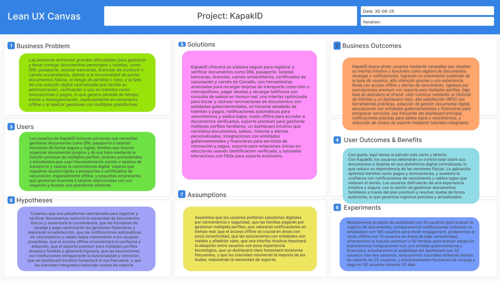

# CAPÍTULO I: Introducción

## 1.1. Startup Profile

### 1.1.1. Descripción de la Startup

PayID es una startup peruana que desarrolla un ecosistema digital para gestionar, desde una sola aplicación, la identidad personal, los documentos, las credenciales académicas, los servicios de transporte y los pagos cotidianos. Su propósito es resolver un problema común: hoy las personas dependen de documentos físicos, varias aplicaciones y distintas tarjetas para realizar tareas simples, lo que les quita tiempo y aumenta el riesgo de pérdida u olvido.

PayID está dirigido principalmente a dos segmentos. El primero son los estudiantes de educación superior de 18 a 29 años, que necesitan tener a mano su DNI y su carné universitario, recargar su tarjeta de transporte y realizar pagos de forma rápida. El segundo son los padres de familia o apoderados de 30 a 55 años, que deben organizar sus documentos y los de su familia, estar atentos a fechas de vencimiento y pagar servicios del hogar. De manera complementaria, PayID considera a los comercios y servicios del ecosistema universitario, que pueden validar el estatus estudiantil de sus clientes y recibir pagos.

En gestión documental, PayID permite registrar, organizar y consultar documentos como el DNI, pasaporte, licencia de conducir, carné universitario y certificados. El usuario registra su DNI en la app y, antes de habilitarlo, el sistema lo valida con RENIEC. Los documentos verificados también pueden consultarse sin conexión a internet. Además, los perfiles familiares permiten que un padre o apoderado administre los documentos de sus hijos desde su propia cuenta.

En movilidad y pagos, PayID busca facilitar la consulta de saldo y la recarga de tarjetas de transporte compatibles con sistemas como el Metropolitano, los corredores complementarios y el Metro de Lima, así como el pago de servicios y deudas, con un historial de todas las operaciones. La disponibilidad de estas funciones dependerá de los acuerdos de integración con cada operador y proveedor.

Como complemento, PayID ofrece un asistente de trámites que guía al usuario con instrucciones, pasos y listas de verificación, y alertas sobre vencimientos de documentos, saldo bajo y operaciones realizadas.

Propuesta de valor

PayID busca ofrecer un ecosistema digital que simplifique la administración personal, académica y familiar mediante la integración de documentos, identidad, movilidad y pagos.

Seguridad: centralización y protección de documentos digitales y credenciales personales mediante mecanismos de autenticación, control de acceso y protección de la información, reduciendo la dependencia de documentos físicos y los riesgos asociados con su pérdida o uso no autorizado.

- Ahorro de tiempo: acceso a documentos, credenciales, servicios y operaciones desde un único entorno digital, evitando que los usuarios tengan que recurrir a diferentes aplicaciones y plataformas para realizar sus actividades cotidianas.
- Acceso inmediato: disponibilidad de documentos e información personal para facilitar su consulta cuando sean necesarios, incluso sin conexión a internet, tanto en actividades académicas como en situaciones personales y familiares.
- Gestión eficiente: organización de documentos, perfiles, pagos y recargas, complementada con recordatorios automáticos sobre vencimientos, alertas de saldo y seguimiento del historial de operaciones.
- Integración: articulación progresiva con servicios de transporte, sistemas de pago y entidades externas, con el propósito de facilitar la administración de diferentes servicios desde un mismo ecosistema digital, de acuerdo con la disponibilidad de integraciones y acuerdos correspondientes.
- Asistencia en trámites: orientación a los usuarios mediante instrucciones, pasos guiados y listas de verificación que faciliten la comprensión y realización de procedimientos administrativos.
- Gestión familiar: administración organizada de documentos e información de diferentes integrantes del núcleo familiar mediante perfiles individuales, facilitando a los padres y apoderados el seguimiento de información y actividades relevantes.

Misión

Desarrollar un ecosistema digital integrado, seguro y accesible que facilite la gestión de la identidad, los documentos personales, las credenciales académicas, los servicios de transporte y las operaciones de pago, contribuyendo a simplificar las actividades cotidianas de estudiantes, padres de familia, apoderados y comercios mediante el uso de tecnologías innovadoras.

Visión

Convertirnos en un ecosistema digital referente en Latinoamérica para la gestión de identidad, documentos y servicios integrados, reconocido por brindar seguridad, confianza y accesibilidad a estudiantes, familias y comercios, promoviendo una experiencia digital más organizada, eficiente e interoperable.

### 1.1.2. Perfiles de integrantes del equipo

| Foto | Alumno | Descripción |
|---|---|---|
|  | Raul Hiroshi Tasayco Osorio | Soy un estudiante de Ingeniería de Software de la Universidad Peruana de Ciencias Aplicadas (UPC), actualmente me encuentro cursando el 7mo ciclo de la carrera.    A lo largo del tiempo que me encuentro en la carrera pude aprender diferentes tecnologías, tanto lenguajes de programación, buenas prácticas de desarrollo, estructuras de datos, finalmente Frameworks como mi Angular en el cual me desempeño en el Frontend. Me considero una persona responsable, listo para trabajar en equipo brindando mi apoyo y con un fuerte compromiso con todos mis deberes.    Mis expectativas para el curso de Aplicaciones Móviles son muy altas, puesto que es un curso en el cual aprenderé diferentes habilidades tanto frontend como backend 📱 |
|  | Jhunior Giussepe Taquiri Calderon | Soy estudiante del séptimo ciclo de Ingeniería de Software en la UPC, con una formación orientada al desarrollo de software y al uso de diversas tecnologías. Tengo experiencia en C++, Python, Java y SQL, además de conocimientos en frameworks frontend como Angular, Vue y React, y tecnologías backend como .NET y Spring Boot. Asimismo, cuento con experiencia en el desarrollo de aplicaciones móviles utilizando Dart, Flutter y Swift, fortaleciendo mis habilidades en diferentes áreas del desarrollo de software. Me considero una persona responsable, organizada y comprometida, con facilidad para trabajar en equipo y con interés en seguir aprendiendo para fortalecer mis conocimientos y perfil profesional. Mis expectativas para el curso de Fundamentos de Arquitectura de Software son comprender cómo se diseñan y estructuran los sistemas de software, conocer los principales estilos y patrones arquitectónicos y aprender a tomar decisiones de diseño considerando atributos de calidad como seguridad, disponibilidad, performance, modificabilidad y usabilidad. Espero que el curso me permita fortalecer mis capacidades para diseñar y desarrollar soluciones de software escalables y de calidad. |
|  | Diego Alonzo Mora Blas | Soy estudiante del octavo ciclo de Ingeniería de Software en la UPC. Tengo experiencia trabajando con TypeScript, Express y Prisma en el desarrollo backend, además de conocimientos en bases de datos SQL. También he trabajado con Spring Boot y .NET aplicando patrones de programación orientada a objetos. Me considero una persona responsable y organizada, con facilidad para trabajar en equipo y muchas ganas de seguir aprendiendo. Para el curso de Fundamentos de Arquitectura de Software espero aprender a diseñar y estructurar sistemas de software, conocer los principales estilos y patrones arquitectónicos, y tomar decisiones de diseño considerando atributos de calidad como seguridad, disponibilidad y performance. Espero aplicar estos conocimientos en el proyecto del curso y fortalecer mis capacidades para diseñar soluciones escalables. |
|  | Dhilsen Armil Mallqui Vilca | Soy estudiante del séptimo ciclo de Ingeniería de Software en la UPC con experiencia como Full Stack Developer. Manejo tecnologías backend (Java, Python, .NET) y frontend (React, Angular, Vue), además de bases de datos. Me considero responsable, organizado y con gran facilidad para trabajar en equipo. Para el curso de Fundamentos de Arquitectura de Software, espero aprender a diseñar sistemas escalables, dominar patrones arquitectónicos y evaluar atributos de calidad como seguridad, disponibilidad y performance. |

## 1.2. Solution Profile

### 1.2.1. Nombre de producto

El producto se llama PayID. El nombre une dos términos en inglés: Pay (pagar) e ID (identificación). De esta forma, refleja las dos funciones principales de la solución: gestionar la identidad y los documentos personales, y realizar pagos y recargas desde una sola aplicación.

Se eligió un nombre corto, fácil de recordar y de pronunciar, pensado para estudiantes de educación superior y padres de familia o apoderados, que son los segmentos objetivo del producto.

### 1.2.2. Antecedentes y Problemática

En la actualidad, los estudiantes de educación superior y los padres de familia o apoderados enfrentan diferentes dificultades para administrar su identidad, documentos personales, credenciales y servicios cotidianos. La información suele encontrarse distribuida entre documentos físicos, archivos digitales y diferentes aplicaciones, lo que puede dificultar su organización, consulta y disponibilidad cuando se necesita realizar un trámite o una actividad específica. Esta situación evidencia la importancia de desarrollar soluciones digitales que faciliten el acceso y la administración de información personal y familiar.

En el contexto peruano, la transformación digital constituye una prioridad para mejorar la relación entre la ciudadanía, las instituciones y los servicios públicos. La Presidencia del Consejo de Ministros (PCM, 2023), mediante la Política Nacional de Transformación Digital al 2030, establece objetivos relacionados con la conectividad, la economía digital, la disponibilidad de servicios públicos digitales inclusivos y el fortalecimiento de la confianza digital. Asimismo, el Estado dispone de la Plataforma de Interoperabilidad (PIDE), que permite el intercambio de información entre entidades públicas y contribuye a simplificar los procedimientos administrativos (PCM, s. f.). Sin embargo, la existencia de estos mecanismos institucionales no significa que todos los servicios que utiliza una persona estén integrados en una única solución de gestión personal.

Esta situación también se observa en el ámbito del transporte público de Lima y Callao. La Autoridad de Transporte Urbano para Lima y Callao (ATU, 2026) informó que, hasta el 31 de enero de 2026, se habían registrado 4 877 954 operaciones de recarga mediante Yape y Plin en el Metropolitano y los corredores complementarios. Esta implementación demuestra el avance de los medios de pago digitales; no obstante, el procedimiento todavía contempla una etapa de activación del saldo mediante módulos o validadores, según el servicio utilizado. Por tanto, existe una oportunidad para continuar mejorando la experiencia de los usuarios mediante soluciones que faciliten la administración de sus servicios de movilidad y pagos desde entornos digitales integrados (ATU, 2026).

La problemática adquiere características particulares en los dos segmentos prioritarios de PayID. Por un lado, los estudiantes de educación superior de entre 18 y 29 años necesitan administrar documentos personales y credenciales académicas, como el carné universitario, además de recargar con frecuencia su tarjeta de transporte. Por otro lado, los padres de familia o apoderados de entre 30 y 55 años requieren organizar sus propios documentos y los de los integrantes de su núcleo familiar, así como realizar un seguimiento de información y actividades importantes. En ambos casos, la utilización de diferentes medios para almacenar documentos, consultar información y gestionar servicios puede incrementar el esfuerzo dedicado a estas actividades.

Adicionalmente, la administración de documentos personales implica responsabilidades relacionadas con la privacidad y la seguridad de la información. En el Perú, la Ley N.° 29733 establece el marco legal para garantizar el derecho fundamental a la protección de los datos personales (Congreso de la República, 2011). Su reglamento vigente, aprobado mediante el Decreto Supremo N.° 016-2024-JUS, desarrolla las disposiciones aplicables al tratamiento de dicha información (Ministerio de Justicia y Derechos Humanos, 2024). En consecuencia, cualquier solución que centralice documentos y datos personales debe considerar mecanismos adecuados de protección, control de acceso y tratamiento responsable de la información.

Frente a este escenario, surge PayID como una propuesta de ecosistema digital integrado que busca centralizar la gestión de identidad, documentos personales, credenciales académicas, perfiles familiares, servicios de transporte y operaciones de pago. Asimismo, incorpora alertas de vencimiento, acceso sin conexión a documentos verificados y un asistente de trámites que orienta a los usuarios mediante pasos guiados. De esta manera, PayID busca reducir la fragmentación de las actividades cotidianas y proporcionar una experiencia digital más organizada, segura y accesible.

5"W"s + 2"H"

WHAT (QUÉ): El problema principal es la dificultad para gestionar de manera centralizada la identidad, los documentos personales, las credenciales académicas, así como determinados servicios de movilidad y pagos. Los usuarios suelen recurrir a diferentes medios para almacenar, consultar y administrar su información, lo que puede ocasionar desorganización, duplicidad de archivos y dificultades para encontrar documentos cuando los necesitan. Esta situación representa una oportunidad para desarrollar un ecosistema digital que facilite la organización y disponibilidad de la información personal y familiar. Esta necesidad se relaciona con los objetivos de la Política Nacional de Transformación Digital al 2030, que promueve servicios digitales inclusivos, seguros y orientados a las necesidades de la ciudadanía (PCM, 2023).

WHEN (CUÁNDO): Este problema se presenta de manera recurrente durante las actividades cotidianas de los usuarios, especialmente cuando necesitan consultar o presentar documentos, realizar trámites, renovar credenciales, efectuar pagos o recargar servicios de transporte. También ocurre cuando deben organizar información de sus familiares o recordar fechas importantes, como el vencimiento de documentos. En el ámbito del transporte público, el uso de recargas digitales evidencia que estas operaciones forman parte de las actividades habituales de los pasajeros. La ATU (2026) reportó más de 4,8 millones de operaciones de recarga mediante Yape y Plin hasta el 31 de enero de 2026.

WHERE (DÓNDE):  El problema se presenta en diferentes entornos personales, académicos y familiares del Perú. En Lima Metropolitana y Callao, también se relaciona con el uso de los sistemas de transporte público, donde los usuarios necesitan gestionar sus recargas y consultar sus operaciones. La implementación de recargas digitales en el Metropolitano y los corredores complementarios constituye un ejemplo de la incorporación de herramientas tecnológicas en estos servicios (ATU, 2026). Asimismo, la problemática se manifiesta en universidades y hogares, espacios en los que los estudiantes y padres de familia requieren acceder a sus documentos y administrar información personal o familiar.

WHO (QUIÉN): Los principales usuarios a los que se dirige PayID son los estudiantes de educación superior de entre 18 y 29 años y los padres de familia o apoderados de entre 30 y 55 años. En el primer segmento se encuentran quienes necesitan administrar sus documentos personales y credenciales académicas, y realizar recargas y pagos cotidianos. En el segundo segmento se encuentran las personas responsables de organizar su propia documentación y la de los integrantes de su núcleo familiar. Ambos grupos han sido definidos como públicos prioritarios de la propuesta, considerando sus necesidades de organización documental y gestión de servicios. De manera complementaria, PayID considera a los comercios y servicios del ecosistema universitario.

WHY (POR QUÉ): Esta problemática se origina principalmente por la fragmentación de la información personal y familiar, la utilización de diferentes aplicaciones para gestionar servicios y la falta de centralización de documentos y credenciales. Además, la administración de esta información exige considerar aspectos de privacidad y seguridad establecidos en la Ley N.° 29733 y su reglamento, aprobado mediante el Decreto Supremo N.° 016-2024-JUS (Congreso de la República, 2011; Ministerio de Justicia y Derechos Humanos, 2024). Por ello, se identifica la necesidad de una solución accesible que permita organizar la información desde un entorno integrado y facilite su consulta mediante herramientas tecnológicas.

HOW (CÓMO): La solución se plantea mediante el desarrollo de PayID como un ecosistema digital integrado, accesible principalmente desde una aplicación móvil, que centralice la gestión de identidad, el almacenamiento y organización de documentos personales, las credenciales académicas y los perfiles familiares. Asimismo, contempla funcionalidades para gestionar pagos y servicios de transporte compatibles. Además, incluirá el registro del DNI en la app validado con RENIEC, el acceso sin conexión a documentos verificados y un asistente de trámites con pasos guiados. También se incorporarán notificaciones y mecanismos de autenticación y control de acceso para contribuir a la protección de la información. Este planteamiento considera los objetivos de seguridad y confianza digital establecidos en la Política Nacional de Transformación Digital al 2030 (PCM, 2023), así como las obligaciones de protección de datos personales aplicables (Ministerio de Justicia y Derechos Humanos, 2024).

HOW MUCH (CUÁNTO): La implementación de PayID requiere considerar los costos asociados al desarrollo del ecosistema digital, la infraestructura en la nube, el almacenamiento de documentos, los mecanismos de seguridad y el mantenimiento de las funcionalidades. También deben contemplarse los recursos necesarios para establecer integraciones con proveedores de pagos y servicios de transporte. Desde la perspectiva del usuario, la propuesta busca reducir el esfuerzo y el tiempo dedicados a gestionar documentos, consultar información y realizar operaciones cotidianas. Estos elementos constituyen criterios para la evaluación económica y técnica del proyecto; los costos específicos deberán determinarse durante su planificación.

### 1.2.3. Lean UX Process

#### 1.2.3.1. Lean UX Problem Statements

Actualmente, los estudiantes de educación superior y los padres de familia o apoderados enfrentan dificultades para gestionar de manera organizada sus documentos personales, credenciales académicas, perfiles familiares y servicios cotidianos. Esta información suele encontrarse distribuida entre documentos físicos, archivos digitales y diferentes aplicaciones, lo que genera dificultades para localizarla, consultarla y mantenerla actualizada. Además, la gestión de pagos y recargas de transporte mediante distintos servicios puede incrementar la cantidad de aplicaciones y procedimientos que los usuarios necesitan utilizar. Esta situación evidencia la falta de un entorno digital integrado que permita administrar la información personal y familiar de manera práctica, segura y accesible.

Consideramos que estos usuarios necesitan una solución integral que les permita centralizar, organizar y consultar sus documentos, credenciales y servicios cotidianos desde un único ecosistema digital. Por ello, PayID busca resolver esta problemática mediante una aplicación móvil que integre funcionalidades de identidad digital, almacenamiento y clasificación de documentos, administración de perfiles familiares, gestión de pagos y servicios de transporte compatibles. También incorpora alertas de vencimiento, acceso sin conexión a documentos verificados y un asistente de trámites con pasos guiados. De esta manera, los estudiantes podrán administrar sus credenciales académicas y recargas de transporte, mientras que los padres de familia o apoderados podrán organizar su documentación y la de sus familiares desde un entorno centralizado.

Sabremos que PayID ha alcanzado los resultados esperados cuando los usuarios puedan encontrar y consultar sus documentos con mayor facilidad, reduzcan la necesidad de utilizar diferentes aplicaciones para gestionar su información y reciban alertas oportunas para recordar fechas importantes. Asimismo, se evaluará el éxito mediante indicadores como la cantidad de usuarios registrados, la frecuencia de uso de las funcionalidades principales, el número de documentos organizados, la utilización del asistente de trámites y el nivel de satisfacción de los usuarios durante los primeros meses de funcionamiento.

#### 1.2.3.2. Lean UX Assumptions

Business Outcomes:

- Crecimiento de la Base de Usuarios

PayID busca atraer a personas que desean gestionar sus documentos y tarjetas de manera digital con campañas de marketing que resalten la facilidad de uso de la plataforma. Su diseño intuitivo y herramientas como el registro de DNI, pasaporte, tarjetas de transporte y notificaciones fomentarán una adopción amplia y sostenida.

- Alta Retención de Usuarios

Buscamos retener a los usuarios comprometidos con una experiencia fluida y funcionalidades valiosas como consulta de saldos, historial de trámites y notificaciones de vencimiento. El dashboard principal, claro y accesible, asegurará que los usuarios integren PayID en su rutina diaria.

- Ingresos por Suscripciones Premium

Generaremos ingresos a través de suscripciones premium, con funciones avanzadas como soporte para múltiples perfiles (por ejemplo, para gestionar documentos de hijos). Estas herramientas motivarán a los usuarios a optar por planes pagos para una mayor comodidad en la gestión de documentos.

- Minimización del Churn Rate

Reducir la pérdida de usuarios es clave para PayID. Con un dashboard principal útil y herramientas como modo offline y notificaciones de vencimiento, la plataforma ofrecerá valor continuo, manteniendo a los usuarios leales y comprometidos a largo plazo.

- Satisfacción del Usuario (NPS)

PayID maximizará la satisfacción con una interfaz intuitiva y funciones prácticas como recarga de tarjetas, renovación de documentos y modo offline. La retroalimentación constante permitirá ajustar la plataforma para superar las expectativas de los usuarios.

- Adopción de Funciones de Gestión de Documentos

Fomentaremos el uso de herramientas para registrar y verificar documentos como DNI, pasaporte, licencias y carnés, accesibles desde el dashboard principal. Estas funcionalidades serán clave para que los usuarios reemplacen documentos físicos por la app.

- Establecimiento de Hábitos de Gestión Digital

Buscaremos motivar a los usuarios a gestionar trámites y pagos, como recargas de transporte o renovación de documentos, con una interfaz sencilla y notificaciones motivadoras en el dashboard principal. Esto convertirá a PayID en un aliado para la organización personal.

- Optimización de Trámites Digitales
- Los usuarios optimizarán sus trámites con PayID, utilizando herramientas para solicitar la renovación de documentos, recargar tarjetas de transporte y pagar deudas desde el dashboard principal. Esto les permitirá ahorrar tiempo, reducir la necesidad de acudir a oficinas físicas y mantener un historial organizado de sus gestiones.
- Precisión en Notificaciones de Vencimiento
- PayID mejorará la experiencia con notificaciones precisas sobre vencimientos de documentos o saldos bajos, integradas en el dashboard principal. Esto permitirá a los usuarios planificar y actuar con anticipación.
- Usuarios Activos en Familias
- PayID atraerá a familias con la opción premium para gestionar múltiples perfiles, como documentos de hijos, desde un dashboard principal intuitivo. Su enfoque práctico y escalable lo convertirá en la opción ideal para la gestión documental familiar.
- Uso de Funciones de Pago y Recarga
- PayID promoverá el uso de herramientas para recargar tarjetas de transporte y pagar deudas desde el dashboard principal. Esto facilitará una gestión financiera responsable y aumentará la confianza en la plataforma.
- Asociaciones con Entidades Gubernamentales y Financieras
- PayID buscará establecer alianzas con entidades gubernamentales y financieras para integrar servicios como la renovación de documentos y el pago de servicios. Estas colaboraciones, accesibles desde el dashboard principal, enriquecerán la experiencia y el valor para los usuarios.
- Frecuencia de Uso del Dashboard Principal
- PayID incentivará el uso frecuente del dashboard principal, que muestra documentos, saldos, historial de trámites y notificaciones de forma clara. Su diseño atractivo asegurará que los usuarios lo consulten regularmente para gestionar sus documentos y pagos.
- Precisión en Notificaciones de Saldo Bajo
- PayID fortalecerá la confianza con notificaciones precisas de saldos bajos en tarjetas, integradas en el dashboard principal. Estas alertas ayudarán a los usuarios a identificar necesidades de recarga y tomar medidas rápidas.
- Reducción de Costos de Soporte
- PayID minimizará los costos de soporte con tutoriales interactivos y FAQs integrados en la plataforma. Esto permitirá a los usuarios resolver dudas de forma autónoma, mejorando la experiencia general.

User Outcomes:

- Control Documental Personal Mejorado
- Los usuarios de PayID lograrán un mayor control sobre sus documentos personales y tarjetas, como DNI, pasaporte, licencias y carnés, al utilizar herramientas de registro y verificación digital. El dashboard principal les proporcionará una visión clara de sus documentos, saldos y trámites, permitiéndoles gestionar todo desde su celular y reducir la dependencia de documentos físicos.
- Organización Eficiente para Familias
- Los usuarios, especialmente familias, usarán PayID para organizar documentos de múltiples perfiles (como los de sus hijos) con la opción premium. El dashboard principal les ofrecerá una vista consolidada de documentos y trámites, ayudándoles a anticipar vencimientos y gestionar renovaciones de manera eficiente.
- Optimización de Trámites Digitales
- Los usuarios optimizarán sus trámites con PayID, utilizando herramientas para renovar documentos, recargar tarjetas de transporte y pagar deudas desde el dashboard principal. Esto les permitirá ahorrar tiempo, reducir la necesidad de acudir a oficinas físicas y mantener un historial organizado de sus gestiones.
- Confianza en la Gestión de Pagos
- Los usuarios que realizan pagos encontrarán en PayID una herramienta confiable para recargar tarjetas o pagar deudas. Desde el dashboard principal, podrán consultar saldos y revisar el historial de pagos, tomando decisiones informadas sin comprometer su organización financiera.
- Adopción de Gestión Documental Digital
- PayID empoderará a los usuarios para gestionar documentos digitalmente, como DNI, pasaporte o certificados, con una interfaz sencilla y notificaciones de vencimiento en el dashboard principal. Esto les ayudará a mantenerse organizados y reducir el uso de documentos físicos con facilidad.
- Reducción del Estrés Documental

Los usuarios experimentarán menos estrés al gestionar documentos gracias a la claridad que ofrece el dashboard principal y las notificaciones de vencimiento o saldo bajo. Estas funcionalidades les permitirán monitorear sus documentos en tiempo real, reaccionar ante alertas y mantener el control sin esfuerzo.

- Mayor Confianza en la Seguridad de Documentos

PayID aumentará la confianza de los usuarios al proporcionar un entorno seguro para almacenar y verificar documentos, con acceso offline a documentos verificados desde el dashboard principal. Esto permitirá a los usuarios sentirse protegidos y acceder a su información incluso sin conexión.

- Experiencia de Uso Intuitiva
- Los usuarios disfrutarán de una experiencia fluida y accesible con PayID, gracias a su interfaz intuitiva y al dashboard principal que centraliza documentos, saldos y trámites. Esto facilitará la adopción de la plataforma, incluso para aquellos con poca experiencia digital, integrándola en su rutina diaria.
- Gestión Colaborativa de Documentos Familiares
- Las familias se beneficiarán de la opción premium de PayID, que permite gestionar documentos de varios miembros desde el dashboard principal. Esto fomentará una organización coordinada, asegurando que todos los documentos estén centralizados y accesibles.
- Acceso a Servicios de Trámites Externos
- A través de asociaciones con entidades gubernamentales y financieras, en la medida en que se concreten, los usuarios de PayID podrán solicitar la renovación de documentos o realizar pagos directamente desde la plataforma. Esto, integrado en el dashboard principal, enriquecerá su experiencia y les proporcionará recursos adicionales para gestionar sus documentos.
- Monitoreo Frecuente de Documentos y Pagos
- PayID incentivará a los usuarios a monitorear sus documentos y pagos regularmente a través del dashboard principal, que presenta documentos, saldos, historial de trámites y notificaciones de forma clara. Este hábito les permitirá mantenerse informados y tomar medidas rápidas para mantener todo en orden.
- Resolución Autónoma de Dudas
- Los usuarios resolverán dudas de manera autónoma con los tutoriales interactivos y FAQs integrados en PayID. Esta funcionalidad reducirá la necesidad de soporte externo, permitiéndoles aprovechar al máximo la plataforma con confianza y facilidad.
- Mayor Claridad en Trámites y Pagos
- PayID ayudará a los usuarios a comprender mejor sus trámites y pagos mediante reportes claros en el dashboard principal. Esta claridad les permitirá ajustar sus hábitos de gestión y alinear sus decisiones con sus necesidades personales o familiares.
- Motivación para Mantener Documentos Actualizados
- Los usuarios se sentirán motivados para mantener sus documentos actualizados con las notificaciones de vencimiento y recordatorios de PayID, integrados en el dashboard principal. Esta funcionalidad les ayudará a mantenerse organizados y celebrar sus logros en la gestión documental.
- Reducción de Errores en Gestión Documental
- PayID minimizará los errores en la gestión documental al automatizar el registro de documentos y ofrecer notificaciones precisas en el dashboard principal. Esto permitirá a los usuarios evitar equivocaciones costosas y mantener registros precisos con menos esfuerzo.

#### 1.2.3.3. Lean UX Hypothesis Statements

Creemos que digitalizar y centralizar los documentos personales y los documentos personales y la información de las tarjetas de transporte compatibles en PayID facilitará la vida diaria de los usuarios al reducir la dependencia de llevar documentos físicos.  Sabremos que esto es cierto cuando los usuarios reporten una menor necesidad de llevar documentos físicos para realizar trámites o actividades cotidianas en el primer mes de uso.

Creemos que las notificaciones automatizadas sobre vencimientos de documentos y saldos bajos ayudarán a los usuarios a mantenerse proactivos y a evitar inconvenientes o estrés por no tener sus documentos al día.  Sabremos que esto es cierto cuando el 60 % de los usuarios que reciban una notificación de vencimiento consulten el documento desde la app dentro de los siguientes 7 días, y cuando el uso de la función de recarga aumente un 15 % tras las alertas de saldo bajo.

Creemos que la función de modo offline proporcionará un valor esencial y aumentará la confianza del usuario, asegurando que siempre tengan acceso a sus documentos verificados, incluso sin conexión a internet.  Sabremos que esto es cierto cuando al menos el 20 % de los usuarios acceda a la app en modo offline en un periodo de 30 días, y cuando los comentarios sobre la seguridad y la conveniencia de esta función sean consistentemente positivos.

Creemos que el plan premium con funcionalidades para administrar múltiples perfiles familiares motivará a los usuarios a suscribirse, ya que les permitirá administrar de forma eficiente los documentos de sus hijos y otros miembros de la familia.  Sabremos que esto es cierto cuando al menos el 10 % de los usuarios que usen la prueba gratuita del plan premium decidan pagar por la suscripción en el primer mes.

Creemos que una interfaz de usuario intuitiva y los tutoriales interactivos permitirán a usuarios con poca familiaridad tecnológica adoptar la app y completar tareas clave como el registro de documentos y los trámites sin necesitar soporte técnico directo.  Sabremos que esto es cierto cuando el 85 % de los usuarios nuevos completen su perfil y registren al menos tres documentos personales en la primera semana sin abrir un ticket de soporte.

Creemos que la integración con entidades gubernamentales para facilitar la solicitud y el seguimiento de la renovación de documentos, así como el acceso a servicios como el pago de multas y servicios, sujeta a los acuerdos que se establezcan con dichas entidades, favorecerá la adopción de PayID, ya que los usuarios verán la app como un ecosistema digital confiable para gestionar documentos y acceder a servicios.  Sabremos que esto es cierto cuando al menos el 25 % de los usuarios que hayan registrado un documento con fecha de vencimiento próxima intenten iniciar el proceso de renovación a través de la app.

Creemos que la capacidad de pagar deudas y servicios básicos directamente desde PayID incrementará la frecuencia de uso del ecosistema y lo posicionará como una herramienta esencial para la gestión financiera personal.  Sabremos que esto es cierto cuando el 40 % de los usuarios que tengan un medio de pago registrado realicen al menos una transacción de pago de servicios, deudas o recarga de transporte en un periodo de 30 días.

#### 1.2.3.4. Lean UX Canvas

## 1.3. Segmentos objetivo

PayID atiende a dos segmentos prioritarios de usuarios finales (B2C) y a un segmento complementario de comercios (B2B). Cada uno se beneficia de las funcionalidades de la aplicación de manera distinta:

Segmento 1: Estudiantes de Educación Superior (B2C)

- Perfil demográfico y psicográfico: Jóvenes de 18 a 29 años, estudiantes de universidades e institutos de educación superior. Son nativos digitales con alta adopción de banca móvil y dispositivos inteligentes, que valoran la inmediatez, la practicidad y la movilidad en su día a día.
- Problema o necesidad (Dolor): Sobrecarga y fricción por portar múltiples identificaciones físicas (DNI, carné universitario, tarjetas bancarias y pases de transporte), lo que genera un alto riesgo de extravío, deterioro o suplantación. Asimismo, enfrentan demoras en trámites presenciales de validación académica y en el pago de servicios universitarios.
- Propuesta de valor de PayID: Centralización en una única aplicación de su identidad ciudadana oficial, su acreditación estudiantil validada en tiempo real y sus métodos de pago, permitiéndoles realizar trámites, identificarse y pagar servicios o consumos cotidianos de forma rápida y segura desde su celular.

Segmento 2: Padres de Familia y Apoderados (B2C)

- Perfil demográfico y psicográfico: Hombres y mujeres de 30 a 55 años con hijos o familiares a su cargo, en etapa escolar o de educación superior. Valoran la seguridad, el orden y la tranquilidad de saber que los documentos y los gastos de su familia están bajo control.
- Problema o necesidad (Dolor): Dificultad para organizar y tener a mano los documentos de sus hijos o familiares, y para recordar sus fechas de vencimiento. Además, tienen poca visibilidad sobre los pagos académicos (matrículas, pensiones, trámites) y los gastos cotidianos del hogar, y les cuesta gestionar documentación a distancia.
- Propuesta de valor de PayID: Perfiles familiares para gestionar desde una sola cuenta los documentos de sus hijos o familiares, con alertas de vencimiento, pago de matrículas, pensiones y servicios, e historial de operaciones para controlar los gastos del hogar con total seguridad.

Segmento 3: Comercios y Servicios del Ecosistema Universitario (B2B)

- Perfil: Micro, pequeñas y medianas empresas ubicadas dentro o en las inmediaciones de los campus (cafeterías, librerías, centros de copiado, concesionarios de alimentación) y comercios afiliados que ofrecen beneficios o tarifas especiales para la comunidad estudiantil.
- Problema o necesidad (Dolor): Dificultad para validar de manera rápida y fiable la condición de estudiante activo para aplicar promociones, sufriendo fraudes por carnés físicos vencidos o adulterados. Adicionalmente, padecen lentitud en el cobro en horas pico mediante efectivo o terminales de pago lentos.
- Propuesta de valor de PayID: Herramienta ágil de cobro y validación simultánea que comprueba al instante la identidad y vigencia académica del cliente mediante códigos seguros, acelerando la atención en caja y reduciendo el fraude sin requerir infraestructura de hardware costosa.
