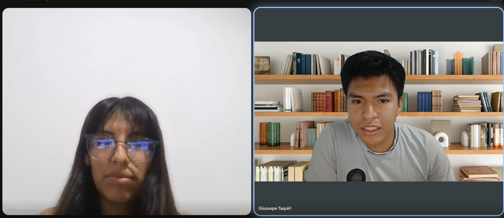
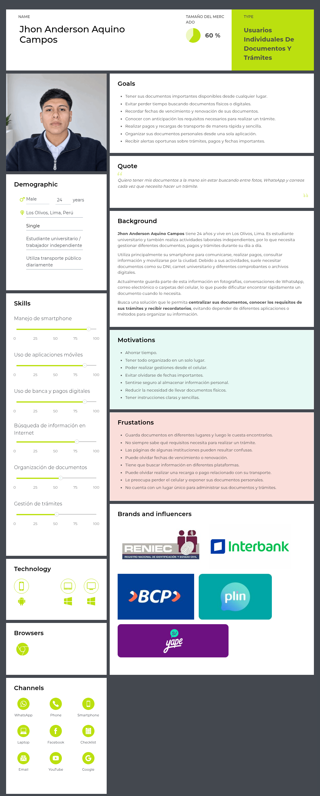
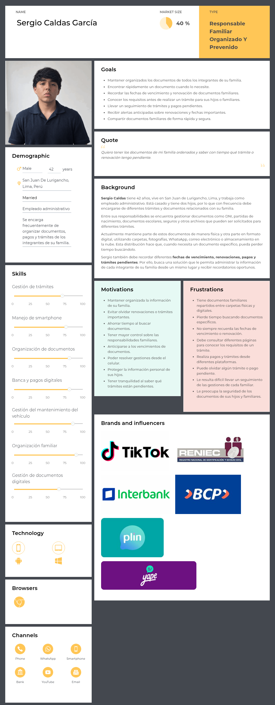
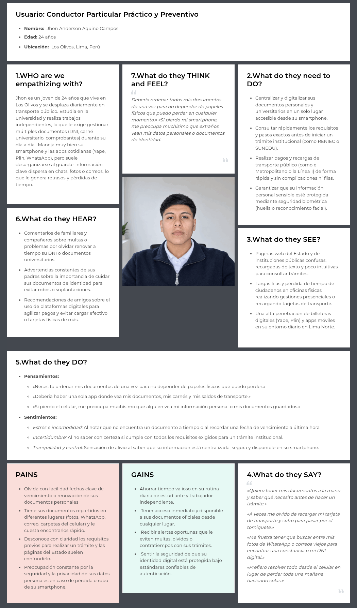
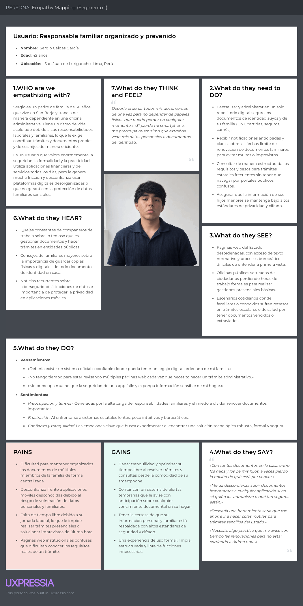
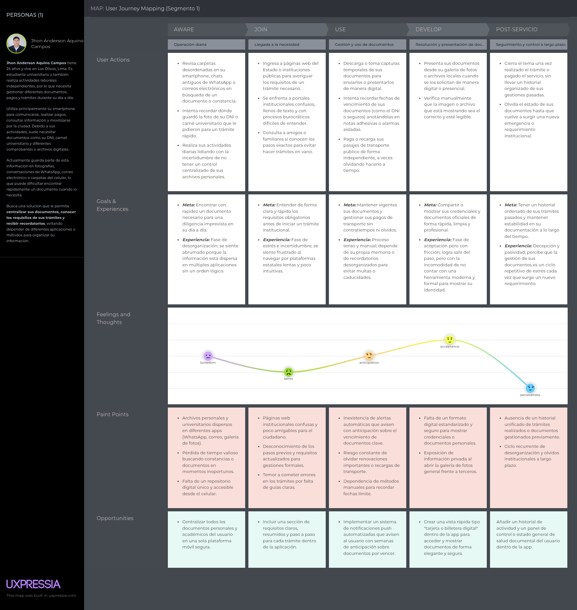
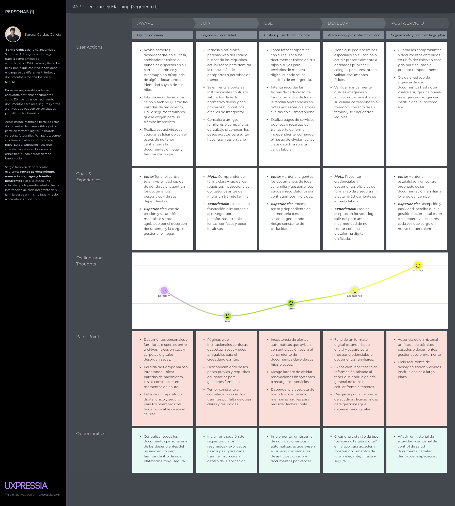
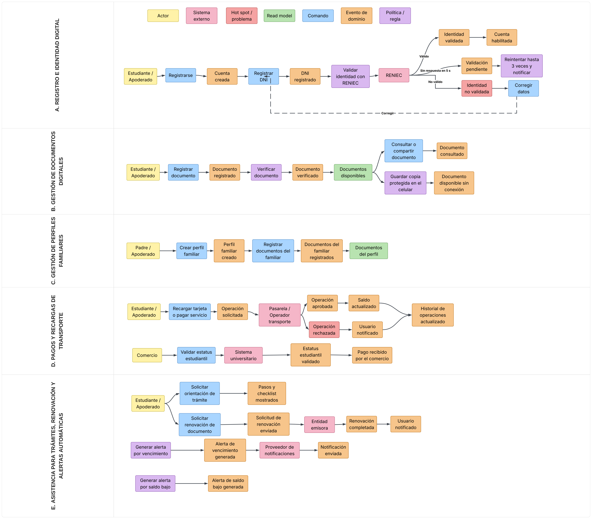

# CAPÍTULO II: Requirements & Analysis

## 2.1. Competidores

¿Por qué es necesario este análisis?

• Evaluar a la competencia va más allá de cumplir con un requerimiento formal del documento; es la base para definir la viabilidad técnica y comercial de PayID. Dado que nuestra plataforma cruza distintas áreas (tecnología financiera, identidad digital y gestión universitaria), analizar el entorno nos permite:

• Entender la fragmentación del mercado actual: Hoy en día, el usuario divide su atención entre aplicaciones bancarias, credenciales plásticas y portales institucionales. Este mapeo sirve para identificar cómo operan estas soluciones de forma aislada y entender por qué no están interoperando.

• Detectar deficiencias y aciertos técnicos: Observar la agilidad transaccional que tienen las billeteras actuales, pero contrastándola con sus debilidades al momento de validar identidad de forma robusta o conectarse con bases de datos académicas. Esto nos muestra qué errores de arquitectura o experiencia de usuario debemos evitar.

• Validar nuestro factor diferenciador: Asegurar que el enfoque de PayID tenga sentido en el mundo real. La meta no es programar una billetera más del montón, sino construir un hub centralizado que unifique el DNI, el estatus estudiantil y los pagos, resolviendo un problema de integración que ningún competidor local ha logrado solucionar por completo.

• Priorizar el desarrollo del producto: Al notar qué necesidades están totalmente desatendidas por la competencia, podemos decidir qué módulos de nuestro sistema construir primero, enfocando los recursos en las funciones que más valor generen desde el lanzamiento.

• Prevenir riesgos normativos y de seguridad: Analizar cómo los actores del mercado manejan el cumplimiento regulatorio (por ejemplo, normativas de la SBS, SUNAT y protección de datos). Esto nos da un marco de referencia vital para diseñar una arquitectura de software segura desde el primer día y evitar penalidades o bloqueos legales a futuro.

### 2.1.1. Análisis competitivo (Comparativa)

¿Por qué llevar a cabo este análisis?

El análisis competitivo de PayID permite entender el panorama actual de billeteras digitales e identidades electrónicas en Perú, identificar qué hacen bien los competidores y en qué fallan, y posicionar a PayID como una solución integral que combina pagos, identidad y gestión de documentos.

| Aspecto | PayID | Yape | Plin | IDPerú (RENIEC) | Google Wallet |
|---|---|---|---|---|---|
| Perfil |  |  |  |  |  |
| Overview | Plataforma digital que integra identidad, pagos, transporte y gestión de documentos. | Billetera digital bancaria popular en Perú. | Billetera digital interoperable entre bancos. | Plataforma estatal de identidad digital. | Billetera digital global de Google. |
| Ventaja competitiva / Valor ofrecido | Centralización de documentos + pagos + alertas + transporte en una sola app. | Confianza y popularidad entre usuarios peruanos. | Interoperabilidad bancaria amplia. | Identidad digital oficial. | Integración global en dispositivos Android. |
| Nivel de Marketing |  |  |  |  |  |
| Mercado objetivo | Estudiantes, familias y ciudadanos que requieren gestionar trámites, transporte y pagos en Perú. | Jóvenes y adultos bancarizados en Perú. | Usuarios de banca digital en Perú. | Ciudadanos peruanos que requieren autenticación oficial. | Usuarios globales de Android interesados en pagos digitales. |
| Estrategias de marketing | Diferenciación por seguridad, centralización y adaptación local (Metropolitano, Línea 1, SUNEDU, CONADIS). Campañas digitales y alianzas institucionales. | Marketing masivo, respaldo bancario. | Posicionamiento en interoperabilidad y simplicidad. | Difusión estatal y obligatoriedad en trámites oficiales. | Estrategia global en Google Pay y servicios Android. |
| Perfil de Producto |  |  |  |  |  |
| Productos & Servicios | Identidad digital, pagos, recargas de transporte, alertas inteligentes, asistente de trámites. | Pagos y transferencias. | Pagos y transferencias entre bancos. | Autenticación y certificados digitales. | Pagos digitales y almacenamiento de tarjetas. |
| Precios & Costos | Modelo freemium: básico gratis, premium con alertas avanzadas y perfiles múltiples. | Gratis para usuarios. | Gratis para usuarios. | Gratis para ciudadanos (respaldado por el Estado). | Gratis, requiere dispositivos Android. |
| Canales de distribución (Web/Móvil) | App móvil (Android/iOS) con integración a servicios locales. | App móvil Android/iOS. | App móvil Android/iOS. | Plataforma digital oficial, apps de gobierno. | App móvil preinstalada en Android. |
| Análisis SWOT |  |  |  |  |  |
| Fortalezas | Centralización total de documentos, alertas inteligentes, perfiles múltiples, modo offline, asistente de trámites. | Popularidad masiva, confianza en respaldo bancario. | Interoperabilidad bancaria, simplicidad. | Respaldo oficial del Estado, obligatoriedad en trámites. | Integración global y masiva en Android. |
| Debilidades | Requiere generar confianza inicial en usuarios para almacenar documentos sensibles. | No gestiona documentos ni transporte. | No maneja alertas ni documentos. | No cubre pagos ni transporte. | No adaptado al contexto peruano, sin enfoque en trámites locales. |
| Oportunidades | Creciente digitalización de trámites en Perú, necesidad de integración transporte + pagos + identidad. | Crecer en funcionalidades más allá de pagos. | Mejorar experiencia de usuario e incluir servicios adicionales. | Ampliar servicios digitales más allá de identidad. | Expandirse en mercados emergentes con servicios locales. |
| Amenazas | Competidores bancarios consolidados, desconfianza en gestión digital de documentos sensibles. | Aparición de apps más completas en Perú. | Nuevos competidores fintech más versátiles. | Baja adopción si usuarios prefieren soluciones privadas. | Regulaciones locales que limiten su alcance. |

¿Por qué PayID es superior?

• Integra lo mejor de todos los competidores: pagos (como Yape/Plin), identidad segura (como IDPerú), y almacenamiento de tarjetas (como Google Wallet).

• Agrega valor único: centralización de documentos, alertas inteligentes, perfiles múltiples, modo offline y asistentes de trámites.

• Diseñada para el contexto peruano: compatible con Metropolitano, Línea 1, SUNEDU y CONADIS.

### 2.1.2. Estrategias y tácticas frente a competidores

Estrategias:

• Diferenciación por centralización y seguridad (cifrado, biometría).

• Experiencia adaptada al contexto peruano (Metropolitano, Línea 1, SUNEDU, CONADIS).

• Cumplimiento Ley 29733 para generar confianza.

Tácticas:

• Alianzas con universidades y colectivos de transporte.

• Campañas digitales: “Olvídate de cargar documentos físicos, usa PayID”.

• Modelo freemium: básico gratis, premium con alertas avanzadas y perfiles múltiples.

## 2.2. Entrevistas

### 2.2.1. Diseño de entrevistas

Segmentos objetivo:

• Estudiantes universitarios (18–29) que usan transporte público.

• Padres/madres o tutores (25–45) que gestionan documentos de hijos.

Objetivo: Identificar las principales necesidades, dificultades y expectativas de los usuarios respecto a la gestión de documentos, trámites y servicios desde dispositivos móviles, así como conocer sus percepciones sobre seguridad, facilidad de uso, disponibilidad, alertas y administración de múltiples perfiles. .

#### Preguntas para el segmento 1: Estudiantes universitarios

- ¿Qué documentos, carnés o tarjetas necesitas utilizar o llevar contigo con mayor frecuencia y para qué los utilizas?
- Cuéntame sobre la última vez que necesitaste un documento y no lo tenías contigo. ¿Qué ocurrió y cómo solucionaste el problema?
- ¿Qué dificultades encuentras actualmente cuando necesitas realizar un trámite relacionado con alguno de tus documentos?
- Cuando tienes que realizar un trámite, ¿cómo recuerdas actualmente los requisitos, pasos y fechas que debes cumplir?
- ¿Cómo realizas actualmente tus recargas o pagos relacionados con el transporte público? ¿Qué parte del proceso te resulta más incómoda o complicada?
- ¿Qué tan cómodo(a) te sentirías teniendo copias digitales de tus documentos importantes en una aplicación móvil? ¿Qué te generaría confianza o desconfianza?
- Si tu celular se pierde o es robado, ¿qué te preocuparía respecto a los documentos almacenados en él y qué esperarías que hiciera la aplicación?
- Si pudieras gestionar tus documentos y los de tus hijos o familiares desde un mismo lugar, ¿qué acciones necesitarías realizar con mayor frecuencia?
- Si existiera una aplicación que centralizara tus documentos, trámites y recordatorios, ¿qué problema esperarías que resolviera principalmente para ti?
- De todo lo que hemos conversado, ¿cuáles serían las tres funciones que considerarías indispensables y por qué?

#### Preguntas para el segmento 2: Padres, madres o tutores

- ¿Qué documentos de tus hijos o familiares necesitas gestionar o utilizar con mayor frecuencia y para qué los necesitas?
- ¿Cómo organizas actualmente los documentos de tus hijos o familiares? ¿Qué dificultades encuentras para mantenerlos ordenados?
- Cuéntame sobre alguna ocasión en la que necesitaste un documento de tu hijo o familiar y no pudiste encontrarlo rápidamente. ¿Qué ocurrió y cómo lo solucionaste?
- Cuando tienes que realizar un trámite para uno de tus hijos o familiares, ¿cómo averiguas los requisitos y qué dificultades encuentras durante el proceso?
- ¿Cómo recuerdas actualmente las fechas de vencimiento o renovación de los documentos de tus hijos o familiares?
- ¿Qué tipo de recordatorios te serían más útiles para evitar olvidar una renovación, trámite, pago o documento importante de tu familia?
- Si pudieras gestionar tus documentos y los de tus hijos o familiares desde una misma aplicación, ¿qué acciones te gustaría poder realizar?
- ¿Qué aspectos de seguridad considerarías necesarios para confiar en una aplicación que almacene los documentos de tus hijos o familiares?
- ¿Cómo llevas actualmente el control de los pagos, trámites o documentos pendientes de tu familia? ¿Qué dificultades tienes para hacer seguimiento?
- Si tuvieras una aplicación para organizar los documentos, trámites, pagos y fechas importantes de tu familia, ¿cuáles serían las tres funciones que más necesitarías y por qué?

### 2.2.2. Registro de entrevistas

Entrevistas a estudiantes universitarios

| Campo | Información |
|---|---|
| Entrevistado 1 | Shary Marquina |
| Edad | 21 años |
| Distrito | San Borja |
| Foto |  |
| Timing | [Ver grabación](https://upcedupe-my.sharepoint.com/:v:/g/personal/u20221c576_upc_edu_pe/IQBBMshAfQy1ToIXr51Hw39bASuW-J9wHx6Z_lq4dxclyIs?nav=eyJyZWZlcnJhbEluZm8iOnsicmVmZXJyYWxBcHAiOiJPbmVEcml2ZUZvckJ1c2luZXNzIiwicmVmZXJyYWxBcHBQbGF0Zm9ybSI6IldlYiIsInJlZmVycmFsTW9kZSI6InZpZXciLCJyZWZlcnJhbFZpZXciOiJNeUZpbGVzTGlua0NvcHkifX0&e=areOxR) |

| Campo | Información |
|---|---|
| Entrevistado 2 | Jhon Anderson Aquino Campos |
| Edad | 24 |
| Distrito | Los olivos |
| Foto |  |
| Timing | [Ver grabación](https://youtu.be/gGd9kwKDJM4) |

Entrevistas a padres/madres o tutores

| Campo | Información |
|---|---|
| Entrevistado 1 | Freddy Jesus Torre Valverde |
| Edad | 35 |
| Distrito | Surco |
| Foto |  |
| Timing | [Ver grabación](https://www.youtube.com/watch?v=LSnkTj_Xj1Q) |

| Campo | Información |
|---|---|
| Entrevistado 2 | Enrique Villazon Saravia |
| Edad | 25 |
| Distrito | Surco |
| Foto |  |
| Timing | [Ver grabación](https://youtu.be/je7XNby1e4k?si=vveTRPffyz0od9pX) |

| Campo | Información |
|---|---|
| Entrevistado 3 | Sergio Caldas García |
| Edad | 42 |
| Distrito | San Juan de Lurigancho |
| Foto |  |
| Timing | [Ver grabación](https://youtu.be/Dh1ir3HOLUQ) |

### 2.2.3. Análisis de entrevistas

Segmento 1: Jóvenes universitarios usuarios de transporte y documentos digitales

Entrevistado 1: Shary (Enfoque en Eficiencia y Gestión Documental)

Perfil

Shary, estudiante de Derecho de 21 años y residente de San Borja. Su rutina diaria combina sus actividades universitarias con sus prácticas en la Fiscalía de Lima Sur, por lo que utiliza constantemente documentos personales, universitarios y relacionados con sus prácticas. Para movilizarse utiliza el transporte público y el tren.

Insights clave

- La gestión de documentos representa una dificultad cuando debe trasladarse entre la universidad, su domicilio y la Fiscalía, debido a que necesita tener disponibles diferentes documentos durante el día.
- La organización y disponibilidad inmediata de documentos digitales tendría un alto valor para Shary, ya que le permitiría reducir el tiempo que dedica a buscar documentos físicos y evitar olvidarlos.

Problemas y frustraciones

- Incomodidad y pérdida de tiempo cuando olvida algún documento importante, especialmente el DNI, y debe regresar a casa para recogerlo.
- Dificultad para encontrar rápidamente los requisitos y pasos de algunos trámites, debido a que la información se encuentra distribuida en diferentes páginas y fuentes.
- Riesgo de olvidar fechas importantes relacionadas con trámites o renovación de documentos debido a sus responsabilidades universitarias y de prácticas.

Necesidades

- Contar con un espacio centralizado donde pueda almacenar y consultar de manera segura sus documentos personales, universitarios y relacionados con sus actividades.
- Recibir alertas anticipadas sobre vencimientos, trámites y fechas importantes para evitar olvidos.
- Disponer de mecanismos de seguridad como huella digital o reconocimiento facial para proteger sus documentos personales.

Oportunidades para PayID

Gestión Documental Centralizada: Permitir que Shary almacene y consulte sus documentos personales y académicos desde un único lugar, reduciendo la necesidad de transportar documentos físicos.

Asistente de Trámites: Incorporar un checklist que muestre los requisitos y pasos de cada trámite, facilitando su organización y reduciendo el tiempo dedicado a buscar información.

Alertas Inteligentes: Implementar notificaciones sobre vencimientos y fechas importantes para ayudarla a mantenerse organizada entre sus actividades universitarias y sus prácticas.

Acceso Seguro a Documentos: Incorporar autenticación mediante biometría para proteger su información y permitirle acceder a sus documentos de forma rápida y segura.

Entrevistado 2: z (Enfoque en Seguridad y Disponibilidad)

Perfil

Insights clave

•

Problemas y frustraciones

•

Necesidades

Oportunidades para PayID

Bóveda Biométrica: .

Soporte Offline: t.

Entrevistado 3: Jhon Anderson Aquino Campos (Enfoque en Organización y Acceso de Documentos)

### Perfil

Jhon Anderson Aquino Campos, estudiante universitario de 24 años y residente de Los Olivos. Su rutina combina sus actividades académicas y laborales, por lo que utiliza con frecuencia documentos personales y universitarios. Se moviliza principalmente en transporte público y utiliza su smartphone para realizar pagos, consultar información y gestionar sus actividades.

### Insights clave

- Jhon necesita tener sus documentos disponibles rápidamente, especialmente cuando se encuentra fuera de casa.
- Actualmente utiliza fotografías, capturas y diferentes aplicaciones para guardar información, lo que dificulta encontrar un documento cuando lo necesita.

### Problemas y frustraciones

- Incomodidad y pérdida de tiempo cuando olvida llevar un documento importante y debe regresar a casa.
- Dificultad para conocer rápidamente los requisitos y pasos de algunos trámites, ya que debe buscar información en Internet.
- Riesgo de olvidar fechas de vencimiento, trámites o pagos importantes al no contar con recordatorios específicos.

### Necesidades

- Contar con un espacio centralizado donde pueda almacenar y consultar de forma segura sus documentos personales y universitarios.
- Recibir alertas sobre vencimientos, trámites y fechas importantes para evitar olvidos.
- Poder proteger sus documentos mediante contraseña, huella digital u otro mecanismo de seguridad.

### Oportunidades para PayID

Gestión Documental Centralizada: Permitir que Jhon almacene y consulte sus documentos personales y universitarios desde un único lugar, evitando depender de fotografías, WhatsApp o diferentes aplicaciones.

Asistente de Trámites: Mostrar los requisitos y pasos necesarios para cada trámite mediante información clara y organizada, reduciendo el tiempo que dedica a buscar información.

Alertas Inteligentes: Enviar recordatorios sobre vencimientos, trámites y pagos importantes para ayudarlo a mantenerse organizado.

Acceso Seguro a Documentos: Incorporar mecanismos como huella digital o contraseña para proteger sus documentos y permitir un acceso rápido y seguro.

Segmento 2: Padres/Madres o Tutores

Entrevistado 1: Enrique Villazon Saravia (Enfoque en Organización Familiar y Acceso Digital)

Perfil

Enrique Villazon Saravia es tutor de su hermano menor, debido a que sus padres se encuentran atravesando un proceso de divorcio y, por motivos laborales, pasan gran parte del día fuera de casa. Por ello, Enrique se encarga frecuentemente de atender las necesidades de su hermano y de gestionar documentos importantes relacionados con él, como su DNI y pasaporte.

Insights clave

• Enrique considera fundamental tener disponibles los documentos de su hermano, especialmente ante situaciones de emergencia, viajes o trámites que requieran identificación.

• Mantiene los documentos físicos en un lugar protegido dentro de su hogar, siguiendo un sistema similar al utilizado por su madre, aunque muestra una preocupación adicional por la seguridad de estos.

• La posibilidad de contar con documentos digitalizados, protegidos mediante una clave y disponibles desde el celular tendría un alto valor para Enrique, especialmente ante pérdidas, robos o situaciones en las que no tenga el documento físico disponible.

Problemas y frustraciones

• Existe el riesgo de no contar con documentos importantes durante una emergencia, como ocurrió con un familiar que necesitó atención médica y no tenía disponible su DNI.

• El tiempo necesario para realizar algunos trámites le resulta estresante, incluso cuando logra encontrar previamente todos los requisitos necesarios.

• Las fechas de vencimiento de documentos pueden olvidarse debido a que suelen encontrarse a varios años de distancia y actualmente las recuerdan principalmente mediante conversaciones familiares.

• Los documentos físicos pueden perderse, ser olvidados o incluso ser robados, dificultando su disponibilidad cuando son necesarios.

Necesidades

• Contar con un espacio digital donde pueda almacenar y consultar documentos importantes de su hermano y otros familiares desde el celular.

• Recibir recordatorios o alarmas sobre trámites, diligencias y fechas importantes para evitar olvidos o renovaciones de último momento.

• Disponer de mecanismos de seguridad sencillos, como un PIN, para proteger los documentos almacenados digitalmente.

• Tener acceso a mecanismos de pago digitales que permitan realizar pagos relacionados con trámites de manera rápida y sencilla.

Oportunidades para PayID

Billetera Documental Familiar: Permitir que Enrique almacene documentos como DNI, pasaporte y otros archivos importantes de sus familiares en formato digital, facilitando su acceso desde el celular ante emergencias, viajes o trámites.

Agenda y Alertas Inteligentes: Incorporar recordatorios y alarmas para informar sobre vencimientos, renovaciones, diligencias y fechas importantes, evitando que los trámites se realicen a último momento.

Acceso Seguro mediante PIN: Proteger los documentos digitales mediante mecanismos simples de autenticación, como un PIN de cuatro dígitos, permitiendo un acceso rápido pero seguro.

Pagos Digitales Integrados: Facilitar el pago de trámites y servicios desde la propia aplicación mediante mecanismos digitales sencillos, similares a las billeteras digitales que Enrique utiliza o reconoce actualmente.

Entrevistado 2: Sergio Caldas García (Enfoque en Gestión Familiar y Control de Documentos)

### Perfil

Sergio Caldas, empleado administrativo de 42 años y residente de San Juan de Lurigancho. Está casado y tiene dos hijos, por lo que se encarga frecuentemente de gestionar documentos, pagos y trámites relacionados con su familia. Utiliza principalmente su smartphone para organizar información, realizar pagos y mantenerse al tanto de sus responsabilidades familiares.

### Insights clave

- Sergio necesita organizar documentos de diferentes integrantes de su familia y encontrarlos rápidamente cuando los necesita.
- La falta de un espacio único para documentos, trámites y fechas importantes hace que dependa de carpetas físicas, WhatsApp, correo y otras aplicaciones.

### Problemas y frustraciones

- Pérdida de tiempo al buscar documentos familiares que están almacenados en diferentes lugares.
- Dificultad para recordar fechas de vencimiento, renovaciones, pagos y trámites pendientes.
- Necesidad de consultar diferentes páginas o fuentes para conocer los requisitos de los trámites familiares.

### Necesidades

- Contar con un espacio centralizado para organizar los documentos de cada integrante de su familia.
- Recibir alertas anticipadas sobre vencimientos, pagos y trámites pendientes.
- Contar con mecanismos de seguridad que protejan especialmente los documentos personales de sus hijos y familiares.

### Oportunidades para PayID

Gestión Familiar Centralizada: Permitir que Sergio tenga un perfil para cada integrante de su familia y pueda almacenar, consultar y organizar sus documentos desde un único lugar.

Seguimiento de Trámites: Incorporar un sistema que permita registrar los trámites y pagos pendientes, mostrando cuáles ya fueron realizados y cuáles aún están por completar.

Alertas Inteligentes: Enviar recordatorios anticipados sobre vencimientos, renovaciones, pagos y trámites de cada integrante de la familia.

Acceso Seguro a Documentos: Incorporar contraseña y autenticación biométrica para proteger la información familiar y controlar el acceso a documentos personales.

## 2.3. Needfinding

### 2.3.1. User Personas

Estudiante universitario

Padre de familia

### 2.3.2. User Task Matrix

| Task | Frequency (Luis, 21 años) | Importance (Luis, 21 años) | Frequency (Patricia, 39 años) | Importance (Patricia, 39 años) |
|---|---|---|---|---|
| Centralizar documentos digitales | Often | High | Always | High |
| Recargar tarjeta de transporte | Always | High | Often | Medium |
| Recibir alertas de saldo bajo / vencimiento | Always | High | Always | High |
| Configurar y gestionar perfiles múltiples | Rarely | Medium | Often | High |
| Acceso offline a documentos | Sometimes | Medium | Often | High |
| Asistente para trámites (checklist, pasos guiados) | Sometimes | Medium | Often | High |
| Historial de transacciones (pagos, recargas, trámites) | Sometimes | Medium | Often | Medium |
| Seguridad y validación biométrica | Often | High | Always | High |
| Vincular billeteras digitales (Yape, Plin, Google Wallet) | Often | High | Sometimes | Medium |
| Compartir documentos verificados (ej. envío digital de DNI) | Sometimes | Medium | Often | High |
| Configurar notificaciones personalizadas (push, correo, WhatsApp) | Often | Medium | Often | High |
| Renovar documentos en línea (DNI, carné universitario, CONADIS) | Rarely | High | Sometimes | High |
| Gestionar pagos de servicios (teléfono, agua, luz, internet) | Rarely | Medium | Often | High |
| Monitorear gastos y generar reportes | Rarely | Medium | Often | Medium |

Análisis de resultados

Los resultados muestran que Luis presenta una mayor frecuencia de uso en actividades relacionadas con la movilidad y la gestión cotidiana de sus recursos digitales. Destacan la recarga de la tarjeta de transporte, la recepción de alertas, la vinculación de billeteras digitales y la aplicación de mecanismos de seguridad, tareas que considera de alta importancia. Esto evidencia su interés por acceder rápidamente a sus documentos y realizar operaciones desde un entorno digital centralizado.

Por otro lado, Patricia otorga mayor relevancia a las funcionalidades relacionadas con la organización y administración de las responsabilidades familiares. La gestión de perfiles múltiples, el acceso sin conexión a documentos, el uso del asistente para trámites y la configuración de notificaciones adquieren mayor relevancia en sus actividades. Asimismo, considera importantes la centralización de documentos, la seguridad biométrica, la renovación de documentos y la gestión de pagos de servicios.

En conjunto, ambos perfiles valoran la seguridad, la centralización de documentos y las alertas oportunas, aunque presentan diferencias en sus prioridades de uso. Por ello, PayID debe contemplar funcionalidades que respondan tanto a las necesidades de autonomía y movilidad de los estudiantes como a las actividades de organización y gestión documental de los padres de familia y apoderados.

### 2.3.3. Empathy Maps

Empathy Map Estudiante Universitario

Empathy Map Padre de Familia

### 2.3.4. As-Is Scenario Mapping

User Journey Mapping Estudiante Universitario

User Journey Mapping Padre de Familia

### 2.3.5. Big Picture EventStorming

### 2.3.6. Ubiquitous Language

En esta sección se presenta el glosario de términos y conceptos contemplados por el Business Domain de PayID. Los términos están definidos en inglés, acompañados de su equivalente en español entre paréntesis y de una definición en español. Este lenguaje ubicuo debe ser utilizado de manera consistente por todos los integrantes del equipo, con el propósito de mantener una comprensión común de los conceptos, procesos y funcionalidades del negocio.

Identity & Documents (Identidad y Documentos)

- National ID (DNI – Documento Nacional de Identidad): Documento oficial de identidad emitido por RENIEC, utilizado para acreditar la identidad de una persona en Perú.
- Passport (Pasaporte): Documento emitido por la autoridad competente que permite a una persona identificarse y viajar al extranjero.
- Driver's License (Licencia de Conducir): Documento emitido por el MTC que autoriza a una persona a conducir vehículos.
- University ID (Carné Universitario): Documento emitido por una universidad o instituto de educación superior, utilizado para identificar a sus estudiantes.
- Disability ID (Carné CONADIS): Documento oficial que acredita la condición de discapacidad de una persona en Perú.
- Digital Document (Documento Digital): Versión electrónica de un documento físico, registrada y almacenada en PayID. Puede encontrarse verificada o pendiente de verificación.
- Identity Validation (Validación de Identidad): Proceso mediante el cual PayID confirma con RENIEC que los datos del DNI registrado son correctos.
- Pending Validation (Validación Pendiente): Estado de la validación de identidad cuando RENIEC no responde dentro del tiempo establecido. El sistema realiza nuevos intentos de validación y notifica al usuario el resultado.
- Document Renewal (Renovación de Documento): Proceso mediante el cual se solicita extender la vigencia de un documento. PayID permite gestionar la solicitud y hacerle seguimiento, pero la renovación la realiza la entidad emisora.

Transportation & Cards (Transporte y Tarjetas)

- Metro Card (Tarjeta de la Línea 1): Tarjeta recargable utilizada para acceder al servicio de transporte de la Línea 1 del Metro de Lima.
- Metropolitano Card (Tarjeta del Metropolitano): Tarjeta recargable utilizada en el sistema de transporte público Metropolitano de Lima.
- Transport Balance (Saldo de Transporte): Monto disponible en una tarjeta de transporte compatible. Su consulta desde PayID depende de la disponibilidad de información proporcionada por el operador del servicio.
- Top-Up (Recarga de Transporte): Acción de añadir saldo a una tarjeta de  transporte compatible mediante el servicio de recarga disponible e integrado en  PayID.

Payments & Transactions (Pagos y Transacciones)

- Debt Payment (Pago de Deuda): Transacción realizada para cancelar obligaciones pendientes, como pagos de servicios o multas.
- Transaction History (Historial de Transacciones): Registro detallado de las recargas y los pagos realizados por el usuario a través de PayID.
- Payment Gateway (Pasarela de Pagos): Servicio externo que procesa los pagos y las recargas realizados desde PayID.
- Merchant (Comercio): Negocio o servicio del ecosistema universitario que puede validar el estatus estudiantil de sus clientes y recibir pagos a través de PayID.
- Student Status (Estatus Estudiantil): Condición que confirma que una persona mantiene su condición de estudiante activo, mediante la validación con el sistema de su universidad, cuando exista una integración disponible.
- Notifications & Alerts (Notificaciones y Alertas)
- Low Balance Alert (Alerta de Saldo Bajo): Notificación enviada al usuario cuando el saldo de una tarjeta de transporte compatible alcanza un nivel bajo, siempre que el operador proporcione dicha información.
- Expiration Alert (Alerta de Vencimiento): Notificación enviada al usuario cuando un documento registrado está próximo a vencer.
- Reminder (Recordatorio): Aviso programado para acciones importantes, como la solicitud de renovación de documentos o las recargas de transporte.

Access & Profiles (Acceso y Perfiles)

- Offline Mode (Modo Offline): Acceso limitado a documentos previamente verificados cuando no hay conexión a internet.
- Verified Document (Documento Verificado): Documento digital cuyos datos fueron validados por la entidad competente, según el tipo de documento, y que puede consultarse de forma segura en la aplicación.
- User Profile (Perfil de Usuario): Identidad principal del titular de la cuenta en PayID.
- Family Profile (Perfil Familiar): Espacio dentro de la aplicación que permite administrar documentos de hijos u otros familiares o dependientes autorizados.
- Procedure Assistant (Asistente de Trámites): Función que orienta al usuario durante la realización de un trámite mediante instrucciones, pasos y listas de verificación.
