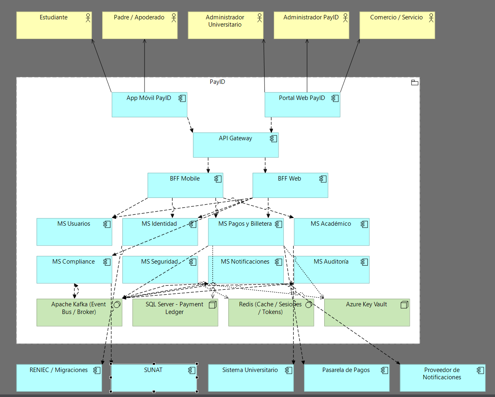
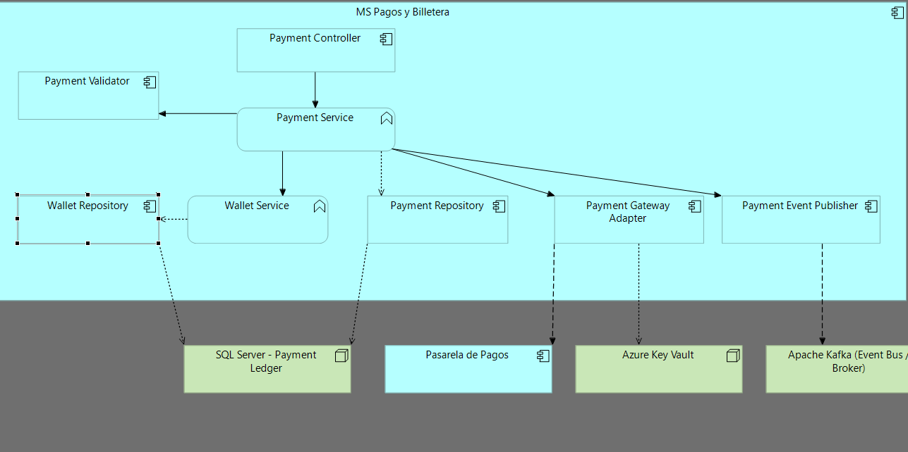
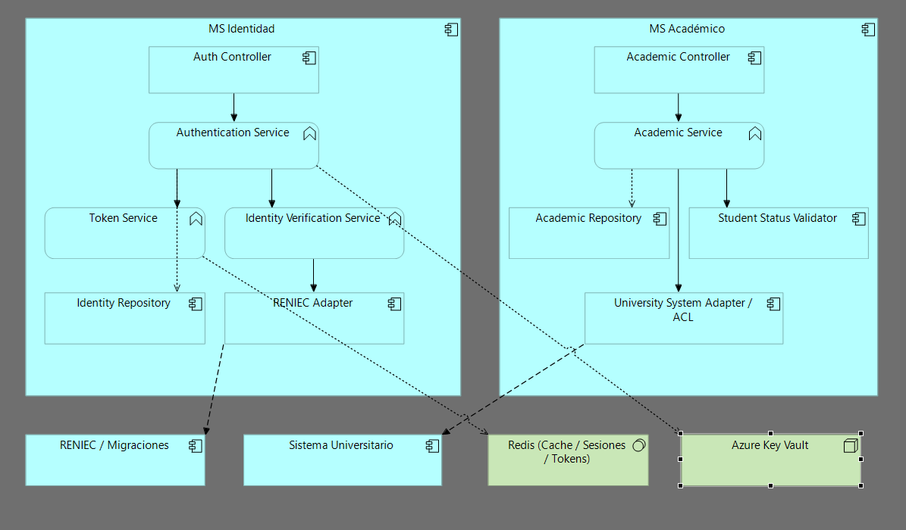
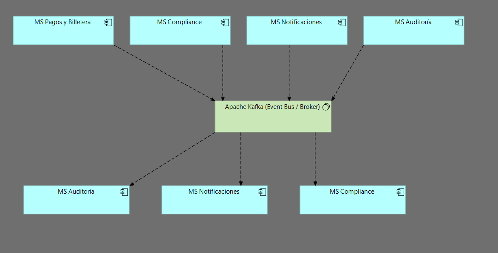

# CAPÍTULO III: Requirements Specification

## 3.1. To-Be Scenario Mapping

[Pendiente] Incorporar los To-Be Scenario Maps de cada User Persona con las filas Phases, Doing, Thinking y Feeling, explicar cómo se elaboraron y contrastarlos con los escenarios As-Is. La sección de User Stories que ya existe pasa a 3.2.

## 3.2. User Stories

| Epic ID | Título | Descripción |
|---|---|---|
| E1 | Gestión de usuarios y perfiles | Comprende el registro, autenticación y administración de cuentas, así como la creación y gestión de perfiles familiares vinculados a un usuario principal. |
| E2 | Gestión de documentos digitales | Incluye el registro, validación con RENIEC, consulta y seguimiento de documentos personales y oficiales desde la aplicación. |
| E3 | Pagos y recargas | Agrupa las funcionalidades relacionadas con las recargas de tarjetas de transporte, el pago de servicios y deudas, y la consulta del historial de operaciones realizadas por el usuario. |
| E5 | Notificaciones y alertas | Comprende el envío y la consulta de notificaciones relacionadas con vencimientos de documentos, operaciones realizadas y recordatorios importantes. |
| E6 | Acceso sin conexión | Permite consultar documentos previamente validados y almacenados de forma segura cuando el usuario no dispone de conexión a internet. |
| E7 | Landing page informativa | Presenta la propuesta de valor de PayID, sus funcionalidades, beneficios, información de seguridad, términos legales y medios de acceso. |
| E8 | API REST del backend | Comprende los servicios que permiten gestionar la autenticación, los documentos y las operaciones de la aplicación mediante endpoints. |
| E9 | Infraestructura de la aplicación móvil | Considera la configuración técnica inicial de la aplicación móvil, incluyendo navegación, gestión de estado y comunicación con servicios externos. |

Tabla de US

| US ID | Título | Descripción | Criterios de Aceptación (Gherkin) | Epic Relacionada |
|---|---|---|---|---|
| US1 | Registro de usuario | Como visitante, quiero registrarme utilizando mi correo electrónico o número de celular para crear una cuenta personal en PayID. | Scenario 1: Registro exitoso. Given un visitante que todavía no tiene una cuenta. When ingresa un correo electrónico o número de celular válido y completa los datos requeridos. Then el sistema crea su cuenta y confirma el registro.  Scenario 2: Datos inválidos. Given un visitante que intenta registrarse. When ingresa información incompleta o con un formato inválido. Then el sistema impide el registro e informa los campos que debe corregir. | E1 |
| US2 | Creación de perfiles familiares | Como usuario registrado, quiero crear perfiles familiares vinculados a mi cuenta para administrar la información y los documentos de mis familiares autorizados. | Scenario 1: Creación exitosa. Given un usuario autenticado. When registra los datos requeridos de un nuevo perfil familiar. Then el sistema crea el perfil y lo vincula a su cuenta principal.  Scenario 2: Datos incompletos. Given un usuario que intenta crear un perfil familiar. When omite información obligatoria. Then el sistema solicita completar los datos antes de guardar el perfil. | E1 |
| US3 | Registro de documentos | Como usuario, quiero registrar mis documentos personales y oficiales para disponer de ellos de manera organizada desde la aplicación. | Scenario 1: Registro y validación exitosa. Given un usuario autenticado. When registra su DNI con datos válidos. Then el sistema valida la información con RENIEC y almacena el documento como verificado.  Scenario 2: Validación pendiente. Given un usuario que registra su DNI. When RENIEC no responde dentro del tiempo establecido. Then el sistema deja el documento en estado «Pendiente», reintenta la validación y notifica el resultado al usuario.  Scenario 3: Información inválida. Given un usuario que intenta registrar un documento. When ingresa información incorrecta o incompleta. Then el sistema rechaza el registro e informa el motivo. | E2 |
| US4 | Solicitud y seguimiento de renovación de documentos | Como usuario, quiero solicitar y consultar el estado de renovación de mis documentos desde PayID para realizar el seguimiento de mis trámites. | Scenario 1: Solicitud de renovación. Given un usuario que tiene un documento próximo a vencer o vencido. When inicia una solicitud de renovación desde la aplicación. Then el sistema registra la solicitud y presenta la información necesaria para continuar el trámite ante la entidad correspondiente.  Scenario 2: Consulta del estado. Given una solicitud de renovación previamente registrada. When el usuario consulta su estado. Then el sistema muestra la última actualización disponible. | E2 |
| US5 | Recarga de tarjetas de transporte | Como usuario, quiero recargar mi tarjeta de transporte desde la aplicación para no quedarme sin saldo. | Scenario 1: Recarga individual exitosa. Given un usuario autenticado que dispone de una tarjeta de transporte compatible. When ingresa los datos de la tarjeta, selecciona un monto permitido y confirma la operación. Then el sistema procesa la solicitud y muestra el resultado de la recarga.  Scenario 2: Datos de recarga inválidos. Given un usuario que se encuentra realizando una recarga individual. When ingresa datos incorrectos o un monto no permitido. Then el sistema impide continuar e informa el motivo. | E3 |
| US6 | Pago de deudas | Como usuario, quiero pagar deudas de servicios o multas disponibles en PayID para realizar mis operaciones de manera más sencilla. | Scenario 1: Pago exitoso. Given un usuario autenticado con una deuda disponible para pagar. When selecciona la deuda y confirma la operación. Then el sistema procesa el pago y muestra su resultado.  Scenario 2: Pago rechazado. Given un usuario que intenta pagar una deuda. When la operación es rechazada por el servicio de pago. Then el sistema informa que el pago no se completó y conserva el estado correspondiente. | E3 |
| US7 | Historial de transacciones | Como usuario, quiero consultar el historial de mis recargas y pagos realizados desde la aplicación para llevar un control de mis operaciones. | Scenario 1: Consulta del historial. Given un usuario autenticado con operaciones realizadas. When ingresa a su historial. Then el sistema muestra sus recargas y pagos ordenados por fecha.  Scenario 2: Sin operaciones registradas. Given un usuario autenticado que aún no ha realizado operaciones. When ingresa a su historial. Then el sistema indica que todavía no tiene movimientos registrados. | E3 |
| US9 | Alerta de vencimiento de documentos | Como usuario, quiero recibir notificaciones cuando mis documentos estén próximos a vencer o hayan vencido para tomar las medidas correspondientes. | Scenario 1: Documento próximo a vencer. Given un documento registrado cuya fecha de vencimiento se encuentra dentro del periodo de alerta configurado. When el sistema ejecuta la verificación correspondiente. Then envía una notificación al usuario.  Scenario 2: Documento vencido. Given un documento cuya fecha de vencimiento ya ha finalizado. When el sistema detecta esta condición. Then actualiza su estado y notifica al usuario. | E5 |
| US10 | Notificaciones sobre trámites | Como usuario, quiero recibir notificaciones sobre los cambios de estado de mis solicitudes para conocer cuándo un trámite presenta una actualización o ha finalizado. | Scenario 1: Actualización de solicitud. Given un usuario con una solicitud de trámite registrada. When el estado de la solicitud presenta una actualización. Then el sistema genera una notificación con la información disponible.  Scenario 2: Finalización del trámite. Given una solicitud cuyo estado ha sido actualizado a finalizado por la entidad correspondiente. When PayID recibe dicha actualización. Then notifica al usuario sobre el resultado del trámite. | E5 |
| US11 | Acceso a documentos sin conexión | Como usuario, quiero consultar mis documentos previamente verificados incluso cuando no tenga conexión a internet para disponer de ellos cuando los necesite. | Scenario 1: Consulta sin conexión. Given un usuario que inició sesión previamente y dispone de documentos verificados almacenados en el dispositivo. When pierde la conexión a internet. Then puede visualizar los documentos disponibles para acceso sin conexión.  Scenario 2: Operación que requiere conexión. Given un usuario que no tiene conexión a internet. When intenta realizar una recarga o un pago. Then el sistema informa que la operación requiere conexión. | E6 |
| US12 | Información de funcionalidades | Como visitante, quiero visualizar las principales funcionalidades de PayID en la landing page para conocer los beneficios y servicios que ofrece. | Scenario 1: Consulta de funcionalidades. Given un visitante que accede a la landing page. When ingresa a la sección de funcionalidades. Then visualiza una descripción clara de los principales servicios de PayID.  Scenario 2: Consulta de seguridad. Given un visitante que navega por la landing page. When busca información sobre seguridad y privacidad. Then encuentra información relacionada con la protección de sus datos. | E7 |
| US13 | Consulta de términos y políticas | Como visitante, quiero acceder a los términos de uso y políticas de privacidad desde la landing page para conocer las condiciones del servicio y el tratamiento de mis datos. | Scenario 1: Acceso a documentos legales. Given un visitante que se encuentra en la landing page. When selecciona el enlace de términos y políticas. Then el sistema muestra los documentos legales correspondientes.  Scenario 2: Visibilidad de enlaces. Given un visitante que navega hasta el pie de página. When visualiza la sección de enlaces legales. Then encuentra disponibles los accesos a los términos de uso y la política de privacidad. | E7 |
| US14 | Visualización de testimonios | Como visitante, quiero consultar testimonios y experiencias de usuarios en la landing page para conocer sus opiniones sobre el servicio. | Scenario 1: Consulta de testimonios. Given un visitante que accede a la landing page. When ingresa a la sección de testimonios. Then visualiza las reseñas publicadas y autorizadas para su difusión.  Scenario 2: Consulta ampliada. Given un visitante que desea conocer más experiencias. When selecciona la opción para consultar más testimonios. Then el sistema muestra el contenido adicional disponible. | E7 |
| US15 | Acceso a la aplicación | Como visitante, quiero encontrar las opciones de registro e inicio de sesión en la landing page para acceder a PayID según mi condición de usuario. | Scenario 1: Acceso al registro. Given un visitante que todavía no tiene una cuenta. When selecciona la opción de registro en la landing page. Then el sistema lo dirige al formulario de creación de cuenta.  Scenario 2: Acceso al inicio de sesión. Given un usuario que ya dispone de una cuenta. When selecciona la opción de iniciar sesión. Then el sistema lo dirige al formulario de autenticación. | E7 |
| US16 | API de autenticación | Como desarrollador, quiero disponer de un endpoint de autenticación para validar las credenciales y gestionar el acceso de los usuarios a la aplicación. | Scenario 1: Credenciales válidas. Given una solicitud que contiene credenciales válidas. When el backend procesa la solicitud de autenticación. Then devuelve una respuesta satisfactoria con un token de acceso válido.  Scenario 2: Credenciales inválidas. Given una solicitud con credenciales incorrectas. When el backend intenta validar la información. Then devuelve una respuesta de autenticación fallida con el código HTTP 401. | E8 |
| US17 | API de documentos | Como desarrollador, quiero disponer de endpoints para registrar y consultar documentos de los usuarios para facilitar la comunicación entre la aplicación y el backend. | Scenario 1: Registro mediante API. Given una solicitud válida que contiene los datos requeridos de un documento. When el backend recibe y procesa la solicitud. Then registra la información y devuelve una respuesta de confirmación.  Scenario 2: Consulta mediante API. Given una solicitud que contiene el identificador de un documento existente. When el backend procesa la consulta. Then devuelve la información disponible del documento. | E8 |
| US18 | Configuración de la arquitectura Flutter | Como desarrollador, quiero contar con una arquitectura base configurada en Flutter, que incluya navegación, gestión de estado y cliente HTTP, para implementar nuevas funcionalidades de manera organizada y mantenible. | Scenario 1: Reutilización de la arquitectura. Given un nuevo módulo que debe incorporarse a la aplicación. When el desarrollador implementa el módulo utilizando la arquitectura configurada. Then puede reutilizar los componentes de navegación, gestión de estado y comunicación HTTP disponibles.  Scenario 2: Navegación entre secciones. Given un usuario que se encuentra utilizando la aplicación. When navega entre las secciones principales. Then la aplicación gestiona correctamente la navegación y conserva el estado requerido. | E9 |
| US19 | Billetera digital y recargas | Como usuario, quiero ver mis tarjetas de transporte y recargarlas desde un flujo guiado en la aplicación para gestionar mi saldo sin salir de PayID. | Scenario 1: Visualización de tarjetas registradas. Given un usuario autenticado que tiene tarjetas de transporte vinculadas a su cuenta. When ingresa a la sección de billetera digital. Then el sistema muestra las tarjetas registradas y su saldo disponible, cuando el servicio de transporte proporcione ese dato.  Scenario 2: Recarga desde la billetera. Given un usuario que se encuentra en la billetera digital y tiene una tarjeta de transporte registrada. When selecciona una tarjeta, ingresa un monto válido y confirma la operación mediante el flujo guiado. Then el sistema procesa la solicitud y muestra el resultado de la recarga.  Scenario 3: Monto inválido. Given un usuario que se encuentra en el flujo de recarga de la billetera. When ingresa un monto que no cumple las condiciones permitidas. Then el sistema impide continuar e informa el motivo. | E3 |
| US21 | Centro de notificaciones | Como usuario, quiero disponer de un centro de notificaciones dentro de PayID para consultar los avisos relacionados con mis operaciones y documentos. | Scenario 1: Generación de notificación. Given un usuario que ha realizado una operación correctamente. When el sistema confirma el resultado de la operación. Then genera una notificación que puede consultarse desde el centro de notificaciones.  Scenario 2: Consulta de notificaciones. Given un usuario que tiene notificaciones registradas. When ingresa al centro de notificaciones. Then visualiza los avisos ordenados desde el más reciente hasta el más antiguo. | E5 |
| US22 | Inicio de sesión | Como usuario registrado, quiero iniciar sesión en PayID utilizando mis credenciales para acceder de manera segura a mi cuenta y a las funcionalidades disponibles. | Scenario 1: Inicio de sesión exitoso. Given un usuario que tiene una cuenta registrada en PayID. When ingresa sus credenciales correctas y confirma el inicio de sesión. Then el sistema valida sus datos y permite el acceso a su cuenta. Scenario 2: Credenciales incorrectas. Given un usuario que se encuentra en la pantalla de inicio de sesión. When ingresa credenciales incorrectas. Then el sistema deniega el acceso e informa que las credenciales no son válidas. Scenario 3: Bloqueo por intentos fallidos. Given un usuario que se encuentra en la pantalla de inicio de sesión y ha acumulado cuatro intentos fallidos consecutivos. When ingresa credenciales incorrectas por quinta vez consecutiva. Then el sistema bloquea temporalmente el acceso a la cuenta durante 15 minutos y notifica al titular. | E1 |

## 3.3. Impact Map

[Pendiente] Insertar y explicar el Impact Map elaborado con Business Goals SMART, actores/personas, impactos, entregables e historias de usuario.

## 3.4. Product Backlog

| Order | US ID | Título | Descripción | Story Points |
|---|---|---|---|---|
| 1 | US12 | Información de funcionalidades | Como visitante, quiero visualizar las principales funcionalidades de PayID en la landing page para conocer los beneficios y servicios que ofrece. | 2 |
| 2 | US15 | Acceso a la aplicación | Como visitante, quiero encontrar las opciones de registro e inicio de sesión en la landing page para acceder a PayID según mi condición de usuario. | 2 |
| 3 | US13 | Consulta de términos y políticas | Como visitante, quiero acceder a los términos de uso y políticas de privacidad desde la landing page para conocer las condiciones del servicio y el tratamiento de mis datos. | 2 |
| 4 | US14 | Visualización de testimonios | Como visitante, quiero consultar testimonios y experiencias de usuarios en la landing page para conocer sus opiniones sobre el servicio. | 2 |
| 5 | US1 | Registro de usuario | Como visitante, quiero registrarme utilizando mi correo electrónico o número de celular para crear una cuenta personal en PayID. | 5 |
| 6 | US22 | Inicio de sesión | Como usuario registrado, quiero iniciar sesión en PayID utilizando mis credenciales para acceder de manera segura a mi cuenta y a las funcionalidades disponibles. | 5 |
| 7 | US2 | Creación de perfiles familiares | Como usuario registrado, quiero crear perfiles familiares vinculados a mi cuenta para administrar la información y los documentos de mis familiares autorizados. | 5 |
| 8 | US3 | Registro de documentos | Como usuario, quiero registrar mis documentos personales y oficiales para disponer de ellos de manera organizada desde la aplicación. | 8 |
| 9 | US4 | Solicitud y seguimiento de renovación de documentos | Como usuario, quiero solicitar y consultar el estado de renovación de mis documentos desde PayID para realizar el seguimiento de mis trámites. | 8 |
| 10 | US5 | Recarga de tarjetas de transporte | Como usuario, quiero recargar mi tarjeta de transporte desde la aplicación para no quedarme sin saldo. | 8 |
| 11 | US6 | Pago de deudas | Como usuario, quiero pagar deudas de servicios o multas disponibles en PayID para realizar mis operaciones de manera más sencilla. | 8 |
| 12 | US7 | Historial de transacciones | Como usuario, quiero consultar el historial de mis recargas y pagos realizados desde la aplicación para llevar un control de mis operaciones. | 3 |
| 13 | US9 | Alerta de vencimiento de documentos | Como usuario, quiero recibir notificaciones cuando mis documentos estén próximos a vencer o hayan vencido para tomar las medidas correspondientes. | 3 |
| 14 | US10 | Notificaciones sobre trámites | Como usuario, quiero recibir notificaciones sobre los cambios de estado de mis solicitudes para conocer cuándo un trámite presenta una actualización o ha finalizado. | 5 |
| 15 | US11 | Acceso a documentos sin conexión | Como usuario, quiero consultar mis documentos previamente verificados incluso cuando no tenga conexión a internet para disponer de ellos cuando los necesite. | 5 |
| 16 | US16 | API de autenticación | Como desarrollador, quiero disponer de un endpoint de autenticación para validar las credenciales y gestionar el acceso de los usuarios a la aplicación. | 5 |
| 17 | US17 | API de documentos | Como desarrollador, quiero disponer de endpoints para registrar y consultar documentos de los usuarios para facilitar la comunicación entre la aplicación y el backend. | 5 |
| 18 | US18 | Configuración de la arquitectura Flutter | Como desarrollador, quiero contar con una arquitectura base configurada en Flutter, que incluya navegación, gestión de estado y cliente HTTP, para implementar nuevas funcionalidades de manera organizada y mantenible. | 5 |
| 19 | US19 | Billetera digital y recargas | Como usuario, quiero ver mis tarjetas de transporte y recargarlas desde un flujo guiado en la aplicación para gestionar mi saldo sin salir de PayID. | 8 |
| 20 | US21 | Centro de notificaciones | Como usuario, quiero disponer de un centro de notificaciones dentro de PayID para consultar los avisos relacionados con mis operaciones y documentos. | 5 |

En el siguiente apartado se mostrará el Product Backlog generado en Jira, que ayudará al equipo durante el desarrollo de este proyecto.

Raul Hiroshi Tasayco Osorio

