
# CAPÍTULO IV: Product Architecture Design

## 4.1 Design Concepts, ViewPoints & ER Diagrams

Esta sección se centra en los conceptos fundamentales de diseño, los diferentes puntos de vista que adoptaremos para comprender y comunicar la arquitectura, y los diagramas de Entidad-Relación para modelar los datos de PayID.

### 4.1.1 Principles Statements

### Principios SOLID

Aplicaremos los cinco principios de diseño orientado a objetos para construir componentes robustos y fáciles de mantener dentro de cada microservicio:

| Principio | Descripción |
|---|---|
| Single Responsibility Principle (SRP) | Cada clase o módulo tendrá una única responsabilidad y, por lo tanto, una única razón para cambiar. |
| Open/Closed Principle (OCP) | Las entidades de software estarán abiertas para la extensión, pero cerradas para la modificación. Esto permite añadir nueva funcionalidad sin alterar el código existente. |
| Liskov Substitution Principle (LSP) | Los subtipos serán sustituibles por sus tipos base sin afectar la correctitud del programa. Esto asegura la coherencia en las jerarquías de herencia. |
| Interface Segregation Principle (ISP) | Es preferible tener múltiples interfaces específicas para los clientes en lugar de una única interfaz genérica. Esto evita que las clases implementen métodos que no necesitan. |
| Dependency Inversion Principle (DIP) | Dependeremos de abstracciones (interfaces o clases abstractas) en lugar de implementaciones concretas. Esto reduce el acoplamiento entre componentes y facilita las pruebas. |

### Domain-Driven Design (DDD)

Adoptaremos los principios de DDD para alinear nuestro diseño de software con el modelo del negocio:

| Principio | Descripción |
|---|---|
| Modelado Basado en el Dominio | El diseño de nuestros microservicios se centrará en el conocimiento y la lógica del dominio del negocio. |
| Límites de Contexto (Bounded Contexts) | Definiremos límites explícitos para cada modelo de dominio (Identidad, Documentos, Pagos, Notificaciones, Auditoría), asegurando la coherencia dentro de cada microservicio. |
| Lenguaje Ubicuo (Ubiquitous Language) | Utilizaremos un lenguaje común y preciso entre los desarrolladores y los expertos del dominio para evitar malentendidos. |

### API First

Diseñaremos las interfaces de nuestros microservicios antes de implementar la lógica interna, facilitando la colaboración y asegurando una buena experiencia para los consumidores de la API.

- Idempotencia

Las operaciones de nuestras APIs serán idempotentes, lo que significa que múltiples solicitudes idénticas tendrán el mismo efecto que una sola solicitud. Esto es crítico en pagos y transferencias.

- Observabilidad

Implementaremos sistemas de logging, métricas y tracing distribuido para monitorear la salud y el rendimiento de nuestros microservicios. Usaremos Datadog o Grafana.

- Resiliencia

Diseñaremos nuestros microservicios para que sean tolerantes a fallos y puedan recuperarse de manera elegante. Aplicaremos Circuit Breaker y Retry con Backoff.

- Seguridad por Diseño (Security by Design)

La seguridad será una consideración fundamental en todas las etapas del diseño y desarrollo. Aplicaremos cifrado AES-256, TLS 1.3, JWT y RBAC.

- Escalabilidad Horizontal

El sistema debe poder crecer agregando más instancias de servicios, no solo aumentando recursos verticales. Se desplegará en Kubernetes con auto-scaling.

### Portabilidad Cloud

El sistema debe poder desplegarse en cualquier proveedor cloud (Azure, AWS, GCP) sin cambios significativos, evitando el vendor lock-in.

- Cumplimiento Normativo

El sistema debe cumplir con las leyes peruanas (Ley N° 29733, normativas SBS y SUNAT), garantizando la privacidad y seguridad de los datos.

### 4.1.2 Approaches Statements

Los enfoques metodológicos de PayID son las estrategias que guiarán el diseño, desarrollo y despliegue del sistema. Estos enfoques aseguran que la arquitectura esté alineada con las mejores prácticas de la industria y con los objetivos del negocio.

- Domain-Driven Design (DDD)

Adoptaremos DDD como un enfoque primordial para asegurar que la arquitectura de PayID refleje fielmente el modelo del negocio. Esto implica:

| Aspecto | Descripción |
|---|---|
| Modelado Colaborativo | Involucrar activamente a los expertos del dominio (product owners, stakeholders) en el proceso de modelado. |
| Lenguaje Ubicuo | Establecer un lenguaje común y preciso entre el equipo técnico y los stakeholders. |
| Énfasis en el Dominio Core | Identificar y priorizar el modelado de las partes más valiosas: identidad, pagos y documentos. |
| Diseño Centrado en el Comportamiento | Modelar el dominio en torno a las acciones y eventos significativos del negocio. |
| Límites de Contexto Claros (Bounded Contexts) | Definir explícitamente los límites que se traducen en microservicios: Identidad, Documentos, Pagos, Académico, Notificaciones, Compliance, Auditoría. |

### Attribute-Driven Design (ADD)

Utilizaremos ADD del SEI como técnica para descomponer y planificar el diseño de nuestra arquitectura. ADD se centra en identificar los atributos de calidad críticos (performance, seguridad, escalabilidad, interoperabilidad) y utilizarlos para guiar las decisiones de diseño en cada iteración.

| Iteración | Driver Principal | Enfoque |
|---|---|---|
| Iteration 1 | Performance, Seguridad | Global System Structure |
| Iteration 2 | Escalabilidad | Sincronización Edge-to-Cloud |
| Iteration 3 | Interoperabilidad | Orquestación de pagos |
| Iteration 4 | Seguridad | Seguridad e Identidad |
| Iteration 5 | Performance | Refinamiento de servicios |

### Arquitectura de Microservicios

Adoptaremos un estilo de Arquitectura de Microservicios, donde PayID se estructura como una colección de servicios débilmente acoplados, organizados alrededor de las capacidades del negocio.

| Microservicio | Responsabilidad |
|---|---|
| MS Usuarios | Gestión de cuentas y perfiles |
| MS Identidad | Validación RENIEC/SUNAT |
| MS Pagos y Billetera | Transacciones financieras |
| MS Académico | Validación SUNEDU |
| MS Compliance | Cumplimiento Ley 29733 |
| MS Seguridad | Cifrado y tokens |
| MS Notificaciones | SMS, email, push |
| MS Auditoría | Event Store |

### Descentralización

Favoreceremos la descentralización de datos y lógica, donde cada microservicio gestiona su propia base de datos y su propia lógica de negocio. Esto promueve la independencia y la escalabilidad.

| Microservicio | Base de Datos |
|---|---|
| MS Usuarios | MySQL |
| MS Pagos | SQL Server (Payment Ledger) |
| MS Auditoría | MySQL (Event Store) |
| MS Seguridad | Azure Key Vault + Redis |

### Automatización

Buscaremos automatizar al máximo los procesos de construcción, prueba, despliegue y monitorización de nuestros microservicios para garantizar la eficiencia y reducir los errores.

| Proceso | Herramienta |
|---|---|
| CI (Integración Continua) | GitHub Actions |
| CD (Despliegue Continuo) | GitHub Actions + Kubernetes |
| Testing | xUnit, Jest, Postman |
| Monitoreo | Datadog / Grafana |

### Infraestructura como Código (IaC)

Gestionaremos nuestra infraestructura utilizando código (Terraform), lo que nos permitirá versionarla, automatizar su aprovisionamiento y garantizar la consistencia del entorno.

- Entrega Continua (CD)

Implementaremos un proceso de entrega continua para poder liberar nuevas funcionalidades y correcciones de forma frecuente y segura.

### Cloud Native

Diseñaremos PayID para ser desplegado en la nube con contenedores (Docker) y orquestación (Kubernetes). Usaremos Azure Kubernetes Service (AKS) con auto-scaling.

| Componente | Tecnología |
|---|---|
| Contenedores | Docker |
| Orquestación | Kubernetes (AKS) |
| Service Mesh | Istio / Linkerd |
| API Gateway | Kong |

### API First

Diseñaremos las interfaces REST de cada microservicio antes de implementar la lógica interna, usando OpenAPI Specification (Swagger) para documentar los contratos.

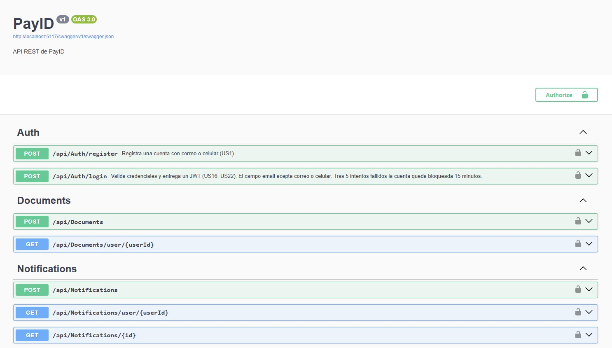

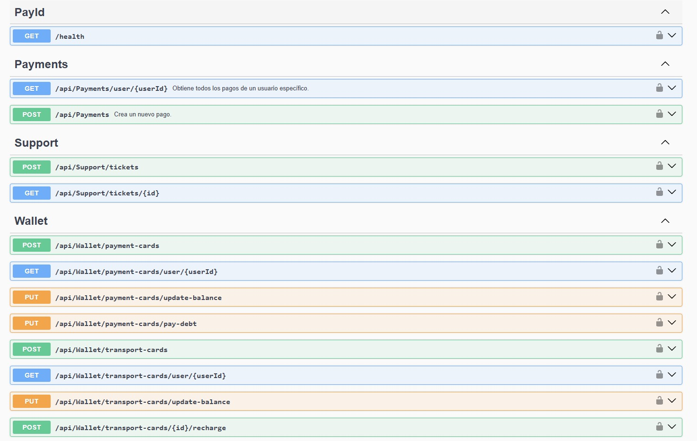

- Scrum
- Trabajaremos en Sprints iterativos e incrementales (2 semanas cada uno) con Sprint Backlog, Daily Standups, Sprint Review y Retrospectiva.

### 4.1.3 Context Diagram

El diagrama de contexto de PayID muestra el sistema como una caja negra, identificando los actores que interactúan con él y los sistemas externos con los que se integra.

Actores:

- Estudiante: registra documentos, recarga tarjetas de transporte y paga servicios.
- Padre/Madre o Tutor: gestiona documentos de sus hijos o familiares.
- Administrador Universitario: valida credenciales académicas.
- Administrador PayID: gestiona usuarios, comercios y configuraciones.
- Comercio/Servicio: acepta pagos con QR.

Sistemas externos:

- RENIEC: validación de identidad (DNI).
- SUNAT: validación de RUC y facturación electrónica.
- Sistema Universitario: validación del carné universitario.
- Pasarela de Pagos: procesamiento de transacciones (Visa, Mastercard, Yape, Plin).
- Proveedor de Notificaciones: envío de SMS, email y push.

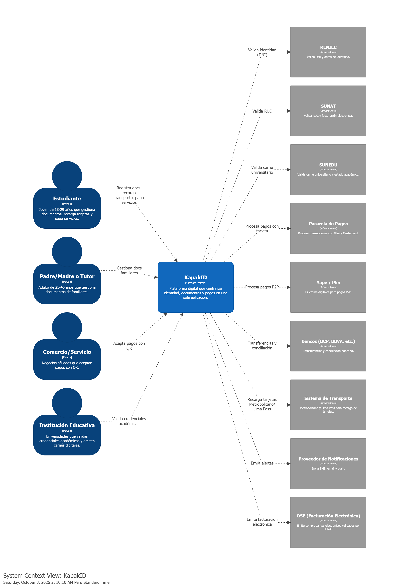

### 4.1.4 Approach Driven ViewPoints Diagrams

Container diagram:

El diagrama de contenedores de PayID muestra los componentes internos del sistema: las aplicaciones cliente (App Móvil y Portal Web), el API Gateway como punto único de entrada, los BFF (Mobile y Web), los microservicios principales (Identidad, Pagos y Documentos), y la infraestructura de soporte (Kafka, Redis, SQL Server), junto con las integraciones con entidades gubernamentales, pasarelas de pago y servicios externos.

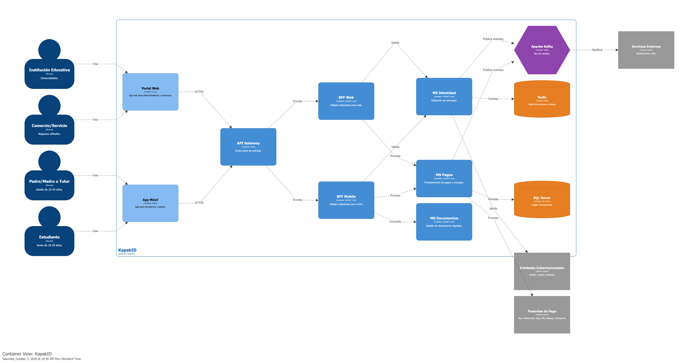

Component diagram:

El diagrama de componentes del MS Pagos muestra los 8 componentes internos que procesan transacciones: Controller, Validator, Payment Service, Wallet Service, Repositories, Gateway Adapter y Event Publisher.

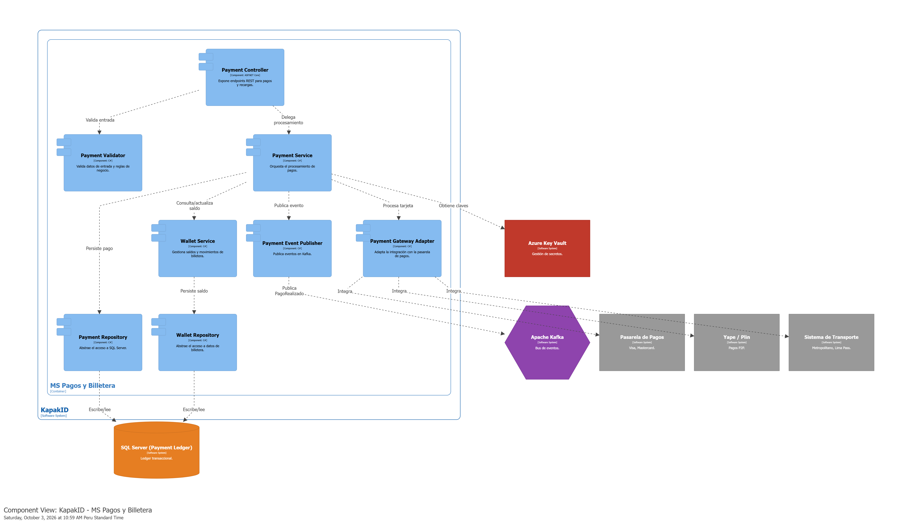

### Diagramas UML:

- Para describir la arquitectura de PayID se emplean diagramas de componentes, clases y secuencia. Estos permiten representar la organización del backend, las entidades del dominio y la interacción entre los elementos que participan en los principales casos de uso. Las vistas se elaboran a partir de la implementación disponible y del alcance funcional descrito en el informe.

Vista lógica:

- El backend se organiza en los módulos Authentication, Documents, Wallet, Payments, Notifications y Support, dentro de una única aplicación ASP.NET Core. Se distinguen las responsabilidades de interfaz REST, aplicación, dominio e infraestructura. Los controladores delegan solicitudes mediante MediatR; los handlers coordinan los casos de uso y utilizan entidades, repositorios o el contexto de persistencia. Documents, Payments, Notifications y Support cuentan con contratos de repositorio e implementaciones basadas en Entity Framework Core. Authentication y Wallet acceden directamente a FinTrackBackDbContext; adicionalmente, la recarga de Wallet utiliza IPaymentRepository. Por ello, la estructura corresponde a un backend modular con separación por capas, aunque el aislamiento de infraestructura no se aplica de forma uniforme a todos los módulos.

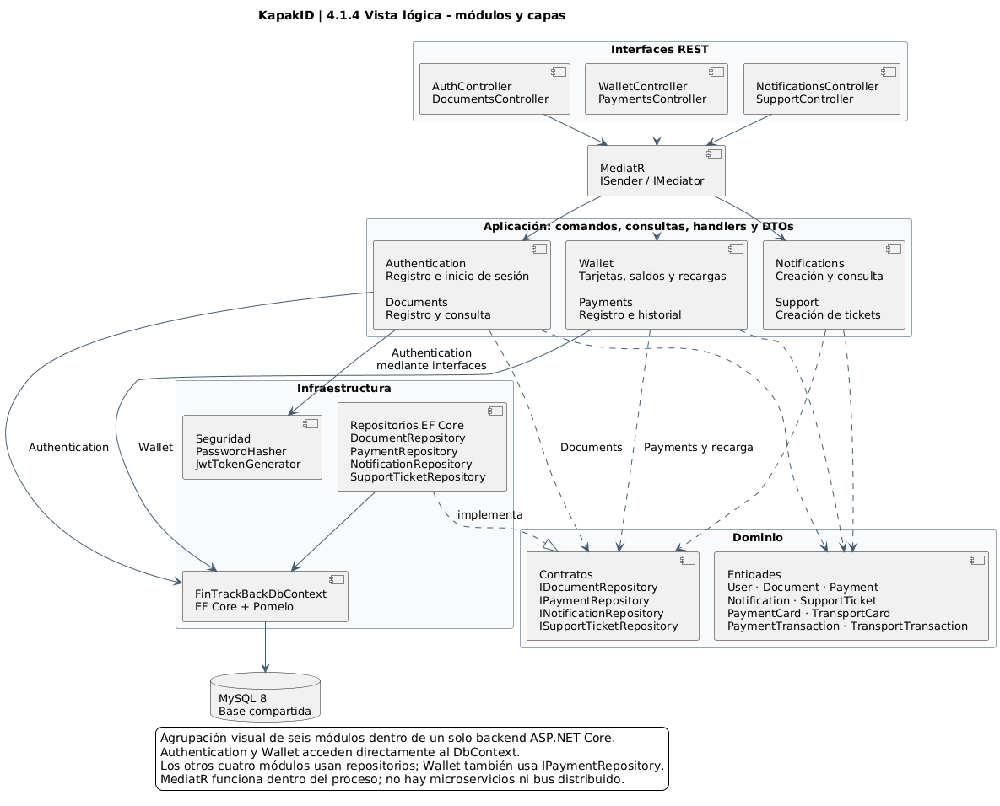

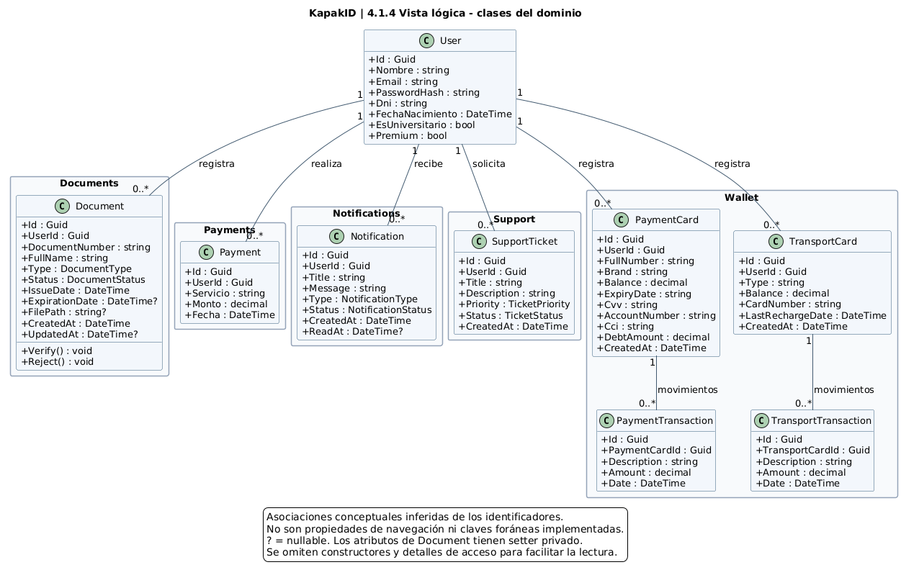

### Vista de procesos

La vista de procesos utiliza diagramas de secuencia para mostrar el orden de los mensajes durante el inicio de sesión, el registro de documentos y la recarga de una tarjeta de transporte. En la autenticación se consulta al usuario, se valida la contraseña y se genera un JWT. En el registro de documentos se crea la entidad con estado Pending, se persiste mediante DocumentRepository y se devuelve un DocumentDto. En la recarga se valida el monto y la existencia de la tarjeta de transporte; cuando se proporciona PaymentCardId, también se comprueba el saldo de la tarjeta de pago. La operación actualiza saldos y registra movimientos y un pago dentro de una transacción de base de datos, con confirmación o reversión según el resultado.

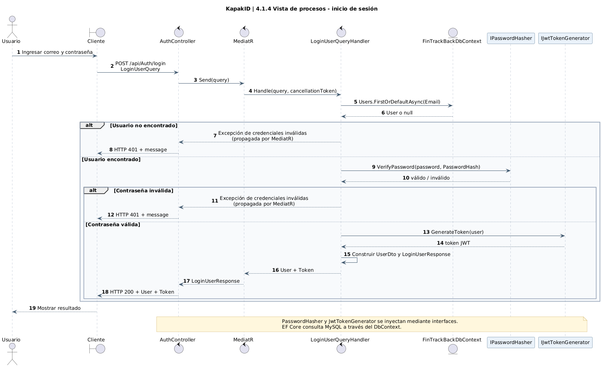

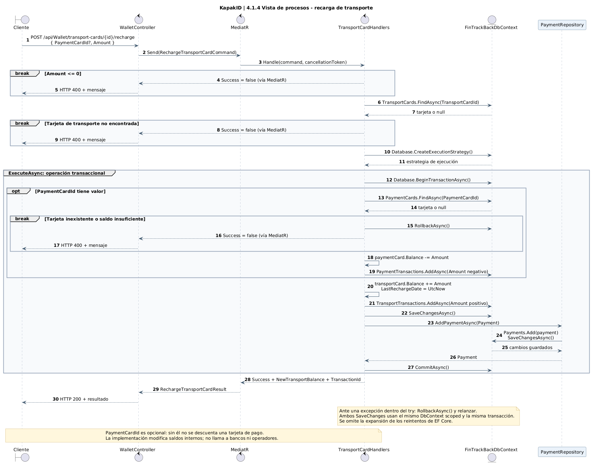

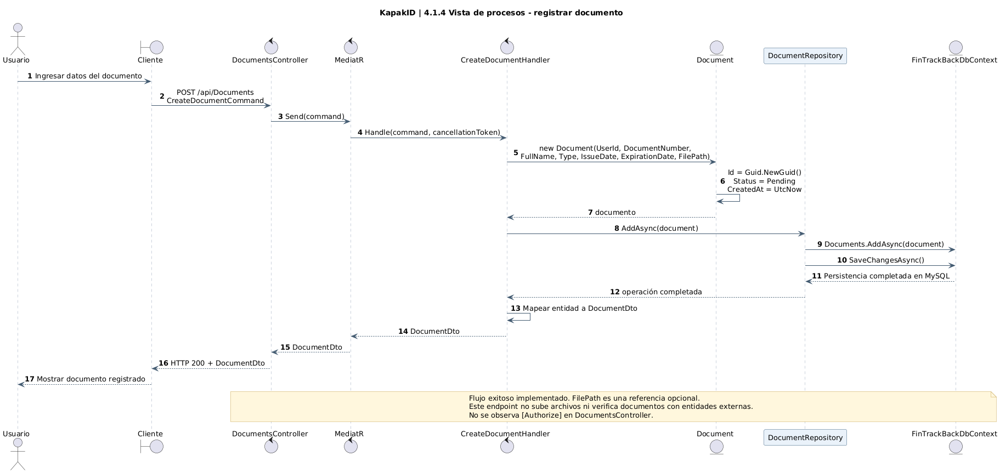

### 4.1.5 Relational / Non Relational Database Diagram

PayID utiliza una base de datos relacional MySQL, configurada mediante el proveedor Pomelo de Entity Framework Core. El modelo contiene nueve tablas: Users, Documents, Payments, Notifications, SupportTickets, PaymentCards, TransportCards, PaymentTransactions y TransportTransactions. Cada tabla posee una clave primaria Id de tipo char(36), correspondiente a Guid en C#. Los campos UserId, PaymentCardId y TransportCardId permiten identificar asociaciones entre registros. Los estados y tipos enumerados se almacenan como int; los importes y saldos utilizan decimal(65,30) en el snapshot revisado. No se encontró una base no relacional configurada en el backend.

El diagrama conserva los nombres, tipos y nulabilidad definidos en FinTrackBackDbContextModelSnapshot. Las referencias se muestran con líneas punteadas porque el modelo y las migraciones revisadas no declaran restricciones de clave foránea para esos campos. Conceptualmente, un usuario puede tener varios documentos, pagos, notificaciones, tickets y tarjetas; cada tarjeta puede registrar varios movimientos. Implementar las claves foráneas sería una mejora posterior y no se presenta como una característica existente.

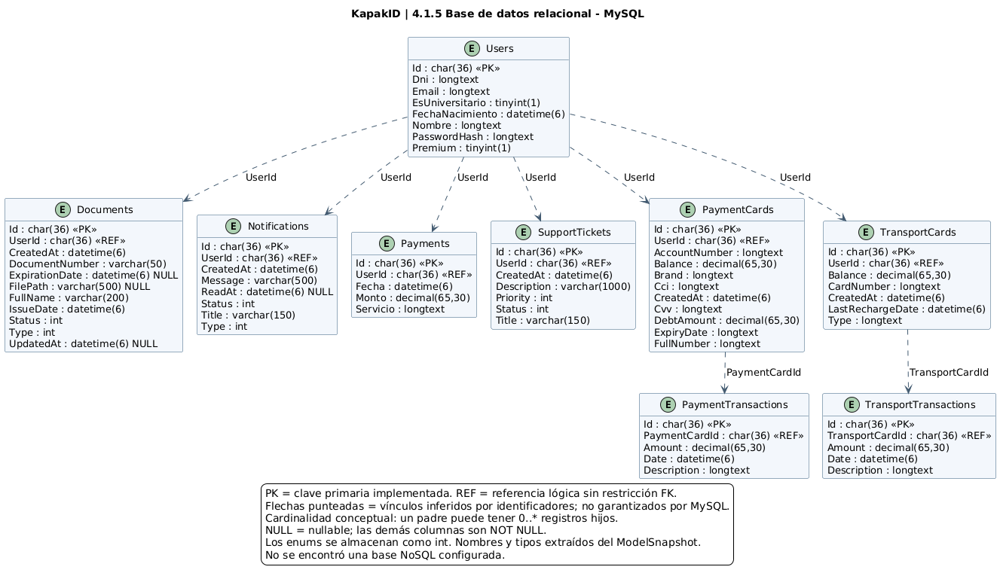

### 4.1.6 Design Patterns

La implementación de PayID combina patrones de diseño y de arquitectura para distribuir responsabilidades y reducir el acoplamiento. Se identifican los siguientes mecanismos en el código fuente:

| Patrón o mecanismo | Evidencia en el backend | Aplicación y propósito |
|---|---|---|
| Repository | IDocumentRepository y DocumentRepository; equivalentes en Payments, Notifications y Support. | Expone operaciones de persistencia mediante contratos. En Documents, el handler depende de la interfaz y el repositorio realiza las operaciones de EF Core. |
| Mediator | ISender/IMediator, llamadas Send y handlers IRequestHandler registrados con AddMediatR. | Centraliza el despacho de solicitudes a sus manejadores, evitando que los controladores instancien o seleccionen directamente un handler concreto. |
| CQRS simple | CreateDocumentCommand/CreateDocumentHandler y GetDocumentsByUserIdQuery/GetDocumentsByUserIdQueryHandler. | Separa operaciones de escritura y lectura a nivel de solicitudes y handlers. Comparte el modelo y la base de datos; no implica event sourcing ni almacenes separados. |
| Inyección de dependencias | AddScoped en Program.cs e interfaces recibidas por constructor. | El contenedor proporciona repositorios, servicios de seguridad y el DbContext. Facilita sustituir implementaciones y controlar su ciclo de vida. |
| DTO | DocumentDto, UserDto, PaymentDto y otros objetos de respuesta. | Define los datos intercambiados en los casos de uso sin entregar directamente la entidad persistida. Por ejemplo, UserDto no incluye PasswordHash. |
| Unit of Work, proporcionado por EF Core | FinTrackBackDbContext, seguimiento de entidades y SaveChangesAsync. | Coordina la persistencia de cambios. La recarga añade una transacción explícita para agrupar actualizaciones y registros realizados en dos llamadas a SaveChangesAsync. No existe una abstracción IUnitOfWork propia. |

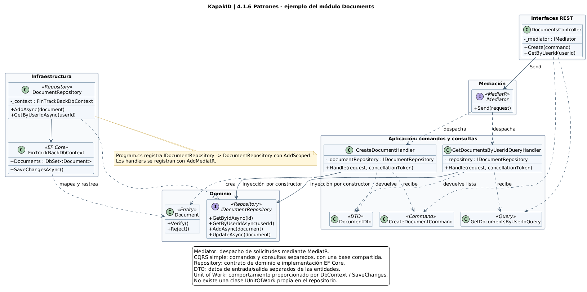

Repository, DTO y Unit of Work pertenecen a patrones de aplicaciones empresariales; CQRS es un patrón arquitectónico e inyección de dependencias es una técnica/patrón de composición. Se distinguen estas categorías para no presentar todos los elementos como patrones GoF. No se atribuyen Factory, Observer o Singleton al código de negocio sin una implementación que los sustente. El registro AddScoped no constituye Singleton.

### 4.1.7. Tactics

Las siguientes tácticas orientan el diseño de PayID para responder a los atributos de calidad definidos en la sección 4.2. Se describen como decisiones de diseño; su implementación debe verificarse con las evidencias del capítulo V.

| Atributo de calidad | Táctica de diseño | Aplicación en PayID |
|---|---|---|
| Seguridad | Autenticación, autorización y privilegio mínimo | Proteger los endpoints y limitar el acceso a documentos, perfiles familiares y operaciones al usuario autorizado. |
| Seguridad | Cifrado en tránsito y gestión externa de secretos | Proteger las comunicaciones y mantener claves y credenciales fuera del código fuente. |
| Disponibilidad | Reintentos limitados y aislamiento de fallas | Manejar errores o demoras de RENIEC, pasarelas y proveedores de notificaciones sin bloquear otros flujos. |
| Rendimiento | Caché y paginación | Reducir consultas repetidas y limitar el volumen de resultados en documentos e historial de transacciones. |
| Integridad | Idempotencia y registro transaccional | Evitar pagos duplicados y conservar trazabilidad de las operaciones y sus estados. |
| Interoperabilidad | Adaptadores y contratos API explícitos | Aislar los servicios externos y mantener contratos claros entre clientes, backend e integraciones. |
| Modificabilidad | Separación de responsabilidades por dominio | Permitir evolucionar identidad, documentos, pagos y notificaciones con menor impacto entre módulos. |

## 4.2. Architectural Drivers

### 4.2.1. Design Purpose

El propósito del diseño de PayID es definir una arquitectura de software que permita gestionar documentos personales, validar la identidad de los usuarios y realizar operaciones de pago y recarga mediante una aplicación integrada. Para ello, la arquitectura prioriza la protección de la información, la interoperabilidad con servicios externos, la disponibilidad de los servicios y la facilidad de uso.

La solución está dirigida a los segmentos de usuarios identificados en la sección 1.3: estudiantes de educación superior, padres de familia y apoderados, así como comercios y servicios vinculados al ecosistema universitario.

PayID es un sistema nuevo que se desarrolla dentro de un dominio conocido, relacionado con las billeteras digitales y los servicios de identidad digital. En consecuencia, su diseño considera estilos y patrones arquitectónicos establecidos, entre ellos la arquitectura basada en microservicios, API Gateway, Backend for Frontend (BFF) y comunicación basada en eventos, descritos en las secciones 4.1 y 4.3.

En función de este propósito, el diseño arquitectónico de PayID persigue los siguientes objetivos:

Proteger la identidad y los datos de los usuarios: garantizar que los documentos personales y la información asociada a las transacciones estén protegidos mediante mecanismos de acceso autorizado y controles de seguridad, considerando las disposiciones de la Ley N.° 29733.

Reducir el tiempo dedicado a las operaciones cotidianas: facilitar la realización de recargas, pagos y consultas de documentos mediante respuestas oportunas, disminuyendo la necesidad de recurrir a filas o trámites presenciales.

Facilitar la integración con entidades y servicios externos: contemplar la interoperabilidad con RENIEC, SUNAT, el sistema universitario y una pasarela de pagos externa, teniendo en cuenta las condiciones de acceso, disponibilidad y comunicación de cada servicio.

Permitir el crecimiento y la evolución del sistema: establecer una arquitectura que facilite la incorporación de nuevos usuarios y funcionalidades mediante servicios independientes, favoreciendo el mantenimiento, la escalabilidad y la adaptación de PayID ante futuras necesidades.

### 4.2.2. Primary Functionality (Primary User Stories)

La funcionalidad principal de PayID está representada por las siguientes historias de usuario del Product Backlog (sección 3.3). Se seleccionaron porque describen las capacidades principales del sistema y tienen una influencia directa en las decisiones de diseño arquitectónico. Para facilitar su identificación, se clasifican en dos tipos:

| Tipo | Historias |
|---|---|
| Funcionales (las usa el usuario final) | US1, US3, US4, US5, US6, US8, US9, US11, US19 y US20 |
| Técnicas (las usa el equipo de desarrollo) | US16 y US17 |

A continuación, se presentan las historias seleccionadas y su influencia en la arquitectura de PayID:

| ID US | Tipo | Descripción | Por qué influye en la arquitectura |
|---|---|---|---|
| US1 | Funcional | Como usuario, quiero registrarme con mi correo o celular para crear mi cuenta en PayID. | Define la autenticación y el manejo de cuentas. |
| US3 | Funcional | Como usuario, quiero registrar mi DNI, pasaporte y otros documentos para tenerlos disponibles en la app. | Maneja datos personales sensibles y requiere validación de identidad. |
| US4 | Funcional | Como usuario, quiero renovar mis documentos vencidos desde la app para evitar trámites presenciales. | La app inicia y hace seguimiento a la solicitud de renovación; el trámite depende de la entidad emisora del documento. |
| US5 | Funcional | Como usuario, quiero recargar mi tarjeta del Metropolitano para no quedarme sin saldo. | Mueve dinero y exige respuesta rápida y consistencia de saldos. |
| US6 | Funcional | Como usuario, quiero pagar mis deudas de servicios o multas desde la app para evitar filas. | Depende de la pasarela de pagos. |
| US8 | Funcional | Como ciudadano, quiero emitir mi voto en elecciones mediante PayID para participar de manera segura. | Exige integridad (un solo voto), privacidad y trazabilidad dentro de los procesos de votación habilitados en PayID. |
| US9 | Funcional | Como usuario, quiero recibir una notificación cuando mis documentos estén próximos a vencer. | Requiere procesamiento por eventos y un proveedor de notificaciones. |
| US11 | Funcional | Como usuario, quiero acceder a mis documentos verificados incluso sin conexión a internet. | Requiere almacenamiento local protegido y sincronización. |
| US16 | Técnica | Como developer, quiero consumir un endpoint de autenticación para validar credenciales de usuarios. | Define el contrato de seguridad entre clientes y backend. |
| US17 | Técnica | Como developer, quiero consumir un endpoint para registrar y consultar documentos de un usuario. | Define el contrato de la API de documentos. |
| US19 | Funcional | Como usuario, quiero ver mis tarjetas de transporte y recargarlas desde un flujo guiado en la app para gestionar mi saldo sin salir de PayID. | Concentra la lógica de billetera y saldos. |
| US20 | Funcional | Como usuario, quiero escanear mi DNI con la cámara de mi celular para registrar mi documento sin necesidad de subir una foto manualmente. | Requiere captura y lectura del documento desde la app móvil. |

Estas historias están relacionadas con la propuesta de valor de PayID, centrada en la seguridad, el ahorro de tiempo, el acceso a documentos y la integración de servicios. Además, permiten identificar las principales responsabilidades que debe asumir la arquitectura, así como los componentes y las interfaces necesarios para implementar las funcionalidades del sistema.

### 4.2.3. Quality Attribute Scenarios

Los escenarios de atributos de calidad describen cómo debe comportarse PayID ante situaciones concretas. El valor de QA-01 corresponde al driver definido en la sección 4.3.1.2 y la regla de QA-07 proviene de los criterios de aceptación de la US8. Los demás valores son metas propuestas por el equipo, pendientes de validar en las pruebas del sistema.

| ID | Atributo | Escenario | Medida | Origen de la medida | US asociada |
|---|---|---|---|---|---|
| QA-01 | Rendimiento | Un usuario confirma una recarga o el pago de un servicio en condiciones normales de uso. | PayID registra la operación y muestra su estado al usuario en menos de 2 segundos. Este tiempo mide la respuesta de PayID, no la confirmación final de la pasarela de pagos. | Driver definido (4.3.1.2) | US5, US6, US19 |
| QA-02 | Seguridad | Una persona falla varias veces seguidas el inicio de sesión de una cuenta. | Tras 5 intentos fallidos, la cuenta se bloquea por 15 minutos y se avisa al dueño. | Meta propuesta | US1, US16 |
| QA-03 | Escalabilidad | En fechas de alta demanda (inicio de ciclo, fin de mes), 1 000 usuarios concurrentes realizan recargas. | El sistema agrega instancias de forma horizontal y el tiempo de respuesta de la recarga no aumenta más de 20 % frente a condiciones normales. | Meta propuesta | US5, US19 |
| QA-04 | Interoperabilidad | Un usuario registra su DNI y el sistema lo valida con RENIEC. | Si RENIEC no responde en 5 segundos, el documento pasa al estado «Pendiente». El sistema hace hasta tres intentos adicionales y, cuando obtiene respuesta, actualiza el estado y avisa al usuario. Si no obtiene respuesta, el documento sigue en «Pendiente» y se informa al usuario. | Meta propuesta | US3, US20 |
| QA-05 | Disponibilidad | Un microservicio no crítico, como Notificaciones, deja de funcionar. | Los servicios críticos (Identidad, Documentos y Pagos) siguen funcionando, con una disponibilidad mensual de 99.5 % cada uno. | Meta propuesta | US5, US6, US9 |
| QA-06 | Usabilidad (offline) | Un usuario sin conexión a internet abre un documento que ya fue verificado y descargado en su celular. | El documento se muestra en menos de 3 segundos. Al volver la conexión, la app actualiza la información pendiente de sincronización de forma segura. | Meta propuesta | US11 |
| QA-07 | Integridad | Un ciudadano que ya votó intenta votar otra vez en el mismo proceso. | El sistema rechaza el segundo intento, informa al usuario y lo registra en auditoría. Se permite un solo voto por ciudadano y proceso. | Criterios de aceptación de la US8 | US8 |
| QA-08 | Modificabilidad | El equipo agrega un nuevo tipo de documento o un nuevo medio de pago. | El cambio se hace principalmente en el microservicio correspondiente (Documentos o Pagos), manteniendo compatibles sus interfaces y evitando cambios innecesarios en los demás servicios. | Meta propuesta | US3, US6, US17 |

### 4.2.4. Constraints

Las restricciones son condiciones ya definidas que limitan el diseño y la implementación de PayID. Incluyen las tecnologías elegidas por el equipo, las normas que se deben cumplir y los servicios externos que la arquitectura debe considerar.

| ID | Constraint | Dónde se establece |
|---|---|---|
| CON-01 | El backend se desarrolla en ASP.NET Core (C#). | 4.1.4 y 4.3.1.2 |
| CON-02 | La aplicación web se desarrolla en Vue. | 4.3.1.2 |
| CON-03 | La aplicación móvil se desarrolla en Flutter. | US18 |
| CON-04 | La base de datos relacional principal es MySQL, usada mediante Entity Framework Core (proveedor Pomelo). | 4.1.5 y 4.3.1.2 |
| CON-05 | El tratamiento de datos personales debe cumplir la Ley N.° 29733 (Ley de Protección de Datos Personales). | 1.2.1 y 4.3.1.2 |
| CON-06 | PayID contempla servicios externos previstos: RENIEC para la validación de identidad, SUNAT para la validación tributaria, el sistema universitario para la validación académica y una pasarela de pagos externa. La arquitectura debe adaptarse a sus condiciones de acceso e interoperabilidad. | 4.1.3 |
| CON-07 | Los servicios se exponen mediante APIs REST, siguiendo el principio API First. | 4.1.1 |

### 4.2.5. Architectural Concerns

Las preocupaciones arquitectónicas son aspectos que el equipo debe considerar durante el diseño y la implementación de PayID, aunque no estén definidos directamente como historias de usuario. Estas permiten identificar riesgos y necesidades relacionadas con la seguridad, integración, consistencia de la información, disponibilidad y mantenimiento del sistema.

| ID | Architectural Concern |
|---|---|
| ARC-01 | Proteger los datos personales de los usuarios y de los perfiles familiares, controlando quién puede acceder a cada información, en cumplimiento de la Ley N.° 29733. |
| ARC-02 | Mantener la portabilidad en la nube para no depender de un solo proveedor (Azure, AWS o Google Cloud). |
| ARC-03 | Mantener la consistencia de saldos y movimientos cuando un pago o recarga involucra a varios servicios, gestionando adecuadamente las transacciones distribuidas. |
| ARC-04 | Manejar las fallas o demoras de RENIEC, SUNAT, el sistema universitario y la pasarela de pagos externa sin bloquear al usuario. |
| ARC-05 | Proteger contraseñas, claves de cifrado y credenciales de servicios externos mediante un gestor de secretos, fuera del código fuente. |
| ARC-06 | Registrar en auditoría las operaciones críticas (inicios de sesión, pagos, votos y cambios en documentos), sin almacenar información sensible innecesaria. |
| ARC-07 | Proteger los documentos guardados en el celular para el modo offline y sincronizarlos de forma segura cuando se restablezca la conexión. |
| ARC-08 | Contar con monitoreo y registros centralizados para detectar errores y medir los tiempos de respuesta de los servicios. |
| ARC-09 | Mantener la coherencia de los contratos REST entre el backend, la aplicación web y la aplicación móvil. |

## 4.3. ADD Iterations

### 4.3.1. Iteration 1: Global System Structure

#### 4.3.1.1. Architectural Design Backlog 1

En la primera iteración del proyecto se definió el Architectural Design Backlog, compuesto por User Stories (necesidades del usuario), Constraints (restricciones técnicas y legales) y Architectural Concerns (preocupaciones arquitectónicas). Estas tarjetas fueron organizadas en un tablero Trello con las columnas TO-DO, IN-PROGRESS, TO-REVIEW y DONE, y su objetivo es establecer la estructura global del sistema, definiendo los microservicios principales, el API Gateway, los BFF, el bus de eventos (Kafka), las bases de datos y las integraciones externas.

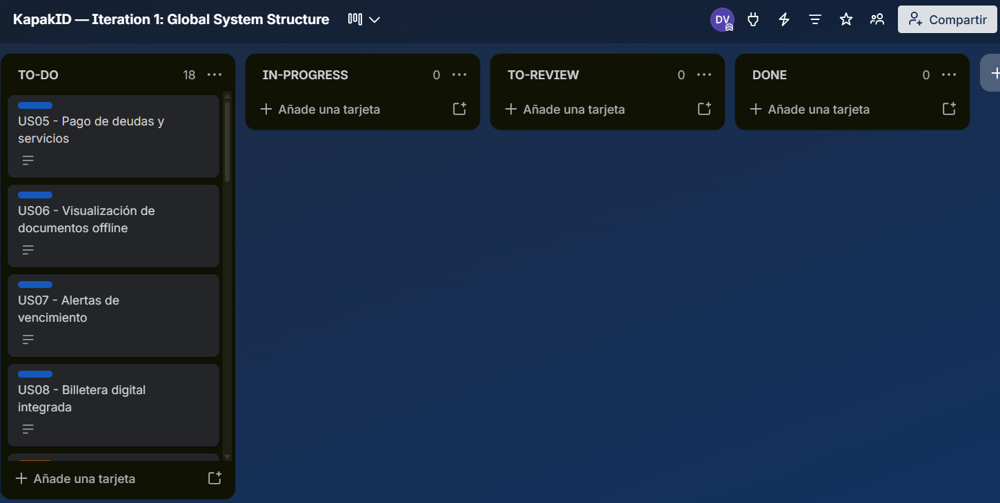

#### 4.3.1.2. Establish Iteration Goal by Selecting Drivers

El objetivo de la Iteration 1 es definir la estructura global del sistema PayID, estableciendo los microservicios principales, el API Gateway, los BFF (Backend for Frontend), el bus de eventos (Kafka), las bases de datos y las integraciones externas, garantizando los atributos de calidad de performance, seguridad, escalabilidad e interoperabilidad.

Para esta iteración se seleccionaron los siguientes drivers arquitectónicos:

- Atributos de calidad: Performance: las recargas de tarjetas de transporte y los pagos de servicios deben procesarse en menos de 2 segundos.
- Seguridad: los documentos personales (DNI, pasaporte, licencia) y las transacciones financieras deben estar cifrados y protegidos con autenticación biométrica.
- Escalabilidad: el sistema debe escalar horizontalmente para soportar el crecimiento de usuarios en Lima Metropolitana.
- Interoperabilidad: el sistema debe integrarse con RENIEC (validación de identidad), SUNAT (validación tributaria), bancos y la pasarela de pagos.

Restricciones:

- Backend en ASP.NET Core y Frontend en Vue, según el stack tecnológico definido por el equipo.
- Base de datos MySQL como persistencia relacional principal.

Preocupaciones arquitectónicas:

- Cumplimiento de la Ley N° 29733 (Ley de Protección de Datos Personales del Perú), garantizando la privacidad de la información de los usuarios.
- Portabilidad cloud, evitando la dependencia de un único proveedor (Azure, AWS o Google Cloud).

#### 4.3.1.3. Choose One or More Elements of the System to Refine

Para la Iteration 1 se seleccionaron los elementos arquitectónicos que serán refinados con el objetivo de establecer la estructura global del sistema PayID. Estos elementos fueron elegidos porque abordan directamente los drivers identificados en la sub-sección anterior (performance, seguridad, escalabilidad e interoperabilidad).

Los elementos seleccionados son:

Componentes de infraestructura:

- API Gateway: punto único de entrada para las aplicaciones móvil y web, encargado de la autenticación, el enrutamiento y el rate limiting.
- BFF Mobile y BFF Web: capas intermedias que adaptan las respuestas del backend según el tipo de cliente (móvil o web).
- Apache Kafka: bus de eventos que permite la comunicación asíncrona entre microservicios.
- Azure Key Vault: servicio para la gestión segura de secretos y claves de cifrado.

Microservicios principales:

- MS Usuarios: gestión de cuentas y autenticación.
- MS Identidad: validación de identidad con RENIEC.
- MS Pagos y Billetera: procesamiento de pagos y recargas.
- MS Académico: validación del estado académico del estudiante.
- MS Compliance: cumplimiento de la Ley N° 29733.
- MS Seguridad: cifrado y biometría.
- MS Notificaciones: envío de alertas y recordatorios.
- MS Auditoría: trazabilidad de transacciones y eventos.

Bases de datos:

- SQL Server (Payment Ledger): registro transaccional de pagos.
- Redis (Cache/Sesiones): caché de sesiones y datos temporales.

Integraciones externas:

- RENIEC: validación de identidad.
- SUNAT: validación tributaria.
- Sistema Universitario: validación del estado académico.
- Pasarela de Pagos: procesamiento de transacciones financieras.
- Proveedor de Notificaciones: envío de SMS, correo y push.

| Nº | Elemento | Tipo | Driver que aborda |
|---|---|---|---|
| 1 | API Gateway | Componente | Performance, Seguridad |
| 2 | BFF Mobile | Componente | Performance |
| 3 | BFF Web | Componente | Performance |
| 4 | MS Usuarios | Microservicio | Seguridad |
| 5 | MS Identidad | Microservicio | Seguridad, Interoperabilidad |
| 6 | MS Pagos y Billetera | Microservicio | Performance, Seguridad |
| 7 | MS Académico | Microservicio | Interoperabilidad |
| 8 | MS Compliance | Microservicio | Seguridad |
| 9 | MS Seguridad | Microservicio | Seguridad |
| 10 | MS Notificaciones | Microservicio | Performance |
| 11 | MS Auditoría | Microservicio | Seguridad |
| 12 | Apache Kafka | Componente | Escalabilidad |
| 13 | SQL Server (Payment Ledger) | Base de datos | Performance, Seguridad |
| 14 | Redis (Cache/Sesiones) | Base de datos | Performance |
| 15 | Azure Key Vault | Componente | Seguridad |

#### 4.3.1.4. Choose One or More Design Concepts That Satisfy the Selected Drivers

Para PayID, una vez identificados los componentes del sistema que requieren refinamiento, el siguiente paso consiste en seleccionar los conceptos de diseño más adecuados que respondan a los drivers arquitectónicos previamente establecidos. Estos conceptos de diseño juegan un papel esencial en guiar el desarrollo de la aplicación y garantizar que se cumplan los objetivos definidos para la iteración de forma eficiente. A continuación, se detallan los conceptos de diseño elegidos para cada uno de los principales drivers:

- Performance:

| Decisión | Justificación |
|---|---|
| API Gateway con Kong | Se implementa un API Gateway como punto único de entrada para centralizar el enrutamiento, el rate limiting y la autenticación. Esto reduce la latencia y evita que cada microservicio gestione estas tareas por separado. |
| BFF (Backend for Frontend) | Se crean dos BFF: uno para la app móvil y otro para la web. Cada uno adapta las respuestas del backend al formato óptimo del cliente, reduciendo el payload y mejorando el tiempo de carga. |
| Cache con Redis | Se utiliza Redis como caché para las consultas frecuentes (ej. saldo de tarjetas, documentos del usuario). Esto reduce la carga sobre MySQL y responde en menos de 100 ms. |
| CQRS para MS Pagos y Billetera | Se separan las operaciones de lectura y escritura en el módulo de pagos. Las consultas de saldo e historial se optimizan en el modelo de lectura, mientras que las transacciones se procesan en el modelo de escritura. |

- Seguridad:

| Decisión | Justificación |
|---|---|
| Autenticación JWT con [ASP.NET](https://asp.net/) Core y Vue | Se implementa JWT para garantizar autenticación segura y escalable. JWT permite sesiones stateless, reduce la carga en la base de datos y es compatible con múltiples dispositivos (móvil y web). |
| Control de Acceso Basado en Roles (RBAC) | Se implementa RBAC para asignar permisos granulares (administrador, estudiante, padre/tutor, comercio). Esto minimiza riesgos de acceso no autorizado a documentos sensibles. |
| Cifrado AES-256 para Datos Sensibles | Se cifran los documentos personales (DNI, pasaporte, licencia) y las transacciones financieras para cumplir con la Ley N° 29733 y proteger la privacidad. |
| Azure Key Vault para Gestión de Secretos | Se utiliza Azure Key Vault para gestionar de forma segura las claves de cifrado, tokens y credenciales de integración (RENIEC, SUNAT, bancos). |
| Cifrado TLS 1.3 en Tránsito | Toda comunicación entre cliente y servidor, y entre microservicios, se cifra con TLS 1.3 para evitar interceptación de datos. |

- Escalabilidad:

| Decisión | Justificación |
|---|---|
| Arquitectura de Microservicios | Se divide el sistema en 8 microservicios independientes (Usuarios, Identidad, Pagos, Académico, Compliance, Seguridad, Notificaciones, Auditoría). Cada uno escala horizontalmente según su demanda. |
| Apache Kafka como Event Bus | Se utiliza Kafka para la comunicación asíncrona entre microservicios. Esto desacopla los servicios y permite manejar picos de tráfico sin afectar el rendimiento. |
| Réplica de MySQL con Read Replicas | Se configuran réplicas de MySQL para distribuir las consultas de lectura y garantizar redundancia ante fallos. |
| Auto-scaling en Kubernetes (AKS) | Se despliega en Azure Kubernetes Service con auto-scaling para agregar o quitar instancias según la carga del sistema. |

- Interoperabilidad:

| Decisión | Justificación |
|---|---|
| Arquitectura Hexagonal (Puertos y Adaptadores) | Cada microservicio se organiza con puertos y adaptadores para aislar la lógica de negocio de las integraciones externas. Si RENIEC cambia su API, solo se modifica el adaptador. |
| Saga Pattern para Transacciones Distribuidas | Se utiliza Saga para coordinar transacciones que involucran varios microservicios (ej. pago + notificación + auditoría). Esto garantiza consistencia eventual. |
| Circuit Breaker con Resilience4j | Se implementa Circuit Breaker para proteger el sistema ante fallos de servicios externos (RENIEC, SUNAT, bancos). Si un servicio falla, se activa un fallback. |
| Adaptadores para RENIEC, SUNAT y Bancos | Se crean adaptadores específicos para cada entidad externa, permitiendo cambiar de proveedor sin afectar la lógica de negocio. |

- Disponibilidad:

| Decisión | Justificación |
|---|---|
| Balanceo de Carga con NGINX | Se distribuye el tráfico entre múltiples instancias del backend para manejar picos de acceso (ej. inicio de mes, quincena). |
| Health Checks Automatizados | Se monitorean los servicios críticos (API de autenticación, MS Pagos) y se reinician instancias fallidas automáticamente. |
| Despliegue Multi-zona en Azure | Se despliega en múltiples zonas de disponibilidad para garantizar que el sistema siga operando ante fallos de una zona. |
| Backups Automatizados de MySQL | Se realizan backups diarios de la base de datos con retención de 30 días. |

#### 4.3.1.5. Instantiate Architectural Elements, Allocate Responsibilities, and Define Interfaces

Una vez seleccionados los conceptos de diseño que satisfacen los drivers arquitectónicos, el siguiente paso consiste en instanciar los elementos arquitectónicos concretos que conformarán el sistema PayID, asignarles sus responsabilidades y definir las interfaces que permitirán su comunicación. A continuación, se detalla cada elemento, su rol dentro del sistema y los endpoints principales que expone.

Instanciando elementos arquitectónicos:

### API GATEWAY

| Aspecto | Detalle |
|---|---|
| Instanciación | Se crea como instancia única (Singleton) en el clúster de Kubernetes, garantizando un punto de entrada centralizado. Se despliega con 3 réplicas para alta disponibilidad. |
| Responsabilidad | Punto único de entrada; enrutamiento, autenticación, rate limiting |
| Interfaces | Expone todos los endpoints del sistema (/api/v1/*) |
| Tecnología | Kong API Gateway |

### BFF MOBILE

| Aspecto | Detalle |
|---|---|
| Instanciación | Se instancia como servicio stateless escalable horizontalmente. Cada instancia atiende un subconjunto de usuarios móviles. |
| Responsabilidad | Adaptar respuestas del backend para la app móvil (Flutter) |
| Interfaces | Endpoints optimizados para móvil |
| Tecnología | [ASP.NET](https://asp.net/) Core |

### BFF WEB

| Aspecto | Detalle |
|---|---|
| Instanciación | Se instancia como servicio stateless escalable horizontalmente. Se despliega en pods independientes de BFF Mobile. |
| Responsabilidad | Adaptar respuestas del backend para la web (Vue) |
| Interfaces | Endpoints optimizados para web |
| Tecnología | [ASP.NET](https://asp.net/) Core |

### MS USUARIOS

| Aspecto | Detalle |
|---|---|
| Instanciación | Se instancia como microservicio independiente con su propia base de datos MySQL. Se despliega con 2 réplicas y auto-scaling hasta 5. |
| Responsabilidad | Gestión de cuentas, registro, login, perfiles |
| Interfaces | /usuarios/registrar, /usuarios/login, /usuarios/{id} |
| Eventos | Publica: UsuarioRegistrado, UsuarioActualizado |
| Tecnología | [ASP.NET](https://asp.net/) Core + MySQL |

### MS IDENTIDAD

| Aspecto | Detalle |
|---|---|
| Instanciación | Se instancia como microservicio independiente con su propia base de datos MySQL. Se integra con RENIEC y SUNAT mediante adaptadores hexagonales. |
| Responsabilidad | Validación de identidad con RENIEC y SUNAT |
| Interfaces | /identidad/validar-dni, /identidad/validar-ruc, /identidad/biometria |
| Eventos | Publica: IdentidadValidada, IdentidadRechazada |
| Tecnología | [ASP.NET](https://asp.net/) Core + MySQL + Adaptadores |

### MS PAGOS Y BILLETERA

| Aspecto | Detalle |
|---|---|
| Instanciación | Se instancia como microservicio transaccional con SQL Server (Payment Ledger) como base de datos. Usa Saga Pattern para coordinar transacciones distribuidas. |
| Responsabilidad | Procesamiento de pagos, recargas, transferencias |
| Interfaces | /pagos/recargar, /pagos/transferir, /pagos/pagar-servicio, /pagos/historial |
| Eventos | Publica: PagoRealizado, RecargaExitosa, TransferenciaCompletada |
| Tecnología | [ASP.NET](https://asp.net/) Core + SQL Server |

### MS ACADÉMICO

| Aspecto | Detalle |
|---|---|
| Instanciación | Se instancia como microservicio independiente con su propia base de datos MySQL. Se integra con SUNEDU mediante adaptador hexagonal. |
| Responsabilidad | Validación del estado académico del estudiante |
| Interfaces | /academico/validar-estudiante, /academico/estado |
| Eventos | Publica: EstudianteValidado |
| Tecnología | [ASP.NET](https://asp.net/) Core + MySQL |

### MS COMPLIANCE

| Aspecto | Detalle |
|---|---|
| Instanciación | Se instancia como microservicio independiente con su propia base de datos MySQL. Se ejecuta como servicio batch para reportes regulatorios. |
| Responsabilidad | Cumplimiento Ley N° 29733 y auditoría regulatoria |
| Interfaces | /compliance/reportes, /compliance/auditar |
| Tecnología | [ASP.NET](https://asp.net/) Core + MySQL |

### MS SEGURIDAD

| Aspecto | Detalle |
|---|---|
| Instanciación | Se instancia como servicio crítico con alta disponibilidad (3 réplicas). Usa Azure Key Vault para gestionar claves y Redis para tokens. |
| Responsabilidad | Cifrado, gestión de tokens, biometría |
| Interfaces | /seguridad/cifrar, /seguridad/descifrar, /seguridad/validar-token |
| Tecnología | [ASP.NET](https://asp.net/) Core + Azure Key Vault + Redis |

### MS NOTIFICACIONES

| Aspecto | Detalle |
|---|---|
| Instanciación | Se instancia como microservicio consumidor de eventos. Escucha Kafka y envía notificaciones de forma asíncrona. |
| Responsabilidad | Envío de SMS, email, push y alertas |
| Interfaces | /notificaciones/enviar, /notificaciones/alertas |
| Eventos | Consume: PagoRealizado, DocumentoProximoAVencer, UsuarioRegistrado |
| Tecnología | [ASP.NET](https://asp.net/) Core + MySQL |

### MS AUDITORÍA

| Aspecto | Detalle |
|---|---|
| Instanciación | Se instancia como microservicio consumidor de todos los eventos. Funciona como Event Store inmutable con base de datos dedicada. |
| Responsabilidad | Registro inmutable de todas las transacciones y eventos |
| Interfaces | /auditoria/eventos, /auditoria/transacciones |
| Eventos | Consume: todos los eventos del sistema |
| Tecnología | [ASP.NET](https://asp.net/) Core + MySQL (Event Store) |

### APACHE KAFKA (EVENT BUS)

| Aspecto | Detalle |
|---|---|
| Instanciación | Se instancia como clúster de Kafka con 3 brokers para alta disponibilidad. Cada topic tiene 3 particiones con replicación 2. |
| Responsabilidad | Bus de eventos para comunicación asíncrona |
| Interfaces | Topics: usuarios, identidad, pagos, academico, notificaciones, auditoria |
| Tecnología | Apache Kafka |

### SQL SERVER (PAYMENT LEDGER)

| Aspecto | Detalle |
|---|---|
| Instanciación | Se instancia como base de datos relacional dedicada al ledger de pagos, con read replicas para consultas y backups automáticos diarios. |
| Responsabilidad | Registro transaccional de pagos |
| Interfaces | Acceso mediante Entity Framework Core desde MS Pagos |
| Tecnología | SQL Server |

### REDIS (CACHE / SESIONES)

| Aspecto | Detalle |
|---|---|
| Instanciación | Se instancia como clúster de Redis con 3 nodos (1 máster + 2 réplicas) para alta disponibilidad. |
| Responsabilidad | Caché de sesiones, saldo de tarjetas, tokens JWT |
| Interfaces | Acceso vía cliente Redis desde microservicios |
| Tecnología | Redis |

### AZURE KEY VAULT

| Aspecto | Detalle |
|---|---|
| Instanciación | Se instancia como servicio gestionado en Azure con acceso restringido por Managed Identity. Se configura con rotación automática de secretos. |
| Responsabilidad | Gestión de secretos, claves de cifrado, credenciales |
| Interfaces | Acceso vía SDK de Azure desde microservicios |
| Tecnología | Azure Key Vault |

Designando responsabilidades de los elementos:

| N.º | Elemento | Responsabilidad Principal | Sub-responsabilidades |
|---|---|---|---|
| 1 | API Gateway | Enrutar todas las solicitudes entrantes | Autenticación, rate limiting, logging, monitoreo |
| 2 | BFF Mobile | Adaptar respuestas para la app móvil | Optimizar payload, gestionar sesión móvil |
| 3 | BFF Web | Adaptar respuestas para la web | Optimizar payload, gestionar sesión web |
| 4 | MS Usuarios | Gestionar cuentas de usuario | Registro, login, perfiles, roles |
| 5 | MS Identidad | Validar identidad de usuarios | DNI (RENIEC), RUC (SUNAT), biometría |
| 6 | MS Pagos y Billetera | Procesar transacciones financieras | Recargas, transferencias, pagos de servicios |
| 7 | MS Académico | Validar estado académico | Carné universitario, SUNEDU |
| 8 | MS Compliance | Garantizar cumplimiento legal | Ley 29733, reportes regulatorios |
| 9 | MS Seguridad | Proteger datos y accesos | Cifrado, tokens, biometría |
| 10 | MS Notificaciones | Enviar notificaciones al usuario | SMS, email, push, alertas |
| 11 | MS Auditoría | Registrar eventos inmutables | Trazabilidad, historial, reportes |
| 12 | Apache Kafka | Comunicar microservicios de forma asíncrona | Publicar y consumir eventos |
| 13 | SQL Server | Almacenar datos transaccionales | Ledger de pagos, historial |
| 14 | Redis | Almacenar datos en caché | Sesiones, tokens, saldos temporales |
| 15 | Azure Key Vault | Gestionar secretos y claves | Cifrado, credenciales, rotación |

Definiendo Interfaces REST:

| Elemento | Endpoint | Método | Descripción | Consumidor |
|---|---|---|---|---|
| API Gateway | /api/v1/auth/* | POST | Autenticación | App móvil, Web |
| API Gateway | /api/v1/usuarios/* | GET, POST, PUT | Gestión de usuarios | BFF Mobile, BFF Web |
| API Gateway | /api/v1/pagos/* | POST | Procesamiento de pagos | BFF Mobile, BFF Web |
| MS Usuarios | /usuarios/registrar | POST | Registrar usuario | API Gateway |
| MS Usuarios | /usuarios/login | POST | Iniciar sesión (genera JWT) | API Gateway |
| MS Identidad | /identidad/validar-dni | POST | Validar DNI con RENIEC | MS Usuarios |
| MS Identidad | /identidad/validar-ruc | POST | Validar RUC con SUNAT | MS Pagos |
| MS Identidad | /identidad/biometria | POST | Validar huella/rostro | MS Usuarios |
| MS Pagos | /pagos/recargar | POST | Recargar tarjeta de transporte | API Gateway |
| MS Pagos | /pagos/transferir | POST | Transferencia P2P | API Gateway |
| MS Pagos | /pagos/pagar-servicio | POST | Pagar deuda o servicio | API Gateway |
| MS Académico | /academico/validar-estudiante | POST | Validar carné universitario | MS Usuarios |
| MS Compliance | /compliance/reportes | GET | Generar reporte de cumplimiento | MS Auditoría |
| MS Seguridad | /seguridad/cifrar | POST | Cifrar datos sensibles | MS Identidad, MS Pagos |
| MS Seguridad | /seguridad/validar-token | POST | Validar JWT | API Gateway |
| MS Notificaciones | /notificaciones/enviar | POST | Enviar notificación | MS Pagos, MS Usuarios |
| MS Auditoría | /auditoria/eventos | GET | Consultar eventos | MS Compliance |

#### 4.3.1.6. Sketch Views (C4 & UML) and Record Design Decisions

Para documentar el diseño arquitectónico de la Iteration 1, se hace referencia a las vistas C4 y UML presentadas en el Capítulo IV. Asimismo, se registran las decisiones de diseño tomadas durante esta iteración, cada una con su justificación alineada a los drivers arquitectónicos seleccionados (performance, seguridad, escalabilidad e interoperabilidad).

Diagrama de Contexto:

| Elemento | Responsabilidad |
|---|---|
| Estudiante | Usa PayID para gestionar documentos personales, recargar tarjetas de transporte y pagar servicios. |
| Padre/Madre o Tutor | Gestiona documentos de sus hijos o familiares desde una sola cuenta. |
| Comercio/Servicio | Negocio afiliado que acepta pagos con QR a través de PayID. |
| Institución Educativa | Universidad que valida credenciales académicas y emite carnés digitales. |
| PayID | Plataforma digital que centraliza identidad, documentos y pagos en una sola aplicación. |
| RENIEC | Sistema externo que valida DNI y datos de identidad. |
| SUNAT | Sistema externo que valida RUC y facturación electrónica. |
| SUNEDU | Sistema externo que valida carné universitario y estado académico. |
| Pasarela de Pagos | Sistema externo que procesa transacciones con Visa y Mastercard. |
| Yape / Plin | Billeteras digitales para pagos P2P. |
| Bancos | Sistema externo para transferencias y conciliación bancaria. |
| Sistema de Transporte | Sistema externo para recarga de tarjetas Metropolitano y Lima Pass. |
| Proveedor de Notificaciones | Sistema externo que envía SMS, email y push. |
| OSE | Sistema externo que emite comprobantes electrónicos validados por SUNAT. |

Diagrama de Contenedores:

| Elemento | Responsabilidad |
|---|---|
| App Móvil | Aplicación móvil para estudiantes y padres (Flutter). |
| Portal Web | Aplicación web para administradores y comercios (Vue.js). |
| API Gateway | Punto único de entrada; enrutamiento, autenticación y rate limiting (Kong). |
| BFF Mobile | Adapta las respuestas del backend para la app móvil. |
| BFF Web | Adapta las respuestas del backend para la web. |
| MS Identidad | Validación de identidad con RENIEC y SUNAT. |
| MS Pagos y Billetera | Procesamiento de pagos, recargas y transferencias. |
| MS Documentos | Gestión de documentos digitales. |
| Apache Kafka | Bus de eventos para comunicación asíncrona. |
| Redis | Caché de sesiones y tokens. |
| SQL Server | Ledger transaccional de pagos. |
| Entidades Gubernamentales | RENIEC, SUNAT y SUNEDU. |
| Pasarelas de Pago | Visa, Mastercard, Yape, Plin, bancos y transporte. |
| Servicios Externos | Notificaciones y OSE. |

Diagrama de Componentes:

| Elemento | Responsabilidad |
|---|---|
| Payment Controller | Expone los endpoints REST para pagos y recargas. |
| Payment Validator | Valida los datos de entrada y las reglas de negocio. |
| Payment Service | Orquesta el procesamiento de pagos. |
| Wallet Service | Gestiona los saldos y movimientos de la billetera digital. |
| Payment Repository | Abstrae el acceso a SQL Server para pagos. |
| Wallet Repository | Abstrae el acceso a datos de billetera. |
| Payment Gateway Adapter | Adapta la integración con pasarelas de pago (Visa, Mastercard, Yape, Plin). |
| Payment Event Publisher | Publica eventos en Kafka (PagoRealizado). |
| SQL Server (Payment Ledger) | Almacena las transacciones financieras. |
| Apache Kafka | Bus de eventos para notificar a otros microservicios. |
| Pasarela de Pagos | Sistema externo que procesa transacciones con tarjeta. |
| Yape / Plin | Billeteras digitales para pagos P2P. |
| Sistema de Transporte | Recarga de tarjetas Metropolitano y Lima Pass. |
| Azure Key Vault | Gestión segura de secretos y claves de cifrado. |

#### 4.3.1.7. Analysis of Current Design and Review Iteration Goal (Kanban Board)

Al cierre de la Iteration 1, se analiza el diseño actual del sistema y se revisa el cumplimiento del objetivo planteado. El tablero Kanban refleja el avance del equipo durante la iteración.

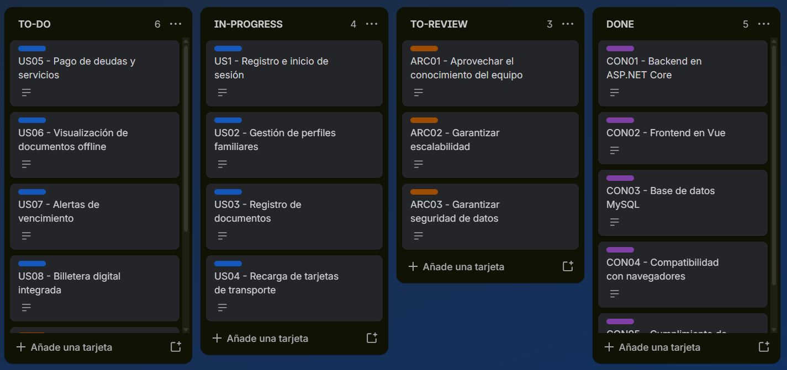

Enlace: [Trello -PayID — Iteration 1: Global System Structure](https://trello.com/invite/b/6ac0277440f8dcdc9077645f/ATTI4fab9412ddb8d1dcead000c1a6c340a84F2E45D5/kapakid-iteration-1-global-system-structure)

### 4.3.2. Iteration 2: Validación de Identidad y Gestión de Documentos Digitales

#### 4.3.2.1. Architectural Design Backlog 2

En la segunda iteración se definió el Architectural Design Backlog enfocado en la gestión de la identidad y de los documentos digitales de PayID. Esta iteración refina los elementos encargados de registrar, validar, almacenar y consultar los documentos de los usuarios, incluyendo la integración con RENIEC, el manejo de la validación pendiente y el acceso sin conexión a documentos verificados.

| Tipo | ID | Descripción |
|---|---|---|
| User Story | US3 | Registro de documentos con validación del DNI en RENIEC. |
| User Story | US2 | Creación de perfiles familiares para administrar documentos de hijos o familiares. |
| User Story | US11 | Acceso a documentos verificados sin conexión a internet. |
| User Story | US17 | API para registrar y consultar documentos. |
| Quality Attribute | QA-04 | Interoperabilidad: si RENIEC no responde en 5 segundos, el documento queda en estado «Pendiente» y se reintenta la validación. |
| Quality Attribute | QA-06 | Usabilidad offline: un documento verificado y descargado se muestra en menos de 3 segundos sin conexión. |
| Quality Attribute | QA-08 | Modificabilidad: agregar un nuevo tipo de documento afecta principalmente al microservicio de documentos. |
| Constraint | CON-05 | El tratamiento de datos personales debe cumplir la Ley N.° 29733. |
| Constraint | CON-06 | PayID depende de servicios externos previstos; en esta iteración aplica a la validación de identidad con RENIEC. |
| Architectural Concern | ARC-01 | Proteger los datos personales y los perfiles familiares con control de acceso. |
| Architectural Concern | ARC-04 | Manejar fallas o demoras de RENIEC sin bloquear al usuario. |
| Architectural Concern | ARC-07 | Proteger los documentos guardados en el celular y sincronizarlos al volver la conexión. |

#### 4.3.2.2. Establish Iteration Goal by Selecting Drivers

El objetivo de la Iteration 2 es refinar la gestión de identidad y documentos de PayID, de modo que el usuario pueda registrar su DNI y otros documentos, validarlos con RENIEC sin quedar bloqueado si el servicio no responde, organizarlos por perfil familiar y consultarlos incluso sin conexión a internet.

Para esta iteración se seleccionaron los siguientes drivers arquitectónicos:

| Tipo de driver | ID | Driver seleccionado |
|---|---|---|
| Atributo de calidad | QA-04 | Interoperabilidad con RENIEC, con estado «Pendiente» y reintentos. |
| Atributo de calidad | QA-06 | Consulta de documentos verificados sin conexión en menos de 3 segundos. |
| Atributo de calidad | QA-08 | Incorporar nuevos tipos de documento sin afectar a otros servicios. |
| Funcionalidad | US3, US2, US11, US17 | Registro, validación, organización por perfil y consulta de documentos. |
| Restricción | CON-05, CON-06 | Ley N.° 29733 y dependencia de servicios externos (RENIEC). |
| Preocupación | ARC-01, ARC-04, ARC-07 | Control de acceso, tolerancia a fallas de RENIEC y almacenamiento local protegido. |

#### 4.3.2.3. Choose One or More Elements of the System to Refine

Para la Iteration 2 se seleccionaron los elementos que participan en el registro, la validación y la consulta de documentos. Se incorpora el MS Documentos como nuevo microservicio, separando la gestión de documentos de la validación de identidad que realiza el MS Identidad.

| Nº | Elemento | Tipo | Driver que aborda |
|---|---|---|---|
| 1 | MS Identidad | Microservicio | QA-04, ARC-04 |
| 2 | MS Documentos (nuevo) | Microservicio | QA-08, US3, US17 |
| 3 | Adaptador RENIEC | Componente | QA-04, CON-06 |
| 4 | Base de datos de documentos (MySQL) | Base de datos | US3, CON-05 |
| 5 | Almacenamiento de archivos (Azure Blob Storage) | Almacenamiento | CON-05, ARC-01 |
| 6 | BFF Mobile | Componente | QA-06 |
| 7 | App móvil (Flutter) – almacenamiento local | Cliente | QA-06, ARC-07 |
| 8 | Apache Kafka | Componente | QA-04 |

#### 4.3.2.4. Choose One or More Design Concepts That Satisfy the Selected Drivers

A continuación, se presentan los conceptos de diseño seleccionados para responder a los drivers de esta iteración, agrupados por atributo de calidad.

1. Interoperabilidad

| Decisión | Justificación |
|---|---|
| Reintentos con espera progresiva (Polly) | Si RENIEC no responde en 5 segundos, se reintenta hasta tres veces con tiempos de espera crecientes, sin bloquear al usuario. |
| Circuit Breaker (Polly) | Si RENIEC falla de forma repetida, se abre el circuito y las nuevas validaciones pasan directamente a estado «Pendiente», evitando sobrecargar el servicio. |
| Validación asíncrona por eventos | El registro del DNI responde de inmediato al usuario. El MS Documentos publica el evento DniValidationRequested solo para los DNI; el MS Identidad procesa la validación en segundo plano y publica su resultado en Kafka. |

2. Modificabilidad

| Decisión | Justificación |
|---|---|
| Microservicio de documentos independiente | La lógica de documentos se separa del MS Identidad, de modo que agregar un tipo de documento solo afecta al MS Documentos. |
| Patrón Strategy por tipo de documento | Cada tipo de documento (DNI, pasaporte, licencia, carné) tiene sus propias reglas de validación, que se agregan sin modificar el código existente. |
| Máquina de estados del documento | El documento pasa por estados definidos: Registrado → Pendiente → Verificado o Rechazado. Esto ordena las reglas y facilita las pruebas. |

3. Usabilidad offline

| Decisión | Justificación |
|---|---|
| Almacenamiento local cifrado en Flutter | Los documentos verificados se guardan en el celular con cifrado (flutter_secure_storage y base local cifrada), permitiendo mostrarlos sin conexión en menos de 3 segundos. |
| Paquete offline desde el BFF Mobile | El BFF Mobile entrega solo los documentos verificados y sus datos esenciales, reduciendo el tamaño de la descarga. |
| Sincronización al volver la conexión | La app compara versiones con el servidor y actualiza los documentos que cambiaron. |

4. Seguridad y privacidad

| Decisión | Justificación |
|---|---|
| Control de acceso por titular y perfil familiar | Cada solicitud verifica que el usuario sea el titular del documento o el responsable del perfil familiar. |
| Cifrado de archivos en reposo | Las imágenes de los documentos se guardan cifradas en Azure Blob Storage, con claves administradas en Azure Key Vault. |

#### 4.3.2.5. Instantiate Architectural Elements, Allocate Responsibilities, and Define Interfaces

En esta etapa se instancian los elementos refinados, se asignan sus responsabilidades y se definen las interfaces de comunicación.

Elementos instanciados y responsabilidades:

| Elemento | Responsabilidades |
|---|---|
| MS Identidad | Recibir solicitudes de validación del DNI, consultar a RENIEC mediante su adaptador, manejar reintentos y publicar el resultado de la validación. |
| MS Documentos | Registrar, consultar y actualizar documentos; gestionar sus estados; asociarlos al titular o a un perfil familiar; generar el paquete offline. |
| Adaptador RENIEC | Traducir las solicitudes de PayID al formato del servicio de RENIEC y aplicar las políticas de reintento y Circuit Breaker. |
| Base de datos de documentos (MySQL) | Guardar los metadatos de cada documento: tipo, número, fechas, estado y perfil asociado. |
| Azure Blob Storage | Guardar de forma cifrada las imágenes o archivos de los documentos. |
| BFF Mobile | Adaptar las respuestas para la app móvil y entregar el paquete de documentos para uso offline. |
| App móvil (Flutter) | Mostrar los documentos, guardarlos cifrados en el dispositivo y sincronizarlos al recuperar la . |

Interfaces REST:

| Método | Endpoint | Descripción |
|---|---|---|
| POST | /api/v1/documents | Registra un documento del usuario o de un perfil familiar. |
| GET | /api/v1/documents?profileId={id} | Lista los documentos del usuario o de un perfil familiar. |
| GET | /api/v1/documents/{id} | Consulta el detalle de un documento. |
| POST | /api/v1/identity/validations | Solicita la validación del DNI con RENIEC. |
| GET | /api/v1/identity/validations/{id} | Consulta el estado de una validación (Pendiente, Verificado o Rechazado). |
| GET | /mobile/v1/documents/offline-package | Entrega los documentos verificados para uso sin conexión. |

Eventos de dominio publicados en Apache Kafka:

| Evento | Publicado por | Consumido por |
|---|---|---|
| DocumentRegistered | MS Documentos | MS Auditoría |
| DniValidationRequested | MS Documentos (solo cuando el documento es un DNI) | MS Identidad |
| IdentityValidated | MS Identidad | MS Documentos, MS Notificaciones |
| IdentityValidationPending | MS Identidad | MS Documentos, MS Notificaciones |
| IdentityValidationRejected | MS Identidad | MS Documentos, MS Notificaciones |

#### 4.3.2.6. Sketch Views (C4 & UML) and Record Design Decisions

Las vistas de esta iteración representan los elementos refinados y su interacción. Se recomienda incluir los siguientes diagramas:

- Diagrama C4 de componentes del MS Documentos y del MS Identidad, con el adaptador de RENIEC.
- Diagrama de secuencia del registro del DNI: registro, validación con RENIEC, caso «Pendiente» con reintentos y notificación del resultado.
- Diagrama de estados del documento: Registrado, Pendiente, Verificado y Rechazado.

Registro de decisiones de diseño:

| ID | Decisión | Alternativa descartada | Motivo |
|---|---|---|---|
| DD-2.1 | Separar MS Documentos del MS Identidad | Mantener todo en MS Identidad | Agregar tipos de documento no debe afectar la validación de identidad (QA-08). |
| DD-2.2 | Validación asíncrona con eventos | Validación síncrona esperando a RENIEC | Evita bloquear al usuario cuando RENIEC demora (QA-04, ARC-04). |
| DD-2.3 | Polly para reintentos y Circuit Breaker | Reintentos manuales en el código | Polly es la librería estándar de resiliencia en .NET y se configura por políticas. |
| DD-2.4 | Almacenamiento local cifrado en Flutter | Guardar los documentos sin cifrar | Protege los datos personales en el celular (CON-05, ARC-07). |

#### 4.3.2.7. Analysis of Current Design and Review Iteration Goal (Kanban Board)

Al cierre de la Iteration 2, se analiza el diseño actual y se revisa el avance de los drivers seleccionados. Se utilizan tres estados: Diseñado, cuando existe una solución arquitectónica definida; Parcial, cuando falta completar o definir algún aspecto; y Validado, cuando existen pruebas o evidencias que demuestran su cumplimiento. Los drivers pasarán a Validado con las evidencias del capítulo V.

| Driver | Estado | Observación |
|---|---|---|
| QA-04 | Diseñado | La validación asíncrona, los reintentos y el estado «Pendiente» evitan bloquear al usuario. |
| QA-06 | Diseñado | El paquete offline y el almacenamiento local cifrado permiten consultar documentos sin conexión. |
| QA-08 | Diseñado | El MS Documentos y el patrón Strategy aíslan los cambios por tipo de documento. |
| ARC-07 | Parcial | Falta validar la sincronización con pruebas en dispositivos reales. |

### 4.3.3. Iteration 3: Pagos, Recargas y Billetera Digital

#### 4.3.3.1. Architectural Design Backlog 3

En la tercera iteración se definió el Architectural Design Backlog enfocado en las operaciones de pago y recarga de PayID. Esta iteración refina los elementos que procesan las recargas de tarjetas de transporte, el pago de servicios y deudas, la billetera digital y el historial de transacciones, considerando la integración con la pasarela de pagos y los operadores de transporte.

| Tipo | ID | Descripción |
|---|---|---|
| User Story | US5 | Recarga de tarjetas de transporte. |
| User Story | US6 | Pago de deudas de servicios o multas. |
| User Story | US7 | Historial de transacciones. |
| User Story | US19 | Billetera digital y recargas mediante flujo guiado. |
| Quality Attribute | QA-01 | Rendimiento: PayID registra la operación y muestra su estado en menos de 2 segundos. |
| Quality Attribute | QA-03 | Escalabilidad: 1 000 usuarios concurrentes sin aumentar más de 20 % el tiempo de respuesta. |
| Quality Attribute | QA-05 | Disponibilidad: los servicios críticos siguen operando si falla un servicio no crítico. |
| Constraint | CON-06 | PayID depende de servicios externos previstos; en esta iteración aplica a la pasarela de pagos y a los operadores de transporte. |
| Architectural Concern | ARC-03 | Mantener la consistencia de saldos y movimientos en operaciones distribuidas. |
| Architectural Concern | ARC-04 | Manejar fallas o demoras de la pasarela de pagos sin bloquear al usuario. |

#### 4.3.3.2. Establish Iteration Goal by Selecting Drivers

El objetivo de la Iteration 3 es refinar el procesamiento de pagos y recargas de PayID, de modo que cada operación se registre y muestre su estado en menos de 2 segundos, que no se dupliquen cobros ante reintentos y que los saldos y movimientos se mantengan consistentes aunque falle la pasarela de pagos.

Para esta iteración se seleccionaron los siguientes drivers arquitectónicos:

| Tipo de driver | ID | Driver seleccionado |
|---|---|---|
| Atributo de calidad | QA-01 | Respuesta al usuario en menos de 2 segundos. |
| Atributo de calidad | QA-03 | Soportar 1 000 usuarios concurrentes en fechas de alta demanda. |
| Atributo de calidad | QA-05 | Los pagos siguen funcionando aunque falle un servicio no crítico. |
| Funcionalidad | US5, US6, US7, US19 | Recargas, pagos, historial y billetera digital. |
| Restricción | CON-06 | Dependencia de servicios externos (pasarela de pagos y operadores de transporte). |
| Preocupación | ARC-03, ARC-04 | Consistencia de saldos y tolerancia a fallas externas. |

#### 4.3.3.3. Choose One or More Elements of the System to Refine

Para la Iteration 3 se seleccionaron los elementos que intervienen en el flujo de una operación de pago o recarga, desde que el usuario la confirma hasta que se registra en su historial.

| Nº | Elemento | Tipo | Driver que aborda |
|---|---|---|---|
| 1 | MS Pagos y Billetera | Microservicio | QA-01, ARC-03 |
| 2 | Adaptador de pasarela de pagos | Componente | CON-06, ARC-04 |
| 3 | Adaptador de operador de transporte | Componente | CON-06 |
| 4 | Base de datos de pagos (Payment Ledger) | Base de datos | ARC-03 |
| 5 | Modelo de lectura del historial | Base de datos | QA-01, US7 |
| 6 | Redis | Caché | QA-01, QA-03 |
| 7 | Apache Kafka | Componente | QA-05, ARC-03 |
| 8 | BFF Mobile | Componente | QA-01, US19 |

#### 4.3.3.4. Choose One or More Design Concepts That Satisfy the Selected Drivers

A continuación, se presentan los conceptos de diseño seleccionados para responder a los drivers de esta iteración, agrupados por atributo de calidad.

1. Rendimiento

| Decisión | Justificación |
|---|---|
| Registro inmediato y confirmación asíncrona | PayID registra la operación con estado «Procesando» y responde al usuario de inmediato; la confirmación de la pasarela llega después como evento. Así se cumple el tiempo de 2 segundos. |
| CQRS para el historial | Las consultas de historial y saldos se leen de un modelo de lectura optimizado, separado de las operaciones de escritura. |
| Caché con Redis | Las tarjetas registradas y el último saldo consultado se guardan temporalmente en Redis para mostrar la billetera más rápido. |

2. Consistencia

| Decisión | Justificación |
|---|---|
| Patrón Saga (orquestación) | El MS Pagos coordina los pasos de la operación (registro, cobro, recarga y notificación). Si un paso falla, ejecuta acciones de compensación, como anular el cobro. |
| Claves de idempotencia | Cada operación lleva una clave única (Idempotency-Key). Si el cliente o el sistema reintenta, no se genera un segundo cobro. |
| Patrón Outbox | El registro de la operación y el evento a publicar se guardan en la misma transacción de base de datos, evitando eventos perdidos. |

3. Disponibilidad y escalabilidad

| Decisión | Justificación |
|---|---|
| Circuit Breaker hacia la pasarela | Si la pasarela falla de forma repetida, se suspenden temporalmente nuevas llamadas y se informa al usuario, sin afectar al resto del sistema. |
| Escalamiento horizontal del MS Pagos | En fechas de alta demanda se agregan instancias del MS Pagos de forma automática. |
| Comunicación por eventos | Las notificaciones y la auditoría se procesan de forma asíncrona, de modo que su falla no detiene los pagos. |

#### 4.3.3.5. Instantiate Architectural Elements, Allocate Responsibilities, and Define Interfaces

En esta etapa se instancian los elementos que participan en las operaciones financieras de PayID y se definen sus interfaces.

Elementos instanciados y responsabilidades:

| Elemento | Responsabilidades |
|---|---|
| MS Pagos y Billetera | Registrar operaciones, coordinar la saga de pago o recarga, aplicar las claves de idempotencia y publicar los eventos del resultado. |
| Adaptador de pasarela de pagos | Traducir las solicitudes de PayID al formato de la pasarela y recibir sus confirmaciones. |
| Adaptador de operador de transporte | Consultar saldos y enviar recargas a las tarjetas de transporte compatibles. |
| Payment Ledger | Guardar cada operación con su estado, monto, medio de pago y clave de idempotencia. |
| Modelo de lectura del historial | Mostrar al usuario sus recargas y pagos ordenados por fecha. |
| Redis | Guardar temporalmente tarjetas y saldos consultados con frecuencia. |
| BFF Mobile | Adaptar la billetera y el flujo guiado de recarga para la app móvil. |

Interfaces REST:

| Método | Endpoint | Descripción |
|---|---|---|
| GET | /api/v1/wallet/cards | Lista las tarjetas de transporte registradas y el último saldo disponible, cuando el operador proporcione dicha información. |
| POST | /api/v1/payments/top-ups | Registra una recarga de transporte. Requiere el encabezado Idempotency-Key. |
| POST | /api/v1/payments/debts/{id}/pay | Registra el pago de una deuda de servicios o multas. |
| GET | /api/v1/payments/{id} | Consulta el estado de una operación (Procesando, Aprobada o Rechazada). |
| GET | /api/v1/transactions?page={n} | Consulta el historial de recargas y pagos del usuario. |

Eventos de dominio publicados en Apache Kafka:

| Evento | Publicado por | Consumido por |
|---|---|---|
| PaymentRequested | MS Pagos y Billetera | MS Auditoría |
| PaymentApproved | MS Pagos y Billetera | MS Notificaciones, MS Auditoría |
| PaymentRejected | MS Pagos y Billetera | MS Notificaciones, MS Auditoría |
| BalanceUpdated | MS Pagos y Billetera | BFF Mobile (actualización de la billetera) |

#### 4.3.3.6. Sketch Views (C4 & UML) and Record Design Decisions

Las vistas de esta iteración representan los elementos refinados y su interacción. Se recomienda incluir los siguientes diagramas:

- Diagrama C4 de componentes del MS Pagos y Billetera con sus adaptadores externos.
- Diagrama de secuencia de una recarga: registro con idempotencia, cobro en la pasarela, recarga en el operador y notificación.
- Diagrama de secuencia de la compensación cuando la recarga falla después del cobro.

Registro de decisiones de diseño:

| ID | Decisión | Alternativa descartada | Motivo |
|---|---|---|---|
| DD-3.1 | Saga orquestada por el MS Pagos | Saga por coreografía | Facilita seguir el estado de cada operación y aplicar compensaciones (ARC-03). |
| DD-3.2 | Claves de idempotencia | Validar duplicados solo en la pasarela | Evita cobros dobles ante reintentos del cliente o del sistema. |
| DD-3.3 | Confirmación asíncrona | Esperar la respuesta de la pasarela | Permite responder en menos de 2 segundos (QA-01). |
| DD-3.4 | CQRS para el historial | Consultar directamente el Payment Ledger | Las consultas frecuentes no afectan el registro de nuevas operaciones. |

#### 4.3.3.7. Analysis of Current Design and Review Iteration Goal (Kanban Board)

Al cierre de la Iteration 3, se analiza el diseño actual y se revisa el avance de los drivers seleccionados. Se utilizan tres estados: Diseñado, cuando existe una solución arquitectónica definida; Parcial, cuando falta completar o definir algún aspecto; y Validado, cuando existen pruebas o evidencias que demuestran su cumplimiento. Los drivers pasarán a Validado con las evidencias del capítulo V.

| Driver | Estado | Observación |
|---|---|---|
| QA-01 | Diseñado | La confirmación asíncrona permite responder en menos de 2 segundos. |
| QA-03 | Parcial | El escalamiento horizontal está definido; falta validarlo con pruebas de carga. |
| QA-05 | Diseñado | La comunicación por eventos aísla la falla de los servicios no críticos. |
| ARC-03 | Diseñado | La saga, la idempotencia y el Outbox mantienen la consistencia de saldos. |

Enlace: [Agregar enlace del tablero de la Iteration 3]

### 4.3.4. Iteration 4: Seguridad, Autenticación y Protección de Datos

#### 4.3.4.1. Architectural Design Backlog 4

En la cuarta iteración se definió el Architectural Design Backlog enfocado en la seguridad de PayID. Esta iteración refina los elementos responsables de la autenticación de los usuarios, el control de acceso a los documentos y perfiles familiares, la protección de los datos personales y la auditoría de las operaciones críticas.

| Tipo | ID | Descripción |
|---|---|---|
| User Story | US1 | Registro de usuario. |
| User Story | US22 | Inicio de sesión con bloqueo por intentos fallidos. |
| User Story | US16 | API de autenticación con token de acceso. |
| Quality Attribute | QA-02 | Seguridad: tras 5 intentos fallidos, la cuenta se bloquea por 15 minutos y se avisa al titular. |
| Constraint | CON-05 | El tratamiento de datos personales debe cumplir la Ley N.° 29733. |
| Architectural Concern | ARC-01 | Controlar quién puede acceder a los datos personales y perfiles familiares. |
| Architectural Concern | ARC-05 | Proteger contraseñas, claves de cifrado y credenciales mediante un gestor de secretos. |
| Architectural Concern | ARC-06 | Registrar en auditoría las operaciones críticas sin guardar información sensible innecesaria. |

[Insertar captura de las tarjetas del Architectural Design Backlog 4 (Trello o Miro)]

#### 4.3.4.2. Establish Iteration Goal by Selecting Drivers

El objetivo de la Iteration 4 es refinar la seguridad de PayID, de modo que solo los usuarios autenticados y autorizados accedan a sus documentos y a los de sus perfiles familiares, que los intentos de acceso indebido se bloqueen, que los datos personales se protejan conforme a la Ley N.° 29733 y que las operaciones críticas queden registradas.

Para esta iteración se seleccionaron los siguientes drivers arquitectónicos:

| Tipo de driver | ID | Driver seleccionado |
|---|---|---|
| Atributo de calidad | QA-02 | Bloqueo temporal de la cuenta tras 5 intentos fallidos. |
| Funcionalidad | US1, US22, US16 | Registro, inicio de sesión y autenticación por token. |
| Restricción | CON-05 | Cumplimiento de la Ley N.° 29733. |
| Preocupación | ARC-01, ARC-05, ARC-06 | Control de acceso, gestión de secretos y auditoría. |

#### 4.3.4.3. Choose One or More Elements of the System to Refine

Para la Iteration 4 se seleccionaron los elementos que intervienen en la autenticación, la autorización, la protección de datos y la trazabilidad de PayID.

| Nº | Elemento | Tipo | Driver que aborda |
|---|---|---|---|
| 1 | MS Usuarios | Microservicio | US1, US22 |
| 2 | MS Seguridad | Microservicio | QA-02, US16 |
| 3 | API Gateway | Componente | ARC-01 |
| 4 | Azure Key Vault | Componente | ARC-05 |
| 5 | MS Compliance | Microservicio | CON-05 |
| 6 | MS Auditoría | Microservicio | ARC-06 |
| 7 | Redis | Caché | QA-02 |

#### 4.3.4.4. Choose One or More Design Concepts That Satisfy the Selected Drivers

A continuación, se presentan los conceptos de diseño seleccionados para responder a los drivers de esta iteración, agrupados por atributo de calidad.

1. Autenticación

| Decisión | Justificación |
|---|---|
| JWT con token de acceso y de renovación | El token de acceso dura poco tiempo y el de renovación permite mantener la sesión sin volver a ingresar la contraseña. |
| Contraseñas con hash seguro | Las contraseñas se guardan con un algoritmo de hash con sal (ASP.NET Core Identity), nunca en texto plano. |
| Bloqueo temporal con contador en Redis | Cada intento fallido se cuenta en Redis; al quinto, la cuenta se bloquea 15 minutos y se notifica al titular (QA-02). |

2. Autorización

| Decisión | Justificación |
|---|---|
| Control de acceso basado en roles (RBAC) | Se definen roles como estudiante, padre o apoderado, comercio y administrador, cada uno con sus permisos. |
| Políticas por titular y perfil familiar | Además del rol, cada solicitud verifica que el usuario sea el titular del recurso o el responsable del perfil familiar (ARC-01). |
| Validación del token en el API Gateway | El API Gateway rechaza las solicitudes sin token válido antes de que lleguen a los microservicios. |

3. Protección de datos

| Decisión | Justificación |
|---|---|
| Cifrado AES-256 en reposo y TLS en tránsito | Los datos sensibles se cifran al guardarse y toda comunicación usa HTTPS/TLS. |
| Azure Key Vault con rotación de claves | Las claves de cifrado y las credenciales externas se guardan fuera del código y se renuevan periódicamente (ARC-05). |
| Gestión de consentimiento (MS Compliance) | Se registra el consentimiento del usuario y se atienden los derechos de acceso, rectificación, cancelación y oposición (Ley N.° 29733). |

4. Trazabilidad

| Decisión | Justificación |
|---|---|
| Registro de auditoría de solo escritura | El MS Auditoría guarda inicios de sesión, pagos y cambios en documentos sin permitir modificaciones posteriores. |
| Exclusión de datos sensibles en la auditoría | No se registran contraseñas, tokens completos ni números de documento completos (ARC-06). |

#### 4.3.4.5. Instantiate Architectural Elements, Allocate Responsibilities, and Define Interfaces

En esta etapa se instancian los elementos de seguridad de PayID, se asignan sus responsabilidades y se definen sus interfaces.

Elementos instanciados y responsabilidades:

| Elemento | Responsabilidades |
|---|---|
| MS Usuarios | Registrar cuentas, gestionar perfiles de usuario y roles. |
| MS Seguridad | Validar credenciales, emitir y renovar tokens, controlar los intentos fallidos y bloquear cuentas. |
| API Gateway | Validar el token de cada solicitud, aplicar límites de solicitudes y enrutar al microservicio correspondiente. |
| Azure Key Vault | Guardar claves de cifrado, secretos y credenciales de servicios externos. |
| MS Compliance | Registrar consentimientos y atender solicitudes sobre derechos de datos personales. |
| MS Auditoría | Guardar el registro de operaciones críticas sin datos sensibles. |
| Redis | Guardar el contador de intentos fallidos y el estado de bloqueo temporal. |

Interfaces REST:

| Método | Endpoint | Descripción |
|---|---|---|
| POST | /api/v1/users | Registra una nueva cuenta de usuario. |
| POST | /api/v1/auth/login | Valida credenciales y entrega los tokens de acceso y de renovación. |
| POST | /api/v1/auth/refresh | Renueva el token de acceso. |
| POST | /api/v1/auth/logout | Cierra la sesión e invalida el token de renovación. |
| GET | /api/v1/compliance/consents | Consulta los consentimientos otorgados por el usuario. |

Eventos de dominio publicados en Apache Kafka:

| Evento | Publicado por | Consumido por |
|---|---|---|
| UserRegistered | MS Usuarios | MS Compliance, MS Auditoría |
| LoginFailed | MS Seguridad | MS Auditoría |
| AccountLocked | MS Seguridad | MS Notificaciones, MS Auditoría |
| ConsentUpdated | MS Compliance | MS Auditoría |

#### 4.3.4.6. Sketch Views (C4 & UML) and Record Design Decisions

Las vistas de esta iteración representan los elementos refinados y su interacción. Se recomienda incluir los siguientes diagramas:

- Diagrama C4 de componentes del MS Seguridad y el MS Usuarios, con el API Gateway y Azure Key Vault.
- Diagrama de secuencia del inicio de sesión: credenciales correctas, credenciales incorrectas y bloqueo al quinto intento.
- Diagrama de secuencia de una solicitud autorizada a un documento de un perfil familiar.

Registro de decisiones de diseño:

| ID | Decisión | Alternativa descartada | Motivo |
|---|---|---|---|
| DD-4.1 | JWT con token de renovación | Sesiones en el servidor | Permite sesiones sin estado y escalables para móvil y web. |
| DD-4.2 | Contador de intentos en Redis | Contador en la base de datos | Es más rápido y permite expirar el bloqueo automáticamente a los 15 minutos. |
| DD-4.3 | RBAC con políticas por titular | Solo RBAC | El rol no basta: un padre solo debe ver los perfiles de su propia familia (ARC-01). |
| DD-4.4 | Azure Key Vault | Guardar secretos en archivos de configuración | Evita exponer credenciales en el código fuente (ARC-05). |

#### 4.3.4.7. Analysis of Current Design and Review Iteration Goal (Kanban Board)

Al cierre de la Iteration 4, se analiza el diseño actual y se revisa el avance de los drivers seleccionados. Se utilizan tres estados: Diseñado, cuando existe una solución arquitectónica definida; Parcial, cuando falta completar o definir algún aspecto; y Validado, cuando existen pruebas o evidencias que demuestran su cumplimiento. Los drivers pasarán a Validado con las evidencias del capítulo V.

| Driver | Estado | Observación |
|---|---|---|
| QA-02 | Diseñado | El contador en Redis bloquea la cuenta 15 minutos al quinto intento fallido. |
| ARC-01 | Diseñado | RBAC y las políticas por titular limitan el acceso a cada perfil. |
| ARC-05 | Diseñado | Las claves y credenciales se gestionan en Azure Key Vault. |
| CON-05 | Parcial | El consentimiento está definido; falta validar el proceso completo de derechos ARCO. |

### 4.3.5. Iteration 5: Notificaciones, Alertas y Seguimiento de Trámites

#### 4.3.5.1. Architectural Design Backlog 5

En la quinta iteración se definió el Architectural Design Backlog enfocado en la comunicación con el usuario. Esta iteración refina los elementos que generan las alertas de vencimiento, informan los cambios de estado de los trámites de renovación, muestran el centro de notificaciones y supervisan el funcionamiento del sistema.

| Tipo | ID | Descripción |
|---|---|---|
| User Story | US4 | Solicitud y seguimiento de la renovación de documentos. |
| User Story | US9 | Alerta de vencimiento de documentos. |
| User Story | US10 | Notificaciones sobre trámites. |
| User Story | US21 | Centro de notificaciones. |
| Quality Attribute | QA-05 | Disponibilidad: si falla el MS Notificaciones, pagos y documentos siguen funcionando. |
| Architectural Concern | ARC-04 | Manejar fallas del proveedor de notificaciones y de las entidades emisoras. |
| Architectural Concern | ARC-08 | Contar con monitoreo y registros centralizados. |

[Insertar captura de las tarjetas del Architectural Design Backlog 5 (Trello o Miro)]

#### 4.3.5.2. Establish Iteration Goal by Selecting Drivers

El objetivo de la Iteration 5 es refinar el sistema de notificaciones de PayID, de modo que el usuario reciba a tiempo las alertas de vencimiento y los cambios de estado de sus trámites, pueda consultarlas en el centro de notificaciones y que una falla en el envío no afecte a los demás servicios.

Para esta iteración se seleccionaron los siguientes drivers arquitectónicos:

| Tipo de driver | ID | Driver seleccionado |
|---|---|---|
| Atributo de calidad | QA-05 | Aislamiento de fallas del MS Notificaciones. |
| Funcionalidad | US4, US9, US10, US21 | Seguimiento de renovaciones, alertas y centro de notificaciones. |
| Preocupación | ARC-04, ARC-08 | Tolerancia a fallas externas y observabilidad. |

#### 4.3.5.3. Choose One or More Elements of the System to Refine

Para la Iteration 5 se seleccionaron los elementos que generan, envían y muestran las notificaciones, así como los que permiten supervisar el sistema.

| Nº | Elemento | Tipo | Driver que aborda |
|---|---|---|---|
| 1 | MS Notificaciones | Microservicio | QA-05, US9, US10, US21 |
| 2 | Proceso programado de vencimientos | Componente | US9 |
| 3 | MS Documentos | Microservicio | US4 |
| 4 | Adaptador del proveedor de notificaciones | Componente | ARC-04 |
| 5 | Base de datos de notificaciones (Inbox) | Base de datos | US21 |
| 6 | Apache Kafka | Componente | QA-05 |
| 7 | Plataforma de monitoreo | Componente | ARC-08 |

#### 4.3.5.4. Choose One or More Design Concepts That Satisfy the Selected Drivers

A continuación, se presentan los conceptos de diseño seleccionados para responder a los drivers de esta iteración, agrupados por atributo de calidad.

1. Disponibilidad

| Decisión | Justificación |
|---|---|
| Consumidores de eventos independientes | El MS Notificaciones consume eventos de Kafka; si falla, los eventos quedan en cola y se procesan al recuperarse, sin afectar pagos ni documentos. |
| Cola de mensajes fallidos (Dead Letter Queue) | Las notificaciones que no se pudieron enviar tras varios reintentos se guardan aparte para revisarlas. |
| Consumidor idempotente | Si un evento llega dos veces, la notificación no se duplica. |

2. Funcionalidad

| Decisión | Justificación |
|---|---|
| Proceso programado diario | Un proceso en segundo plano revisa cada día los documentos próximos a vencer (30 días) o vencidos y genera las alertas (US9). |
| Estados de la solicitud de renovación | La solicitud pasa por los estados Registrada, En trámite y Finalizada; cada cambio genera una notificación (US4, US10). |
| Inbox persistente | Todas las notificaciones se guardan y se muestran ordenadas de la más reciente a la más antigua (US21). |

3. Observabilidad

| Decisión | Justificación |
|---|---|
| Registros y métricas centralizados (OpenTelemetry y Azure Monitor) | Todos los servicios envían sus registros, métricas y trazas a un mismo lugar para detectar errores y medir tiempos de respuesta (ARC-08). |
| Alertas técnicas | El equipo recibe avisos cuando un servicio falla o supera los tiempos esperados. |

#### 4.3.5.5. Instantiate Architectural Elements, Allocate Responsibilities, and Define Interfaces

En esta etapa se instancian los elementos de notificación y monitoreo de PayID, se asignan sus responsabilidades y se definen sus interfaces.

Elementos instanciados y responsabilidades:

| Elemento | Responsabilidades |
|---|---|
| MS Notificaciones | Consumir eventos, generar notificaciones, enviarlas por push, correo o SMS y guardarlas en el Inbox. |
| Proceso programado de vencimientos | Revisar diariamente las fechas de vencimiento y publicar los eventos de alerta. |
| MS Documentos | Registrar las solicitudes de renovación y actualizar su estado. |
| Adaptador del proveedor de notificaciones | Enviar los mensajes al proveedor externo y aplicar reintentos. |
| Inbox | Guardar las notificaciones de cada usuario y su estado de lectura. |
| Plataforma de monitoreo | Centralizar registros, métricas y trazas, y avisar al equipo ante fallas. |

Interfaces REST:

| Método | Endpoint | Descripción |
|---|---|---|
| GET | /api/v1/notifications?page={n} | Lista las notificaciones del usuario, de la más reciente a la más antigua. |
| PATCH | /api/v1/notifications/{id}/read | Marca una notificación como leída. |
| POST | /api/v1/documents/{id}/renewals | Registra una solicitud de renovación de documento. |
| GET | /api/v1/renewals/{id} | Consulta el estado de una solicitud de renovación. |

Eventos de dominio publicados en Apache Kafka:

| Evento | Publicado por | Consumido por |
|---|---|---|
| DocumentExpiring | Proceso programado | MS Notificaciones |
| DocumentExpired | Proceso programado | MS Notificaciones, MS Documentos |
| RenewalStatusChanged | MS Documentos | MS Notificaciones |
| PaymentApproved | MS Pagos y Billetera | MS Notificaciones |

#### 4.3.5.6. Sketch Views (C4 & UML) and Record Design Decisions

Las vistas de esta iteración representan los elementos refinados y su interacción. Se recomienda incluir los siguientes diagramas:

- Diagrama C4 de componentes del MS Notificaciones con el proceso programado y el adaptador del proveedor.
- Diagrama de secuencia de la alerta de vencimiento: proceso programado, evento, notificación e Inbox.
- Diagrama de secuencia del seguimiento de una renovación con sus cambios de estado.

Registro de decisiones de diseño:

| ID | Decisión | Alternativa descartada | Motivo |
|---|---|---|---|
| DD-5.1 | Notificaciones por eventos | Llamadas directas desde cada servicio | Aísla las fallas del envío (QA-05). |
| DD-5.2 | Proceso programado diario | Revisar el vencimiento en cada consulta | Genera las alertas aunque el usuario no abra la app. |
| DD-5.3 | Dead Letter Queue | Descartar las notificaciones fallidas | Permite revisar y reenviar los mensajes que no llegaron. |
| DD-5.4 | OpenTelemetry con Azure Monitor | Registros separados por servicio | Centraliza la información para detectar errores rápido (ARC-08). |

#### 4.3.5.7. Analysis of Current Design and Review Iteration Goal (Kanban Board)

Al cierre de la Iteration 5, se analiza el diseño actual y se revisa el avance de los drivers seleccionados. Se utilizan tres estados: Diseñado, cuando existe una solución arquitectónica definida; Parcial, cuando falta completar o definir algún aspecto; y Validado, cuando existen pruebas o evidencias que demuestran su cumplimiento. Los drivers pasarán a Validado con las evidencias del capítulo V.

| Driver | Estado | Observación |
|---|---|---|
| QA-05 | Diseñado | Los eventos en cola evitan que una falla de notificaciones afecte a otros servicios. |
| US9, US10, US21 | Diseñado | El proceso programado, los estados de renovación y el Inbox cubren las historias. |
| ARC-08 | Diseñado | La plataforma de monitoreo centraliza registros y métricas. |
| ARC-04 | Parcial | Falta definir el proveedor de notificaciones y sus límites de envío. |

Enlace: [Agregar enlace del tablero de la Iteration 5]
