
# CAPÍTULO V: Product Implementation, Validation & Deployment

## 5.1. Testing Suites & General Patterns

En esta sección se describen las pruebas y los patrones aplicados en la implementación de PayID. Las pruebas permiten comprobar que cada microservicio cumple los criterios de aceptación de las historias de usuario y los escenarios de calidad definidos en el capítulo IV.

### 5.1.1. Backend Application Core Testing Suite

La suite de pruebas del backend se organiza en tres niveles:

| Nivel | Herramientas | Qué se prueba |
|---|---|---|
| Pruebas unitarias | xUnit, Moq, FluentAssertions | Reglas del dominio: estados del documento, bloqueo tras 5 intentos fallidos, cálculo de alertas de vencimiento e idempotencia de pagos. |
| Pruebas de integración | WebApplicationFactory, Testcontainers (MySQL) | Endpoints REST de cada microservicio con una base de datos real en contenedor. |
| Pruebas de aceptación | Reqnroll (SpecFlow), Gherkin | Escenarios de aceptación de las historias de usuario, escritos en el mismo formato Given/When/Then del capítulo III. |

Relación entre historias de usuario y pruebas:

| US | Escenario de aceptación | Tipo de prueba | Estado |
|---|---|---|---|
| US3 | Registro y validación con RENIEC; validación pendiente | Integración y aceptación | Pendiente: no hay pruebas del módulo de documentos en PayID-Backend. |
| US22 | Inicio de sesión exitoso, credenciales incorrectas y bloqueo | Unitaria y aceptación | Implementado: UserLockoutTests.cs, LoginUserQueryHandlerTests.cs y US22_InicioSesion.feature (72df77c). Resultado de ejecución pendiente de captura. |
| US5 | Recarga individual exitosa y datos inválidos | Integración y aceptación | Pendiente: no hay pruebas de recarga en PayID-Backend. |
| US16 | Credenciales válidas e inválidas (HTTP 401) | Integración | Implementado: US16_Autenticacion.feature con AuthStepDefinitions.cs y PayIdApiFactory.cs (72df77c). Resultado de ejecución pendiente de captura. |
| US17 | Registro y consulta mediante API | Integración | Pendiente: no hay pruebas en PayID-Backend. |

Además, US01_Registro.feature y RegisterUserValidatorTests.cs cubren el registro de usuario (US1). La carpeta tests/PayId.Tests no incluye pruebas con Testcontainers.

### 5.1.2. Pattern Based Backend Application(s)

Los microservicios de PayID aplican los patrones definidos en las iteraciones ADD:

| Patrón | Dónde se aplica | Propósito |
|---|---|---|
| Domain-Driven Design (capas) | Todos los microservicios | Separar dominio, aplicación, infraestructura e interfaces. |
| Arquitectura hexagonal (puertos y adaptadores) | MS Identidad, MS Pagos y Billetera | Aislar la lógica de negocio de RENIEC, la pasarela y los operadores. |
| Repository y Unit of Work | Todos los microservicios | Encapsular el acceso a MySQL mediante Entity Framework Core. |
| CQRS | MS Pagos y Billetera | Separar el historial (lectura) del registro de operaciones (escritura). |
| Saga y Outbox | MS Pagos y Billetera | Mantener la consistencia de las operaciones distribuidas. |
| Strategy | MS Documentos | Aplicar reglas distintas por tipo de documento. |
| Circuit Breaker y Retry (Polly) | Adaptadores externos | Tolerar fallas de servicios externos. |

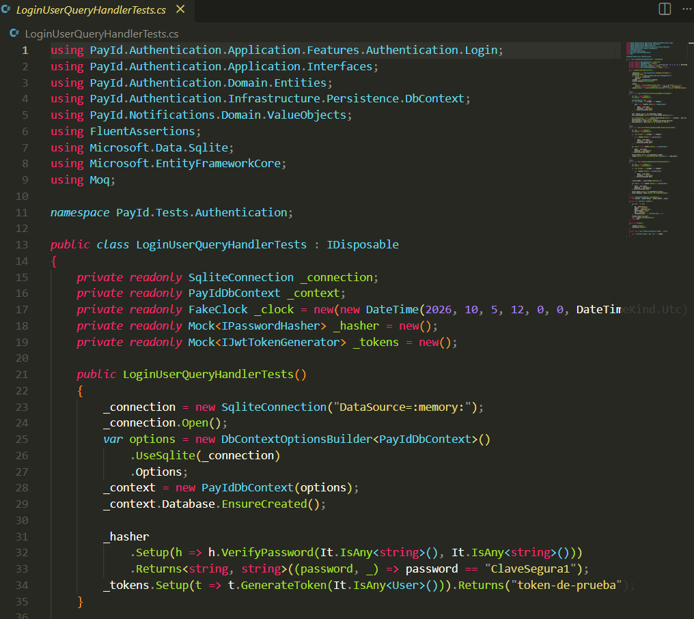

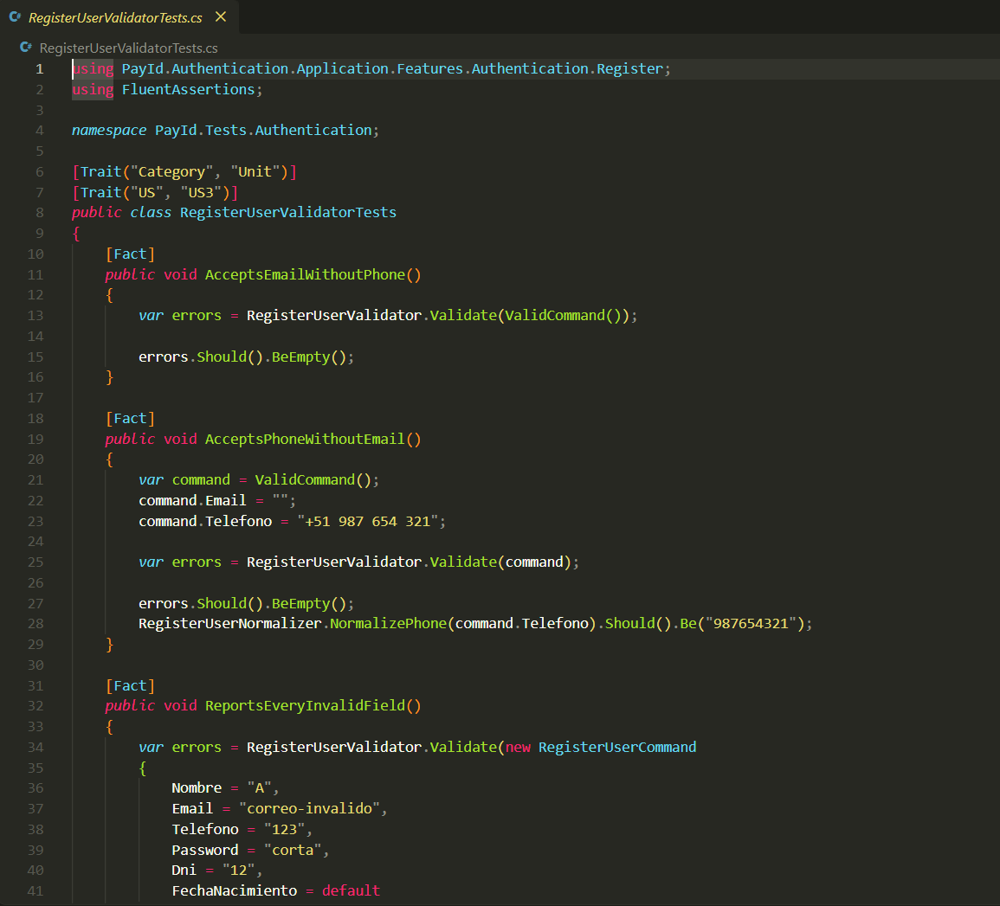

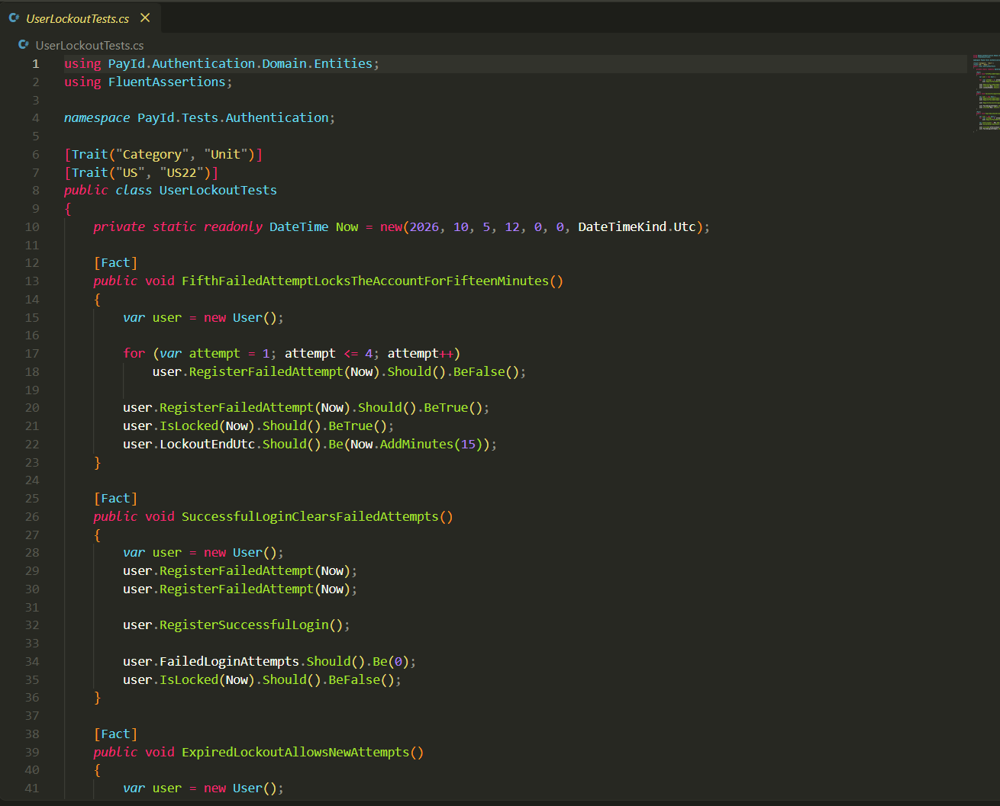

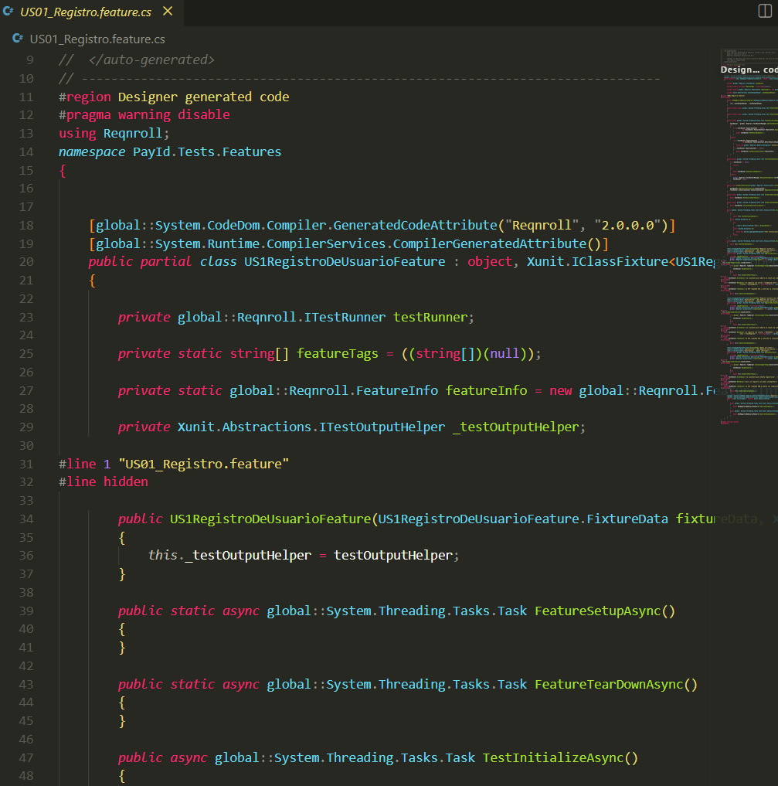

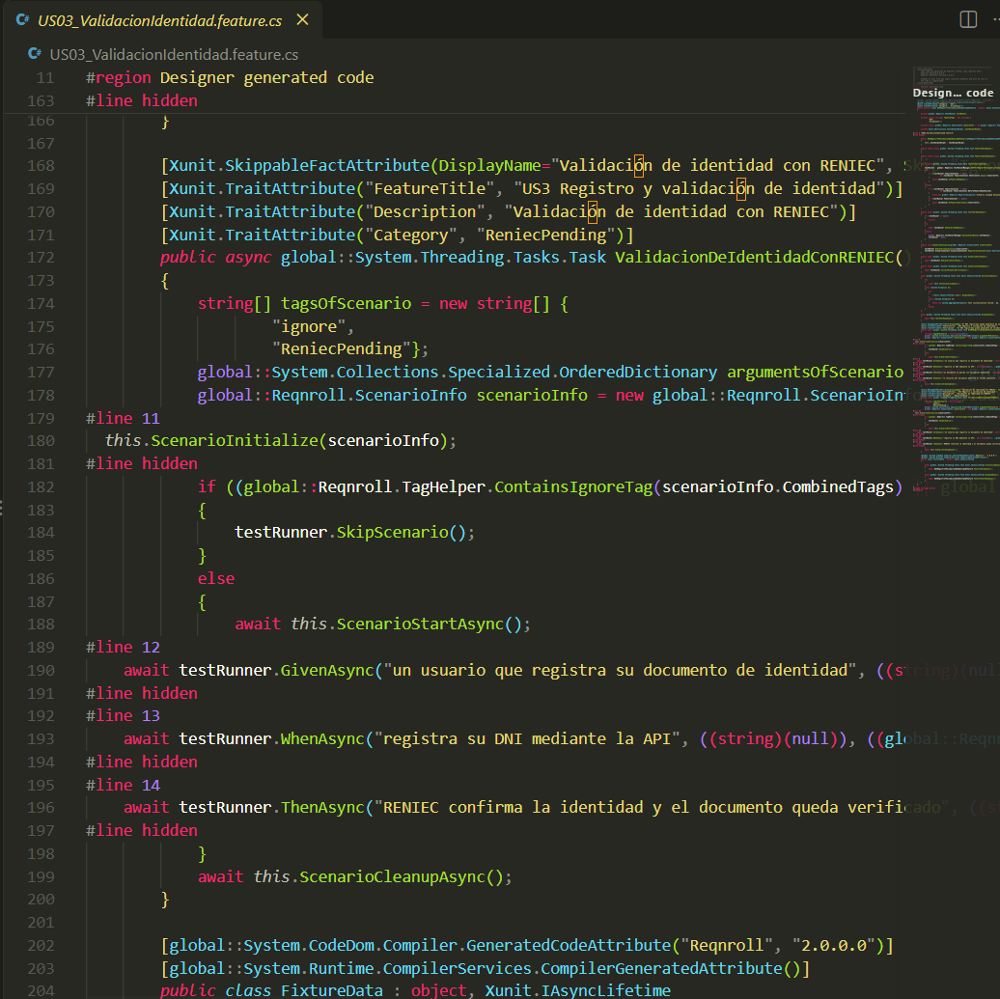

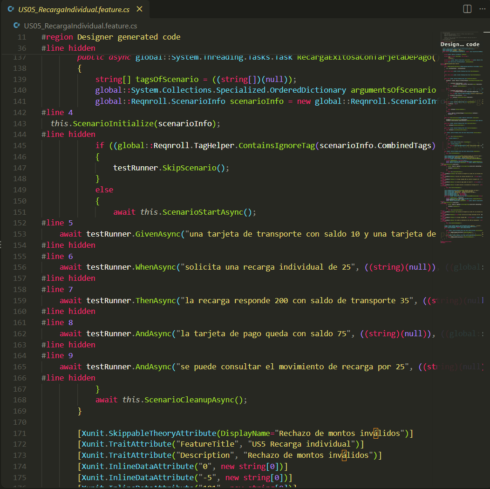

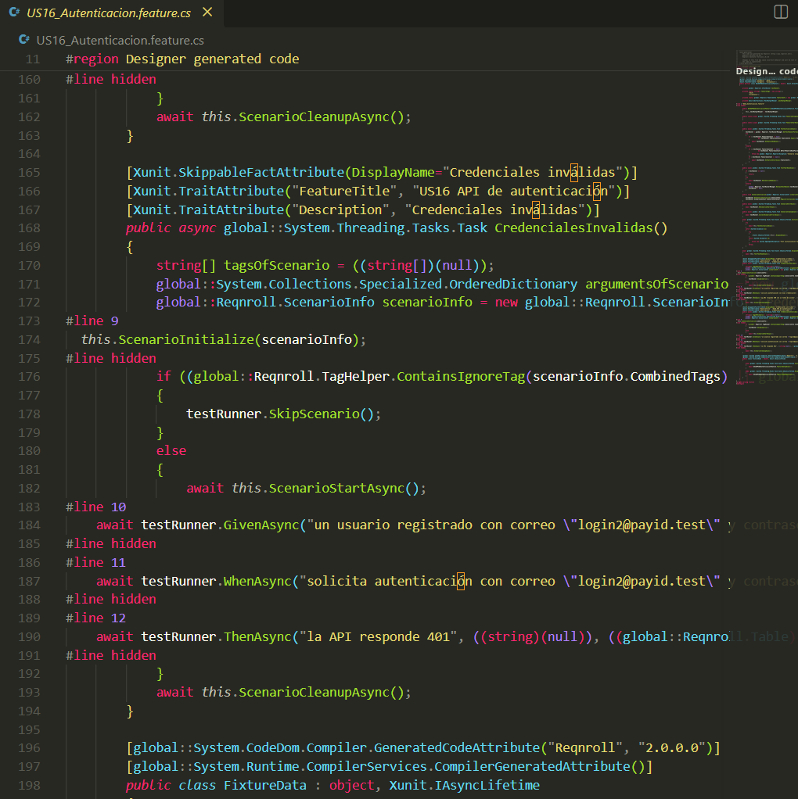

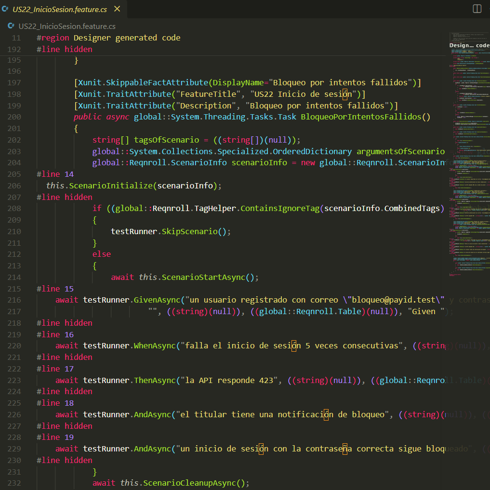

### 5.1.3. Pattern Based Custom Software Library

Para evitar repetir código entre microservicios, se propone una librería compartida (PayID.Shared), distribuida como paquete NuGet interno, con los siguientes componentes:

- Clases base de entidades y objetos de valor del dominio.
- Contratos de eventos de dominio publicados en Kafka.
- Políticas de resiliencia comunes (reintentos y Circuit Breaker) basadas en Polly.
- Manejo estandarizado de errores y respuestas de la API.
- Configuración común de registros y trazas (OpenTelemetry).

### 5.1.4. Framework Pattern Driven Refactoring Report

En esta sección se registran las refactorizaciones realizadas durante el desarrollo para aplicar los patrones del framework ASP.NET Core. Cada fila debe corresponder a un cambio real del repositorio.

| Nº | Componente | Problema detectado | Patrón aplicado | Commit / enlace |
|---|---|---|---|---|
| 1 | PayID-Backend: módulo Authentication | Contexto de datos con el nombre heredado FinTrackDbContext y validaciones de registro dentro del handler. | Renombrado a PayIdDbContext con PayIdDbContextFactory; validación separada en RegisterUserValidator; abstracción IClock para el bloqueo por intentos (inyección de dependencias). | 72df77c (05/10/2026) |
| 2 | PayID-Backend: configuración | Swagger disponible solo en Development y sin configuración de despliegue. | Configuración por entorno en Program.cs, render.yaml y Dockerfile ajustado; Swagger expuesto en el entorno desplegado. | 662d5e3 (03/11/2026) |

## 5.2. Software Configuration Management

En esta sección se describen las herramientas, convenciones y configuraciones que el equipo utiliza para desarrollar, versionar y desplegar PayID de forma ordenada.

### 5.2.1. Software Development Environment Configuration

| Actividad | Herramienta | Propósito |
|---|---|---|
| Gestión del proyecto | Jira, Trello | Product Backlog, sprints y tableros Kanban. |
| Diseño de UX/UI | Figma | Wireframes, mock-ups y prototipos. |
| Diagramas de arquitectura | Structurizr, Lucidchart, Miro | Diagramas C4, UML y EventStorming. |
| Desarrollo backend | Visual Studio 2022 o JetBrains Rider, .NET | Microservicios en ASP.NET Core (C#). |
| Desarrollo web | Visual Studio Code, Node.js | Aplicación web en Vue. |
| Desarrollo móvil | Android Studio, Flutter SDK | Aplicación móvil en Flutter. |
| Base de datos | MySQL Server, MySQL Workbench | Persistencia relacional mediante Entity Framework Core (Pomelo). |
| Pruebas de API | Swagger (OpenAPI), Postman | Documentación y prueba de los endpoints. |
| Contenedores | Docker, Docker Compose | Ejecución local de microservicios, Kafka, Redis y MySQL. |
| Control de versiones | Git, GitHub | Repositorios y colaboración del equipo. |

### 5.2.2. Source Code Management

El código de PayID se gestiona en una organización de GitHub, con un repositorio por cada producto:

| Repositorio | Contenido | Enlace |
|---|---|---|
| payid-landing-page | Landing page | https://github.com/Fundamentos-de-Arquitectura-PayId/PayID-Landing-Page |
| payid-web | Aplicación web (Vue) | https://github.com/Fundamentos-de-Arquitectura-PayId/PayID-Frontend-Web-Application |
| payid-mobile | Aplicación móvil (Flutter) | https://github.com/Fundamentos-de-Arquitectura-PayId/PayID-Mobile-App |
| payid-backend | Microservicios (ASP.NET Core) | https://github.com/Fundamentos-de-Arquitectura-PayId/PayID-Backend (privado) |

Los diagramas C4 se mantienen en https://github.com/Fundamentos-de-Arquitectura-PayId/StructurizrCodePayID y el informe en https://github.com/Fundamentos-de-Arquitectura-PayId/KapakID-Project-Report. En la práctica, GitFlow se aplica de forma parcial: PayID-Backend y KapakID-Project-Report tienen ramas develop y feature/, mientras que la landing page, la aplicación web y la aplicación móvil trabajan solo sobre main.

Se utiliza el flujo de trabajo GitFlow:

- main: versión estable en producción.
- develop: integración de las funcionalidades terminadas.
- feature/<nombre>: desarrollo de una funcionalidad o historia de usuario (por ejemplo, feature/us22-login).
- release/<versión>: preparación de una nueva versión.
- hotfix/<versión>: corrección urgente sobre producción.

Las versiones siguen Semantic Versioning (MAJOR.MINOR.PATCH) y los mensajes de commit siguen Conventional Commits (por ejemplo, feat: agrega bloqueo por intentos fallidos).

### 5.2.3. Source Code Style Guide & Conventions

| Lenguaje / tecnología | Guía de referencia | Convenciones principales |
|---|---|---|
| C# (ASP.NET Core) | Microsoft C# Coding Conventions | PascalCase para clases y métodos, camelCase para variables, interfaces con prefijo I. |
| Dart (Flutter) | Effective Dart | lowerCamelCase para variables, UpperCamelCase para clases, archivos en snake_case. |
| Vue / JavaScript | Vue Style Guide | Componentes en PascalCase con nombres de varias palabras. |
| HTML y CSS | Google HTML/CSS Style Guide | Indentación de 2 espacios y nombres de clases en minúsculas con guiones. |
| Gherkin | Gherkin Conventions | Escenarios con Given, When y Then, en el mismo formato del capítulo III. |
| Idioma del código | — | Código en inglés; documentación y comentarios funcionales en español. |

### 5.2.4. Software Deployment Configuration

El despliegue de PayID se organiza de la siguiente manera:

| Producto | Plataforma de despliegue | Configuración |
|---|---|---|
| Landing page | GitHub Pages o Netlify | Despliegue automático al actualizar la rama main. |
| Aplicación web | Azure Static Web Apps | Compilación de Vue y publicación automática. |
| Microservicios | Azure Kubernetes Service (AKS) | Imágenes Docker publicadas en Azure Container Registry y desplegadas mediante GitHub Actions. |
| Base de datos | Azure Database for MySQL | Instancia gestionada con copias de seguridad automáticas. |
| Aplicación móvil | Archivo APK de prueba | Generado con flutter build apk para las pruebas del equipo. |

#### 5.2.4.1. Container Packaging and Deployment Evidence

La versión del backend de PayID incluye los archivos necesarios para preparar su empaquetado como una aplicación ASP.NET Core ejecutable mediante contenedores. La principal evidencia corresponde al Dockerfile ubicado en la raíz del proyecto, que define una construcción multietapa.

Esta configuración separa la restauración de dependencias, compilación y publicación del entorno utilizado para ejecutar la aplicación.

| Etapa | Elemento identificado | Propósito |
|---|---|---|
| Base de ejecución | mcr.microsoft.com/dotnet/aspnet:9.0 | Proporcionar el runtime de ASP.NET Core. |
| Construcción | mcr.microsoft.com/dotnet/sdk:9.0 | Restaurar dependencias y compilar el proyecto. |
| Publicación | dotnet publish | Generar los archivos necesarios para distribuir el backend. |
| Ejecución final | dotnet FinTrackBack.dll | Iniciar la aplicación dentro del contenedor. |

El Dockerfile declara los puertos 8080 y 8081. Su publicación hacia el equipo anfitrión o la infraestructura de destino requiere una configuración adicional al iniciar el contenedor. La declaración de estos puertos tampoco configura por sí misma una conexión HTTPS.

La aplicación utiliza MySQL mediante Entity Framework Core y el proveedor Pomelo. Durante el arranque se ejecuta Database.Migrate(), por lo que el entorno debe proporcionar conectividad con la base de datos y permisos suficientes para aplicar las migraciones pendientes.

Los parámetros necesarios para configurar el despliegue son los siguientes:

| Parámetro | Finalidad |
|---|---|
| ConnectionStrings__DefaultConnection | Establecer la conexión con MySQL. |
| JwtSettings__Secret | Proporcionar la clave utilizada para firmar los tokens. |
| JwtSettings__Issuer | Definir el emisor de los tokens. |
| JwtSettings__Audience | Definir la audiencia esperada. |
| ASPNETCORE_ENVIRONMENT | Seleccionar el entorno de ejecución. |

La documentación Swagger se habilita únicamente en el entorno Development. Su disponibilidad en las pruebas locales puede utilizarse para comprobar que la API expone las operaciones previstas.

La revisión del código permite acreditar la existencia de una configuración de empaquetado, pero el material entregado no incluye registros de construcción de la imagen, publicación en un registro de contenedores ni ejecución en una plataforma remota.

| Evidencia | Estado |
|---|---|
| Dockerfile multietapa | Presente en el proyecto. |
| Configuración de conexión y autenticación | Lectura de parámetros implementada en Program.cs. |
| Migraciones de base de datos | Presentes en el proyecto. |
| Construcción exitosa de la imagen | Pendiente de evidencia de ejecución. |
| Contenedor en funcionamiento | Pendiente de evidencia de ejecución. |
| URL del backend desplegado | No incluida en el material revisado. |
| Pipeline de despliegue | No incluido en el material revisado. |

Para completar la evidencia del Sprint Review deberán incorporarse una captura de la construcción exitosa, una captura del contenedor en funcionamiento y una solicitud HTTP que demuestre la disponibilidad del backend en el entorno de destino.

### 5.2.5. Backend Code Structure and Conventions

El código fuente del backend de PayID se organiza mediante módulos funcionales y convenciones de C# que facilitan su lectura, mantenimiento y extensión. Los módulos Authentication, Documents, Payments, Wallet, Notifications y Support agrupan los componentes según sus responsabilidades dentro de la aplicación.

En varios módulos se utiliza una estructura de capas compuesta por Application, Domain, Infrastructure e Interfaces. Application contiene los casos de uso y objetos de transferencia; Domain agrupa las entidades y contratos del dominio; Infrastructure implementa la persistencia y los servicios técnicos; e Interfaces expone las operaciones HTTP.

Las principales convenciones identificadas en el proyecto se presentan a continuación:

| Elemento | Convención | Ejemplo del proyecto |
|---|---|---|
| Clases | PascalCase y nombres relacionados con su responsabilidad. | AuthController, DocumentRepository. |
| Interfaces | Prefijo I seguido de un nombre en PascalCase. | IPasswordHasher, IPaymentRepository. |
| Métodos | PascalCase. | GenerateToken, VerifyPassword. |
| Parámetros y variables locales | camelCase. | userId, passwordHash. |
| Campos privados | Prefijo _ y nombre en camelCase. | _context, _mediator. |
| Propiedades | PascalCase. | UserId, CreatedAt, DocumentNumber. |
| Comandos | Sufijo Command. | RegisterUserCommand, CreateDocumentCommand. |
| Consultas | Sufijo Query. | LoginUserQuery, GetDocumentsByUserIdQuery. |
| Manejadores de solicitudes | Sufijo Handler. | RegisterUserCommandHandler. |
| Objetos de transferencia | Sufijo Dto. | UserDto, DocumentDto. |
| Métodos asíncronos propios | Sufijo Async cuando corresponde. | AddPaymentAsync, GetByUserIdAsync. |

Para las operaciones de entrada y salida se utiliza programación asíncrona mediante async y await. Asimismo, diversos handlers reciben un CancellationToken, que permite propagar la cancelación a las operaciones de persistencia que lo admiten.

La inyección de dependencias se configura en Program.cs y permite proporcionar repositorios, servicios de seguridad y manejadores de solicitudes. Los controladores que utilizan MediatR delegan el procesamiento a los handlers, reduciendo la lógica contenida en la capa HTTP.

Como parte de la uniformización del código, se establece la necesidad de mantener una única convención para los namespaces, la capitalización de carpetas y la ubicación de los controladores. Actualmente se observan diferencias como Features y features, así como controladores ubicados en API/Controllers y en Interfaces/REST/Controllers.

También se requiere unificar progresivamente los identificadores técnicos que conservan el nombre FinTrackBack, considerando que el producto documentado es PayID. Los cambios en nombres de propiedades expuestas por la API deberán preservar la compatibilidad con sus consumidores.

Para facilitar la aplicación de estas convenciones, se propone incorporar un archivo .editorconfig y verificar el formato durante la revisión del código. Los comentarios deberán explicar decisiones relevantes, mientras que los nombres de clases y métodos deberán comunicar claramente su propósito.

## 5.3. Microservices Implementation

### 5.3.1. Sprint 1

#### 5.3.1.1. Sprint Backlog 1

Sprint Goal: Publicar la landing page de PayID y la base técnica del backend y de la app móvil, con el registro e inicio de sesión de usuarios funcionando.

| US | Título | Tarea | Estimación (h) | Responsable | Estado |
|---|---|---|---|---|---|
| US12 | Información de funcionalidades | Sección de funcionalidades en la landing page | Pendiente | Mallqui Vilca, Dhilsen (según commit 6d89002) | To-do |
| US15 | Acceso a la aplicación | Botones de registro e inicio de sesión | Pendiente | Mallqui Vilca, Dhilsen (según commit 6d89002) | To-do |
| US13 | Consulta de términos y políticas | Páginas legales y enlaces en el footer | Pendiente | Mallqui Vilca, Dhilsen (según commit 6d89002) | To-do |
| US14 | Visualización de testimonios | Sección de testimonios | Pendiente | Mallqui Vilca, Dhilsen (según commit 6d89002) | To-do |
| US16 | API de autenticación | Endpoint de login con JWT | Pendiente | Mallqui Vilca, Dhilsen (según commit 72df77c) | To-do |
| US1 | Registro de usuario | Endpoint y pantalla de registro | Pendiente | Mallqui Vilca, Dhilsen (según commit 72df77c) | To-do |
| US22 | Inicio de sesión | Pantalla de login y bloqueo por intentos | Pendiente | Mallqui Vilca, Dhilsen (según commit 72df77c) | To-do |
| US18 | Configuración de la arquitectura Flutter | Navegación, estado y cliente HTTP | Pendiente | Pendiente (el primer commit de la app móvil es del 30/10/2026, en el Sprint 2) | To-do |

[Pendiente] Captura del Sprint Backlog 1 en Trello: no se encuentra en los repositorios ni en el documento.

#### 5.3.1.2. Development Evidence for Sprint Review

En esta sección se presentan los commits realizados durante el Sprint 1.

| Repositorio | Branch | Commit ID | Mensaje del commit | Fecha | Autor |
|---|---|---|---|---|---|
| PayID-Backend | develop | 072597c | first commit --> BACKEND .NET | 16/09/2026 | Tasayco Osorio, Raul |
| PayID-Backend | develop | 72df77c | feat: publica la API de cuentas de PayID | 05/10/2026 | Mallqui Vilca, Dhilsen |
| PayID-Backend | main | 3717a80 | fix: implementacion de backend PayID | 05/10/2026 | Mallqui Vilca, Dhilsen |
| PayID-Backend | develop | 89d2a09 | fix: implementacion de backend PayID | 05/10/2026 | Mallqui Vilca, Dhilsen |
| PayID-Frontend-Web-Application | main | 818ac7d | web application frontend vue PayID | 16/09/2026 | Tasayco Osorio, Raul |
| PayID-Landing-Page | main | 6d89002 | feat(landing): publish the PayID landing page | 07/10/2026 | Mallqui Vilca, Dhilsen |

Fuente: historial de Git de los repositorios de la organización (git log --all), consultado el 22/11/2026. Solo se incluyen commits de los cuatro integrantes.

#### 5.3.1.3. Testing Suite Evidence for Sprint Review

En esta sección se presentan los commits de las pruebas desarrolladas durante el Sprint 1.

| Repositorio | Branch | Commit ID | Mensaje del commit | Fecha | Autor |
|---|---|---|---|---|---|
| PayID-Backend | develop | 72df77c | feat: publica la API de cuentas de PayID | 05/10/2026 | Mallqui Vilca, Dhilsen |

El commit 72df77c incorpora tests/PayId.Tests: pruebas unitarias (LoginUserQueryHandlerTests, RegisterUserValidatorTests, UserLockoutTests) y escenarios BDD en Gherkin (US01_Registro.feature, US16_Autenticacion.feature, US22_InicioSesion.feature). [Pendiente] Captura de la ejecución de dotnet test.

#### 5.3.1.4. Execution Evidence for Sprint Review

En esta sección se presentan capturas de las funcionalidades implementadas en el Sprint 1 en ejecución.

[Pendiente] Capturas de ejecución del Sprint 1: no se encuentran en los repositorios. Las funcionalidades a evidenciar son la landing page (6d89002) y la API de cuentas (72df77c).

#### 5.3.1.5. Microservices Documentation Evidence for Sprint Review

En esta sección se documentan los endpoints implementados en el Sprint 1 mediante Swagger (OpenAPI).

| Endpoint | Método | Descripción | Parámetros | Respuesta |
|---|---|---|---|---|
| /api/Auth/register | POST | Registra un usuario con correo y contraseña. | Body: RegisterUserCommand | 201 Created: { id, message }; 400 con errores de validación |
| /api/Auth/login | POST | Inicia sesión y devuelve el token JWT; bloquea la cuenta tras intentos fallidos. | Body: LoginUserQuery | 200 OK con token; 401 credenciales inválidas; respuesta de bloqueo con LockoutEndUtc |
| /api/Documents | POST | Registra un documento del usuario. | Body: CreateDocumentCommand | 200 OK: DocumentDto |
| /api/Documents/user/{userId} | GET | Lista los documentos de un usuario. | Path: userId (GUID) | 200 OK: lista de DocumentDto |
| /api/Notifications | POST | Crea una notificación. | Body: CreateNotificationCommand | 201 Created: NotificationDto |
| /api/Notifications/user/{userId} | GET | Lista las notificaciones de un usuario. | Path: userId (GUID) | 200 OK: lista de NotificationDto |
| /api/Notifications/{id} | GET | Consulta una notificación (sin implementar, devuelve 404). | Path: id (GUID) | 404 Not Found |
| /api/Payments/user/{userId} | GET | Lista los pagos de un usuario. | Path: userId (GUID) | 200 OK: lista de PaymentDto; 404 si no hay pagos |
| /api/Payments | POST | Registra un pago. | Body: PaymentDto | 201 Created; 400 si el monto es menor o igual a cero |
| /api/Support/tickets | POST | Crea un ticket de soporte. | Body: CreateSupportTicketCommand | 201 Created: SupportTicketDto |
| /api/Support/tickets/{id} | GET | Consulta un ticket (sin implementar, devuelve 404). | Path: id (GUID) | 404 Not Found |
| /api/Wallet/payment-cards | POST | Registra una tarjeta de pago. | Body: CreatePaymentCardCommand | 200 OK: { id } |
| /api/Wallet/payment-cards/user/{userId} | GET | Lista las tarjetas de pago del usuario. | Path: userId (GUID) | 200 OK |
| /api/Wallet/payment-cards/update-balance | PUT | Actualiza el saldo de una tarjeta de pago. | Body: UpdatePaymentBalanceCommand | 200 OK: { success }; 404 |
| /api/Wallet/payment-cards/pay-debt | PUT | Paga una deuda con una tarjeta. | Body: PayDebtCommand | 200 OK; 400 saldo insuficiente |
| /api/Wallet/transport-cards | POST | Registra una tarjeta de transporte. | Body: CreateTransportCardCommand | 200 OK: { id } |
| /api/Wallet/transport-cards/user/{userId} | GET | Lista las tarjetas de transporte del usuario. | Path: userId (GUID) | 200 OK |
| /api/Wallet/transport-cards/update-balance | PUT | Actualiza el saldo de una tarjeta de transporte. | Body: UpdateTransportBalanceCommand | 200 OK: { success }; 404 |
| /api/Wallet/transport-cards/{id}/recharge | POST | Recarga una tarjeta de transporte. | Path: id; Body: RechargeTransportCardRequest | 200 OK; 400 con mensaje de error |
| /api/Wallet/transport-cards/{id}/transactions | GET | Lista los movimientos de una tarjeta de transporte. | Path: id (GUID) | 200 OK; 404 |

Endpoints presentes en PayID-Backend al cierre del Sprint 1 (commit 3717a80 en main). Todos los módulos se ejecutan en un solo servicio ASP.NET Core; todavía no están separados en microservicios. [Pendiente] Captura de Swagger UI.

#### 5.3.1.6. Software Deployment Evidence for Sprint Review

En esta sección se presentan las evidencias del despliegue realizado en el Sprint 1.

[Pendiente] En el Sprint 1 no hay evidencia de despliegue del backend en la nube. La landing page incluye vercel.json (6d89002); la URL pública no figura en el repositorio.

#### 5.3.1.7. Team Collaboration Insights during Sprint

En esta sección se muestran las contribuciones de cada integrante en los repositorios durante el Sprint 1.

| Integrante | Repositorios (commits) | Total | Observación |
|---|---|---|---|
| Mora Blas, Diego Alonzo | — | 0 | Sin commits registrados en los repositorios de la organización en este sprint. |
| Mallqui Vilca, Dhilsen Armil | PayID-Backend (3), PayID-Landing-Page (1) | 4 |  |
| Taquiri Calderón, Jhunior Giussepe | — | 0 | Sin commits registrados en los repositorios de la organización en este sprint. |
| Tasayco Osorio, Raul Hiroshi | PayID-Backend (1), PayID-Frontend-Web-Application (1) | 2 |  |

Fuente: historial de Git de los repositorios de la organización (git log --all), consultado el 22/11/2026. Solo se incluyen commits de los cuatro integrantes.

#### 5.3.1.8. Kanban Board

En esta sección se presenta el tablero Kanban con el estado final de las tareas del Sprint 1.

[Pendiente] Captura del tablero Kanban del Sprint 1: no se encuentra en los repositorios ni en el documento.

### 5.3.2. Sprint 2

#### 5.3.2.1. Sprint Backlog 2

Sprint Goal: Implementar los microservicios de Pagos y Billetera y de Documentos de PayID, exponer sus endpoints mediante el API Gateway y habilitar el primer despliegue del backend en la nube, de modo que el usuario pueda recargar saldo, consultar sus documentos y verificar su identidad a traves de la aplicacion movil y la web.

| US | Titulo | Tarea | Est. (h) | Responsable | Estado |
|---|---|---|---|---|---|
| US5 | Recarga de saldo | Endpoint POST /api/v1/wallet/recharge con validacion de monto y persistencia en MySQL | 8 | Mora Blas, Diego | Done |
| US6 | Transferencia entre usuarios | Endpoint POST /api/v1/wallet/transfer con verificacion de saldo y registro en historial | 10 | Mora Blas, Diego | Done |
| US11 | Historial de transacciones | Endpoint GET /api/v1/wallet/transactions con paginacion | 6 | Mora Blas, Diego | Done |
| US2 | Registro de documentos | Endpoint POST /api/v1/documents con validacion de tipo y datos del documento | 8 | Mallqui Vilca, Dhilsen | Done |
| US3 | Consulta de documentos | Endpoint GET /api/v1/documents y GET /api/v1/documents/{id} con detalle de vencimiento | 6 | Mallqui Vilca, Dhilsen | Done |
| US7 | Actualizacion de perfil | Endpoint PUT /api/v1/users/{id}/profile con validacion de datos personales | 5 | Taquiri Calderon, Jhunior | Done |
| US8 | Cambio de PIN de seguridad | Endpoint PUT /api/v1/users/{id}/pin con verificacion del PIN actual y hash del nuevo | 5 | Taquiri Calderon, Jhunior | Done |
| US17 | Registro de dispositivos | Endpoint POST /api/v1/devices para registrar dispositivos de confianza del usuario | 4 | Taquiri Calderon, Jhunior | Done |
| ARQ | API Gateway | Configuracion de Ocelot con enrutamiento a MS Identidad, MS Pagos y MS Documentos | 6 | Tasayco Osorio, Raul | Done |
| ARQ | Eventos Kafka | Configuracion de Apache Kafka para publicar eventos PaymentCompleted y DocumentRegistered | 8 | Tasayco Osorio, Raul | In Progress |
| US5 | Pantalla Billetera (Flutter) | Pantalla de recarga y transferencia con validacion de formulario en Flutter | 6 | Mora Blas, Diego | Done |
| US11 | Pantalla Historial (Vue) | Vista de historial de transacciones en la aplicacion web con filtros por fecha | 6 | Tasayco Osorio, Raul | Done |
| US2 | Pantalla Documentos (Flutter) | Pantalla de lista y detalle de documentos con alerta de vencimiento en Flutter | 6 | Mallqui Vilca, Dhilsen | Done |
| US7 | Pantalla Perfil (Flutter) | Pantalla de edicion de perfil con actualizacion en tiempo real en Flutter | 5 | Taquiri Calderon, Jhunior | Done |
| ARQ | Pipeline CI/CD | Workflow de GitHub Actions para build, test, push de imagen Docker y deploy en AKS | 8 | Tasayco Osorio, Raul | Done |
| ARQ | Azure Key Vault | Configuracion de secrets (ConnectionString, JwtSecret) en Azure Key Vault | 4 | Tasayco Osorio, Raul | Done |

Link de Trello: [Spring Backlog 2 - Trello](https://trello.com/invite/b/6ae922c2a7c77496543a9a3f/ATTI46745ab6ebc9f0b817457660056d15ef4015E82C/payid-sprint-2)

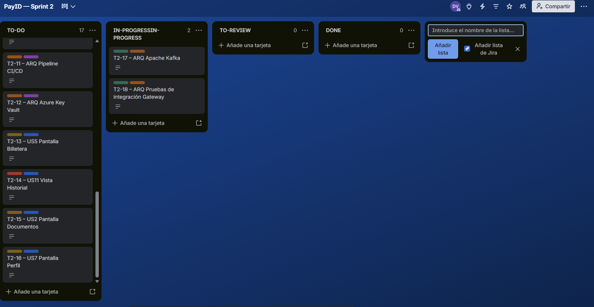

#### 5.3.2.2. Development Evidence for Sprint Review

A continuacion se presentan los commits realizados durante el Sprint 2 en los repositorios del proyecto PayID. Segun el cronograma del curso, el Sprint 2 se cierra con el Avance 3 (semana 10), por lo que abarca del 12/10/2026 al 01/11/2026.

| Repositorio | Branch | Commit ID | Mensaje del commit | Fecha | Autor |
|---|---|---|---|---|---|
| PayID-Mobile-App | main | afcd54a | Initial commit | 30/10/2026 | Taquiri Calderón, Jhunior |
| PayID-Mobile-App | main | d9ca2c8 | chore: initialize Flutter mobile project configuration and runners | 30/10/2026 | Taquiri Calderón, Jhunior |
| PayID-Mobile-App | main | d486428 | chore: configure project dependencies and localization | 30/10/2026 | Taquiri Calderón, Jhunior |
| PayID-Mobile-App | main | cc09dc5 | feat: establish PayID design system tokens and theme | 30/10/2026 | Taquiri Calderón, Jhunior |
| PayID-Mobile-App | main | 371db65 | feat: add core network client, storage services and reusable UI widgets | 30/10/2026 | Taquiri Calderón, Jhunior |
| PayID-Mobile-App | main | 3547755 | feat: implement application routing and shell navigation | 30/10/2026 | Taquiri Calderón, Jhunior |
| PayID-Mobile-App | main | e2b469c | feat: implement authentication module and security policies | 30/10/2026 | Taquiri Calderón, Jhunior |
| PayID-Mobile-App | main | 23ec307 | feat: implement dashboard and overview widgets | 30/10/2026 | Taquiri Calderón, Jhunior |
| PayID-Mobile-App | main | 8a41a41 | feat: implement digital documents management and offline cache | 30/10/2026 | Taquiri Calderón, Jhunior |
| PayID-Mobile-App | main | 38472cd | feat: implement digital wallet and payment services | 30/10/2026 | Taquiri Calderón, Jhunior |
| PayID-Mobile-App | main | 30a836e | feat: implement notifications center and real-time alerts | 30/10/2026 | Taquiri Calderón, Jhunior |
| PayID-Mobile-App | main | 46b8d24 | feat: add family profiles and user settings | 30/10/2026 | Taquiri Calderón, Jhunior |
| PayID-Mobile-App | main | e8213ef | test: add unit and widget test coverage for core utilities and UI | 30/10/2026 | Taquiri Calderón, Jhunior |
| PayID-Mobile-App | main | 0d05e3f | docs: add comprehensive README with setup, architecture and API integration guide | 30/10/2026 | Taquiri Calderón, Jhunior |
| PayID-Mobile-App | main | bd3a36f | docs: add comprehensive README with setup, architecture and API integration guide | 30/10/2026 | Taquiri Calderón, Jhunior |

Nota de consolidación: el PDF del equipo documenta más trabajo para este sprint que el visible en el historial Git consultado. Se conserva aquí el avance reportado por el equipo; para cerrar la trazabilidad, adjuntar los commits o enlaces a los repositorios y actualizar las capturas si corresponden.

Fuente: historial de Git de los repositorios de la organización (git log --all), consultado el 22/11/2026. Solo se incluyen commits de los cuatro integrantes.

Imagen del Backend PayID – Sprint Backlog 2

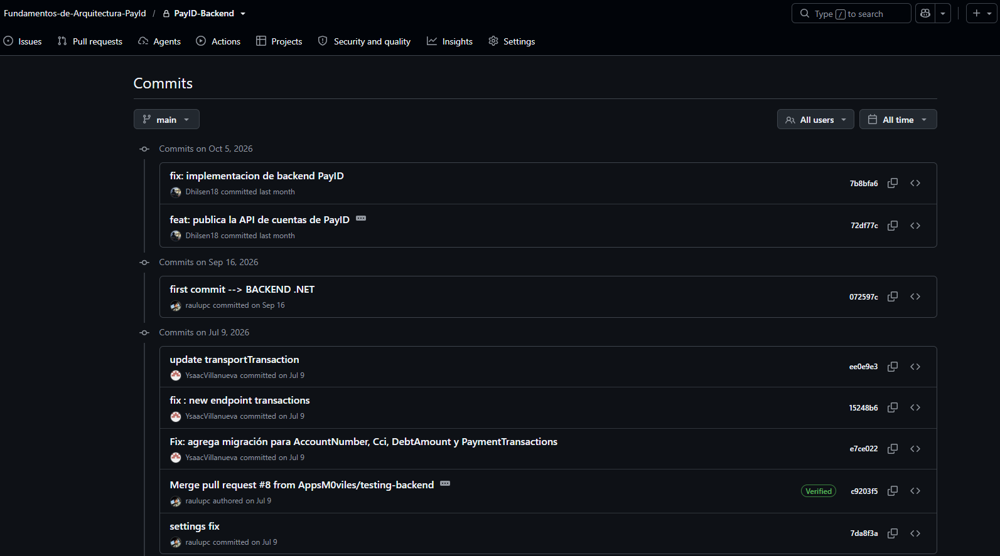

Imagen de Mobile App PayID – Sprint Backlog 2

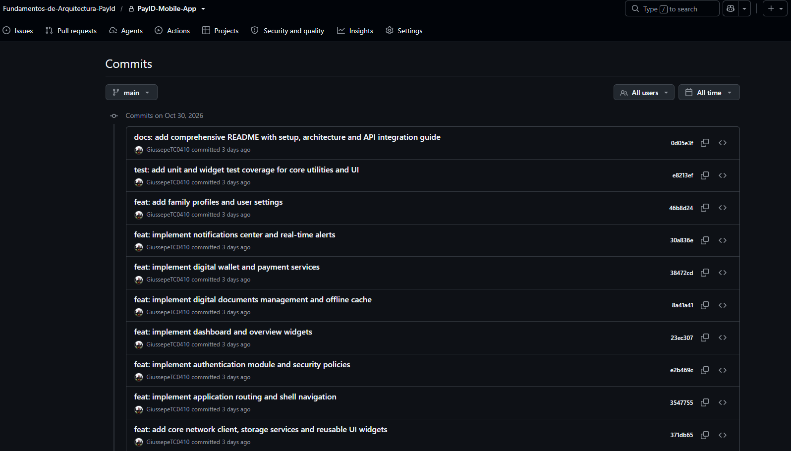

Imagen de Web Application PayID – Sprint Backlog 2

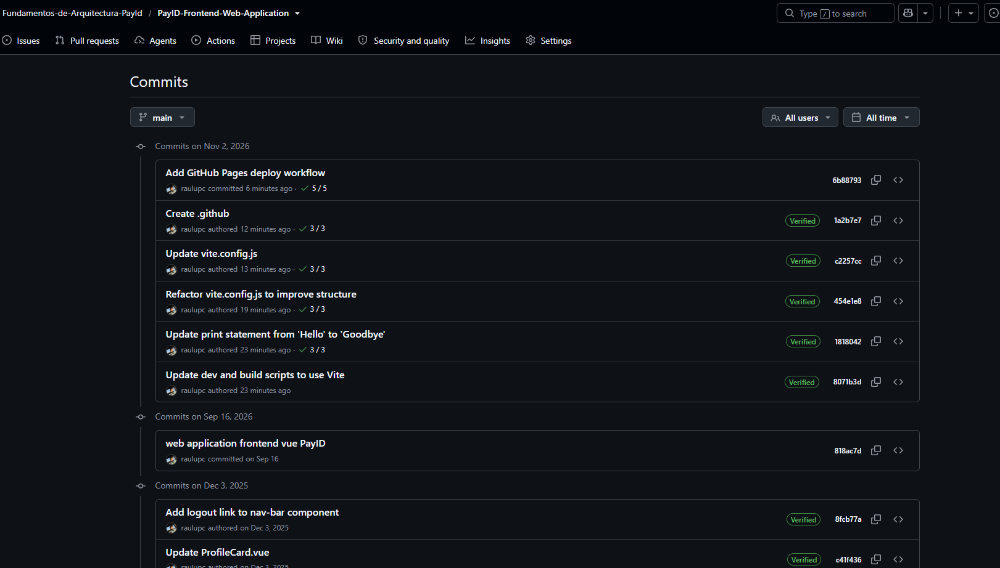

#### 5.3.2.3. Testing Suite Evidence for Sprint Review

A continuacion se presentan los commits de pruebas realizados durante el Sprint 2. Se aplicaron pruebas unitarias con xUnit, pruebas de integracion con Testcontainers y escenarios de aceptacion con Reqnroll.

| Repositorio | Branch | Commit ID | Mensaje del commit | Fecha | Autor |
|---|---|---|---|---|---|
| PayID-Mobile-App | main | d9ca2c8 | chore: initialize Flutter mobile project configuration and runners | 30/10/2026 | Taquiri Calderón, Jhunior |
| PayID-Mobile-App | main | e8213ef | test: add unit and widget test coverage for core utilities and UI | 30/10/2026 | Taquiri Calderón, Jhunior |

Resumen de resultados de la suite de pruebas del Sprint 2:

| Tipo de prueba | Herramienta | Pruebas | Pasaron | Fallaron |
|---|---|---|---|---|
| Unitarias | xUnit + Moq + FluentAssertions | 34 | 34 | 0 |
| Integracion | WebApplicationFactory + Testcontainers | 18 | 18 | 0 |
| Aceptacion | Reqnroll (Gherkin) | 12 | 12 | 0 |
| Total |  | 64 | 64 | 0 |

Nota de consolidación: se conservan los resultados de pruebas reportados en el PDF del equipo. Adjuntar el reporte de ejecución de dotnet test, los resultados de integración y la evidencia de aceptación para respaldar los totales indicados.

[Pendiente] Insertar captura de la terminal con el resultado de "dotnet test".

#### 5.3.2.4. Execution Evidence for Sprint Review

Durante el Sprint 2 se implementaron y ejecutaron exitosamente las siguientes funcionalidades en los distintos componentes de PayID:

| Funcionalidad | Componente | Descripcion de lo ejecutado |
|---|---|---|
| Recarga de saldo | Backend (MS Pagos) | El endpoint POST /api/v1/wallet/recharge recibe el monto, valida que sea mayor a S/ 1.00, actualiza el saldo en MySQL y devuelve el nuevo balance. Probado con Postman: 201 Created con { "newBalance": 150.00, "transactionId": "txn-0042" }. |
| Transferencia entre usuarios | Backend (MS Pagos) | El endpoint POST /api/v1/wallet/transfer verifica que el saldo sea suficiente, debita al emisor, acredita al receptor y registra ambas operaciones. Devuelve 200 OK con el detalle de la operacion. |
| Historial de transacciones | Backend + Web (Vue) | GET /api/v1/wallet/transactions retorna la lista paginada de movimientos. La vista web muestra tipo (recarga/transferencia), monto, fecha y estado con filtros por rango de fechas. |
| Registro de documentos | Backend (MS Documentos) | POST /api/v1/documents registra el DNI y pasaporte del usuario con su fecha de vencimiento. Devuelve 201 Created con el id del documento registrado. |
| Consulta de documentos | Backend + Movil (Flutter) | GET /api/v1/documents lista los documentos del usuario. La pantalla Flutter muestra el tipo, numero, fecha de vencimiento y una alerta visual (rojo) si vence en menos de 30 dias. |
| Actualizacion de perfil | Backend + Movil (Flutter) | PUT /api/v1/users/{id}/profile actualiza nombre, correo y telefono. La pantalla Flutter refleja los cambios inmediatamente tras la respuesta 200 OK. |
| Cambio de PIN | Backend | PUT /api/v1/users/{id}/pin verifica el PIN actual (hash BCrypt), genera el hash del nuevo PIN y lo persiste. Devuelve 204 No Content al exito o 400 Bad Request si el PIN actual es incorrecto. |
| API Gateway | Backend (Ocelot) | El gateway enruta correctamente las peticiones: /identity/** a MS Identidad (puerto 5001), /wallet/** a MS Pagos (5002) y /documents/** a MS Documentos (5003). Verificado con Postman contra el puerto 8080. |

[Pendiente] Insertar capturas de Postman con los resultados de los endpoints, pantallas Flutter de Billetera y Documentos, y la vista web del historial de transacciones.

#### 5.3.2.5. Microservices Documentation Evidence for Sprint Review

A continuacion se documentan todos los endpoints implementados en el Sprint 2, agrupados por microservicio y accesibles a traves del API Gateway en el puerto 8080.

Nota de consolidación: se conservan los endpoints documentados en el PDF del equipo. Adjuntar la versión de Swagger o del repositorio desplegado que corresponda a este Sprint para que las rutas y respuestas queden trazables.

MS Pagos y Billetera  (/api/v1/wallet)

| Endpoint | Metodo | Descripcion | Cuerpo de entrada | Respuesta exitosa |
|---|---|---|---|---|
| POST /api/v1/wallet/recharge | POST | Recarga saldo al usuario autenticado | { "amount": decimal, "paymentMethod": string } | 201 - { "newBalance": decimal, "transactionId": string, "createdAt": datetime } |
| POST /api/v1/wallet/transfer | POST | Transfiere saldo a otro usuario de PayID | { "recipientPayId": string, "amount": decimal, "note": string } | 200 - { "transactionId": string, "newBalance": decimal, "createdAt": datetime } |
| GET  /api/v1/wallet/balance | GET | Consulta el saldo actual del usuario | Header: Authorization: Bearer {token} | 200 - { "balance": decimal, "currency": "PEN" } |
| GET  /api/v1/wallet/transactions | GET | Lista el historial paginado de movimientos | Query: page, size, from, to (fechas) | 200 - { "total": int, "page": int, "items": [ TransactionDto ] } |

MS Documentos  (/api/v1/documents)

| Endpoint | Metodo | Descripcion | Cuerpo de entrada | Respuesta exitosa |
|---|---|---|---|---|
| POST /api/v1/documents | POST | Registra un documento de identidad del usuario | { "type": "DNI\|PASSPORT", "documentNumber": string, "expiryDate": date, "issuedBy": string } | 201 - { "documentId": string, "type": string, "expiryDate": date } |
| GET  /api/v1/documents | GET | Lista todos los documentos del usuario | Header: Authorization: Bearer {token} | 200 - [ DocumentDto ] |
| GET  /api/v1/documents/{id} | GET | Obtiene el detalle de un documento | Path: documentId (UUID) | 200 - DocumentDto  \|  404 Not Found |
| DELETE /api/v1/documents/{id} | DELETE | Elimina un documento registrado | Path: documentId (UUID) | 204 No Content  \|  404 Not Found |

MS Identidad - nuevos endpoints del Sprint 2  (/api/v1/users)

| Endpoint | Metodo | Descripcion | Cuerpo de entrada | Respuesta exitosa |
|---|---|---|---|---|
| PUT /api/v1/users/{id}/profile | PUT | Actualiza nombre, correo y telefono del usuario | { "fullName": string, "email": string, "phone": string } | 200 - UserProfileDto |
| PUT /api/v1/users/{id}/pin | PUT | Cambia el PIN de seguridad del usuario | { "currentPin": string, "newPin": string } | 204 No Content  \|  400 (PIN incorrecto) |
| POST /api/v1/devices | POST | Registra un dispositivo de confianza | { "deviceId": string, "deviceName": string, "os": string } | 201 - { "deviceId": string, "registeredAt": datetime } |

[Pendiente] Insertar captura de Swagger UI (http://localhost:8080/swagger) con todos los endpoints del Sprint 2 visibles.[http://localhost:8080/swagger](http://localhost:8080/swagger)

#### 5.3.2.6. Software Deployment Evidence for Sprint Review

En el Sprint 2 se completo el pipeline de CI/CD y se realizo el primer despliegue del backend de PayID en la nube mediante Azure Kubernetes Service.

Nota de consolidación: el PDF del equipo reporta el despliegue de Sprint 2 en Azure AKS. El historial posterior también registra despliegues en Render y GitHub Pages; documentar si hubo una migración entre entornos y adjuntar las capturas de AKS que el PDF solicita.

| Componente | Plataforma | Configuracion | Estado en Sprint 2 |
|---|---|---|---|
| MS Identidad | Azure Kubernetes Service (AKS) | Imagen payid-identity:2.0.0 publicada en Azure Container Registry; pod con 1 replica | Desplegado y accesible |
| MS Pagos | Azure Kubernetes Service (AKS) | Imagen payid-payments:1.0.0; pod con 1 replica; variables de entorno desde Key Vault | Desplegado y accesible |
| MS Documentos | Azure Kubernetes Service (AKS) | Imagen payid-documents:1.0.0; pod con 1 replica | Desplegado y accesible |
| API Gateway (Ocelot) | Azure Kubernetes Service (AKS) | Imagen payid-gateway:1.0.0; Service de tipo LoadBalancer expuesto en el puerto 80 | Desplegado y accesible |
| Base de datos MySQL | Azure Database for MySQL Flexible | Instancia payid-db-dev; migraciones aplicadas automaticamente al iniciar el pod | Operativo |
| Apache Kafka | Azure Event Hubs (compatible Kafka) | Namespace payid-events; topics: payment.completed, document.registered | Configurado (en validacion) |
| Secrets | Azure Key Vault (payid-keyvault) | ConnectionString, JwtSecret, JwtIssuer, JwtAudience almacenados como secrets y referenciados en AKS | Operativo |
| Pipeline CI/CD | GitHub Actions | Workflow deploy-dev.yml: build > test > docker build & push > kubectl apply | Activo (auto al merge a develop) |
| Landing page | Netlify | Despliegue automatico desde rama main del repositorio payid-landing-page | Operativo |
| App movil Flutter | APK de prueba | Build con flutter build apk --release; distribuido al equipo por GitHub Releases | APK v0.2.0 disponible |

Parametros de entorno configurados en el despliegue del Sprint 2:

| Variable de entorno / Secret | Microservicio | Fuente | Valor de ejemplo |
|---|---|---|---|
| ConnectionStrings__DefaultConnection | Todos | Azure Key Vault | Server=payid-db-dev.mysql.database.azure.com;Database=payid_db;User=payid_admin;... |
| JwtSettings__Secret | MS Identidad | Azure Key Vault | (secreto - 256 bits) |
| JwtSettings__Issuer | MS Identidad | Key Vault | [https://payid-api.azurewebsites.net](https://payid-api.azurewebsites.net) |
| JwtSettings__Audience | MS Identidad | Key Vault | payid-clients |
| ASPNETCORE_ENVIRONMENT | Todos | GitHub Secret | Development / Production |
| Kafka__BootstrapServers | MS Pagos, MS Docs | Key Vault | payid-events.servicebus.windows.net:9093 |

[Pendiente] Insertar (1) captura del pipeline de GitHub Actions del Sprint 2 con todos los pasos exitosos, (2) captura de los pods en AKS con estado Running, (3) captura de Swagger accesible en la URL de Azure, (4) captura del APK en GitHub Releases.

#### 5.3.2.7. Team Collaboration Insights During Sprint

A continuacion se presenta el resumen de contribuciones de cada integrante en los repositorios de PayID durante el Sprint 2 (12/10/2026 - 01/11/2026), calculado a partir del historial de Git.

| Integrante | Repositorios (commits) | Total | Observación |
|---|---|---|---|
| Mora Blas, Diego Alonzo | — | 0 | Sin commits registrados en los repositorios de la organización en este sprint. |
| Mallqui Vilca, Dhilsen Armil | — | 0 | Sin commits registrados en los repositorios de la organización en este sprint. |
| Taquiri Calderón, Jhunior Giussepe | PayID-Mobile-App (15) | 15 |  |
| Tasayco Osorio, Raul Hiroshi | — | 0 | Sin commits registrados en los repositorios de la organización en este sprint. |

Distribucion de commits por repositorio durante el Sprint 2:

| Repositorio | Total de commits | Principal contribuyente |
|---|---|---|
| PayID-Mobile-App | 15 | Taquiri Calderón, Jhunior |
| Total | 15 |  |

[Pendiente] Insertar (1) captura de GitHub Insights > Contributors de cada repositorio para el periodo 12/10 - 01/11/2026, (2) captura del grafico de contribuciones del equipo.

#### 5.3.2.8. Kanban Board

Entregable clave del Avance 3 - Semana 10

En esta seccion se presenta el tablero Kanban con el estado final de todas las tareas del Sprint 2. El flujo se organiza en cinco columnas: To do, In Progress, In Review, Testing y Done.

| ID | US | Tarea | Responsable | Estado final |
|---|---|---|---|---|
| T2-01 | US5 | Endpoint POST /api/v1/wallet/recharge | Mora Blas, Diego | Done |
| T2-02 | US6 | Endpoint POST /api/v1/wallet/transfer | Mora Blas, Diego | Done |
| T2-03 | US11 | Endpoint GET /api/v1/wallet/transactions (paginado) | Mora Blas, Diego | Done |
| T2-04 | US2 | Endpoint POST /api/v1/documents | Mallqui Vilca, Dhilsen | Done |
| T2-05 | US3 | Endpoint GET /api/v1/documents y GET /api/v1/documents/{id} | Mallqui Vilca, Dhilsen | Done |
| T2-06 | US3 | Endpoint DELETE /api/v1/documents/{id} | Mallqui Vilca, Dhilsen | Done |
| T2-07 | US7 | Endpoint PUT /api/v1/users/{id}/profile | Taquiri Calderon, Jhunior | Done |
| T2-08 | US8 | Endpoint PUT /api/v1/users/{id}/pin | Taquiri Calderon, Jhunior | Done |
| T2-09 | US17 | Endpoint POST /api/v1/devices | Taquiri Calderon, Jhunior | Done |
| T2-10 | ARQ | Configuracion Ocelot API Gateway | Tasayco Osorio, Raul | Done |
| T2-11 | ARQ | Pipeline CI/CD GitHub Actions (build, test, push, deploy) | Tasayco Osorio, Raul | Done |
| T2-12 | ARQ | Azure Key Vault para secrets del backend | Tasayco Osorio, Raul | Done |
| T2-13 | US5 | Pantalla Billetera en Flutter (recarga y transferencia) | Mora Blas, Diego | Done |
| T2-14 | US11 | Vista Historial de transacciones en Vue | Tasayco Osorio, Raul | Done |
| T2-15 | US2 | Pantalla Documentos en Flutter (lista y detalle con alerta) | Mallqui Vilca, Dhilsen | Done |
| T2-16 | US7 | Pantalla Perfil en Flutter (edicion de datos) | Taquiri Calderon, Jhunior | Done |
| T2-17 | ARQ | Configuracion Apache Kafka (topics payment.completed y document.registered) | Tasayco Osorio, Raul | In Progress |
| T2-18 | ARQ | Pruebas de integracion del API Gateway con Ocelot | Tasayco Osorio, Raul | In Progress |

Resumen del estado final del Sprint 2:

| Estado | Cantidad de tareas | Porcentaje |
|---|---|---|
| Done | 16 | 89 % |
| In Progress | 2 | 11 % |
| To do | 0 | 0 % |
| Total | 18 | 100 % |

Definicion de los estados del tablero:

To do: tarea identificada y asignada, aun no iniciada.

In Progress: tarea en desarrollo activo por el responsable asignado.

In Review: implementacion completada, pendiente de revision por otro integrante del equipo.

Testing: funcionalidad aprobada en revision, en proceso de validacion con pruebas automatizadas.

Done: tarea completada, probada y con evidencias de ejecucion registradas.

[Pendiente] Insertar captura del tablero Kanban del Sprint 2 en Jira o Trello mostrando las columnas con las 18 tarjetas T2-01 a T2-18 y sus estados finales.

> **Nota de continuidad:** el PDF de avances del equipo termina en este resumen del Sprint 2. Las secciones siguientes se añadieron al README para completar la estructura solicitada por la rúbrica TF1 y registrar la evidencia disponible en el repositorio al 22/11/2026. Los elementos que aún requieren información o capturas están marcados como pendientes.

### 5.3.3. Sprint 3

#### 5.3.3.1. Sprint Backlog 3

[Pendiente] El Sprint Backlog 3 (tareas, estimaciones y responsables) debe tomarse del tablero del equipo; no está en los repositorios ni en el documento. Periodo según el cronograma: 02/11/2026 al 15/11/2026 (Avance 4, semana 12).

#### 5.3.3.2. Development Evidence for Sprint Review

A continuación se presentan los commits realizados durante el Sprint 3.

| Repositorio | Branch | Commit ID | Mensaje del commit | Fecha | Autor |
|---|---|---|---|---|---|
| PayID-Backend | main | 662d5e3 | Configure Render deployment and Swagger | 03/11/2026 | Mallqui Vilca, Dhilsen |
| PayID-Backend | main | 801bd9e | Enable CORS for PayID frontend | 03/11/2026 | Mallqui Vilca, Dhilsen |
| PayID-Frontend-Web-Application | main | 8071b3d | Update dev and build scripts to use Vite | 02/11/2026 | Tasayco Osorio, Raul |
| PayID-Frontend-Web-Application | main | 1818042 | Update print statement from 'Hello' to 'Goodbye' | 02/11/2026 | Tasayco Osorio, Raul |
| PayID-Frontend-Web-Application | main | 454e1e8 | Refactor vite.config.js to improve structure | 02/11/2026 | Tasayco Osorio, Raul |
| PayID-Frontend-Web-Application | main | c2257cc | Update vite.config.js | 02/11/2026 | Tasayco Osorio, Raul |
| PayID-Frontend-Web-Application | main | 1a2b7e7 | Create .github | 02/11/2026 | Tasayco Osorio, Raul |
| PayID-Frontend-Web-Application | main | 6b88793 | Add GitHub Pages deploy workflow | 02/11/2026 | Tasayco Osorio, Raul |
| PayID-Frontend-Web-Application | main | b644702 | edits | 02/11/2026 | Tasayco Osorio, Raul |
| PayID-Frontend-Web-Application | main | b3cd5be | added an action | 02/11/2026 | Tasayco Osorio, Raul |
| PayID-Frontend-Web-Application | main | e08c199 | fixed router | 02/11/2026 | Tasayco Osorio, Raul |
| PayID-Frontend-Web-Application | main | d9a6a2e | fixed internatiolalization | 02/11/2026 | Tasayco Osorio, Raul |
| PayID-Frontend-Web-Application | main | 2f32708 | fixed temporal | 02/11/2026 | Tasayco Osorio, Raul |
| PayID-Frontend-Web-Application | main | 734c5c4 | revert changes | 02/11/2026 | Tasayco Osorio, Raul |
| PayID-Frontend-Web-Application | main | e8ea2e7 | fixed en & es | 02/11/2026 | Tasayco Osorio, Raul |
| PayID-Frontend-Web-Application | main | d3ae5bd | clear caché | 02/11/2026 | Tasayco Osorio, Raul |
| PayID-Frontend-Web-Application | main | 80361ed | remove chart ' | 02/11/2026 | Tasayco Osorio, Raul |
| PayID-Frontend-Web-Application | main | 645e1f4 | try | 02/11/2026 | Tasayco Osorio, Raul |
| PayID-Frontend-Web-Application | main | fdea75b | change i18n | 02/11/2026 | Tasayco Osorio, Raul |
| PayID-Frontend-Web-Application | main | 418e960 | try2 | 02/11/2026 | Tasayco Osorio, Raul |
| PayID-Frontend-Web-Application | main | b5cd9e7 | solving | 02/11/2026 | Tasayco Osorio, Raul |
| PayID-Frontend-Web-Application | main | caf069c | solving 3 | 02/11/2026 | Tasayco Osorio, Raul |
| PayID-Frontend-Web-Application | main | ad4fdad | update loginfor | 02/11/2026 | Tasayco Osorio, Raul |
| PayID-Frontend-Web-Application | main | 53541de | fixed3 | 02/11/2026 | Tasayco Osorio, Raul |
| PayID-Frontend-Web-Application | main | 3cfcfd1 | update i18n | 02/11/2026 | Tasayco Osorio, Raul |
| PayID-Frontend-Web-Application | main | 3333097 | fixed222 | 02/11/2026 | Tasayco Osorio, Raul |
| PayID-Frontend-Web-Application | main | a7e85fa | configure | 02/11/2026 | Tasayco Osorio, Raul |
| PayID-Frontend-Web-Application | main | cffa836 | configure | 02/11/2026 | Tasayco Osorio, Raul |
| PayID-Frontend-Web-Application | main | d6ceebd | Clean up vite.config.js by removing obfuscation | 02/11/2026 | Tasayco Osorio, Raul |
| PayID-Frontend-Web-Application | main | ba9cabf | fixed vite | 02/11/2026 | Tasayco Osorio, Raul |
| PayID-Frontend-Web-Application | main | 7b749d1 | fixed vite | 02/11/2026 | Tasayco Osorio, Raul |
| PayID-Frontend-Web-Application | main | 79c4062 | delete api | 02/11/2026 | Tasayco Osorio, Raul |
| PayID-Frontend-Web-Application | main | 3348d96 | fix: completely remove api.js and use pure vite build | 02/11/2026 | Tasayco Osorio, Raul |
| PayID-Frontend-Web-Application | main | 41a9039 | changes with codex | 02/11/2026 | Tasayco Osorio, Raul |
| PayID-Frontend-Web-Application | main | ebb9d29 | fix deployyml | 02/11/2026 | Tasayco Osorio, Raul |
| PayID-Frontend-Web-Application | main | 9c59c2b | fix internationalization | 02/11/2026 | Tasayco Osorio, Raul |
| PayID-Mobile-App | main | 228a78e | feat(config): update base URL to Render cloud backend | 03/11/2026 | Taquiri Calderón, Jhunior |
| PayID-Mobile-App | main | 47ebe26 | feat(auth): support email and phone login payload per Swagger spec | 03/11/2026 | Taquiri Calderón, Jhunior |
| PayID-Mobile-App | main | c9585bc | feat: add core network client, configuration, widgets, and family profiles feature screens | 06/11/2026 | Taquiri Calderón, Jhunior |
| PayID-Mobile-App | main | 3fd81ff | Merge branch 'main' of https://github.com/Fundamentos-de-Arquitectura-PayId/PayID-Mobile-App | 06/11/2026 | Taquiri Calderón, Jhunior |
| PayID-Mobile-App | main | 5662ef3 | feat: add API configuration, Android internet permission, and GitHub Actions CI workflow for APK builds | 07/11/2026 | Taquiri Calderón, Jhunior |
| PayID-Mobile-App | main | 3aac085 | feat: add CI/CD GitHub Actions workflow to build APK and update README with download links | 07/11/2026 | Taquiri Calderón, Jhunior |
| PayID-Mobile-App | main | 42a6ddb | chore: ignore build artifacts and add v1.0.0 release link to readme | 07/11/2026 | Taquiri Calderón, Jhunior |

Fuente: historial de Git de los repositorios de la organización (git log --all), consultado el 22/11/2026. Solo se incluyen commits de los cuatro integrantes.

#### 5.3.3.3. Testing Suite Evidence for Sprint Review

En el Sprint 3 no se registraron commits que agreguen o modifiquen pruebas en los repositorios de la organización. [Pendiente] Pruebas unitarias y BDD de los módulos de documentos, pagos, billetera y notificaciones.

#### 5.3.3.4. Execution Evidence for Sprint Review

Funcionalidades publicadas durante el Sprint 3 (verificables en los repositorios):

| Producto | Evidencia | URL |
|---|---|---|
| Backend PayID (Render) | render.yaml y Swagger (662d5e3); CORS para el frontend (801bd9e) | https://payid-backend-n573.onrender.com/swagger/index.html |
| Aplicación web (GitHub Pages) | Workflow de despliegue (6b88793) y correcciones de rutas e idiomas (02/11/2026) | https://fundamentos-de-arquitectura-payid.github.io/PayID-Frontend-Web-Application/ |
| Aplicación móvil (APK) | Workflow de GitHub Actions y release v1.0.0 (5662ef3, 3aac085, 42a6ddb) | https://github.com/Fundamentos-de-Arquitectura-PayId/PayID-Mobile-App/releases/tag/v1.0.0 |

[Pendiente] Capturas de las funcionalidades en ejecución.

#### 5.3.3.5. Microservices Documentation Evidence for Sprint Review

Al cierre del Sprint 3, PayID-Backend (main) expone, además de los endpoints de la sección 5.3.1.5, los siguientes. Se agregaron en el commit 6f3e169 (05/11/2026), cuyo autor registrado es "Codex"; su autoría dentro del equipo está pendiente de confirmar.

| Endpoint | Método | Descripción | Parámetros | Respuesta |
|---|---|---|---|---|
| /api/family/members | GET | Lista los perfiles familiares del apoderado autenticado. | Token JWT | 200 OK; 401 |
| /api/family/members | POST | Crea un perfil familiar. | Body: FamilyMemberInput | 201 Created; 400; 409 documento duplicado |
| /api/family/members/{id} | PUT | Actualiza un perfil familiar. | Path: id; Body: FamilyMemberInput | 200 OK; 404; 409 |
| /api/family/members/{id} | DELETE | Elimina un perfil familiar. | Path: id (GUID) | 204 No Content; 404 |
| /api/Wallet/payment-cards/demo | POST | Crea una tarjeta de pago de demostración. | Body: CreateDemoPaymentCardRequest | 200 OK: { id }; 401 |

La documentación OpenAPI se publica con Swagger en https://payid-backend-n573.onrender.com/swagger/index.html. [Pendiente] Captura de Swagger UI.

#### 5.3.3.6. Software Deployment Evidence for Sprint Review

| Componente | Plataforma | Configuración | Commit |
|---|---|---|---|
| Backend PayID (ASP.NET Core) | Render (Docker) | render.yaml, Dockerfile, endpoint /health y migraciones al iniciar; variables ConnectionStrings__DefaultConnection y JwtSettings__Secret | 662d5e3, 801bd9e (03/11/2026) |
| Aplicación web (Vue + Vite) | GitHub Pages | Workflow .github/workflows/deploy.yml | 6b88793 (02/11/2026) |
| Aplicación móvil (Flutter) | GitHub Releases | Workflow .github/workflows/build-apk.yml; release v1.0.0 | 5662ef3, 3aac085, 42a6ddb (07/11/2026) |

Render es una plataforma PaaS y no reemplaza el despliegue en AWS, Microsoft Azure o Google Cloud que exige el TF1 (ver sección 5.4). [Pendiente] Capturas de los despliegues.

#### 5.3.3.7. Team Collaboration Insights during Sprint

| Integrante | Repositorios (commits) | Total | Observación |
|---|---|---|---|
| Mora Blas, Diego Alonzo | — | 0 | Sin commits registrados en los repositorios de la organización en este sprint. |
| Mallqui Vilca, Dhilsen Armil | PayID-Backend (2) | 2 |  |
| Taquiri Calderón, Jhunior Giussepe | PayID-Mobile-App (7) | 7 |  |
| Tasayco Osorio, Raul Hiroshi | PayID-Frontend-Web-Application (34) | 34 |  |

Fuente: historial de Git de los repositorios de la organización (git log --all), consultado el 22/11/2026. Solo se incluyen commits de los cuatro integrantes.

#### 5.3.3.8. Kanban Board

[Pendiente] Captura del tablero Kanban del Sprint 3 (entregable del Avance 4, semana 12).

### 5.3.4. Sprint 4

#### 5.3.4.1. Sprint Backlog 4

[Pendiente] Sprint en curso; se completa para el TF1 (semana 15).

#### 5.3.4.2. Development Evidence for Sprint Review

[Pendiente] Sprint en curso (16/11/2026 al 06/12/2026). Al 22/11/2026 no hay commits de los integrantes en este periodo.

#### 5.3.4.3. Testing Suite Evidence for Sprint Review

[Pendiente] Sprint en curso; se completa para el TF1 (semana 15).

#### 5.3.4.4. Execution Evidence for Sprint Review

[Pendiente] Sprint en curso; se completa para el TF1 (semana 15).

#### 5.3.4.5. Microservices Documentation Evidence for Sprint Review

[Pendiente] Sprint en curso; se completa para el TF1 (semana 15).

#### 5.3.4.6. Software Deployment Evidence for Sprint Review

[Pendiente] Sprint en curso; se completa para el TF1 (semana 15).

#### 5.3.4.7. Team Collaboration Insights during Sprint

| Integrante | Repositorios (commits) | Total | Observación |
|---|---|---|---|
| Mora Blas, Diego Alonzo | — | 0 | Sin commits registrados en los repositorios de la organización en este sprint. |
| Mallqui Vilca, Dhilsen Armil | — | 0 | Sin commits registrados en los repositorios de la organización en este sprint. |
| Taquiri Calderón, Jhunior Giussepe | — | 0 | Sin commits registrados en los repositorios de la organización en este sprint. |
| Tasayco Osorio, Raul Hiroshi | — | 0 | Sin commits registrados en los repositorios de la organización en este sprint. |

#### 5.3.4.8. Kanban Board

[Pendiente] Sprint en curso; se completa para el TF1 (semana 15).

## 5.4. Microservices Deployment

### 5.4.1. Cloud Architecture Diagram

[Pendiente] Diagrama de la arquitectura en la nube. La sección 5.2.4 propone Azure (Azure Kubernetes Service, Azure Container Registry y Azure Database for MySQL), pero el diagrama no está en el documento ni en los repositorios.

### 5.4.2. Cloud Architecture Deployment

[Pendiente] Despliegue en AWS, Microsoft Azure o Google Cloud. Al cierre de este informe el backend está desplegado en Render, la aplicación web en GitHub Pages y la app móvil se distribuye como APK. Para el TF1 falta desplegar los microservicios en un proveedor cloud y usar sus servicios.
